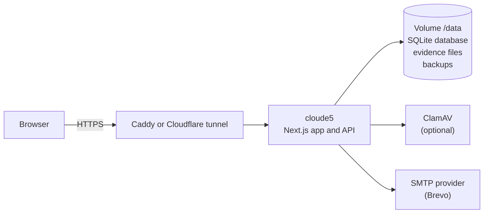

<div align="center">

# DPDP

**DPDP Act readiness assessments for Indian organisations: guided, evidence-backed and self-hosted.**

[](https://nextjs.org)
[](https://www.typescriptlang.org)
[](https://www.sqlite.org)
[](docs/SELF_HOSTING.md)
[](https://nodejs.org)

**Live:** [cloude5.tech](https://cloude5.tech)

[Features](#features) · [Screenshots](#screenshots) · [Quick start](#quick-start) · [Deploy](#deploy) · [Production](#production-deployment) · [Architecture](#architecture) · [Documentation](#documentation)


</div>

CloudE5 helps an organisation measure its readiness for India's **Digital Personal Data Protection
Act, 2023**. Teams answer a guided 60-question assessment mapped to a documented control library, attach
supporting evidence, and receive an explainable gap register, provisional readiness metrics and a
corrective action plan. It runs as a single Docker container with an embedded SQLite database: no
external database or cloud services required.

> [!IMPORTANT]
> CloudE5 is a self-assessment tool. Its results come from the information an organisation provides,
> using a documented, provisional methodology. They are not legal advice and not a determination of
> compliance with the DPDP Act or the DPDP Rules.

## Features

**Assessment**
- Guided questionnaire: 8 areas, 60 questions, shown as one table per area: the question on the left and a
  tick for each answer (Implemented, Partial, Not implemented, Unknown, N/A), the areas as tabs on top,
  and a details panel per question for comments and evidence; autosave; "Not applicable" needs a reason
- Deterministic scoring and gap analysis; every finding traces back to the answer and control behind it
- Assessor review, clarification threads, approval workflow and lifecycle history
- Report generation (.docx) and remediation (CAPA) tracking with owners and due dates
- Works on desktop, tablet and phone: the navigation becomes a drawer and every page fits the screen

**Customers and platform staff**
- Customers see only their own work: Questionnaire, Evidence, Results, Team and Settings
- Platform administrators see every organisation, assessment, report and the full review workflow
- Self-service assessments open ready for answers; customers submit them for review on their own
- Onboarding records the organisation type (list plus "Other"), team size, company phone, company email,
  website and office address

**Evidence**
- Private, per-organisation evidence vault with type and content validation and SHA-256 integrity
- Optional ClamAV virus scanning; uploads are refused while the scanner is unavailable

**Accounts and security**
- Self-service organisation sign-up with email verification, password reset and single-use invitations
- Customer accounts must use a work email address: free mailbox domains (Gmail, Yahoo, Outlook, ...) are refused
- Two-factor sign-in (authenticator app plus recovery codes), optionally required for a whole organisation
- Role-based access for organisation administrators, business-unit leads, contributors, viewers,
  platform administrators, lead consultants and reviewers
- Tenant isolation enforced for every query inside the database layer
- Database-backed rate limits, same-origin (CSRF) checks, nonce-based Content Security Policy, HSTS

**Operations**
- One container plus a data volume; optional Caddy (HTTPS), ClamAV, Mailpit and Cloudflare tunnel profiles
- Versioned, checksummed migrations with an automatic backup before each upgrade
- Health and readiness probes, online backups, verified restore and operator recovery commands

## Screenshots

| Dashboard | Questionnaire |
|---|---|
|  |  |
| **Gap analysis** | **Landing page** |
|  |  |

Screenshots show a demonstration organisation with sample answers.

## Quick start

Requires Node.js 22 or later.

```bash
npm ci
npm run db:migrate          # creates .cloude5/cloude5.db
npm run dev                 # http://localhost:3000
```

Without SMTP settings, development emails (verification and reset links) are written to
`.cloude5/dev-outbox/`.

## Deploy

On a Linux server with Docker and a domain name:

```bash
cp .env.example .env        # set CLOUDE5_PUBLIC_URL, SESSION_SECRET, CLOUDE5_ENCRYPTION_KEY, SMTP_*
docker compose build
docker compose run --rm cloude5 migrate
docker compose run --rm cloude5 admin:create --email=you@example.com --name="Your Name"
CLOUDE5_DOMAIN=cloude5.example.com docker compose --profile proxy --profile antivirus up -d
curl -fsS https://cloude5.example.com/api/ready
```

See [Production deployment](#production-deployment) for how the live site runs and is updated.

- **No server yet?** Try it on a laptop with a temporary public address:
  [laptop setup](docs/SELF_HOSTING.md#trying-it-on-a-laptop-no-server-no-domain).
- **Going live?** Work through the [production checklist](docs/PRODUCTION_CHECKLIST.md).
- **First customers?** See [onboarding customers](docs/ONBOARDING.md).

## Production deployment

The live site, [cloude5.tech](https://cloude5.tech), runs on a single Linux VPS (2 vCPU, 8 GB RAM, NVMe,
India region) with Docker Compose. Nothing else is hosted elsewhere.

| Part | How it runs |
|---|---|
| Server | Ubuntu 24.04 LTS, Docker Engine and Compose; firewall allows only SSH, HTTP and HTTPS |
| App | `cloude5` container built on the server from this repository (`cloude5:latest`), data in the `/data` volume |
| HTTPS | Caddy (`proxy` profile) with automatic Let's Encrypt certificates for `cloude5.tech` and `www.cloude5.tech` |
| Virus scanning | ClamAV (`antivirus` profile); uploads are refused while it is unavailable |
| Email | [Brevo](https://www.brevo.com) SMTP relay (`smtp-relay.brevo.com:587`, STARTTLS) sending as `no-reply@cloude5.tech` |
| DNS | `A @` → server, `CNAME www` → `cloude5.tech`, plus Brevo's domain records (brevo-code TXT, two DKIM CNAMEs, DMARC TXT) |
| Backups | Nightly `backup-all` at 02:15 (database snapshot plus evidence archive), 14 days kept; an automatic backup before every migration |

### Updating the live site

After a pull request is merged into `main`:

```bash
# on the server, in the application directory
docker compose exec -T cloude5 cloude5-entrypoint backup-all     # 1. back up first
git pull                                                          # 2. or copy the new code (keep .env)
docker build -t cloude5:latest .                                  # 3. build the new image
docker compose stop cloude5
docker compose run --rm cloude5 migrate                           # 4. apply new migrations (backs up automatically)
docker compose --profile proxy --profile antivirus up -d cloude5  # 5. start the new version
curl -fsS http://127.0.0.1:3000/api/ready                         # 6. every check must be "ok"
```

Migrations do not run on container start, so step 4 is required whenever `migrations/sqlite/` changed.
Never edit a migration that has already been applied.

### Email with Brevo

1. Add and authenticate the sending domain in Brevo (**Senders, domains, IPs → Domains**) and copy its DNS
   records to the domain's DNS.
2. Add the sender `no-reply@<domain>` and generate an **SMTP key** (not an API key).
3. Add the server's public IP under **Security → Authorized IPs**, or Brevo refuses the connection
   ("525 Unauthorized IP address").
4. Set in `.env`: `SMTP_HOST=smtp-relay.brevo.com`, `SMTP_PORT=587`, `SMTP_SECURE=false` (STARTTLS is
   still required), `SMTP_USER=<Brevo SMTP login>`, `SMTP_PASSWORD=<SMTP key>`,
   `SMTP_FROM="CloudE5 <no-reply@<domain>>"`, then recreate the `cloude5` container.

Delivery problems show in Brevo under **Transactional → Logs**. A "hard bounce" (for example
`550 5.1.1 User does not exist`) comes from the recipient's mail server, not from CloudE5: check that the
mailbox exists and that the recipient domain's MX records point at one mail provider, then remove the
address from Brevo's blocked contacts and resend.

### Configuration kept only on the server

`.env` holds `SESSION_SECRET`, `CLOUDE5_PUBLIC_URL=https://cloude5.tech`,
`CLOUDE5_DOMAIN="cloude5.tech, www.cloude5.tech, ..."`, `CLOUDE5_CLAMAV_HOST=clamav` and the `SMTP_*`
values. It is never committed; a copy is made before every change.

## Architecture



Every request passes a same-origin check and receives a per-request CSP nonce. Sessions are re-checked
against live account state, and tenant data is reachable only through a per-connection policy layer.
See [ARCHITECTURE.md](docs/ARCHITECTURE.md) and [SECURITY_MODEL.md](docs/SECURITY_MODEL.md).

## Testing

```bash
npm test                    # unit and integration tests against a template SQLite database
npx tsc --noEmit            # type check
npm run lint                # ESLint (no explicit any)
npm run build               # production build
E2E_BASE_URL=https://your-host npm run test:e2e   # Playwright browser tests against a running installation
```

The browser tests cover registration (including refusal of personal email addresses), email
verification, onboarding with the organisation profile, the questionnaire table, answer validation, evidence
upload (including virus detection when ClamAV runs), two-factor sign-in, and phone and tablet
layouts (the `mobile` and `tablet` projects fail if any workspace page spills past the screen).

## Documentation

| Document | Contents |
|---|---|
| [Architecture](docs/ARCHITECTURE.md) | Components, request flow, deployment modes and design limits |
| [Onboarding customers](docs/ONBOARDING.md) | Self-service and administrator-created organisations, roles, two-factor |
| [Self-hosting](docs/SELF_HOSTING.md) | Installation, configuration, backups, upgrades, troubleshooting |
| [Production checklist](docs/PRODUCTION_CHECKLIST.md) | Moving from a laptop trial to a production server |
| [Security model](docs/SECURITY_MODEL.md) | Tenant isolation, account security, security headers |
| [Methodology and reference](docs/README.md) | Control library, evidence catalogue, scoring, legal sources, design history |

## Project structure

| Path | Contents |
|---|---|
| `app/` | Next.js App Router pages and API routes |
| `components/` | UI components |
| `lib/db/sqlite/` | SQLite connection, query client, tenant policy layer, migrations runner |
| `lib/auth/`, `lib/organization/`, `lib/onboarding/` | Accounts, sessions, two-factor, organisations, invitations |
| `lib/scoring/`, `lib/gaps/`, `lib/lifecycle/`, `lib/reports/`, `lib/remediation/` | Assessment methodology |
| `lib/storage/` | Evidence validation, virus scanning and storage |
| `migrations/sqlite/` | Versioned SQLite migrations (never edit an applied migration) |
| `data/`, `schemas/` | Canonical control library, evidence catalogue, questionnaire and their source and schemas |
| `e2e/`, `tests/` | Playwright browser tests; unit and integration tests |
| `scripts/`, `deploy/` | Operations CLI, admin bootstrap, data validators, container entrypoint, Caddy configuration |
| `docs/` | Operating guides; `docs/reference/` methodology and legal sources; `docs/archive/` design history |

## License

No licence has been published for this repository yet, so all rights are reserved by the authors.
