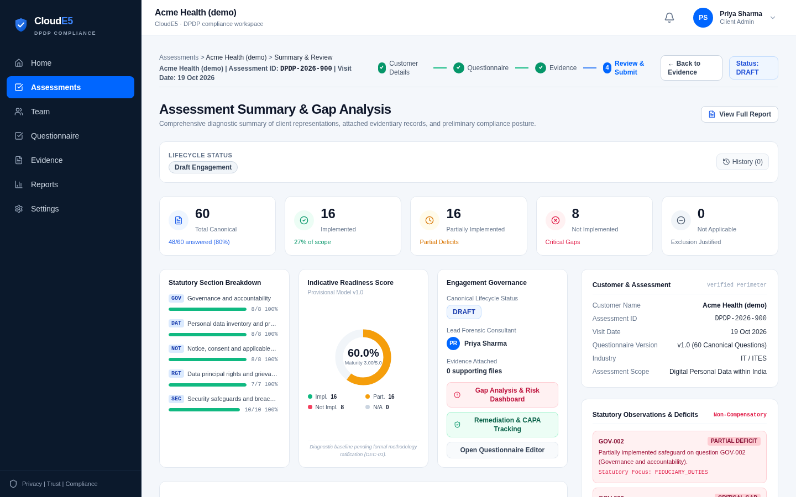
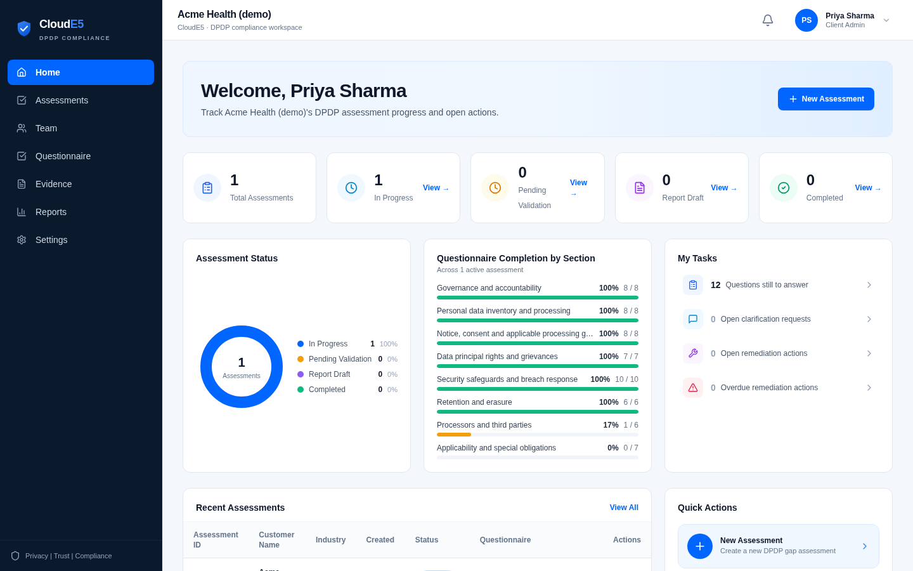
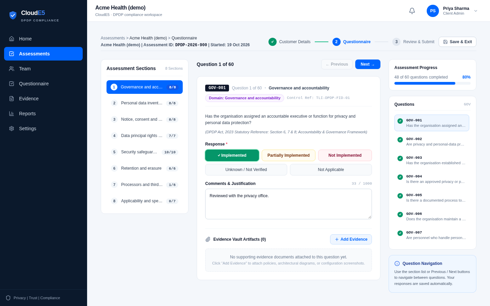
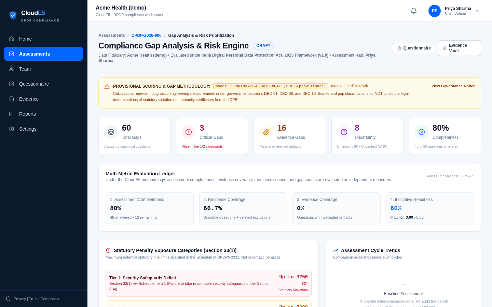
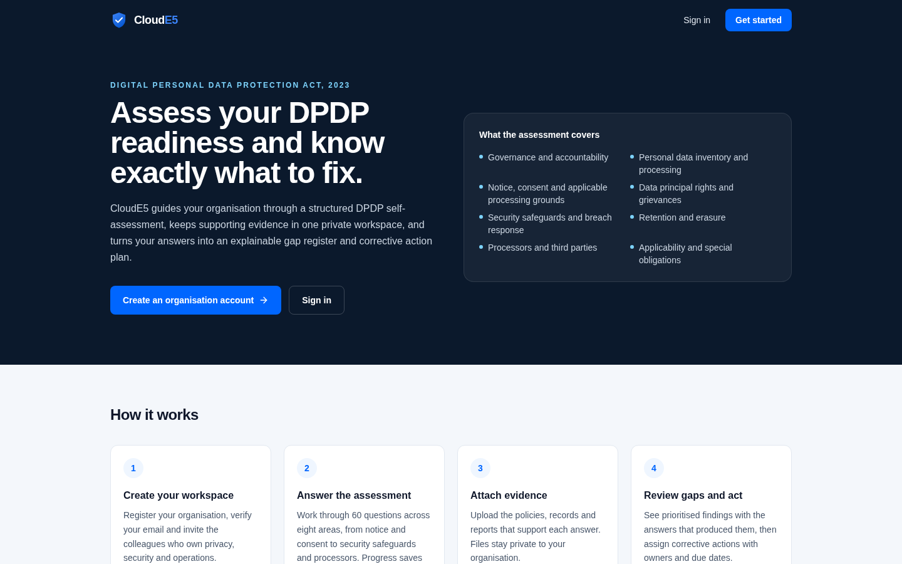
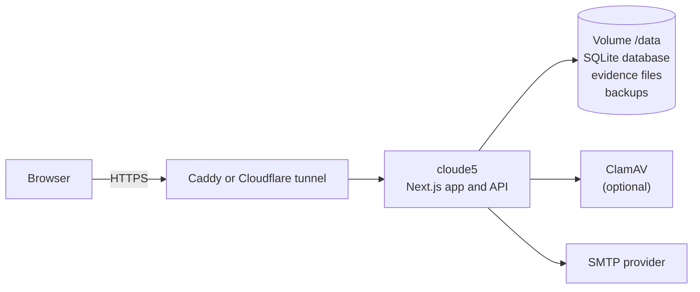

<div align="center">

# CloudE5

**DPDP Act readiness assessments for Indian organisations: guided, evidence-backed and self-hosted.**

[](https://nextjs.org)
[](https://www.typescriptlang.org)
[](https://www.sqlite.org)
[](docs/SELF_HOSTING.md)
[](https://nodejs.org)

[Features](#features) · [Screenshots](#screenshots) · [Quick start](#quick-start) · [Deploy](#deploy) · [Architecture](#architecture) · [Documentation](#documentation)



</div>

CloudE5 helps an organisation measure its readiness for India's **Digital Personal Data Protection
Act, 2023**. Teams answer a guided 60-question assessment mapped to a documented control library, attach
supporting evidence, and receive an explainable gap register, provisional readiness metrics and a
corrective action plan. It runs as a single Docker container with an embedded SQLite database: no
external database or cloud services required.

> [!IMPORTANT]
> CloudE5 is a self-assessment tool. Its results come from the information an organisation provides,
> using a documented, provisional methodology. They are not legal advice and not a determination of
> compliance with the DPDP Act or the DPDP Rules.

## Features

**Assessment**
- Guided questionnaire: 8 areas, 60 questions, autosave, mandatory justification for "Not applicable"
- Deterministic scoring and gap analysis; every finding traces back to the answer and control behind it
- Assessor review, clarification threads, approval workflow and lifecycle history
- Report generation (.docx) and remediation (CAPA) tracking with owners and due dates
- Works on desktop, tablet and phone: the navigation becomes a drawer and every page fits the screen

**Evidence**
- Private, per-organisation evidence vault with type and content validation and SHA-256 integrity
- Optional ClamAV virus scanning; uploads are refused while the scanner is unavailable

**Accounts and security**
- Self-service organisation sign-up with email verification, password reset and single-use invitations
- Two-factor sign-in (authenticator app plus recovery codes), optionally required for a whole organisation
- Role-based access for organisation administrators, business-unit leads, contributors, viewers,
  platform administrators, lead consultants and reviewers
- Tenant isolation enforced for every query inside the database layer
- Database-backed rate limits, same-origin (CSRF) checks, nonce-based Content Security Policy, HSTS

**Operations**
- One container plus a data volume; optional Caddy (HTTPS), ClamAV, Mailpit and Cloudflare tunnel profiles
- Versioned, checksummed migrations with an automatic backup before each upgrade
- Health and readiness probes, online backups, verified restore and operator recovery commands

## Screenshots

| Dashboard | Questionnaire |
|---|---|
|  |  |
| **Gap analysis** | **Landing page** |
|  |  |

Screenshots show a demonstration organisation with sample answers.

## Quick start

Requires Node.js 22 or later.

```bash
npm ci
npm run db:migrate          # creates .cloude5/cloude5.db
npm run dev                 # http://localhost:3000
```

Without SMTP settings, development emails (verification and reset links) are written to
`.cloude5/dev-outbox/`.

## Deploy

On a Linux server with Docker and a domain name:

```bash
cp .env.example .env        # set CLOUDE5_PUBLIC_URL, SESSION_SECRET, CLOUDE5_ENCRYPTION_KEY, SMTP_*
docker compose build
docker compose run --rm cloude5 migrate
docker compose run --rm cloude5 admin:create --email=you@example.com --name="Your Name"
CLOUDE5_DOMAIN=cloude5.example.com docker compose --profile proxy --profile antivirus up -d
curl -fsS https://cloude5.example.com/api/ready
```

- **No server yet?** Try it on a laptop with a temporary public address:
  [laptop setup](docs/SELF_HOSTING.md#trying-it-on-a-laptop-no-server-no-domain).
- **Going live?** Work through the [production checklist](docs/PRODUCTION_CHECKLIST.md).
- **First customers?** See [onboarding customers](docs/ONBOARDING.md).

## Architecture



Every request passes a same-origin check and receives a per-request CSP nonce. Sessions are re-checked
against live account state, and tenant data is reachable only through a per-connection policy layer.
See [ARCHITECTURE.md](docs/ARCHITECTURE.md) and [SECURITY_MODEL.md](docs/SECURITY_MODEL.md).

## Testing

```bash
npm test                    # unit and integration tests against a template SQLite database
npx tsc --noEmit            # type check
npm run lint                # ESLint (no explicit any)
npm run build               # production build
E2E_BASE_URL=https://your-host npm run test:e2e   # Playwright browser tests against a running installation
```

The browser tests cover registration, email verification, onboarding, answer validation, evidence
upload (including virus detection when ClamAV runs), two-factor sign-in, and phone and tablet
layouts (the `mobile` and `tablet` projects fail if any workspace page spills past the screen).

## Documentation

| Document | Contents |
|---|---|
| [Architecture](docs/ARCHITECTURE.md) | Components, request flow, deployment modes and design limits |
| [Onboarding customers](docs/ONBOARDING.md) | Self-service and administrator-created organisations, roles, two-factor |
| [Self-hosting](docs/SELF_HOSTING.md) | Installation, configuration, backups, upgrades, troubleshooting |
| [Production checklist](docs/PRODUCTION_CHECKLIST.md) | Moving from a laptop trial to a production server |
| [Security model](docs/SECURITY_MODEL.md) | Tenant isolation, account security, security headers |
| [Methodology and design history](docs/README.md) | Control library, evidence catalogue, scoring, legal sources |

## Project structure

| Path | Contents |
|---|---|
| `app/` | Next.js App Router pages and API routes |
| `components/` | UI components |
| `lib/db/sqlite/` | SQLite connection, query client, tenant policy layer, migrations runner |
| `lib/auth/`, `lib/organization/`, `lib/onboarding/` | Accounts, sessions, two-factor, organisations, invitations |
| `lib/scoring/`, `lib/gaps/`, `lib/lifecycle/`, `lib/reports/`, `lib/remediation/` | Assessment methodology |
| `lib/storage/` | Evidence validation, virus scanning and storage |
| `migrations/sqlite/` | Versioned SQLite migrations (never edit an applied migration) |
| `data/` | Canonical control library, evidence catalogue and questionnaire |
| `e2e/`, `tests/` | Playwright browser tests; unit and integration tests |
| `scripts/`, `deploy/` | Operations CLI, admin bootstrap, container entrypoint, Caddy configuration |
| `docs/` | Architecture, operations, security, methodology and legal source register |

## License

No licence has been published for this repository yet, so all rights are reserved by the authors.
