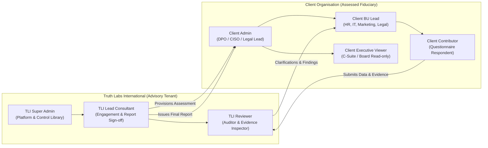

# 01. Product Requirements Specification (PRS) — Refined

## 1. Executive Summary & Purpose

**Truth Labs International (TLI)** is an independent forensic science and risk consulting institution delivering high-assurance compliance advisory, cyber forensics, and regulatory assessments.

With the enactment of India's **Digital Personal Data Protection Act, 2023 (Act No. 22 of 2023)** and the forthcoming issuance of the **DPDP Rules, 2025** and official administrative notifications, corporate enterprises, digital intermediaries, financial institutions, and government-facing entities acting as **Data Fiduciaries** or **Data Processors** must demonstrate verifiable alignment of their technical and organisational measures (TOMs).

The **TLI DPDP Compliance Gap Analysis Tool** is a multi-tenant, enterprise-grade assessment platform. It enables TLI consultants and client organisations to:
1. Conduct structured, auditable gap analyses across diverse business units and data-processing activities.
2. Evaluate operational practices against versioned DPDP legal control libraries.
3. Manage confidential evidence vaults with privacy-by-default safeguards.
4. Execute peer-reviewed consultant audits with in-line clarification workflows.
5. Compute deterministic, explainable maturity scores and statutory risk exposure registers.
6. Generate tamper-evident PDF/spreadsheet reports and manage end-to-end corrective remediation (CAPA).

---

## 2. Statutory Legal Context & Boundary Analysis

To ensure statutory fidelity and prevent legal inaccuracies, the application explicitly categorizes compliance mandates according to their official statutory basis:

### 2.1 Statutory Mapping & Analysis (DPDPA 2023)

| Statutory Area | Official Legal Reference | Nature of Mandate | Core Legal Analysis & Application Implementation |
|---|---|---|---|
| **Grounds for Processing** | DPDPA 2023, Section 4 | Enacted Statutory Requirement | Processing of digital personal data is lawful **only** if underpinned by valid consent (Sec 6) or specified legitimate uses (Sec 7). The tool records the legal ground for every evaluated data processing activity. |
| **Notice Architecture** | DPDPA 2023, Section 5; Draft Rules | Enacted Requirement + Rules Context | Notice must be presented before or at the time of seeking consent. It must itemise personal data sought, specific purpose, manner of exercising rights under Section 11, and grievance redressal mechanisms. **Statutory Nuance**: Section 5(3) mandates providing the **option** to access notice in English or any of the 22 languages in the Eighth Schedule to the Constitution. The tool evaluates whether the *multilingual option mechanism* is operational, rather than demanding static translations across all 22 languages for every internal process. |
| **Consent Architecture** | DPDPA 2023, Section 6 | Enacted Statutory Requirement | Consent must be free, specific, informed, unconditional, unambiguous, and signified by a clear affirmative action. Data Principals must have the right to withdraw consent with ease comparable to granting it. Evaluates integration readiness for registered Consent Managers. |
| **Certain Legitimate Uses** | DPDPA 2023, Section 7 | Enacted Statutory Exception List | **Critical Distinction**: DPDPA 2023 does **not** contain an open-ended "legitimate interest" balancing test (unlike GDPR Art. 6(1)(f)). Section 7 provides an **exhaustive statutory list** of legitimate uses (voluntary provision for a specific purpose without withholding consent, state subsidies/benefits, sovereign/court functions, medical emergencies, employment functions). The tool verifies that claims of legitimate use map strictly to statutory clauses. |
| **Data Processors & Contracts** | DPDPA 2023, Section 8(1)-(2) | Enacted Statutory Requirement | Data Fiduciary remains accountable for compliance regardless of processor involvement. Processors may be engaged **only under a valid contract**. The tool evaluates processor contract clauses, audit rights, and technical safeguards. |
| **Completeness & Accuracy** | DPDPA 2023, Section 8(3) | Enacted Statutory Requirement | Mandatory data accuracy, consistency, and completeness when data is used to make decisions affecting the Data Principal or shared with another fiduciary. |
| **Security Safeguards** | DPDPA 2023, Section 8(4)-(5) | Enacted Statutory Requirement | Mandatory implementation of appropriate technical and organisational measures (TOMs) and reasonable security safeguards to prevent personal data breaches. |
| **Personal Data Breach Reporting** | DPDPA 2023, Section 8(6); Rules | Enacted Requirement + Operational Procedure | In the event of a breach, mandatory notification must be made to the Data Protection Board of India (DPBI) and to each affected Data Principal. **Operational Context**: Prescribed reporting forms, contents, and timelines are governed by upcoming DPDP Rules and CERT-In directions. The tool evaluates incident response plans, triage speed, and notification readiness. |
| **Erasure & Retention** | DPDPA 2023, Section 8(7)-(9) | Enacted Statutory Requirement | Mandatory data erasure upon withdrawal of consent or as soon as purpose fulfillment occurs, unless retention is mandated by law. Publication of contact details of DPO or authorised grievance officer. |
| **Children's & Disabled Data** | DPDPA 2023, Section 9 | Enacted Statutory Requirement | Mandatory verifiable parental consent for children (< 18 years) and lawful guardians for persons with disabilities. Absolute ban on processing likely to cause detrimental effect on child well-being, tracking, behavioural monitoring, or targeted advertising. **Statutory Exception**: Section 9(4)-(5) permits Central Government exemptions for certain entities/purposes; tool supports documented exemption claims. |
| **Significant Data Fiduciaries (SDF)** | DPDPA 2023, Section 10 | Enacted Statutory Powers | Additional obligations apply **only to entities notified by the Central Government** (or qualifying candidates): Resident DPO, Independent Data Auditor, periodic Data Protection Impact Assessments (DPIAs), and audits. The tool tags SDF-only controls and provides an SDF candidacy evaluation module. |
| **Data Principal Rights** | DPDPA 2023, Sections 11–14 | Enacted Statutory Requirement | Rights of access (Sec 11), correction/completion/erasure (Sec 12), grievance redressal (Sec 13), and nomination (Sec 14). The tool evaluates operational DSAR workflows, SLAs, and verification mechanics. |
| **Cross-Border Transfers** | DPDPA 2023, Section 16 | Enacted Negative-List Requirement | DPDPA permits transfers outside India **except** to countries restricted by Central Government notification (negative list). Sectoral localization laws (RBI payment data localization, IRDAI rules) remain operative under Section 16(2). The tool evaluates both general DPDPA rules and sectoral mandates. |
| **Statutory Penalties** | DPDPA 2023, Schedule | Enacted Statutory Framework | Financial penalties up to ₹250 Crores for breach of security safeguards (Sec 8(5)), up to ₹200 Crores for failure to report breaches (Sec 8(6)) and children's data violations (Sec 9). The tool calculates potential penalty exposure brackets without declaring definitive legal liability. |

> [!IMPORTANT]
> **Legal Disclaimer & Non-Compensatory Evaluation**: 
> A numerical maturity score (e.g., 85%) **shall never declare legal compliance**. Compliance with statutory obligations under DPDPA 2023 is non-compensatory: an organization with high policy documentation but non-compliant security safeguards or missing breach response capabilities remains in direct violation of Section 8(5) and exposed to statutory penalties. The platform explicitly separates **Implementation Maturity Scoring** from a **Statutory Deficit & Legal Red-Flag Register**.

---

## 3. User Personas & Organizational Boundaries

The platform operates across two discrete organizational domains:

### 3.1 Advisory Firm Personas (TLI)
1. **TLI Super Admin**: Maintains system settings, provisions tenant accounts, manages global versioned control libraries, monitors security logs, and manages global TLI personnel.
2. **TLI Lead Consultant**: Engagement lead assigned to specific client assessments. Defines assessment scope, evaluates and approves/rejects exclusion requests, assigns reviewers, peer-reviews findings, authorizes final reports, and validates remediation closures.
3. **TLI Reviewer**: Assigned auditor. Inspects client responses and uploaded evidence, initiates clarification queries, scores verified implementation maturity, and drafts statutory gap findings.

### 3.2 Client Organisation Personas
1. **Client Admin (e.g., DPO, General Counsel, CISO)**: Manages internal business units, invites client users, maps controls to BU leads, monitors questionnaire completion, formally submits assessments, and coordinates remediation tasks. **Cannot approve their own statutory exclusions or close findings without TLI validation.**
2. **Client Business Unit (BU) Lead**: Oversees questionnaires assigned to their department (e.g., Head of HR, VP Engineering, Legal Director). Delegates questions to BU Contributors, reviews responses, and coordinates BU remediation.
3. **Client Contributor**: Operational specialist (e.g., DevOps lead, HR specialist, Product manager). Provides operational responses, enters self-scores, attaches documentary evidence, and answers clarification queries.
4. **Client Executive Viewer**: Read-only executive stakeholder (Board Member, CEO). Views high-level compliance dashboards, scorecards, issued reports, and remediation progress. Cannot access in-progress consultant working papers.

---

## 4. Functional Scope & Lifecycle Capabilities

The platform implements 12 core functional modules:

### F-01: Organisation & Business Unit Management
- Hierarchical tenant structuring: Client Organisation $\rightarrow$ Business Units (HR, Engineering, Legal, Customer Support, Marketing).
- Organizational metadata: Industry sector, estimated Data Principal volume, processing of children's data indicator, and Significant Data Fiduciary (SDF) candidacy tagging.

### F-02: User Management & Engagement-Scoped RBAC
- Multi-tenant user provisioning with strict tenant isolation.
- Explicit engagement assignment mapping (`assessment_assignments`): TLI consultants have access **only** to client assessments to which they are formally assigned.
- Scoped business-unit visibility: BU Contributors are restricted to controls assigned to their department.

### F-03: Versioned DPDP Control Library & Evidence Catalogue
- Decoupled, immutable framework releases (`framework_versions`, e.g., `DPDPA-2023-V1.0`, `DPDPA-RULES-2025-V1.0`).
- Control metadata: Domain/Category, Statutory Section, Control Code, Title, Intent, Detailed Guidance, Indicative Evidence List, Penalty Exposure Tier, and Maturity Scale Criteria (Levels 0 to 5).
- Evidence Catalogue: Predefined directory of recommended documentary evidence items (e.g., "Parental Consent Flow Diagram", "Data Processor Agreement Template", "Incident Escalation Matrix", "Multilingual Notice Screenshots").

### F-04: Data Processing Activities Registry (RoPA)
- Fiduciary-level inventory of distinct personal data processing activities (e.g., "Customer KYC Onboarding", "Employee Payroll Administration", "App Telemetry & Analytics").
- Records purpose, categories of Data Principals, categories of personal data, statutory processing ground (Consent vs Sec 7 Legitimate Use), external processors, cross-border flows, and retention schedules.
- Direct linking between processing activities and assessment controls to provide operational context for gap findings.

### F-05: Assessment Creation, Scoping & Documented Exclusions
- Configurable assessment profiles: Full Statutory DPDPA Audit, Baseline Gap Check, Vendor/Processor Assessment, SDF Readiness Review.
- Documented Exclusion Workflow: Ability to mark controls out-of-scope with **mandatory written statutory justification** (e.g., "Section 9 inapplicable: organisation does not process data of individuals under 18 years"). Exclusions remain pending until formal digital approval by the assigned TLI Lead Consultant.

### F-06: Questionnaires, Drafts & Evidence Vault
- Responsive questionnaire organized by statutory domain, business unit, and processing activity.
- Versioned response drafts: Full revision history tracking (`control_responses`), capturing client narrative changes and self-assessment scores across revisions.
- Secure Evidence Vault: Private S3 storage with presigned URLs, MIME validation, SHA-256 integrity verification, and risk-based evidence sanitization warnings.

### F-07: Consultant Review, Findings & Clarification Loop
- Dual-verdict evaluation: Client self-score (0–5) vs. TLI verified maturity score (0–5) and verification status (`Verified Compliant`, `Partially Compliant`, `Non-Compliant`).
- In-line clarification threads: Threaded discussion directly attached to individual controls, enabling reviewers to request additional proof without rejecting the entire assessment.
- Structured gap findings: Identification of missing safeguards, statutory exposure tier, and tailored remediation recommendations.

### F-08: Deterministic, Explainable Scoring & Risk Prioritization
- Non-compensatory scoring engine producing distinct metrics:
  1. **Implementation Maturity Score**: 0.00 to 5.00 based on verified control criteria.
  2. **Evidence Sufficiency Rating**: Ratio of verified vs required evidence items.
  3. **Assessment Coverage Percentage**: Proportion of applicable controls evaluated and verified.
  4. **Statutory Deficit / Red-Flag Register**: Discrete count of active legal non-compliances.
  5. **Potential Penalty Exposure Bracket**: Derived from DPDPA Schedule tiers (up to ₹250 Crores).
- Configurable, versioned scoring formulas ensuring deterministic recalculation and historical reproducibility.

### F-09: Compliance Dashboards & Gap Matrix
- Executive summary dashboards: Implementation maturity gauge, domain radar chart, business unit breakdown, and statutory deficit heatmaps.
- Granular Gap Matrix: High/Medium/Low priority gap ranking with statutory section citations and estimated implementation effort.

### F-10: Pixel-Perfect PDF Reports & Structured Spreadsheet Export
- Asynchronous PDF report generator producing TLI-branded gap analysis reports, executive summaries, radar charts, legal disclaimers, and remediation roadmaps.
- Cryptographic snapshot verification: Reports embed a SHA-256 hash of the complete underlying assessment dataset at the moment of issuance.
- Structured Excel export (XLSX) containing raw control data, responses, consultant findings, and action items.

### F-11: Remediation Management (CAPA) & Independent Closure Validation
- Automatic conversion of verified compliance gaps into actionable `remediation_tasks`.
- Client assigns remediation owners, target dates, and implementation narratives.
- Remediation Evidence Vault: Clients attach corrective evidence files (e.g., executed DPA, deployed encryption configuration) directly to remediation tasks.
- Independent Closure Gate: Tasks **cannot be closed unilaterally** by client admins. A TLI Consultant must inspect corrective evidence and validate closure (`VALIDATED_CLOSED` or `REJECTED_REOPENED`).

### F-12: Tamper-Evident Audit Trails & Historical Snapshots
- Append-only, tamper-evident audit logging of all state transitions, user logins, response edits, evidence downloads, score overrides, and report issuances.
- Assessment cloning for periodic reassessment cycles (e.g., Year 1 Baseline vs Year 2 Audit) with side-by-side gap progress analytics.

---

## 5. Non-Functional Requirements (NFRs)

### 5.1 Security & Data Isolation
- **Tenant Isolation**: Absolute isolation between client organizations enforced at application, database (PostgreSQL Row-Level Security), and storage layers. Zero cross-tenant data inference.
- **Evidence Protection**: Object storage buckets private by default with SSE-KMS encryption. Time-limited presigned URLs (10 min upload, 15 min download) issued only after authenticated, authorization-checked API requests.
- **Data Residency**: Strict storage within the Republic of India (e.g., AWS `ap-south-1` Mumbai / Indian sovereign cloud) to satisfy national data sovereignty principles.
- **Zero AI Training Guarantee**: Client compliance data, evidence documents, and consultant notes shall never be ingested into public or private AI training datasets.
- **Least Privilege**: Application runtime connects with non-superuser database credentials. Tables enforce `FORCE ROW LEVEL SECURITY`.

### 5.2 Performance & Reliability
- Page load time $< 1.5$ seconds for standard assessment interfaces.
- Support for concurrent evidence uploads up to 50 MB per file.
- Asynchronous report generation to prevent HTTP connection timeouts on large engagements.
- Deterministic response times for scoring algorithms ($< 200$ ms per full assessment recalculation).

### 5.3 Auditability & Legal Integrity
- Immutable record preservation: Final issued assessments and generated reports cannot be modified or deleted.
- Soft deletion / retention locks on historical audit records. Foreign keys enforce `ON DELETE RESTRICT` on historical compliance entities.
