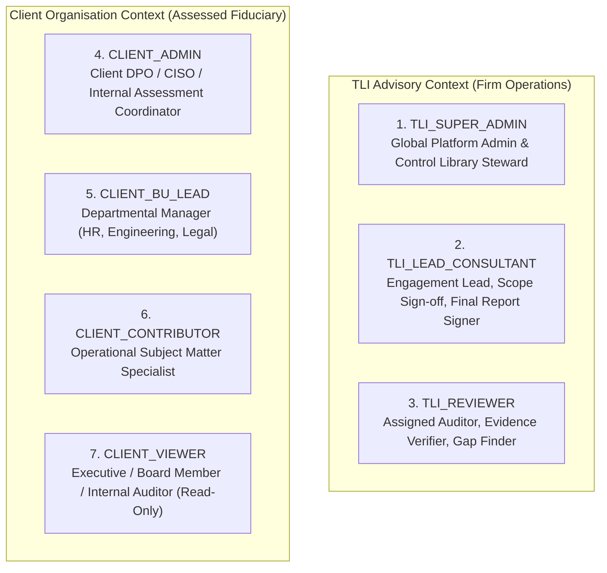

# 02. User Roles and Permission Matrix — Refined

## 1. Multi-Tenant RBAC Architecture & Design Principles

The platform implements a multi-tenant Role-Based Access Control (RBAC) model founded on three core security principles:
1. **Least Privilege**: Users are granted only the minimum permissions necessary to execute their designated organizational function.
2. **Strict Separation of Duties**: Operational respondents (clients) are prohibited from validating their own compliance claims, approving their own statutory exclusions, or self-closing audit findings.
3. **Engagement-Scoped Authorization**: Advisory personnel (TLI consultants) do not possess universal client data access. Access is granted explicitly on a per-assessment basis via an `assessment_assignments` mapping table.

---

## 2. Role Definitions & Boundary Validation

The platform defines 7 distinct roles across the two organizational contexts. Each role is validated against actual business workflows to eliminate ambiguity and redundancy:

### 2.1 Advisory Roles (Truth Labs International)
| Role Code | Role Name | Organizational Boundary | Justification & Workflow Need |
|---|---|---|---|
| `TLI_SUPER_ADMIN` | Platform Super Administrator | Global across all tenants | Manages system configuration, provisions client tenants, maintains global DPDP control libraries, oversees security and audit logs. Has zero participation in day-to-day client assessment workflows. |
| `TLI_LEAD_CONSULTANT` | Lead DPDP Consultant | Assigned client engagements only | Senior consultant who initiates engagements, evaluates client out-of-scope justifications, executes formal exclusion approvals, assigns peer reviewers, signs off on draft findings, authorizes final issued reports, and validates remediation closures. |
| `TLI_REVIEWER` | DPDP Reviewer / Auditor | Assigned client engagements only | Domain specialist/auditor who inspects uploaded evidence, scores verified implementation maturity (0–5), raises clarification queries, and formulates technical gap findings and remediation recommendations. |

### 2.2 Client Roles (Assessed Organisation)
| Role Code | Role Name | Organizational Boundary | Justification & Workflow Need |
|---|---|---|---|
| `CLIENT_ADMIN` | Client Organisation Admin (DPO / CISO) | Entire client tenant | Configures client business units, invites client users, maps controls to department leads, monitors overall completion, submits assessment for review, and coordinates remediation action plans. **Restricted**: Cannot approve statutory exclusions or self-certify finding closures. |
| `CLIENT_BU_LEAD` | Business Unit Lead | Designated Business Unit(s) only | Department head (e.g., Head of HR, VP Cloud Engineering, Marketing Director). Oversees questions scoped to their BU, delegates questions to BU Contributors, reviews departmental drafts, and updates BU remediation tasks. |
| `CLIENT_CONTRIBUTOR` | Business Unit Contributor | Assigned controls within designated BU | Operational specialist (e.g., DevOps engineer, HR operations). Authors narrative responses, self-scores implementation, attaches evidence documents, and responds to auditor clarification threads. Cannot view controls outside assigned scope if confidentiality is enabled. |
| `CLIENT_VIEWER` | Executive Viewer | Entire client tenant (Read-only) | C-suite executive, board member, or internal oversight auditor. Inspects executive dashboards, gap scorecards, issued final reports, and high-level CAPA progress. Cannot edit operational responses or view draft reviewer working papers. |

---

## 3. Revised Granular Permission Matrix

The table below defines granular operation permissions across the complete application lifecycle.
- **C**: Create, **R**: Read / View, **U**: Update / Edit, **D**: Delete, **S**: Submit, **REV**: Review, **APP**: Approve, **ISS**: Formally Issue, **EXP**: Export, **REO**: Reopen, **-**: No Access.

| Functional Module & Operation | TLI Super Admin | TLI Lead Consultant | TLI Reviewer | Client Admin | Client BU Lead | Client Contributor | Client Viewer |
|---|:---:|:---:|:---:|:---:|:---:|:---:|:---:|
| **Tenant Provisioning & Deactivation** | CRUD | - | - | - | - | - | - |
| **Business Unit Hierarchy** | R | R | R | CRUD | R (Own BU) | R (Own BU) | R |
| **Data Processing Activities (RoPA)** | R | R (Assigned) | R (Assigned) | CRUD | RU (Own BU) | R (Own BU) | R |
| **User Management (Client Accounts)**| CRUD | R (Assigned) | - | CRUD | R (Own BU) | - | - |
| **Global DPDP Control Library** | CRUD | R | R | R | R | R | R |
| **Assessment: Create & Configure** | CRUD | CRUD (Assigned) | R (Assigned) | - | - | - | - |
| **Assessment: Propose Exclusions** | - | - | - | U | U (Own BU) | - | - |
| **Assessment: Approve Exclusions** | - | APP | - | - | - | - | - |
| **Questionnaire: Draft Responses** | R | R (Assigned) | R (Assigned) | RU | RU (Own BU) | RU (Assigned) | R |
| **Questionnaire: Formal Submission**| - | - | - | S | - | - | - |
| **Questionnaire: Withdraw Submission**| - | - | - | REO (Pre-audit)| - | - | - |
| **Evidence: Upload & Link** | - | - | - | CR | CR (Own BU) | CR (Assigned) | - |
| **Evidence: Download / Inspect** | R (Audited) | R (Assigned) | R (Assigned) | R (Own Org) | R (Own BU) | R (Assigned) | - |
| **Evidence: Delete / Supersede** | - | - | - | D (Draft only) | D (Draft/BU) | D (Draft/Own) | - |
| **Consultant Review & Scoring** | R | REV, APP | REV, U | R (Published) | R (Published) | - | R (Published) |
| **Clarification Threads: Raise** | - | C (Assigned) | C (Assigned) | C | C (Own BU) | C (Assigned) | R |
| **Clarification Threads: Respond** | - | U (Assigned) | U (Assigned) | U | U (Own BU) | U (Assigned) | - |
| **Report: Generate Draft** | EXP | EXP (Assigned) | EXP (Assigned)| - | - | - | - |
| **Report: Sign-off & Formal Issue** | - | APP, ISS | - | - | - | - | - |
| **Report: Download Issued Final** | EXP | EXP (Assigned) | EXP (Assigned)| EXP | EXP | - | EXP |
| **Assessment: Reopen / Reassess** | REO | REO (Assigned) | - | - | - | - | - |
| **Remediation: Create Tasks** | R | C (Assigned) | C (Assigned) | C | C (Own BU) | - | R |
| **Remediation: Submit CAPA Proof** | - | - | - | RU, S | RU, S (Own BU)| RU, S (Assigned)| R |
| **Remediation: Validate Closure** | - | APP | APP | - | - | - | - |
| **Audit Logs: Tenant Activity** | R (All) | R (Assigned) | - | R (Own Org) | - | - | - |

---

## 4. Key Governance & Security Boundary Rules

### Rule 1: Exclusion Approval Boundary
- Client users may flag an assessment control as `EXCLUSION_PROPOSED` and provide written statutory justifications (e.g., an enterprise conducting purely wholesale B2B transactions proposing exclusion of Section 9 Children's Data).
- Under no circumstances can a `CLIENT_ADMIN` mark an exclusion as confirmed. Only an assigned `TLI_LEAD_CONSULTANT` has the authority to transition a control to `EXCLUSION_APPROVED`.
- Rejected exclusions return to `UNANSWERED` with reviewer rationale and become mandatory.

### Rule 2: Engagement Assignment Enforcement
- TLI personnel do **not** have universal access to all client assessments.
- When an assessment is created, the system records explicit memberships in `assessment_assignments`:
  - Exactly one `TLI_LEAD_CONSULTANT` is designated as Engagement Lead.
  - One or more `TLI_REVIEWER` accounts are explicitly attached.
- Database RLS and API middleware enforce that consultants cannot inspect, score, or download evidence for engagements to which they are not assigned.

### Rule 3: Client Self-Assessment vs. Reviewer Working Papers
- Client users input narratives and self-scores into client fields (`client_response_narrative`, `client_self_maturity_score`).
- TLI auditors record independent findings into reviewer fields (`reviewer_verified_maturity_score`, `reviewer_eval_notes`, `gap_findings`, `gap_severity`).
- While an assessment is `UNDER_REVIEW`, reviewer notes and scores are treated as internal working papers. They become visible to client users only upon publication of clarifications, draft reports, or final issuance.

### Rule 4: Remediation Closure Independence
- Client personnel can update remediation progress, enter CAPA narratives, and upload remediation evidence files.
- The transition from `SUBMITTED_FOR_CLOSURE` to `VALIDATED_CLOSED` requires an independent validation sign-off by a `TLI_REVIEWER` or `TLI_LEAD_CONSULTANT`.
- Client self-closure of statutory findings is blocked by default, unless TLI executive leadership explicitly approves a self-governance policy for specific non-critical findings.
