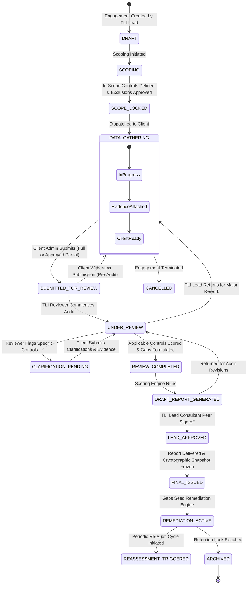
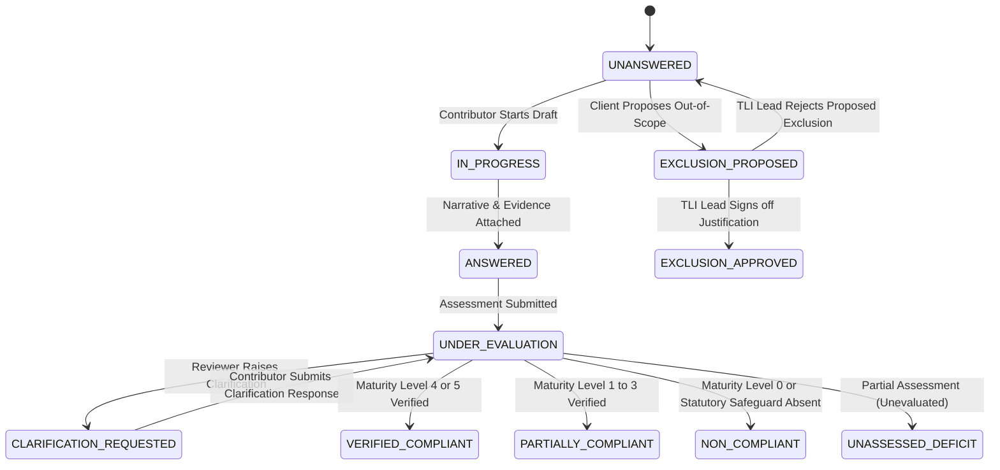
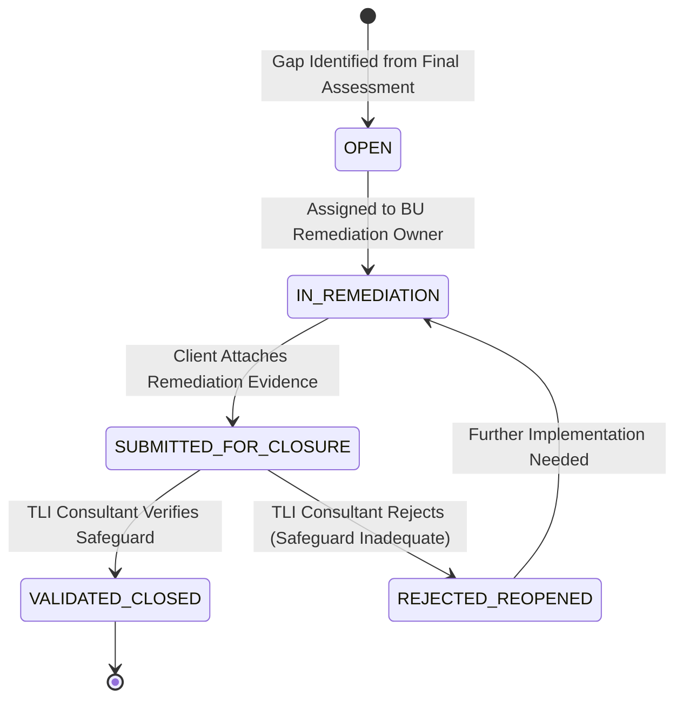

# 03. Assessment Workflow and State Machine — Refined

## 1. End-to-End Assessment Lifecycle & State Machine

The assessment lifecycle is governed by an auditable, deterministic finite state machine. Transitions are protected by role-based guards, data completeness validations, and documented exception rules.

---

## 2. Assessment State Transition Specifications & Guards

| State Name | Allowed Operations | Transition Destination | Transition Guard / Pre-condition | Authorized Roles |
|---|---|---|---|---|
| `DRAFT` | Define engagement title, client tenant, framework version (`DPDPA-2023-V1.0`), engagement lead, target deadlines. | `SCOPING`, `CANCELLED` | Valid framework version and client tenant selected. | `TLI_LEAD_CONSULTANT`, `TLI_SUPER_ADMIN` |
| `SCOPING` | Define applicable scope. Mark non-applicable controls as `EXCLUSION_PROPOSED` with written statutory justification. Link Data Processing Activities. | `SCOPE_LOCKED` | **Guard**: Every proposed exclusion has non-empty statutory justification and signed digital approval from the assigned TLI Lead Consultant. | `TLI_LEAD_CONSULTANT`, `CLIENT_ADMIN` |
| `SCOPE_LOCKED` | Map controls to Client Business Units and assign BU Leads/Contributors. | `DATA_GATHERING` | All active controls mapped to designated business units. | `TLI_LEAD_CONSULTANT`, `CLIENT_ADMIN` |
| `DATA_GATHERING` | Contributors author narratives, self-scores (0–5), and attach evidence. Client Admin monitors progress dashboard. | `SUBMITTED_FOR_REVIEW` | **Standard Guard**: 100% of applicable controls have responses. **Approved Partial Guard**: Client Admin requests incomplete submission with documented justification, and TLI Lead grants approval for an *Interim/Partial Gap Assessment*. | `CLIENT_ADMIN` |
| `SUBMITTED_FOR_REVIEW` | Client edits are locked. TLI Lead assigns one or more TLI Reviewers. | `UNDER_REVIEW`, `DATA_GATHERING` | - `UNDER_REVIEW`: Reviewer assignment confirmed. - `DATA_GATHERING`: Client Admin withdraws submission **only if** review has not commenced. | `TLI_LEAD_CONSULTANT`, `CLIENT_ADMIN` (Withdrawal only) |
| `UNDER_REVIEW` | Reviewers inspect evidence, input verified maturity scores (0–5), formulate gap findings, and raise clarification queries. | `CLARIFICATION_PENDING`, `REVIEW_COMPLETED`, `DATA_GATHERING` | - `CLARIFICATION_PENDING`: At least one clarification thread opened. - `REVIEW_COMPLETED`: All evaluated controls scored. - `DATA_GATHERING`: Lead consultant returns assessment due to fundamental client data inadequacy. | `TLI_REVIEWER`, `TLI_LEAD_CONSULTANT` |
| `CLARIFICATION_PENDING` | Read/write access is unlocked **only** for flagged controls and clarification threads. Client attaches supplementary proof. | `UNDER_REVIEW` | All active clarification threads marked as answered by Client. | `CLIENT_ADMIN`, `CLIENT_BU_LEAD` |
| `REVIEW_COMPLETED` | Scoring engine synthesizes implementation maturity, coverage %, statutory deficits, and penalty exposure tiers. | `DRAFT_REPORT_GENERATED` | Deterministic scoring and risk formulas execute without errors. | `TLI_REVIEWER`, `TLI_LEAD_CONSULTANT` |
| `DRAFT_REPORT_GENERATED` | Internal TLI peer review. Executive summary, legal disclaimers, gap matrix, and remediation roadmap inspected. | `LEAD_APPROVED`, `UNDER_REVIEW` | - `LEAD_APPROVED`: Lead Consultant signature and date recorded. - `UNDER_REVIEW`: Returned to reviewer for finding revisions. | `TLI_LEAD_CONSULTANT` |
| `LEAD_APPROVED` | Final report compilation ready for client delivery. | `FINAL_ISSUED` | Cryptographic SHA-256 hash of entire assessment dataset generated and stored. | `TLI_LEAD_CONSULTANT` |
| `FINAL_ISSUED` | Final PDF and XLSX delivered to client. Remediation tasks automatically created from identified gaps. Dataset is permanently immutable. | `REMEDIATION_ACTIVE` | Remediation tasks created in database. | Automated / `TLI_LEAD_CONSULTANT` |
| `REMEDIATION_ACTIVE` | Client assigns remediation leads, logs CAPA progress, and attaches corrective proof. TLI validates closures. | `REASSESSMENT_TRIGGERED`, `ARCHIVED` | - `REASSESSMENT_TRIGGERED`: New assessment cloned from baseline. - `ARCHIVED`: Final closure or contractual retention period reached. | `CLIENT_ADMIN`, `TLI_LEAD_CONSULTANT` |

---

## 3. Handling Edge Cases & Exception Workflows

### 3.1 Documented Exclusions & Applicability Decisions
- A client organisation may not need to implement every control in the DPDPA library (e.g., an enterprise that does not process children's data under Section 9, or a standard fiduciary that has not been notified as a Significant Data Fiduciary under Section 10).
- **Workflow**:
  1. Client Admin or BU Lead flags control as `EXCLUSION_PROPOSED`.
  2. Mandatory input: `exclusion_justification` citing the statutory basis and operational facts.
  3. The control cannot be excluded without TLI approval: The assigned `TLI_LEAD_CONSULTANT` reviews the justification.
  4. If approved: Status becomes `EXCLUSION_APPROVED`, control is excluded from denominator in maturity calculations, and justification is permanently recorded in the final report.
  5. If rejected: Returns to `UNANSWERED` with consultant explanation.

### 3.2 Approved Incomplete Assessments (Rapid Diagnostic Mode)
- In scenarios such as an M&A due-diligence review or an interim quarterly milestone, a client may need an official report before 100% of controls are answered.
- **Workflow**:
  1. If an assessment has $< 100\%$ completion, standard submission is blocked.
  2. Client Admin can trigger "Request Incomplete Assessment Review", specifying the business rationale.
  3. `TLI_LEAD_CONSULTANT` reviews and approves the exception.
  4. The assessment transitions to `SUBMITTED_FOR_REVIEW` with an `is_partial_assessment = TRUE` flag.
  5. Scoring engine calculates `assessment_coverage_pct` (e.g., 68.5%).
  6. Generated reports prominently display a **Scope Limitation Banner**:
     > *"NOTICE OF PARTIAL ASSESSMENT: This evaluation covers 68.5% of applicable statutory controls. The remaining 31.5% were unevaluated and are treated as unassessed risks."*

### 3.3 Withdrawn Submissions
- If a Client Admin accidentally submits an assessment or discovers missing documentation immediately after submission:
- The Client Admin can execute "Withdraw Submission" **only if** no TLI Reviewer has begun review (`status = SUBMITTED_FOR_REVIEW` and no control has transitioned to `UNDER_EVALUATION`).
- Upon withdrawal, status reverts to `DATA_GATHERING` and an audit event (`ASSESSMENT_SUBMISSION_WITHDRAWN`) is logged.

### 3.4 Assessment Reopening & Historical Integrity
- Once an assessment is in `LEAD_APPROVED` or `FINAL_ISSUED`, it **cannot be reopened or modified in place**. This protects the legal integrity of the issued report.
- If significant new evidence emerges or the client requests a re-audit:
  - TLI Lead Consultant triggers "Initiate Re-assessment Cycle".
  - A new assessment entity is created with `parent_assessment_id = [Original UUID]`.
  - Scoping, previous responses, and approved exclusions are optionally cloned forward, allowing comparative delta analytics (Baseline vs. Year 2).

---

## 4. Control-Level Granular State Machine

### 4.1 Verification Status Definitions
1. `UNANSWERED`: Initial state upon assessment initiation.
2. `IN_PROGRESS`: Contributor has saved draft narrative without finalizing.
3. `ANSWERED`: Complete narrative, self-maturity score, and mandatory evidence attached.
4. `UNDER_EVALUATION`: TLI Reviewer is actively evaluating compliance claims.
5. `CLARIFICATION_REQUESTED`: Reviewer identified an ambiguity, missing contract schedule, or inadequate evidence.
6. `VERIFIED_COMPLIANT`: Reviewer confirmed operational measures satisfy statutory requirements (Maturity 4 or 5).
7. `PARTIALLY_COMPLIANT`: Basic policies or partial safeguards exist, but operational enforcement is incomplete (Maturity 1, 2, or 3).
8. `NON_COMPLIANT`: Total absence of statutory safeguards or active violation of statutory duty (Maturity 0).
9. `UNASSESSED_DEFICIT`: In an approved partial assessment, controls that were never evaluated.
10. `EXCLUSION_PROPOSED`: Proposed as out-of-scope with written client justification.
11. `EXCLUSION_APPROVED`: Formally approved as inapplicable by TLI Lead Consultant.

---

## 5. Remediation Task Lifecycle & Independent Closure Validation

### 5.1 Closure Validation Criteria
- Client Admins cannot self-close statutory remediation tasks.
- To submit for closure, the client must:
  1. Record an implementation summary (`closure_submission_notes`).
  2. Attach at least one new documentary evidence file (e.g., updated privacy notice, executed DPA, encryption key rotation SOP) linked via `remediation_evidence_items`.
- A `TLI_REVIEWER` or `TLI_LEAD_CONSULTANT` inspects the uploaded corrective evidence:
  - If adequate: Transitions to `VALIDATED_CLOSED` with signed commentary.
  - If inadequate: Transitions to `REJECTED_REOPENED` with specific feedback detailing remaining deficiencies.
