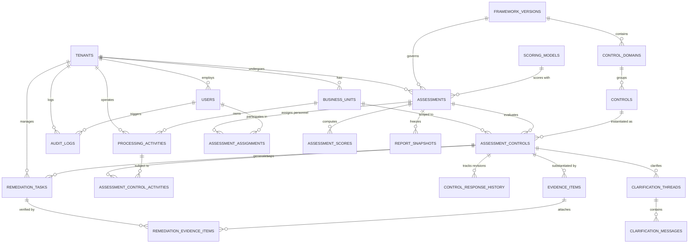

# 04. Database Schema and Entity Relationship Diagram (ERD) — Refined

## 1. Schema Architecture & Design Principles

The database layer utilizes **PostgreSQL 16+** with relational integrity, explicit foreign key constraints, Row-Level Security (RLS), and append-only audit tracking.

### Key Architectural Enhancements
1. **Historical Record Preservation**: Unsafe cascading deletes (`ON DELETE CASCADE`) are eliminated from core compliance records (`assessment_controls`, `evidence_items`, `report_snapshots`, `remediation_tasks`). They are protected with `ON DELETE RESTRICT` or soft-deletion semantics to preserve forensic audit trails.
2. **Data Processing Activities (RoPA)**: Introduced `processing_activities` and `assessment_control_activities` to link legal controls directly to real operational data flows.
3. **Explicit Engagement Memberships**: Introduced `assessment_assignments` ensuring consultants have access strictly to their assigned client engagements.
4. **Response Revision History**: Introduced `control_response_history` to track client answers across draft cycles and post-clarification resubmissions.
5. **Remediation Evidence Vault**: Introduced `remediation_evidence_items` linking corrective documents directly to remediation tasks for independent consultant validation.
6. **Versioned Scoring Rules**: Introduced `scoring_models` to make scoring formulas immutable and historically reproducible.
7. **Identifier Strategy**: Provides a native PL/pgSQL UUIDv7 generator function that requires zero external C-extensions, ensuring time-ordered indexing while retaining full compatibility with standard `gen_random_uuid()` (UUIDv4).

---

## 2. Refined Entity Relationship Diagram (ERD)



---

## 3. Data Dictionary and SQL DDL Specifications

### 3.1 Identifiers & Extension Setup

```sql
CREATE EXTENSION IF NOT EXISTS "pgcrypto";

-- Pure PL/pgSQL UUIDv7 Generator (Zero External C-Extensions Required)
-- Generates time-ordered UUIDs (Unix epoch ms in high 48 bits, version 7, variant 2)
CREATE OR REPLACE FUNCTION generate_uuid_v7() RETURNS UUID AS $$
DECLARE
    unix_time_ms BIGINT;
    uuid_bytes BYTEA;
BEGIN
    unix_time_ms := FLOOR(EXTRACT(EPOCH FROM CLOCK_TIMESTAMP()) * 1000);
    uuid_bytes := set_byte(
        set_byte(
            gen_random_bytes(16),
            6, (get_byte(gen_random_bytes(1), 0) & 15) | 112 -- Version 7: 0111xxxx
        ),
        8, (get_byte(gen_random_bytes(1), 0) & 63) | 128  -- Variant 2: 10xxxxxx
    );
    -- Set 48-bit timestamp
    uuid_bytes := set_byte(uuid_bytes, 0, ((unix_time_ms >> 40) & 255)::INT);
    uuid_bytes := set_byte(uuid_bytes, 1, ((unix_time_ms >> 32) & 255)::INT);
    uuid_bytes := set_byte(unix_bytes, 2, ((unix_time_ms >> 24) & 255)::INT);
    uuid_bytes := set_byte(uuid_bytes, 3, ((unix_time_ms >> 16) & 255)::INT);
    uuid_bytes := set_byte(uuid_bytes, 4, ((unix_time_ms >> 8) & 255)::INT);
    uuid_bytes := set_byte(uuid_bytes, 5, (unix_time_ms & 255)::INT);
    RETURN encode(uuid_bytes, 'hex')::UUID;
END;
$$ LANGUAGE plpgsql VOLATILE;
```

---

### 3.2 Tenant & Identity Model

```sql
CREATE TYPE tenant_type AS ENUM ('TLI', 'CLIENT');
CREATE TYPE user_role AS ENUM (
    'TLI_SUPER_ADMIN',
    'TLI_LEAD_CONSULTANT',
    'TLI_REVIEWER',
    'CLIENT_ADMIN',
    'CLIENT_BU_LEAD',
    'CLIENT_CONTRIBUTOR',
    'CLIENT_VIEWER'
);

CREATE TABLE tenants (
    id UUID PRIMARY KEY DEFAULT generate_uuid_v7(),
    type tenant_type NOT NULL DEFAULT 'CLIENT',
    name VARCHAR(255) NOT NULL,
    slug VARCHAR(100) UNIQUE NOT NULL,
    industry VARCHAR(100),
    is_sdf BOOLEAN DEFAULT FALSE,
    dpo_name VARCHAR(255),
    dpo_email VARCHAR(255),
    status VARCHAR(50) DEFAULT 'ACTIVE' CHECK (status IN ('ACTIVE', 'SUSPENDED', 'ARCHIVED')),
    created_at TIMESTAMPTZ NOT NULL DEFAULT CURRENT_TIMESTAMP,
    updated_at TIMESTAMPTZ NOT NULL DEFAULT CURRENT_TIMESTAMP
);

CREATE TABLE business_units (
    id UUID PRIMARY KEY DEFAULT generate_uuid_v7(),
    tenant_id UUID NOT NULL REFERENCES tenants(id) ON DELETE RESTRICT,
    name VARCHAR(150) NOT NULL,
    code VARCHAR(50) NOT NULL,
    description TEXT,
    created_at TIMESTAMPTZ NOT NULL DEFAULT CURRENT_TIMESTAMP,
    updated_at TIMESTAMPTZ NOT NULL DEFAULT CURRENT_TIMESTAMP,
    CONSTRAINT uq_tenant_bu_code UNIQUE (tenant_id, code)
);

CREATE TABLE users (
    id UUID PRIMARY KEY DEFAULT generate_uuid_v7(),
    tenant_id UUID NOT NULL REFERENCES tenants(id) ON DELETE RESTRICT,
    email VARCHAR(255) UNIQUE NOT NULL,
    password_hash VARCHAR(255) NOT NULL,
    full_name VARCHAR(255) NOT NULL,
    phone VARCHAR(50),
    role user_role NOT NULL,
    is_active BOOLEAN DEFAULT TRUE,
    mfa_enabled BOOLEAN DEFAULT FALSE,
    mfa_secret_encrypted TEXT,
    last_login_at TIMESTAMPTZ,
    created_at TIMESTAMPTZ NOT NULL DEFAULT CURRENT_TIMESTAMP,
    updated_at TIMESTAMPTZ NOT NULL DEFAULT CURRENT_TIMESTAMP
);
CREATE INDEX idx_users_tenant_role ON users(tenant_id, role);
```

---

### 3.3 Data Processing Activities Registry (RoPA)

```sql
CREATE TYPE processing_ground AS ENUM (
    'CONSENT_SECTION_6',
    'VOLUNTARY_SECTION_7_A',
    'STATE_BENEFITS_SECTION_7_B',
    'STATE_FUNCTIONS_SECTION_7_C',
    'LEGAL_DECREE_SECTION_7_D',
    'MEDICAL_EMERGENCY_SECTION_7_E',
    'EMPLOYMENT_SECTION_7_G'
);

CREATE TABLE processing_activities (
    id UUID PRIMARY KEY DEFAULT generate_uuid_v7(),
    tenant_id UUID NOT NULL REFERENCES tenants(id) ON DELETE RESTRICT,
    business_unit_id UUID REFERENCES business_units(id) ON DELETE SET NULL,
    activity_name VARCHAR(255) NOT NULL,
    purpose_description TEXT NOT NULL,
    data_principal_category VARCHAR(150) NOT NULL, -- e.g., 'Customers', 'Employees', 'Minors'
    personal_data_categories JSONB NOT NULL, -- e.g., ["Identity", "Financial", "Contact"]
    statutory_ground processing_ground NOT NULL,
    external_processors JSONB, -- List of engaged processor entities
    cross_border_transfer BOOLEAN NOT NULL DEFAULT FALSE,
    destination_countries TEXT[],
    retention_period_months INT,
    created_at TIMESTAMPTZ NOT NULL DEFAULT CURRENT_TIMESTAMP,
    updated_at TIMESTAMPTZ NOT NULL DEFAULT CURRENT_TIMESTAMP
);
CREATE INDEX idx_processing_activities_tenant ON processing_activities(tenant_id);
```

---

### 3.4 Versioned DPDP Control Library & Scoring Models

```sql
CREATE TYPE framework_status AS ENUM ('DRAFT', 'ACTIVE', 'DEPRECATED');
CREATE TYPE penalty_tier AS ENUM ('TIER_1_250CR', 'TIER_2_200CR', 'TIER_3_150CR', 'TIER_4_50CR', 'TIER_5_10CR');

CREATE TABLE framework_versions (
    id UUID PRIMARY KEY DEFAULT generate_uuid_v7(),
    code VARCHAR(50) UNIQUE NOT NULL, -- e.g., 'DPDPA-2023-V1.0'
    name VARCHAR(255) NOT NULL,
    description TEXT,
    legal_basis VARCHAR(255) DEFAULT 'Digital Personal Data Protection Act, 2023',
    status framework_status NOT NULL DEFAULT 'DRAFT',
    effective_date DATE NOT NULL,
    created_at TIMESTAMPTZ NOT NULL DEFAULT CURRENT_TIMESTAMP
);

CREATE TABLE scoring_models (
    id UUID PRIMARY KEY DEFAULT generate_uuid_v7(),
    code VARCHAR(50) UNIQUE NOT NULL, -- e.g., 'SCORING-V1-STANDARD-WEIGHTED'
    name VARCHAR(255) NOT NULL,
    version VARCHAR(20) NOT NULL,
    formula_definition JSONB NOT NULL,
    status VARCHAR(50) NOT NULL DEFAULT 'ACTIVE',
    created_at TIMESTAMPTZ NOT NULL DEFAULT CURRENT_TIMESTAMP
);

CREATE TABLE control_domains (
    id UUID PRIMARY KEY DEFAULT generate_uuid_v7(),
    framework_version_id UUID NOT NULL REFERENCES framework_versions(id) ON DELETE RESTRICT,
    code VARCHAR(50) NOT NULL,
    name VARCHAR(255) NOT NULL,
    description TEXT,
    statutory_focus VARCHAR(255),
    weight NUMERIC(5,2) NOT NULL DEFAULT 1.0,
    order_index INT NOT NULL,
    CONSTRAINT uq_framework_domain_code UNIQUE (framework_version_id, code)
);

CREATE TABLE controls (
    id UUID PRIMARY KEY DEFAULT generate_uuid_v7(),
    framework_version_id UUID NOT NULL REFERENCES framework_versions(id) ON DELETE RESTRICT,
    domain_id UUID NOT NULL REFERENCES control_domains(id) ON DELETE RESTRICT,
    code VARCHAR(50) NOT NULL,
    statutory_section VARCHAR(100) NOT NULL, -- e.g., 'Section 8(5)'
    title VARCHAR(255) NOT NULL,
    intent TEXT NOT NULL,
    implementation_guidance TEXT NOT NULL,
    indicative_evidence TEXT NOT NULL,
    penalty_tier penalty_tier NOT NULL DEFAULT 'TIER_4_50CR',
    default_weight NUMERIC(5,2) NOT NULL DEFAULT 1.0,
    order_index INT NOT NULL,
    is_sdf_only BOOLEAN NOT NULL DEFAULT FALSE,
    CONSTRAINT uq_framework_control_code UNIQUE (framework_version_id, code)
);
CREATE INDEX idx_controls_domain ON controls(domain_id);
```

---

### 3.5 Assessment Engagement & Granular Verification

```sql
CREATE TYPE assessment_status AS ENUM (
    'DRAFT',
    'SCOPING',
    'SCOPE_LOCKED',
    'DATA_GATHERING',
    'SUBMITTED_FOR_REVIEW',
    'UNDER_REVIEW',
    'CLARIFICATION_PENDING',
    'REVIEW_COMPLETED',
    'DRAFT_REPORT_GENERATED',
    'LEAD_APPROVED',
    'FINAL_ISSUED',
    'REMEDIATION_ACTIVE',
    'CANCELLED',
    'ARCHIVED'
);

CREATE TYPE verification_status AS ENUM (
    'UNANSWERED',
    'IN_PROGRESS',
    'ANSWERED',
    'UNDER_EVALUATION',
    'CLARIFICATION_REQUESTED',
    'VERIFIED_COMPLIANT',
    'PARTIALLY_COMPLIANT',
    'NON_COMPLIANT',
    'UNASSESSED_DEFICIT',
    'EXCLUSION_PROPOSED',
    'EXCLUSION_APPROVED'
);

CREATE TYPE gap_severity AS ENUM ('CRITICAL', 'HIGH', 'MEDIUM', 'LOW', 'INFORMATIONAL');

CREATE TABLE assessments (
    id UUID PRIMARY KEY DEFAULT generate_uuid_v7(),
    tenant_id UUID NOT NULL REFERENCES tenants(id) ON DELETE RESTRICT,
    framework_version_id UUID NOT NULL REFERENCES framework_versions(id) ON DELETE RESTRICT,
    scoring_model_id UUID NOT NULL REFERENCES scoring_models(id) ON DELETE RESTRICT,
    parent_assessment_id UUID REFERENCES assessments(id) ON DELETE SET NULL, -- For reassessment cycles
    engagement_code VARCHAR(100) NOT NULL UNIQUE,
    title VARCHAR(255) NOT NULL,
    status assessment_status NOT NULL DEFAULT 'DRAFT',
    lead_consultant_id UUID NOT NULL REFERENCES users(id) ON DELETE RESTRICT,
    is_partial_assessment BOOLEAN NOT NULL DEFAULT FALSE,
    target_completion_date DATE,
    submitted_at TIMESTAMPTZ,
    reviewed_at TIMESTAMPTZ,
    approved_at TIMESTAMPTZ,
    issued_at TIMESTAMPTZ,
    created_at TIMESTAMPTZ NOT NULL DEFAULT CURRENT_TIMESTAMP,
    updated_at TIMESTAMPTZ NOT NULL DEFAULT CURRENT_TIMESTAMP
);
CREATE INDEX idx_assessments_tenant ON assessments(tenant_id);

CREATE TABLE assessment_assignments (
    id UUID PRIMARY KEY DEFAULT generate_uuid_v7(),
    assessment_id UUID NOT NULL REFERENCES assessments(id) ON DELETE RESTRICT,
    user_id UUID NOT NULL REFERENCES users(id) ON DELETE RESTRICT,
    assignment_role VARCHAR(50) NOT NULL CHECK (assignment_role IN ('ENGAGEMENT_LEAD', 'REVIEWER', 'CLIENT_COORDINATOR')),
    assigned_at TIMESTAMPTZ NOT NULL DEFAULT CURRENT_TIMESTAMP,
    CONSTRAINT uq_assessment_user UNIQUE (assessment_id, user_id)
);

CREATE TABLE assessment_controls (
    id UUID PRIMARY KEY DEFAULT generate_uuid_v7(),
    assessment_id UUID NOT NULL REFERENCES assessments(id) ON DELETE RESTRICT,
    control_id UUID NOT NULL REFERENCES controls(id) ON DELETE RESTRICT,
    business_unit_id UUID REFERENCES business_units(id) ON DELETE SET NULL,
    assigned_contributor_id UUID REFERENCES users(id) ON DELETE SET NULL,
    
    -- Scoping & Exclusions
    is_applicable BOOLEAN NOT NULL DEFAULT TRUE,
    exclusion_justification TEXT,
    exclusion_approved_by_id UUID REFERENCES users(id) ON DELETE RESTRICT,
    exclusion_approved_at TIMESTAMPTZ,
    
    -- Current Response State
    verification_status verification_status NOT NULL DEFAULT 'UNANSWERED',
    current_response_narrative TEXT,
    current_self_maturity_score SMALLINT CHECK (current_self_maturity_score BETWEEN 0 AND 5),
    response_submitted_at TIMESTAMPTZ,
    
    -- Consultant Review & Findings
    reviewer_verified_maturity_score SMALLINT CHECK (reviewer_verified_maturity_score BETWEEN 0 AND 5),
    reviewer_eval_notes TEXT,
    gap_findings TEXT,
    remediation_recommendation TEXT,
    gap_severity gap_severity,
    score_override_reason TEXT,
    evaluated_by_reviewer_id UUID REFERENCES users(id) ON DELETE RESTRICT,
    evaluated_at TIMESTAMPTZ,
    
    created_at TIMESTAMPTZ NOT NULL DEFAULT CURRENT_TIMESTAMP,
    updated_at TIMESTAMPTZ NOT NULL DEFAULT CURRENT_TIMESTAMP,
    CONSTRAINT uq_assessment_control UNIQUE (assessment_id, control_id)
);
CREATE INDEX idx_assessment_controls_status ON assessment_controls(assessment_id, verification_status);

CREATE TABLE assessment_control_activities (
    id UUID PRIMARY KEY DEFAULT generate_uuid_v7(),
    assessment_control_id UUID NOT NULL REFERENCES assessment_controls(id) ON DELETE RESTRICT,
    processing_activity_id UUID NOT NULL REFERENCES processing_activities(id) ON DELETE RESTRICT,
    CONSTRAINT uq_control_activity UNIQUE (assessment_control_id, processing_activity_id)
);

CREATE TABLE control_response_history (
    id UUID PRIMARY KEY DEFAULT generate_uuid_v7(),
    assessment_control_id UUID NOT NULL REFERENCES assessment_controls(id) ON DELETE RESTRICT,
    version_number INT NOT NULL,
    response_narrative TEXT NOT NULL,
    self_maturity_score SMALLINT CHECK (self_maturity_score BETWEEN 0 AND 5),
    submitted_by_id UUID NOT NULL REFERENCES users(id) ON DELETE RESTRICT,
    submitted_at TIMESTAMPTZ NOT NULL DEFAULT CURRENT_TIMESTAMP,
    CONSTRAINT uq_control_response_version UNIQUE (assessment_control_id, version_number)
);
```

---

### 3.6 Evidence Vault & Clarification Engine

```sql
CREATE TYPE evidence_status AS ENUM ('PENDING_SCAN', 'ACTIVE', 'REJECTED', 'SUPERSEDED');

CREATE TABLE evidence_items (
    id UUID PRIMARY KEY DEFAULT generate_uuid_v7(),
    tenant_id UUID NOT NULL REFERENCES tenants(id) ON DELETE RESTRICT,
    assessment_control_id UUID NOT NULL REFERENCES assessment_controls(id) ON DELETE RESTRICT,
    uploaded_by_user_id UUID NOT NULL REFERENCES users(id) ON DELETE RESTRICT,
    file_name VARCHAR(255) NOT NULL,
    file_size_bytes BIGINT NOT NULL,
    mime_type VARCHAR(100) NOT NULL,
    s3_key VARCHAR(512) NOT NULL,
    s3_bucket VARCHAR(255) NOT NULL,
    sha256_hash CHAR(64) NOT NULL,
    encryption_kms_key_id VARCHAR(255),
    status evidence_status NOT NULL DEFAULT 'ACTIVE',
    redaction_certified_by_client BOOLEAN NOT NULL DEFAULT FALSE,
    
    -- Consultant Verification State
    verified_by_reviewer_id UUID REFERENCES users(id) ON DELETE RESTRICT,
    verification_notes TEXT,
    verified_at TIMESTAMPTZ,
    
    created_at TIMESTAMPTZ NOT NULL DEFAULT CURRENT_TIMESTAMP
);
CREATE INDEX idx_evidence_control ON evidence_items(assessment_control_id);
CREATE INDEX idx_evidence_tenant ON evidence_items(tenant_id);

CREATE TABLE clarification_threads (
    id UUID PRIMARY KEY DEFAULT generate_uuid_v7(),
    assessment_control_id UUID NOT NULL REFERENCES assessment_controls(id) ON DELETE RESTRICT,
    raised_by_user_id UUID NOT NULL REFERENCES users(id) ON DELETE RESTRICT,
    title VARCHAR(255) NOT NULL,
    status VARCHAR(50) NOT NULL DEFAULT 'OPEN' CHECK (status IN ('OPEN', 'RESOLVED')),
    created_at TIMESTAMPTZ NOT NULL DEFAULT CURRENT_TIMESTAMP,
    resolved_at TIMESTAMPTZ
);

CREATE TABLE clarification_messages (
    id UUID PRIMARY KEY DEFAULT generate_uuid_v7(),
    thread_id UUID NOT NULL REFERENCES clarification_threads(id) ON DELETE RESTRICT,
    author_user_id UUID NOT NULL REFERENCES users(id) ON DELETE RESTRICT,
    message_text TEXT NOT NULL,
    created_at TIMESTAMPTZ NOT NULL DEFAULT CURRENT_TIMESTAMP
);
CREATE INDEX idx_clarification_thread ON clarification_messages(thread_id);
```

---

### 3.7 Scoring Snapshots, Reports & Remediation Management

```sql
CREATE TABLE assessment_scores (
    id UUID PRIMARY KEY DEFAULT generate_uuid_v7(),
    assessment_id UUID NOT NULL REFERENCES assessments(id) ON DELETE RESTRICT,
    scoring_model_id UUID NOT NULL REFERENCES scoring_models(id) ON DELETE RESTRICT,
    overall_maturity_score NUMERIC(4,2) NOT NULL,
    overall_coverage_pct NUMERIC(5,2) NOT NULL,
    domain_scores_json JSONB NOT NULL,
    statutory_deficits_count INT NOT NULL DEFAULT 0,
    critical_gaps_count INT NOT NULL DEFAULT 0,
    high_gaps_count INT NOT NULL DEFAULT 0,
    medium_gaps_count INT NOT NULL DEFAULT 0,
    low_gaps_count INT NOT NULL DEFAULT 0,
    potential_penalty_exposure_inr BIGINT NOT NULL DEFAULT 0,
    calculation_hash CHAR(64) NOT NULL,
    calculated_at TIMESTAMPTZ NOT NULL DEFAULT CURRENT_TIMESTAMP
);
CREATE INDEX idx_scores_assessment ON assessment_scores(assessment_id);

CREATE TABLE report_snapshots (
    id UUID PRIMARY KEY DEFAULT generate_uuid_v7(),
    assessment_id UUID NOT NULL REFERENCES assessments(id) ON DELETE RESTRICT,
    tenant_id UUID NOT NULL REFERENCES tenants(id) ON DELETE RESTRICT,
    report_type VARCHAR(10) NOT NULL CHECK (report_type IN ('PDF', 'XLSX')),
    version_label VARCHAR(50) NOT NULL,
    s3_key VARCHAR(512) NOT NULL,
    file_sha256_hash CHAR(64) NOT NULL,
    dataset_sha256_hash CHAR(64) NOT NULL,
    generated_by_user_id UUID NOT NULL REFERENCES users(id) ON DELETE RESTRICT,
    lead_approver_id UUID NOT NULL REFERENCES users(id) ON DELETE RESTRICT,
    approved_at TIMESTAMPTZ NOT NULL,
    created_at TIMESTAMPTZ NOT NULL DEFAULT CURRENT_TIMESTAMP
);
CREATE INDEX idx_reports_assessment ON report_snapshots(assessment_id);

CREATE TYPE remediation_status AS ENUM (
    'OPEN',
    'IN_REMEDIATION',
    'SUBMITTED_FOR_CLOSURE',
    'VALIDATED_CLOSED',
    'REJECTED_REOPENED'
);

CREATE TABLE remediation_tasks (
    id UUID PRIMARY KEY DEFAULT generate_uuid_v7(),
    tenant_id UUID NOT NULL REFERENCES tenants(id) ON DELETE RESTRICT,
    assessment_control_id UUID NOT NULL REFERENCES assessment_controls(id) ON DELETE RESTRICT,
    title VARCHAR(255) NOT NULL,
    description TEXT NOT NULL,
    priority gap_severity NOT NULL,
    target_date DATE NOT NULL,
    owner_user_id UUID REFERENCES users(id) ON DELETE SET NULL,
    status remediation_status NOT NULL DEFAULT 'OPEN',
    closure_submission_notes TEXT,
    closure_submitted_at TIMESTAMPTZ,
    closure_validated_by_id UUID REFERENCES users(id) ON DELETE RESTRICT,
    closure_validation_notes TEXT,
    validated_at TIMESTAMPTZ,
    created_at TIMESTAMPTZ NOT NULL DEFAULT CURRENT_TIMESTAMP,
    updated_at TIMESTAMPTZ NOT NULL DEFAULT CURRENT_TIMESTAMP
);
CREATE INDEX idx_remediation_tenant ON remediation_tasks(tenant_id, status);

CREATE TABLE remediation_evidence_items (
    id UUID PRIMARY KEY DEFAULT generate_uuid_v7(),
    remediation_task_id UUID NOT NULL REFERENCES remediation_tasks(id) ON DELETE RESTRICT,
    evidence_item_id UUID NOT NULL REFERENCES evidence_items(id) ON DELETE RESTRICT,
    attached_at TIMESTAMPTZ NOT NULL DEFAULT CURRENT_TIMESTAMP,
    CONSTRAINT uq_remediation_evidence UNIQUE (remediation_task_id, evidence_item_id)
);
```

---

### 3.8 Immutable Audit Log

```sql
CREATE TABLE audit_logs (
    id UUID PRIMARY KEY DEFAULT generate_uuid_v7(),
    tenant_id UUID REFERENCES tenants(id) ON DELETE RESTRICT,
    user_id UUID REFERENCES users(id) ON DELETE RESTRICT,
    action VARCHAR(100) NOT NULL,
    entity_type VARCHAR(100) NOT NULL,
    entity_id UUID NOT NULL,
    ip_address INET,
    user_agent TEXT,
    previous_state JSONB,
    new_state JSONB,
    timestamp TIMESTAMPTZ NOT NULL DEFAULT CURRENT_TIMESTAMP
);
CREATE INDEX idx_audit_tenant_time ON audit_logs(tenant_id, timestamp DESC);
CREATE INDEX idx_audit_entity ON audit_logs(entity_type, entity_id);
```
