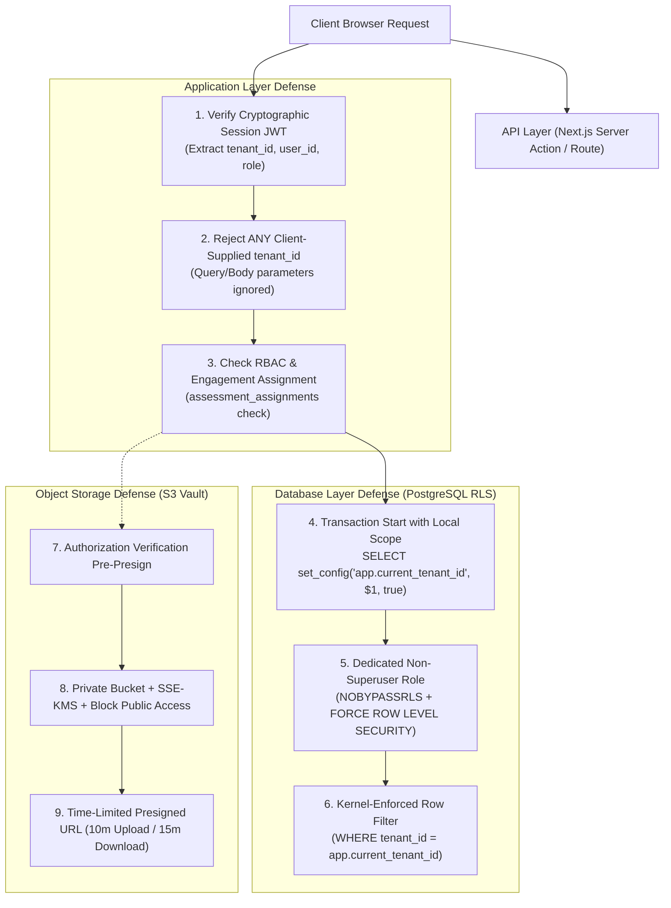
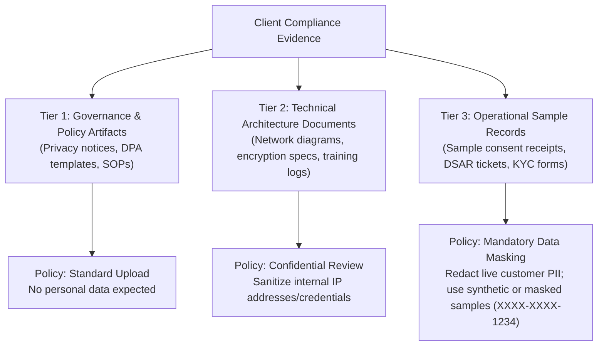

# 05. Tenant Isolation and Evidence Security Design — Refined

## 1. Multi-Tenant Isolation Strategy & Defense-in-Depth

In a regulatory compliance system, a cross-tenant data leak is both an existential operational failure and a statutory violation under Section 8(5) of the DPDPA 2023.

Isolation is enforced via a **three-tier defense-in-depth architecture**:
1. **Network & Ingress Tier**: Authenticated session verification and strict request context resolution.
2. **Database Engine Tier**: PostgreSQL Row-Level Security (RLS) enforced at the database kernel.
3. **Storage Tier**: Deterministically partitioned, private-only object storage buckets accessed exclusively via authorization-gated presigned URLs.



---

## 2. PostgreSQL Row-Level Security (RLS) Implementation

### 2.1 Server-Side Context Extraction & Pool Safety
- **Zero Browser Trust**: The application **never** trusts client-supplied tenant IDs, user roles, or permissions transmitted in query parameters (`?tenant_id=XYZ`) or request bodies.
- Tenant context is derived exclusively from a cryptographically signed, encrypted session JWT stored in an `HttpOnly`, `Secure`, `SameSite=Strict` cookie.
- Every database interaction executes within an isolated SQL transaction where session variables are injected with `is_local = true`:

```sql
BEGIN;
-- The third argument 'true' ensures parameters are strictly local to this transaction
SELECT set_config('app.current_tenant_id', '018f3a5b-7c8d-7e90-8000-000000000001', true);
SELECT set_config('app.current_user_id', '018f3a5b-7c8d-7e90-8000-000000000002', true);
SELECT set_config('app.current_user_role', 'CLIENT_CONTRIBUTOR', true);

-- Execute business query...
SELECT * FROM assessment_controls WHERE assessment_id = $1;

COMMIT; -- Session variables are automatically cleared upon COMMIT or ROLLBACK
```

> [!CRITICAL]
> **Connection Pooling & Session Bleed Prevention**: In pooled architectures (PgBouncer in transaction pooling mode or Node.js connection pools), reusing physical database connections without resetting session variables would cause catastrophic cross-tenant session bleed. Setting `is_local = true` guarantees that PostgreSQL purges the configuration parameter as soon as the transaction ends. As a secondary defense, the database wrapper verifies that context injection occurs on every transaction checkout.

### 2.2 Privileged Connections & RLS Bypass Defense
- **Superuser & Table Owner Vulnerability**: By default in PostgreSQL, superusers and table owners **bypass Row-Level Security**.
- **Engineered Defenses**:
  1. The application runtime connects using a dedicated least-privilege role: `app_runtime_user`.
  2. `app_runtime_user` is explicitly granted `NOSUPERUSER` and `NOBYPASSRLS`.
  3. Every tenant table executes `ALTER TABLE <table_name> FORCE ROW LEVEL SECURITY;`. This ensures that RLS policies are applied even if a query runs under the table owner's context.
  4. Database schema migrations and DDL scripts execute via a separate CI/CD migration user (`migration_admin`), completely decoupled from runtime web traffic.

### 2.3 RLS Kernel Policy Definitions

```sql
-- Enforce RLS on assessments
ALTER TABLE assessments ENABLE ROW LEVEL SECURITY;
ALTER TABLE assessments FORCE ROW LEVEL SECURITY;

CREATE POLICY assessment_tenant_isolation ON assessments
    FOR ALL
    TO app_runtime_user
    USING (
        -- TLI Super Admins can view all tenants
        current_setting('app.current_user_role', true) = 'TLI_SUPER_ADMIN'
        OR
        -- TLI Consultants can view only assessments they are assigned to
        (current_setting('app.current_user_role', true) IN ('TLI_LEAD_CONSULTANT', 'TLI_REVIEWER')
         AND id IN (
             SELECT assessment_id FROM assessment_assignments 
             WHERE user_id = current_setting('app.current_user_id', true)::UUID
         ))
        OR
        -- Client users can only access assessments belonging to their tenant
        tenant_id = current_setting('app.current_tenant_id', true)::UUID
    );

-- Enforce RLS on evidence_items
ALTER TABLE evidence_items ENABLE ROW LEVEL SECURITY;
ALTER TABLE evidence_items FORCE ROW LEVEL SECURITY;

CREATE POLICY evidence_tenant_isolation ON evidence_items
    FOR ALL
    TO app_runtime_user
    USING (
        current_setting('app.current_user_role', true) = 'TLI_SUPER_ADMIN'
        OR
        (current_setting('app.current_user_role', true) IN ('TLI_LEAD_CONSULTANT', 'TLI_REVIEWER')
         AND tenant_id IN (
             SELECT a.tenant_id FROM assessments a
             JOIN assessment_assignments aa ON aa.assessment_id = a.id
             WHERE aa.user_id = current_setting('app.current_user_id', true)::UUID
         ))
        OR
        tenant_id = current_setting('app.current_tenant_id', true)::UUID
    );
```

---

## 3. Evidence Storage Architecture & Access Security

Client compliance documents (network architectures, consent flowcharts, vendor contracts, incident records) contain highly confidential proprietary security information.

### 3.1 Object Storage Hierarchy & Bucket Partitioning
All evidence files reside in a private S3-compatible bucket organized under a deterministic tenant partition:
```text
s3://tli-dpdp-vault-prod/
  └── tenants/
      └── {tenant_id}/
          └── assessments/
              └── {assessment_id}/
                  └── controls/
                      └── {control_code}/
                          └── {evidence_id}_{sanitized_basename}.pdf
```

### 3.2 Secure Upload Workflow (Presigned PUT)
1. **Request Upload Token**: Client sends file metadata (`fileName`, `fileSizeBytes`, `mimeType`, `assessmentControlId`).
2. **Server-Side Validation**:
   - Verifies authenticated session matches the control's tenant.
   - Verifies caller has write permissions on the control's Business Unit.
   - Validates file extension and declared MIME type against an allowlist: `application/pdf`, `application/vnd.openxmlformats-officedocument.wordprocessingml.document` (DOCX), `application/vnd.openxmlformats-officedocument.spreadsheetml.sheet` (XLSX), `image/png`, `image/jpeg`.
   - Validates file size ($100\text{ KB} \le \text{size} \le 50\text{ MB}$).
3. **Presigned PUT URL Issuance**: Generates a presigned S3 PUT URL with:
   - Expiration limited to **10 minutes**.
   - Strict `Content-Type` constraint matching the declared MIME type.
   - Strict `x-amz-server-side-encryption: aws:kms`.
4. **Direct Browser-to-S3 Upload**: Browser uploads binary payload directly to S3, bypassing application web servers and avoiding memory bloat.
5. **Completion Verification & File Signature (Magic Bytes) Check**:
   - Client notifies backend of upload completion.
   - Background worker executes `HeadObject` on S3 to verify exact byte size.
   - Inspects the first 512 bytes (file header magic bytes) to verify format integrity (e.g., verifying `%PDF-` header for PDF files), preventing polyglot file execution or disguised executables.
   - Computes SHA-256 hash and updates `evidence_items.status = 'ACTIVE'`.

### 3.3 Secure Inspection Workflow (Presigned GET)
1. **Authorization Check**: Auditor or client requests a download link for `evidence_id`.
2. **Access Gate**:
   - Application verifies caller's tenant match or active assignment in `assessment_assignments`.
   - If user is a `CLIENT_CONTRIBUTOR`, verifies control is mapped to their Business Unit.
3. **Presigned GET URL Generation**:
   - Expiration limited to **15 minutes**.
   - Header enforcement: `response-content-disposition: attachment; filename="sanitized_name.pdf"`. This prevents the browser from rendering active content inline (mitigating stored XSS via SVG or HTML).
4. **Audit Logging**: Emits an immutable `audit_logs` entry: `action = 'EVIDENCE_INSPECTED'`, capturing user ID, timestamp, client IP, and evidence ID.

---

## 4. Risk-Based Evidence Handling & Personal Data Minimisation

### 4.1 Critique of Blanket Aadhaar/PAN Redaction
The initial design proposed a rigid declaration forbidding the upload of any document containing an Aadhaar or PAN number. 
**Operational Problem**: In a DPDP compliance audit, clients must demonstrate compliance with Section 5 (Notice) and Section 6 (Consent) for onboarding workflows (e.g., sample customer KYC forms, redacted PAN collection screens). A blanket prohibition prevents clients from submitting genuine operational evidence proving their consent notices are functioning.

### 4.2 Recommended Risk-Based Evidence Classification Policy



1. **Tier 1 — Governance & Policy Artifacts**:
   - *Scope*: Privacy policies, data protection agreements, employee handbooks, incident escalation matrices.
   - *Risk*: Low privacy risk; commercial confidential. Standard upload permitted.
2. **Tier 2 — Technical Architecture Documents**:
   - *Scope*: Cloud network diagrams, database encryption configurations, backup schedules.
   - *Risk*: High security sensitivity. Must be sanitized of live production credentials, API keys, and internal database passwords.
3. **Tier 3 — Operational Sample Records**:
   - *Scope*: Sample customer consent receipts, completed DSAR fulfillment tickets, employee consent forms.
   - *Risk*: High privacy risk (Data Principal personal data).
   - *Mandatory Masking Standard*:
     - **Prohibited**: Live, unmasked, identifiable Data Principal records (full 12-digit Aadhaar, unmasked 10-digit PAN, passport copies, biometric data, health records).
     - **Permitted**: Blank template forms, synthetic test account data, or masked records where personal identifiers are redacted (e.g., Aadhaar masked to last 4 digits `XXXX-XXXX-1234`, customer names obscured).
4. **Client Affirmative Pre-Upload Certification**:
   Before initiating an evidence upload, the user must check an affirmative confirmation:
   > *"I certify that this evidence document contains no unmasked direct personal identifiers (such as full Aadhaar, PAN, voter ID, passport, or medical records) and no production credentials. All operational samples have been sanitized or masked in accordance with TLI Evidence Standards."*

---

## 5. Storage Security Constraints & Backup Lifecycle

1. **Storage Service Level Protection**:
   - `BlockPublicAcls = true`, `IgnorePublicAcls = true`, `BlockPublicPolicy = true`, `RestrictPublicBuckets = true`.
   - Bucket Policy rejects unencrypted HTTP requests (`aws:SecureTransport = false`).
   - Server-Side Encryption with Customer-Managed Keys (SSE-KMS) with annual automatic rotation.
2. **Malware & Antivirus Scanning Pipeline**:
   - New uploads enter `status = 'PENDING_SCAN'`.
   - Event-driven antivirus scanner (AWS GuardDuty S3 Malware Protection or containerized ClamAV worker) inspects the binary payload.
   - If clean: transitions to `status = 'ACTIVE'`.
   - If infected: quarantined immediately, status set to `REJECTED`, and security alert dispatched to TLI Super Admin.
3. **Backup & Retention Lifecycle**:
   - S3 Object Versioning enabled with MFA Delete to prevent accidental or malicious destruction of evidence.
   - Cross-region replication to a secondary sovereign Indian cloud region (e.g., Mumbai to Hyderabad) ensuring disaster recovery while maintaining domestic data residency.
   - Report snapshots and final evidence locked under S3 Object Lock (Compliance Mode) following assessment issuance, guaranteeing WORM (Write Once, Read Many) integrity for the statutory retention period (e.g., 5 years).
