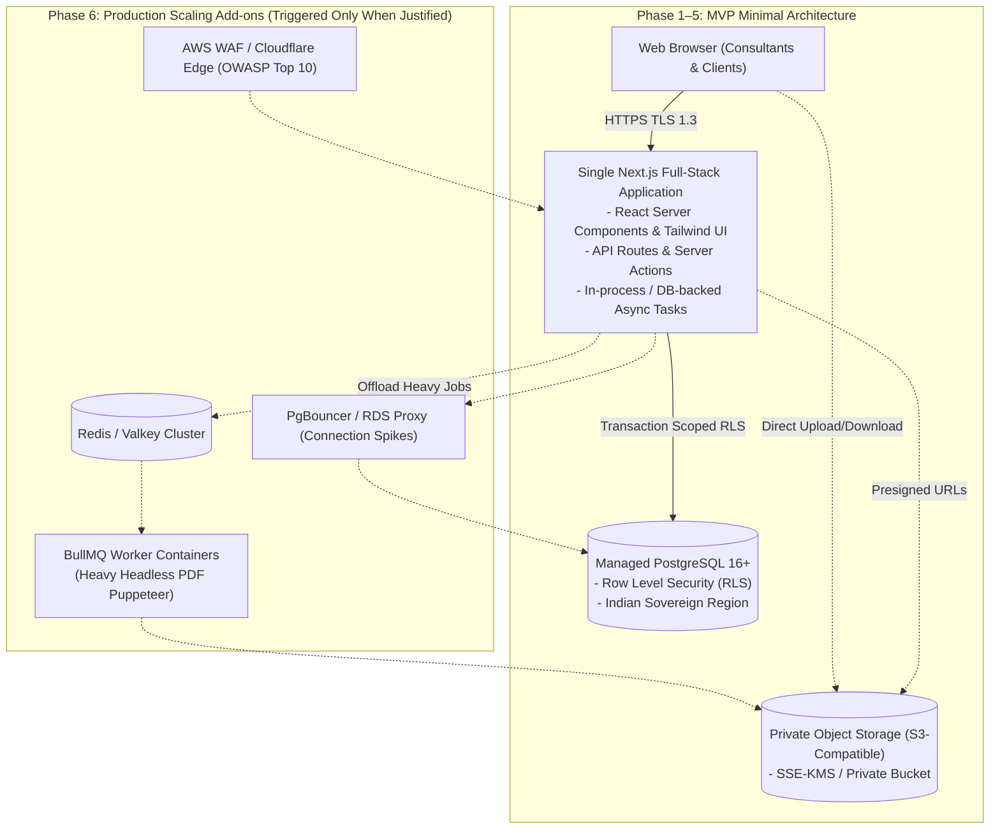

# 06. System Architecture and Deployment Proposal — Refined

## 1. Architectural Philosophy: The Simplest Viable Architecture

To maximize maintainability, minimize operational overhead, and accelerate delivery, the platform adheres to a strict principle: **introduce no unnecessary infrastructure or dependencies**.

### 1.1 Architectural Evaluation: Monolith vs. Microservices

| Architecture Pattern | Architectural Evaluation | Operational Complexity | Cost Implications | MVP Recommendation |
|---|---|---|---|---|
| **Separate Backend Microservices (e.g. NestJS / FastAPI + Next.js SPA)** | Requires managing two separate codebases, dual CI/CD pipelines, cross-service authentication tokens, distributed logging, and CORS configurations. | High (multiple runtime containers, complex local dev) | High ($300+/month minimum cloud baseline) | **REJECTED for MVP**. Unjustified for an advisory tool with low to moderate concurrency (hundreds of users). |
| **Unified Full-Stack Next.js (App Router) + Managed PostgreSQL (with RLS)** | Full-stack TypeScript architecture. Server Components reduce client JS. Server Actions & Route Handlers provide native API endpoints. Shared Zod schemas deliver end-to-end type safety. Database RLS enforces multi-tenancy at the data tier. | Low (single unified deployment, single Docker container, simple local setup) | Low ($50–$150/month baseline) | **SELECTED for MVP**. |

---

## 2. MVP Architecture vs. Production Scaling Triggers

### 2.1 The MVP Baseline Architecture (Recommended Default)
- **Application Tier**: A single containerized Next.js 14+ application running Node.js 20+ LTS. It hosts the UI, authentication endpoints, REST route handlers, scoring engine, and report compilation.
- **Data Tier**: A managed PostgreSQL 16+ database with native Row-Level Security. In-process connection pooling via standard client pool (10–20 connections) satisfies MVP load without requiring an external proxy.
- **Storage Tier**: An S3-compatible private object store (AWS S3 in Mumbai, Azure Blob in Central India, or local MinIO container for development).
- **Asynchronous Processing in MVP**:
  - For PDF generation, `@react-pdf/renderer` generates streaming vector PDFs in-memory in 1–2 seconds for standard assessments, avoiding headless Chrome overhead.
  - For Excel generation, `exceljs` streams XLSX data with minimal memory footprint.
  - Neither Redis nor BullMQ is mandatory for MVP launch. Tasks execute directly within Next.js Route Handlers (with standard 30s timeouts) or use a lightweight PostgreSQL table-backed queue (`pg-boss` or custom task table).

### 2.2 Production Scaling Triggers & Infrastructure Justification
Additional infrastructure components must be justified by explicit operational metrics:

| Infrastructure Component | When Justified (Scaling Trigger) | Operational & Financial Implication |
|---|---|---|
| **Redis / Valkey + BullMQ Workers** | Justified **only** when concurrent PDF report requests cause web server memory spikes (V8 heap exhaustion) or if complex visual charts require headless Chromium (Puppeteer). | Adds ~$30–$70/mo for managed Redis; requires monitoring an additional queue worker service. |
| **PgBouncer / RDS Proxy** | Justified **only** when database connections exceed 80% of max connection limits (e.g., horizontal auto-scaling exceeds 5 application nodes). | Adds ~$25–$50/mo; requires configuring transaction-level pooling parameters. |
| **Automated Malware Scanner (AWS GuardDuty / ClamAV)** | Justified **only** when client evidence upload volume reaches production scale ($> 100$ files/week) to safeguard consultant review machines. | Adds AWS GuardDuty S3 malware inspection fees or a dedicated 1 GB container running ClamAV. |

---

## 3. Evaluation of Cloud Providers & Data Sovereignty

To satisfy Section 16 of the DPDPA 2023 and protect sensitive client compliance gaps, **all data must reside within the Republic of India**. The architecture remains 100% cloud-agnostic:

| Cloud Provider | Target Regions | Supported Services | Assessment & Trade-offs |
|---|---|---|---|
| **Amazon Web Services (AWS)** | `ap-south-1` (Mumbai) `ap-south-2` (Hyderabad) | RDS PostgreSQL, S3, KMS, WAF, SES | **Recommended Default**: Mature sovereign compliance features, native S3 Object Lock for WORM compliance, multi-AZ failover between Mumbai and Hyderabad. |
| **Microsoft Azure** | Central India (Pune) South India (Chennai) | Azure Database for PostgreSQL, Azure Blob Storage (S3 API), Key Vault | **Viable Alternative**: Excellent enterprise Active Directory integration; suitable if TLI or major clients have an existing Azure Enterprise Agreement. |
| **Google Cloud (GCP)** | `asia-south1` (Mumbai) `asia-south2` (Delhi) | Cloud SQL PostgreSQL, Cloud Storage, KMS | **Viable Alternative**: Strong data analytics tooling. |
| **Indian Sovereign Clouds (Yotta, CtrlS, E2E)** | Pan-India Data Centers (Navi Mumbai, Noida) | Managed Kubernetes, Hosted PostgreSQL, S3-compatible Ceph/MinIO | **High-Sovereignty Option**: 100% Indian ownership. Slightly higher self-management overhead for managed database and object storage services. |

---

## 4. Local Development & Testing Topology

The local development environment is 100% offline, self-contained, and deterministic:
- **`app`**: Next.js development server running locally via Node.js (`pnpm dev`).
- **`db`**: PostgreSQL 16 container running in Docker, pre-seeded with synthetic DPDPA control libraries and synthetic client tenants.
- **`storage`**: Local MinIO container simulating private S3 bucket storage with presigned URL compatibility.
- **`mail`**: Local MailHog/Inbucket container capturing outbound verification and clarification notification emails.
- **Zero Internet Requirement**: Developers can run, test, and debug the entire application locally without cloud credentials, internet access, or billable cloud resources.
