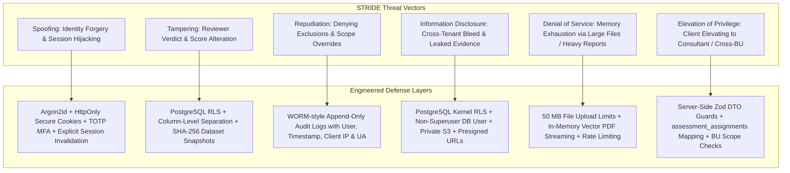
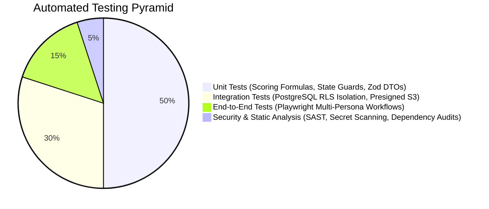

# 07. Testing Strategy and Security Threat Model — Refined

## 1. Security Threat Model (STRIDE Framework)

The TLI DPDP Compliance Gap Analysis Tool stores sensitive corporate privacy deficits, cybersecurity weaknesses, and statutory liabilities across multiple commercial enterprises. If compromised, an attacker would gain an actionable vulnerability roadmap across all client organizations.

---

## 2. Granular STRIDE Threat Analysis & Specific Defenses

| Threat Category | Specific Attack Vector | Potential Impact | Severity | Engineered Mitigation & Verification |
|---|---|---|---|---|
| **Spoofing** | JWT token theft, session hijacking, or credential stuffing. | Unauthorized access to client assessment data. | **High** | Password hashing via Argon2id (memory-hard, resistant to GPU attacks). Session cookies enforce `HttpOnly`, `Secure`, `SameSite=Strict`. Server-side token invalidation upon password reset or role change. Optional TOTP MFA. |
| **Tampering** | Malicious client injecting modified reviewer scores or altering statutory deficit counts. | Falsified compliance posture; compromised audit integrity. | **Critical** | Database column isolation: client mutation endpoints reject reviewer fields. PostgreSQL RLS policies restrict update of reviewer columns to authorized TLI roles. Report issuance locks dataset and computes a cryptographic SHA-256 hash. |
| **Tampering** | Polyglot file upload (executable script masked as a valid PDF). | Arbitrary code execution on reviewer workstation or server. | **High** | Multi-tier file inspection: MIME type allowlisting, file extension matching, and file header magic bytes verification (`%PDF-`, `PK\x03\x04`). S3 bucket enforces `Content-Disposition: attachment` to prevent inline browser execution. |
| **Repudiation** | Consultant or client denying they approved a control exclusion, changed a score, or issued a report. | Inability to establish legal accountability in regulatory disputes. | **High** | Append-only `audit_logs` table records every state transition, user ID, tenant ID, action code, client IP address, user agent, and previous/new state JSON diffs. Application runtime has zero `DELETE` or `UPDATE` permissions on audit records. |
| **Information Disclosure** | Cross-tenant data bleed via Insecure Direct Object References (IDOR) on assessment or evidence URLs. | Catastrophic leak of client vulnerability data across tenants. | **Critical** | Dual-layer isolation: Application-layer route guards verify tenant context before query dispatch. Database kernel enforces PostgreSQL Row-Level Security (RLS) on all tenant tables using transaction-local parameters (`set_config(..., true)`). |
| **Information Disclosure** | Exposure of live customer personal data (unmasked Aadhaar/PAN) in uploaded evidence. | Regulatory violation under DPDPA Section 8(5). | **High** | Risk-based evidence classification policy. Mandatory client pre-upload certification checkbox. Private S3 buckets with SSE-KMS encryption. Absolute contractual and architectural exclusion from external AI model training. |
| **Denial of Service** | Uploading massive files (e.g. 5 GB) or triggering concurrent heavy PDF exports to exhaust server RAM. | Application downtime and degraded responsiveness. | **Medium** | Presigned S3 PUT URLs enforce strict `Content-Length-Range` ($100\text{ KB} \le \text{size} \le 50\text{ MB}$). In-memory vector PDF generation (`@react-pdf/renderer`) avoids headless Chrome memory overhead. API rate limiting (100 req/min per IP). |
| **Elevation of Privilege** | Client Contributor in HR modifying IT controls or escalating to Client Admin. | Unauthorized data tampering across departmental perimeters. | **High** | Server-side authorization middleware verifies both `user_role` and `business_unit_id` before allowing state mutations. Client Admin accounts cannot approve statutory exclusions. |

---

## 3. Comprehensive Automated Testing Strategy

Security, privacy, and legal validation must begin early and continue throughout development via an automated testing pyramid:

### 3.1 Unit Testing (Deterministic Mechanics & State Guards)
- **Scoring Engine Determinism**:
  - Verification of mathematical correctness across varied weighting distributions.
  - Edge cases: Assessments where 100% of controls are in scope; assessments with 40% approved exclusions; partial assessments with 50% completion.
  - Zero-division prevention: Assert that scoring functions handle empty domains gracefully without throwing `NaN` or unhandled exceptions.
  - **Statutory Non-Compensatory Assertion**: An automated test asserting that an assessment with 100% implementation maturity across all other domains, but a missing Section 8(5) safeguard (Maturity 0), outputs `VERDICT: STATUTORY_DEFICITS_IDENTIFIED` and calculates ₹250 Cr penalty exposure bracket.
- **State Machine Guard Tests**:
  - Assert that transition from `DATA_GATHERING` to `SUBMITTED_FOR_REVIEW` is rejected if controls are incomplete, unless explicit `is_partial_assessment` approval exists.
  - Assert that an exclusion cannot transition to `EXCLUSION_APPROVED` without an authorized `TLI_LEAD_CONSULTANT` session and a non-empty justification string.
- **DTO Input Sanitization**:
  - Zod schemas tested for SQL injection strings, XSS script tags, invalid UUID formats, and unauthorized payload fields.

### 3.2 Integration Testing (RLS Boundary & Data Layer)
- **Automated PostgreSQL RLS Isolation Test Suite**:
  - Connects to an ephemeral test PostgreSQL database container:
    1. Authenticate as Tenant A (`SET LOCAL app.current_tenant_id = 'uuid-a'`).
    2. Attempt `SELECT * FROM assessments WHERE id = 'uuid-b'`. Assert result is `0 rows`.
    3. Attempt `UPDATE evidence_items SET file_name = 'hacked' WHERE id = 'uuid-b-evidence'`. Assert `0 rows affected`.
    4. Attempt `SELECT * FROM audit_logs WHERE tenant_id = 'uuid-b'`. Assert `0 rows`.
  - Repeat isolation tests across `business_units`, `processing_activities`, and `remediation_tasks`.
- **Presigned URL Lifecycle Integration**:
  - Mock S3/MinIO integration test:
    1. Generate presigned PUT URL.
    2. Upload test binary.
    3. Verify completion webhook validates byte length and header magic bytes.
    4. Request download presigned GET URL and assert correct tenant scoping and short TTL.
- **Audit Log Verification**:
  - Assert that every write operation to `assessments`, `assessment_controls`, or `evidence_items` generates an append-only entry in `audit_logs`.

### 3.3 End-to-End (E2E) Testing with Playwright
- **Complete Persona Lifecycle Journey**:
  1. `TLI_SUPER_ADMIN` provisions client tenant and creates engagement lead.
  2. `TLI_LEAD_CONSULTANT` initiates assessment, reviews scoping, and approves an exclusion.
  3. `CLIENT_ADMIN` logs in, maps controls to HR and IT business units.
  4. `CLIENT_CONTRIBUTOR` authors responses, certifies redaction, and uploads evidence.
  5. `CLIENT_ADMIN` submits assessment for review.
  6. `TLI_REVIEWER` inspects evidence, opens a clarification thread on Section 8(6) Breach Reporting.
  7. `CLIENT_CONTRIBUTOR` responds with incident SOP.
  8. `TLI_REVIEWER` completes scoring and drafts gap findings.
  9. `TLI_LEAD_CONSULTANT` approves draft and formally issues final report.
  10. System generates PDF report, locks snapshot, and seeds remediation tasks.

### 3.4 Synthetic Data Protocol
- In strict adherence to mandatory project constraints, **zero real client data, real employee PII, or real corporate security records shall be used during development, testing, or CI/CD pipelines**.
- A deterministic synthetic data seeder (using TypeScript and Faker) will generate:
  - Synthetic client corporate entities (e.g., `Bharat FinTech Services Ltd`, `Deccan Health Labs Pvt Ltd`).
  - Synthetic Data Processing Activities (Customer KYC, Employee Payroll, App Analytics).
  - Watermarked synthetic evidence documents: Blank privacy policy templates, simulated DPA agreements with watermark `SYNTHETIC SAMPLE - NOT FOR PRODUCTION USE`.
