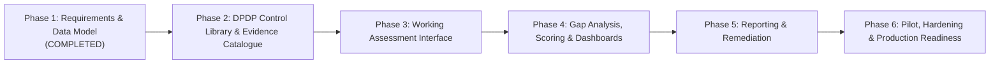

# 08. Implementation Roadmap — Refined

## 1. Phased Product Structure

The product development roadmap adheres strictly to the six canonical product phases. Each phase comprises smaller, verifiable engineering milestones with defined scope, dependencies, deliverables, acceptance criteria, automated tests, security verifications, and outstanding stakeholder decisions.

---

## 2. Detailed Milestone Specifications

### Phase 1 — Requirements and Data Model (Completed / Review Refinement)
- **Scope**: Requirements specification, RBAC matrix, workflow state machines, PostgreSQL relational schema, tenant isolation design, threat model, and stakeholder decision register.
- **Dependencies**: Initial stakeholder briefing and legal research into DPDPA 2023.
- **Deliverables**: Comprehensive Phase 1 documentation suite (`docs/01` to `docs/10`).
- **Acceptance Criteria**: Formal review and sign-off on architectural principles, RLS isolation mechanics, data model, and stakeholder decisions.
- **Automated Tests**: N/A (Documentation phase).
- **Security Verification**: Architectural threat modeling (STRIDE) and defense-in-depth isolation review.
- **Outstanding Decisions**: Business engagement model, cloud provider confirmation, report co-branding, legal review ownership.

---

### Phase 2 — DPDP Control Library and Evidence Catalogue
#### Milestone 2.1: Technical Foundation & PostgreSQL Schema
- **Scope**: Next.js 14+ full-stack scaffolding (TypeScript, Tailwind, shadcn/ui), PostgreSQL database setup with RLS scripts, connection pooling, and Argon2id session authentication.
- **Dependencies**: Phase 1 approval.
- **Deliverables**: Dockerized local development stack, DDL migration scripts, session JWT authentication middleware, and transaction RLS context injector (`set_config(..., true)`).
- **Acceptance Criteria**: Authenticated session reliably injects tenant context; connection pool recycling does not leak session variables; login and logout workflows execute smoothly.
- **Automated Tests**: Unit tests for Argon2id hashing and JWT signature verification; integration tests proving cross-tenant RLS query blocking.
- **Security Verification**: Verification of `FORCE ROW LEVEL SECURITY` on all tables; verification that runtime database role is non-superuser (`NOBYPASSRLS`).
- **Outstanding Decisions**: Confirmation of enterprise SSO / SAML 2.0 requirements for initial release.

#### Milestone 2.2: Statutory DPDP Control Library & Evidence Catalogue
- **Scope**: Compile and seed the canonical `DPDPA-2023-V1.0` statutory control library and standard evidence catalogue.
- **Dependencies**: Milestone 2.1.
- **Deliverables**: Seed data script populating `framework_versions`, `control_domains`, `controls`, and standard evidence catalogue items. Each control records exact statutory section, title, intent, guidance, penalty tier, and maturity criteria (Levels 0 to 5).
- **Acceptance Criteria**: 100% of statutory sections (Sections 4 through 16, SDF obligations, and Schedule penalties) represented without invented legal requirements.
- **Automated Tests**: Data integrity tests verifying foreign keys, domain weights, and unique control codes.
- **Security Verification**: Verification that control library tables are read-only for client tenants.
- **Outstanding Decisions**: Approval of draft DPDP Rules ingestion timeline by TLI legal counsel.

---

### Phase 3 — Working Assessment Interface
#### Milestone 3.1: Tenant, Business Unit & RoPA Administration
- **Scope**: Administration interfaces for client organization management, Business Unit hierarchy, user invites with RBAC roles, and Data Processing Activities (RoPA) inventory.
- **Dependencies**: Phase 2.
- **Deliverables**: Tenant management views, BU management views, RoPA registry views, and user role assignment views.
- **Acceptance Criteria**: Client Admin can create BUs and log processing activities; BU scoping prevents cross-department data tampering.
- **Automated Tests**: CRUD integration tests with RLS validation across tenants.
- **Security Verification**: Verification that Client Admins cannot create TLI advisory accounts or access other client tenants.
- **Outstanding Decisions**: Client user self-registration vs. invite-only provisioning.

#### Milestone 3.2: Assessment Initiation, Scoping & Questionnaire Interface
- **Scope**: Assessment creation, documented exclusion workflow with TLI Lead approval gate, dynamic questionnaire UI, and response draft auto-save.
- **Dependencies**: Milestone 3.1.
- **Deliverables**: Assessment setup wizard, scoping exclusion interface, responsive questionnaire grouped by domain and business unit, and `control_response_history` versioning.
- **Acceptance Criteria**: Client can submit draft answers; proposed exclusions require written justification and cannot be self-approved by client; state machine transitions adhere to status guards.
- **Automated Tests**: State machine unit tests verifying transition blocks on unauthorized exclusions or incomplete assessments.
- **Security Verification**: Verification that client users cannot modify reviewer verdict columns.
- **Outstanding Decisions**: Incomplete assessment approval workflow limits.

#### Milestone 3.3: Secure Evidence Vault & Clarification Engine
- **Scope**: Presigned S3 upload/download pipeline, client redaction certification checkbox, file header magic bytes verification, and in-line clarification threads.
- **Dependencies**: Milestone 3.2.
- **Deliverables**: File upload modal with pre-upload certification, presigned URL API endpoints, MinIO/S3 storage integration, and threaded clarification messaging component.
- **Acceptance Criteria**: Client can upload up to 50 MB files; presigned URLs expire in 10/15 mins; upload validates magic bytes; reviewers can open clarification queries.
- **Automated Tests**: Integration tests for presigned URL lifecycle, SHA-256 hash matching, and attachment authorization.
- **Security Verification**: Magic byte validation against polyglot files; audit log generation on evidence download (`EVIDENCE_INSPECTED`).
- **Outstanding Decisions**: Antivirus scanning pipeline choice (AWS GuardDuty vs. ClamAV).

---

### Phase 4 — Gap Analysis, Scoring, Risk Prioritisation and Dashboards
#### Milestone 4.1: Deterministic Scoring & Risk Engine
- **Scope**: Core scoring algorithm calculating Implementation Maturity (0.00–5.00), Evidence Sufficiency, Coverage %, Statutory Deficit Register, and Potential Penalty Exposure Brackets.
- **Dependencies**: Phase 3.
- **Deliverables**: TypeScript scoring engine library, unit test suite covering mathematical edge cases, and `assessment_scores` persistence.
- **Acceptance Criteria**: Scoring is deterministic and reproducible; scoring never declares legal compliance from an overall numerical score; missing critical safeguards flag statutory red-flags.
- **Automated Tests**: Comprehensive mathematical unit tests (zero-division tests, partial completion weighting, penalty bracket calculations).
- **Security Verification**: Scoring algorithms run server-side only; scoring snapshots are tamper-evident.
- **Outstanding Decisions**: Statutory weighting adjustments across specific domains.

#### Milestone 4.2: Compliance Dashboards & Gap Matrix
- **Scope**: Visual analytical dashboards for executives and operational teams.
- **Dependencies**: Milestone 4.1.
- **Deliverables**: Executive dashboard (maturity gauge, domain radar chart, penalty exposure indicator), granular Gap Matrix with statutory citations, and business unit comparison views.
- **Acceptance Criteria**: Fast dashboard load ($< 1.5$s); interactive filtering by business unit, severity tier, and statutory section.
- **Automated Tests**: Component rendering tests and data aggregation unit tests.
- **Security Verification**: Verification that Client Viewers have read-only access and cannot view unreleased reviewer working papers.
- **Outstanding Decisions**: Selection of standard chart visualization library (Recharts vs. Tremor).

---

### Phase 5 — Reporting and Remediation
#### Milestone 5.1: PDF & Spreadsheet Report Generator
- **Scope**: Asynchronous report generation producing TLI-branded executive PDF reports and structured operational Excel workbooks.
- **Dependencies**: Phase 4.
- **Deliverables**: `@react-pdf/renderer` PDF template with executive summary, radar charts, legal disclaimers, gap findings, and cryptographic SHA-256 dataset hash; ExcelJS spreadsheet export; report snapshot storage in private S3.
- **Acceptance Criteria**: Pixel-perfect PDF formatting; embedded statutory disclaimers; immutable snapshot records in `report_snapshots`.
- **Automated Tests**: PDF generation speed and memory profiling tests; verification of embedded SHA-256 hash.
- **Security Verification**: S3 Object Lock compliance; download gated by tenant authorization.
- **Outstanding Decisions**: TLI executive approval on mandatory report legal disclaimer language and co-branding guidelines.

#### Milestone 5.2: Remediation Management (CAPA) & Independent Closure Gate
- **Scope**: Automatic conversion of verified gaps into actionable remediation tasks, CAPA progress tracking, remediation evidence attachment, and consultant closure validation.
- **Dependencies**: Milestone 5.1.
- **Deliverables**: Remediation Kanban/list board, task assignment and deadline tracking, `remediation_evidence_items` linking, and TLI Consultant validation queue (`VALIDATED_CLOSED` / `REJECTED_REOPENED`).
- **Acceptance Criteria**: Gaps from issued assessments seed remediation tasks; client cannot self-close findings without consultant validation; audit logs capture closure rationale.
- **Automated Tests**: Lifecycle state machine tests for remediation transitions.
- **Security Verification**: Independent closure verification enforced at API and database layers.
- **Outstanding Decisions**: Commercial policy regarding whether remediation re-validation is included in baseline engagement fee.

---

### Phase 6 — Pilot, Testing, Security Hardening and Production Readiness
#### Milestone 6.1: Comprehensive E2E Testing & Synthetic Demo Seeder
- **Scope**: Playwright end-to-end multi-persona test suites, synthetic data seeding for staging/demo environments, and edge case regression testing.
- **Dependencies**: Phase 5.
- **Deliverables**: Automated Playwright test suite executing full assessment lifecycle; deterministic synthetic data seeder generating realistic client compliance fixtures.
- **Acceptance Criteria**: 100% automated test suite passing; zero real client data used anywhere in development or staging.
- **Automated Tests**: Full E2E suite covering Super Admin, Lead Consultant, Reviewer, Client Admin, and BU Contributor.
- **Security Verification**: Synthetic data verification to ensure zero real PII or live credentials.
- **Outstanding Decisions**: Pilot client selection for closed beta testing.

#### Milestone 6.2: Production Security Hardening & Deployment Readiness
- **Scope**: Content Security Policy (CSP), HTTP security headers, rate limiting, infrastructure deployment templates, static application security testing (SAST), and secret scanning.
- **Dependencies**: Milestone 6.1.
- **Deliverables**: Terraform/IaC templates for Indian sovereign cloud deployment, production Dockerfile, CI/CD security pipelines (Gitleaks, Snyk, SonarQube), and disaster recovery runbooks.
- **Acceptance Criteria**: A+ security header rating; zero critical/high vulnerabilities in SAST and dependency audits; successful backup and restore rehearsal.
- **Automated Tests**: CI/CD automated security pipeline checks.
- **Security Verification**: Penetration testing readiness; RLS leak regression test execution.
- **Outstanding Decisions**: Final production cloud account provisioning and domain configuration.
