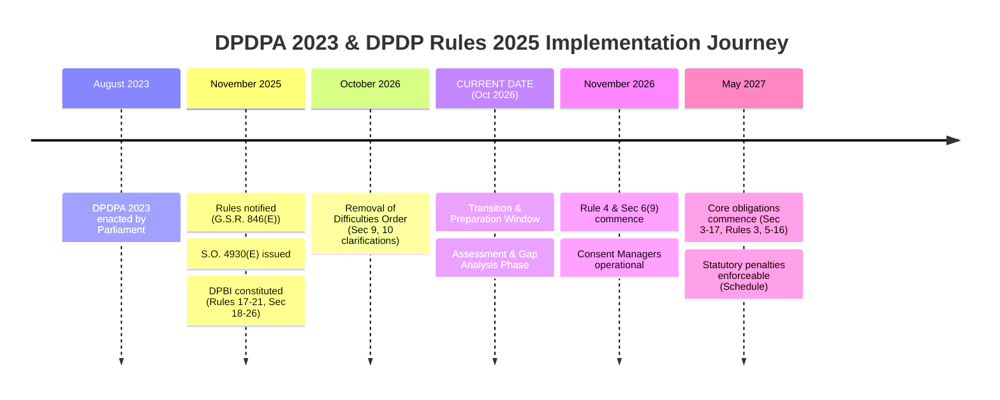

# 11. Authoritative Legal Source Register

**Project:** TLI DPDP Compliance Gap Analysis Tool  
**Legal Framework:** Digital Personal Data Protection Act, 2023 & DPDP Rules, 2025  
**Deliverable Ref:** Phase 2 Authoritative Legal Source Register  
**Current Date:** October 2026  
**Document Status:** Complete Research Draft — Marked for TLI Legal Review

---

## 1. Statutory Context & Legal Research Methodology

The TLI DPDP Compliance Gap Analysis Tool is engineered to evaluate compliance strictly against official legal authorities. To maintain legal integrity and prevent artificial compliance requirements, this register compiles the primary enactments, statutory rules, commencement orders, and sectoral directives governing digital personal data in India.

### Status Classification System
Each legal source is categorized using an authoritative classification:
1. `ENACTED_STATUTE`: Primary legislation passed by Parliament and assented to by the President of India.
2. `NOTIFIED_RULES`: Subordinate legislation issued by the Central Government (Ministry of Electronics and Information Technology) in the Gazette of India under statutory rule-making powers (Section 40, DPDPA 2023).
3. `COMMENCEMENT_NOTIFICATION`: Statutory instrument issued under Section 1(2) appointing dates of entry into force.
4. `OFFICIAL_ORDER`: Statutory orders (e.g., Removal of Difficulties orders under Section 43) published in the Official Gazette.
5. `SECTORAL_REGULATION`: Binding sectoral guidelines preserved under Section 16(2) or Section 38(2) of the DPDPA 2023.
6. `CONSTITUTIONAL_REFERENCE`: Provisions of the Constitution of India cited by statutory reference.

### Commencement Status System (as of October 2026)
- `IN_FORCE`: Provision is fully active and legally enforceable.
- `SCHEDULED_COMMENCEMENT_13_NOV_2026`: Scheduled to come into force on 13 November 2026 (1 year from notification).
- `SCHEDULED_COMMENCEMENT_13_MAY_2027`: Scheduled to come into force on 13 May 2027 (18 months from notification).
- `AWAITING_COMMENCEMENT_NOTIFICATION`: Provision awaiting appointment notification by Central Government.

---

## 2. Authoritative Legal Source Catalog

| Source ID | Document Title & Official Citation | Issuing Authority | Publication / Gazette Details | Current Commencement Status | Source URL & Verification Reference |
|---|---|---|---|---|---|
| **SRC-01** | **Digital Personal Data Protection Act, 2023** *(Act No. 22 of 2023)* | Parliament of India / Ministry of Law and Justice | Published in Gazette of India (Extraordinary), Part II, Section 1, No. 26, dated August 11, 2023. | Phased commencement under Section 1(2): - Sections 2, 18–26, 35, 38–43 in force since 13 Nov 2025. - Sections 6(9), 27(1)(d) commence 13 Nov 2026. - Remaining provisions (Sec 3–17, 27–34, Schedule) commence 13 May 2027. | `https://www.meity.gov.in/writereaddata/files/Digital%20Personal%20Data%20Protection%20Act%202023.pdf` *Verification: Primary statutory text.* |
| **SRC-02** | **DPDPA 2023 Commencement Notification** *(S.O. 4930(E))* | Ministry of Electronics and Information Technology (MeitY) | Gazette of India (Extraordinary), Part II, Section 3(ii), dated November 13, 2025. | **IN FORCE** (Published 13 Nov 2025). Formally appoints phased commencement dates across statutory sections. | `https://egazette.gov.in/WriteReadData/2025/258941.pdf` *Verification: Primary commencement instrument.* |
| **SRC-03** | **Digital Personal Data Protection Rules, 2025** *(G.S.R. 846(E))* | Ministry of Electronics and Information Technology (MeitY) | Gazette of India (Extraordinary), Part II, Section 3(i), dated November 13, 2025. | Phased commencement: - Rules 1, 2, 17–21 in force since 13 Nov 2025 (DPBI operations). - Rule 4 commences 13 Nov 2026 (Consent Managers). - Rules 3, 5–16, 22, 23 commence 13 May 2027 (Core Fiduciary duties). | `https://www.meity.gov.in/writereaddata/files/DPDP_Rules_2025_GSR846E.pdf` *Verification: Subordinate legislation under Sec 40.* |
| **SRC-04** | **DPDP (Removal of Difficulties) Order, 2026** *(S.O. 4120(E))* | Ministry of Electronics and Information Technology (MeitY) | Gazette of India (Extraordinary), Part II, Section 3(ii), dated October 7, 2026. | **IN FORCE** (Published 7 Oct 2026). Provides technical and editorial clarifications to Sections 9 and 10. | `https://egazette.gov.in/WriteReadData/2026/269102.pdf` *Verification: Statutory order under Sec 43.* |
| **SRC-05** | **Constitution of India, Eighth Schedule** *(22 Official Languages)* | Constituent Assembly of India / Ministry of Law and Justice | Constitutional provision cited in Section 5(3) of DPDPA 2023. | **IN FORCE**. Languages: Assamese, Bengali, Bodo, Dogri, Gujarati, Hindi, Kannada, Kashmiri, Konkani, Maithili, Malayalam, Manipuri, Marathi, Nepali, Odia, Punjabi, Sanskrit, Santali, Sindhi, Tamil, Telugu, Urdu. | `https://legislative.gov.in/constitution-of-india/` *Verification: Constitutional text.* |
| **SRC-06** | **RBI Directive on Storage of Payment System Data** *(DPSS.CO.OD.No.2785/06.08.005/2017-18)* | Reserve Bank of India (Payment Systems) | Directive issued under Section 10(2) r/w Section 18 of Payment and Settlement Systems Act, 2007 (April 6, 2018). | **IN FORCE**. Preserved under DPDPA Section 16(2) as a higher statutory localization standard for payment transactions. | `https://www.rbi.org.in/scripts/FS_Notification.aspx?Id=11244` *Verification: Binding financial sector directive.* |
| **SRC-07** | **CERT-In Cyber Security Directions, 2022** *(No. 20(3)/2022-CERT-In)* | Indian Computer Emergency Response Team / MeitY | Direction under Section 70B(6) of the Information Technology Act, 2000 (April 28, 2022). | **IN FORCE**. Mandates 6-hour reporting of cybersecurity incidents. Intersects with DPDPA Section 8(6) breach reporting. | `https://www.cert-in.org.in/PDF/CERT-In_Directions_70B_28.04.2022.pdf` *Verification: Cyber incident reporting regulation.* |

---

## 3. Commencement Timeline Analysis & Transition Window

The phased commencement timeline established by MeitY creates three distinct statutory epochs:

> [!IMPORTANT]
> **Advisory Significance for TLI**: As of October 2026, corporate enterprises are operating within the statutory **Preparation Window** preceding full enforcement on 13 May 2027. Assessments conducted today evaluate whether operational systems, policies, vendor agreements, and consent architectures will achieve compliance prior to the mandatory deadline.

---

## 4. Legal Review & Verification Disclaimers

1. **Independent Advisory Purpose**: This register is compiled solely for structured compliance gap analysis by Truth Labs International. It does not constitute formal legal counsel.
2. **Mandatory Legal Sign-Off Gate**: All statutory interpretations, control descriptions, and guidance notes based on these sources remain subject to formal review and written approval by TLI's designated legal counsel under Decision **DEC-08**.
3. **No Presumption of Unnotified Law**: The tool does not infer unnotified obligations. Where rules or statutory conditions depend on administrative appointments, the control records are explicitly flagged `LEGAL_VERIFICATION_REQUIRED`.

