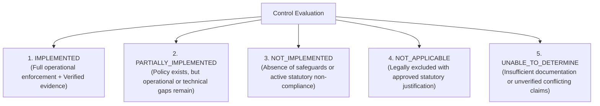
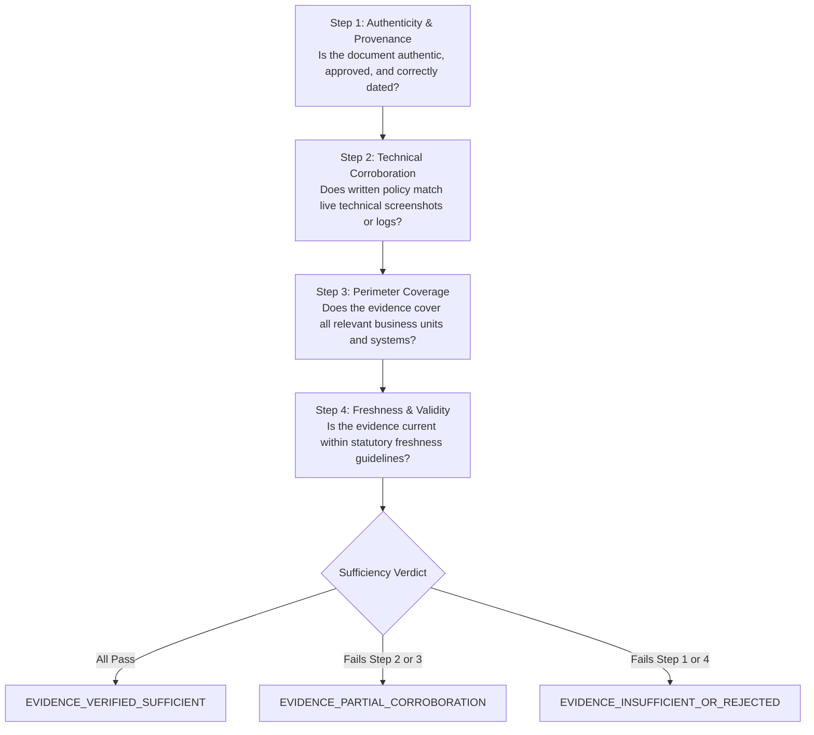
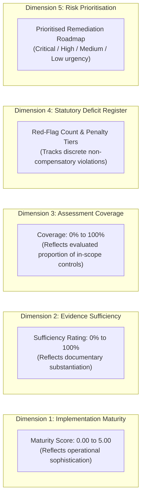

# 16. Assessment Response and Evidence-Review Guidance

**Project:** TLI DPDP Compliance Gap Analysis Tool  
**Framework Version:** `DPDPA-2023-V1.0`  
**Deliverable Ref:** Phase 2 Assessment Response & Evidence-Review Guidance  
**Status:** Canonical Standard — Version 1.0.0

---

## 1. Core Principles of Forensic Evaluation

Truth Labs International assessments operate under rigorous forensic principles. When evaluating corporate alignment with India's DPDPA 2023 and DPDP Rules 2025, consultants and client respondents must adhere to four cardinal rules:

1. **Objectivity Over Policy Statements**: A written policy document is a statement of intent, not proof of operational execution. Technical configuration, audit logs, and verified samples are required to confirm operational implementation.
2. **Strict Independence of Assessment Dimensions**:
   - *Implementation Status* (Is the measure operational?) is evaluated independently from *Evidence Sufficiency* (Is documentary proof adequate?).
   - *Applicability* (Does the law command this organisation to do this?) is evaluated prior to scoring.
   - *Risk Prioritisation* (What is the potential regulatory and business exposure?) is determined by statutory penalty tiers and deficit severity, not by compliance percentage.
3. **No Self-Declared Compliance**: An overall numerical score **shall never declare legal compliance**. Compliance with statutory obligations is non-compensatory.
4. **Transparent Audit Trails**: Every score determination, reviewer adjustment, or exclusion decision must record an author attribution, timestamp, and defensible rationale.

---

## 2. Standard Assessment Response States

The evaluation framework enforces five standardized response states. Every assessed control must resolve into one of these explicit categories:

### Detailed Evaluation State Criteria

| Response State | Operational Definition | Minimum Required Evidence | Scoring Impact | Reviewer Action & Verification Mandate |
|---|---|---|:---:|---|
| **`IMPLEMENTED`** | The control objective is fully achieved across all relevant systems, business units, and data flows. Technical safeguards and procedural measures are actively enforced, monitored, and documented. | Approved policy/SOP **plus** verifiable technical proof (live configuration screenshot, automated test log, or verified sample record). | Full Points (1.0 weight) | Reviewer verifies that documentary proof directly substantiates the live implementation and that no obvious bypasses exist. |
| **`PARTIALLY_IMPLEMENTED`** | The organisation has drafted policies, initiated governance, or implemented partial technical measures, but execution is incomplete, inconsistent across business units, or lacks automated enforcement. | Draft or approved policy/SOP, but technical configuration is missing, incomplete, or covers only a subset of corporate systems. | Partial Points (0.25 to 0.50 weight) | Reviewer documents the specific operational deficits, identifies which business units are non-compliant, and formulates remediation actions. |
| **`NOT_IMPLEMENTED`** | The control measure is absent. The organisation maintains no formal policy, operational workflow, or technical safeguards addressing the statutory mandate. | None, or only irrelevant documentation. | Zero Points (0.0 weight) | Reviewer classifies the gap severity, calculates statutory penalty tier exposure, and logs an entry in the Statutory Deficit Register. |
| **`NOT_APPLICABLE`** | The control does not apply to the organisation due to objective factual and statutory exemptions (e.g. Section 9 for pure B2B entities with zero child data, or Section 10 for non-SDFs). | Written statutory justification citing legal grounds and operational proof confirming absence of triggering activity. | Excluded from denominator | Reviewer evaluates justification. **Requires digital sign-off from TLI Lead Consultant** before exclusion is accepted. |
| **`UNABLE_TO_DETERMINE`** | The client has provided contradictory statements, ambiguous documentation, or declined to furnish required proof due to confidentiality or operational constraints. | Incomplete, corrupted, or unverified documents. | Zero Points (Treated as Gap) | Reviewer raises a formal clarification query. If unresolved, treated as an unassessed risk with documented scope limitation. |

---

## 3. Evidence Sufficiency & Verification Standards

To determine whether submitted evidence is sufficient to justify an `IMPLEMENTED` determination, reviewers follow a 4-tier verification protocol:

### Reviewer Evaluation Checklist
1. **Authenticity & Sign-off**:
   - Are policies formally approved by authorized executive management (e.g., CISO, Board, General Counsel)?
   - Are vendor agreements signed by both parties with active contract dates?
2. **Technical Corroboration**:
   - A written policy stating *"All customer data is encrypted using AES-256"* must be corroborated by a database configuration snapshot or cloud KMS policy screenshot.
   - A notice policy stating *"Notices are provided in regional languages"* must be corroborated by live UI screenshots demonstrating the multilingual toggle.
3. **Enterprise Perimeter Coverage**:
   - Does the evidence apply enterprise-wide, or only to a single subsidiary/department?
   - If a measure is deployed in the FinTech unit but absent in the HR unit, the control must be scored `PARTIALLY_IMPLEMENTED`.
4. **Data Masking Compliance**:
   - Reviewer must verify that the submitted evidence contains no unmasked direct personal identifiers (Aadhaar, live biometric data, unmasked PAN). Any unmasked sample must be rejected immediately, prompting the client to resubmit a sanitized version.

---

## 4. Separation of Assessment Dimensions

To prevent misleading compliance assertions, the assessment engine maintains five strictly isolated analytical dimensions:

### The Non-Compensatory Evaluation Rule
> [!CRITICAL]
> **Statutory Integrity Standard**:
> A high maturity average (e.g., 92%) can **never** offset, cancel, or mitigate an active statutory violation.
> 
> *Forensic Example*: An enterprise achieves Level 5 implementation across Notice, Consent, and Data Principal Rights, but has zero Technical Security Safeguards (Section 8(5), Maturity 0) and no Personal Data Breach Reporting Plan (Section 8(6), Maturity 0).
> - **Aggregate Score**: May appear high (e.g., 85%).
> - **Legal Reality**: The enterprise is in direct breach of Section 8(5) and Section 8(6), exposing the board of directors to statutory penalties up to ₹250 Crores and ₹200 Crores under the Schedule.
> - **Platform Verdict**: `STATUTORY_DEFICITS_IDENTIFIED — MATERIAL NON-COMPLIANCE REGISTERED`. The executive summary highlights the ₹250 Cr penalty exposure prominently, regardless of the overall score.

---

## 5. Reviewer Objectivity & Common Evidentiary Pitfalls

When reviewing client submissions, TLI consultants must actively guard against common evidentiary fallacies:

| Common Evidentiary Pitfall | Client Claim | Forensic Reality & Correct Reviewer Determination |
|---|---|---|
| **The "Shelfware" Policy** | Client uploads an unapproved 50-page privacy policy drafted 3 years ago. | No proof of operational adoption or employee awareness. Determine as `PARTIALLY_IMPLEMENTED` or `NOT_IMPLEMENTED` pending training logs and configuration proof. |
| **The "Cloud Responsibility Shift"** | Client claims *"We host on AWS, so encryption and breach reporting are AWS's responsibility."* | Under Section 8(1), fiduciary responsibility is strictly non-delegable. AWS provides infrastructure; the client must configure bucket encryption, IAM policies, and breach triage. Determine as `NOT_IMPLEMENTED` if client has no configuration controls. |
| **The "Silent Legitimate Interest"** | Client processes customer transaction data for unsolicited credit marketing, claiming "business interest". | DPDPA Section 7 provides an exhaustive statutory list with no open-ended legitimate interest clause. Secondary marketing without consent is unlawful under Section 4. Determine as `NOT_IMPLEMENTED`. |
| **The "Self-Declaration Age Gate"** | Client operates a mobile gaming app and claims *"We don't process children's data because users check 'I am over 18'."* | Self-declaration without technical age-assurance or verifiable parental consent fails Section 9(1) for services directed at or accessible to minors. Determine as `PARTIALLY_IMPLEMENTED` or `NOT_IMPLEMENTED`. |
| **The "Contract Clickwrap Trap"** | Client uses 15 SaaS vendors but provides only standard clickwrap website terms of service without DPAs. | Section 8(2) and Rule 7 mandate a valid contract containing specific statutory safeguards. Standard commercial terms without privacy schedules fail this mandate. Determine as `NOT_IMPLEMENTED`. |

