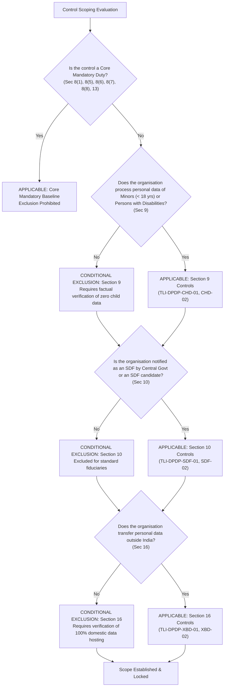
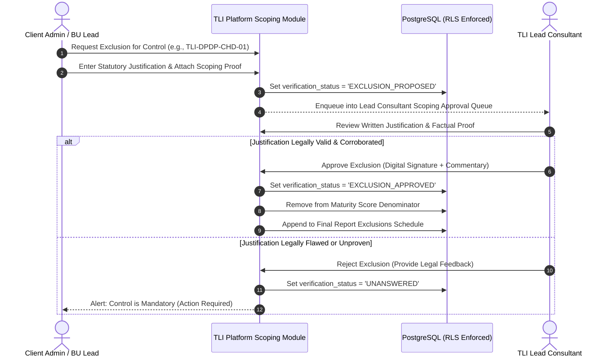

# 17. Control Applicability and Scoping Methodology

**Project:** TLI DPDP Compliance Gap Analysis Tool  
**Framework Version:** `DPDPA-2023-V1.0`  
**Deliverable Ref:** Phase 2 Applicability & Scoping Methodology  
**Status:** Canonical Standard — Version 1.0.0

---

## 1. Objectives & Scoping Principles

Not every statutory provision of the DPDPA 2023 applies equally to every corporate entity. For example, an industrial manufacturing enterprise that operates strictly in B2B wholesale transactions and does not process data of minors cannot be evaluated against Section 9 (Children's Data) as if it were a consumer edtech platform.

However, in compliance gap analysis, **improper exclusion of mandatory controls is a common tactic used to artificially inflate compliance scores**.

To prevent gaming of compliance metrics, this methodology enforces four strict scoping rules:
1. **Mandatory Statutory Baselines Cannot Be Excluded**: Core duties (Section 8(1) accountability, Section 8(4)-(5) security safeguards, Section 8(6) breach notification, Section 8(7) purpose fulfillment, and Section 8(8) grievance redressal) apply universally to all Data Fiduciaries and **can never be marked Not Applicable**.
2. **Documented Factual Justification Mandate**: Any proposed exclusion of a conditional control must cite:
   - The statutory exemption clause.
   - Verifiable factual evidence proving the absence of the triggering processing activity.
3. **Dual-Custody Approval Gate**: A client user cannot unilaterally approve an exclusion. An exclusion remains `EXCLUSION_PROPOSED` until formally reviewed, verified, and signed off by an assigned **TLI Lead Consultant**.
4. **Permanent Audit Record in Final Reports**: All approved exclusions are published in an explicit "Documented Scope Exclusions" schedule within the final issued report, detailing the justification, approver identity, and approval timestamp.

---

## 2. Applicability Decision Tree & Conditional Triggers

---

## 3. Applicability Criteria for Specific Control Domains

### 3.1 Core Fiduciary Baseline Controls (Non-Excludable)
- **Controls**: `TLI-DPDP-SCO-01`, `TLI-DPDP-LGL-01`, `TLI-DPDP-FID-01`, `TLI-DPDP-FID-02`, `TLI-DPDP-SEC-01`, `TLI-DPDP-SEC-02`, `TLI-DPDP-BRC-01`, `TLI-DPDP-BRC-02`, `TLI-DPDP-RET-01`, `TLI-DPDP-RET-02`, `TLI-DPDP-DSR-01`, `TLI-DPDP-DSR-02`, `TLI-DPDP-DSR-03`, `TLI-DPDP-DSR-04`, `TLI-DPDP-PEN-01`.
- **Statutory Grounds**: Sections 3, 4, 8, 11, 12, 13, 14, and Schedule.
- **Rule**: **Universal Application**. Every legal entity qualifying as a Data Fiduciary under Section 2(i) must implement these measures. The system UI disables the "Propose Exclusion" action on these controls.

---

### 3.2 Processing Children's and Disabled Persons' Data (Section 9)
- **Controls**: `TLI-DPDP-CHD-01`, `TLI-DPDP-CHD-02` *(Statutory exemptions under Section 9(4)-(5) are evaluated as conditional scoping exclusion rules, not standalone controls)*.
- **Statutory Grounds**: Section 9(1)-(5) r/w Rule 12 and Removal of Difficulties Order 2026.
- **Applicable When**: The organisation operates public consumer services, digital apps, educational platforms, healthcare systems, gaming environments, or e-commerce portals accessible to or targeted at minors under 18 years of age.
- **Valid Exclusion Justification**:
  - The organisation operates strictly in B2B enterprise wholesale commerce where all users are verified corporate representatives ($> 18$ years).
  - The organisation enforces strict age verification at entry blocking individuals under 18 from creating accounts, with audit logs confirming zero registered minor profiles.
- **Invalid Exclusion Claims**:
  - *"We don't know the age of our users because we never ask."* (Ignorance of user age on consumer platforms accessible to children does not constitute a valid legal exclusion).

---

### 3.3 Significant Data Fiduciary (SDF) Governance (Section 10)
- **Controls**: `TLI-DPDP-SDF-01`, `TLI-DPDP-SDF-02`.
- **Statutory Grounds**: Section 10(1)-(2) r/w Rule 13 and Removal of Difficulties Order 2026.
- **Applicable When**:
  - The Central Government has formally notified the entity as an SDF under Section 10(1).
  - The engagement scope is an **SDF Readiness Assessment** evaluating whether the organisation would satisfy SDF obligations if notified.
- **Valid Exclusion Justification**:
  - The organisation is a standard commercial Data Fiduciary and has not received an official SDF designation notification from MeitY under Section 10(1).
- **Consultant Action**:
  - Verify against MeitY gazette notifications whether the client's industry sector or corporate entity has been scheduled.
  - If excluded, mark as `EXCLUSION_APPROVED (Non-SDF Status Verified)`.

---

### 3.4 Cross-Border Data Transfers (Section 16)
- **Controls**: `TLI-DPDP-XBD-01`, `TLI-DPDP-XBD-02`.
- **Statutory Grounds**: Section 16(1)-(2) r/w Rule 16 and Sectoral Regulations.
- **Applicable When**: The organisation uses overseas cloud regions, third-party international SaaS providers (e.g. US/EU hosted tools), offshore data processing centers, or transfers personal data to parent/subsidiary entities outside India.
- **Valid Exclusion Justification**:
  - The organisation maintains 100% domestic data hosting within the territory of India across all systems, databases, and third-party SaaS vendors, with contractual and technical network egress controls blocking foreign data transmission.
- **Verification Evidence Required**:
  - Cloud hosting architecture diagrams and vendor contract schedules confirming all servers, database replicas, and backups are stationed in India.

---

### 3.5 Consent Management vs. Legitimate Uses (Sections 5, 6 vs. 7)
- **Notice & Consent Controls**: `TLI-DPDP-NOT-01`, `TLI-DPDP-NOT-02`, `TLI-DPDP-NOT-03`, `TLI-DPDP-CON-01`, `TLI-DPDP-CON-02`, `TLI-DPDP-CON-03`.
- **Legitimate Uses Controls**: `TLI-DPDP-LEG-01`, `TLI-DPDP-LEG-02`.
- **Applicability Interaction**:
  - If a specific processing activity relies **exclusively** on an exhaustive legitimate use under Section 7 (e.g., pure internal employee payroll under Section 7(g) or statutory court disclosures under Section 7(d)), pre-consent notice under Section 5(1) and consent withdrawal under Section 6(4) do not apply to that specific data flow.
  - However, almost all commercial enterprises operate consumer-facing or customer workflows relying on consent. Therefore, notice and consent controls can be excluded **only at the granular activity level**, never at the enterprise level, unless the entire business perimeter operates under Section 7.

---

## 4. Formal Exclusion Workflow and Lead Sign-off Gate

### Required Fields for an Exclusion Proposal
Before the platform accepts an exclusion request, the client must submit:
1. `exclusion_statutory_basis`: Exact section or rule permitting exclusion.
2. `exclusion_factual_rationale`: Detailed description of corporate operations proving the activity does not occur.
3. `exclusion_supporting_evidence_id`: Reference to supporting evidence (e.g. B2B customer agreement template, domestic server hosting attestation).
4. `client_certifier_user_id`: Identity of the Client Admin certifying the representation.

