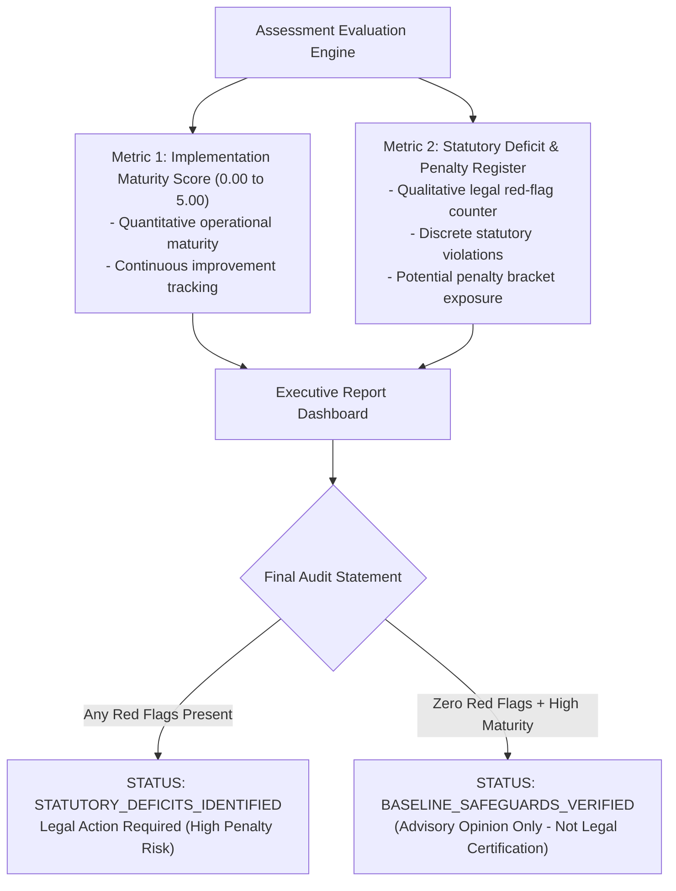

# 18. Provisional Scoring and Risk-Prioritisation Methodology

**Project:** TLI DPDP Compliance Gap Analysis Tool  
**Model Code:** `SCORING-V1-PROVISIONAL`  
**Deliverable Ref:** Phase 2 Provisional Scoring & Risk Methodology Proposal  
**Status:** **PROVISIONAL ENGINEERING PROPOSAL — SUBJECT TO FORMAL TLI METHODOLOGY SIGN-OFF**

---

> [!WARNING]
> **PROVISIONAL STATUS NOTICE**:
> This document details an illustrative engineering proposal for deterministic scoring, coverage calculation, and risk prioritisation. It does **not** represent settled TLI methodology until formally approved by TLI Executive Leadership and Legal Counsel under Decision **DEC-08** and **DEC-09**.
> 
> Under no circumstances shall an aggregate score generated by this model be represented as a legal declaration of statutory compliance or immunity from DPBI penalties.

---

## 1. Architectural Principles of Non-Compensatory Scoring

Traditional audit tools frequently calculate a single weighted percentage average (e.g., 88%) and label the organisation "Compliant". In privacy law, this is fundamentally flawed and legally hazardous:
- An enterprise can score 100% on notice, consent, and HR policies, but completely lack reasonable security safeguards (Section 8(5)) or a breach notification plan (Section 8(6)).
- A weighted average would report "88% Compliant", obscuring the fact that the organisation is in direct violation of Tier 1 and Tier 2 statutory mandates carrying penalties up to **₹250 Crores** and **₹200 Crores**.

### The TLI Dual-Metric Evaluation Model
To preserve statutory fidelity, the platform calculates two parallel, non-compensating analytical metrics:

---

## 2. Metric 1: Implementation Maturity Score (0.00 to 5.00)

The Implementation Maturity Score evaluates the operational sophistication of controls that are in-scope and applicable.

### 2.1 Control Maturity Scale (0 to 5)

| Maturity Level | Label | Evaluation Criteria | Numerical Value |
|:---:|---|---|:---:|
| **Level 0** | **Absent / Non-Compliant** | Control is completely missing. No policy, procedure, or technical safeguard exists. | `0.0` |
| **Level 1** | **Ad-Hoc / Initial** | Informal, undocumented practices exist. Highly dependent on individual initiative; no standardisation. | `1.0` |
| **Level 2** | **Documented / Defined** | Formal policies and SOPs drafted and approved, but technical implementation is incomplete or inconsistent. | `2.0` |
| **Level 3** | **Implemented / Operational** | Safeguards are technically operational across standard systems, with basic logging and departmental coverage. | `3.0` |
| **Level 4** | **Monitored / Managed** | Safeguards are enterprise-wide, systematically monitored, periodically audited (e.g. VAPT), and metrics-tracked. | `4.0` |
| **Level 5** | **Optimised / Continual Review** | Automated enforcement, self-healing controls, proactive DPIA reviews, and continuous external audit assurance. | `5.0` |

### 2.2 Mathematical Formula for Domain & Overall Maturity

For any evaluated domain $D$ containing in-scope controls $c \in C_D$:

$$\text{Domain Maturity Score } (S_D) = \frac{\sum_{c \in C_D} \left( M_c \times W_c \right)}{\sum_{c \in C_D} W_c}$$

Where:
- $M_c \in \{0.0, 1.0, 2.0, 3.0, 4.0, 5.0\}$ is the verified reviewer maturity rating for control $c$.
- $W_c \ge 1.0$ is the assigned statutory weight of control $c$.
- $C_D$ is the set of controls in domain $D$ with `verification_status` $\ne$ `EXCLUSION_APPROVED`.

#### Handling Zero-Division Edge Cases
If all controls within domain $D$ are approved as `EXCLUSION_APPROVED` (e.g. Section 9 Children's Data for a pure B2B entity):
- $\sum_{c \in C_D} W_c = 0$.
- **Formula Guard**: If $\sum W_c = 0$, $S_D$ is marked `N/A (EXCLUDED)`, and the domain is removed entirely from the overall weighted score calculation.

#### Overall Implementation Maturity Score ($S_{\text{Overall}}$)
Across all applicable domains $D \in \mathcal{D}_{\text{active}}$:

$$S_{\text{Overall}} = \frac{\sum_{D \in \mathcal{D}_{\text{active}}} \left( S_D \times W_D \right)}{\sum_{D \in \mathcal{D}_{\text{active}}} W_D}$$

Normalized to a two-decimal floating-point number between $0.00$ and $5.00$.

---

## 3. Metric 2: Assessment Coverage Percentage

Assessment Coverage tracks what proportion of applicable statutory requirements have been evaluated:

$$\text{Coverage Percentage } (Cov) = \left( \frac{N_{\text{evaluated}}}{N_{\text{total}} - N_{\text{excluded}}} \right) \times 100\%$$

Where:
- $N_{\text{total}}$ is the total number of controls in the library (e.g. 30).
- $N_{\text{excluded}}$ is the count of controls with `EXCLUSION_APPROVED`.
- $N_{\text{evaluated}}$ is the count of applicable controls with status in $\{ \text{IMPLEMENTED}, \text{PARTIALLY\_IMPLEMENTED}, \text{NOT\_IMPLEMENTED} \}$.

> [!IMPORTANT]
> If $Cov < 100\%$, any issued report must display a prominent **Scope Limitation Banner** declaring that the evaluation represents an incomplete assessment.

---

## 4. Metric 3: Statutory Deficit & Penalty Exposure Register

Regardless of the maturity score, any control evaluated as `NOT_IMPLEMENTED` or `PARTIALLY_IMPLEMENTED` on a mandatory provision generates an entry in the **Statutory Deficit Register**.

### 4.1 Statutory Penalty Tier Mapping (DPDPA Schedule)

Under Section 33(1) and the Schedule of the DPDPA 2023, Parliament establishes discrete maximum statutory penalty brackets:

| Statutory Tier | Statutory Authority | Maximum Statutory Ceiling | Triggering Provisions | Evaluated Enterprise Controls | Deficit Severity |
|---|---|---|---|---|:---:|
| **Tier 1** | Schedule Item 1 | **₹250 Crores** | Section 8(5) (Failure to take reasonable security safeguards to prevent personal data breach) | `TLI-DPDP-SEC-01` `TLI-DPDP-SEC-02` | **CRITICAL** |
| **Tier 2** | Schedule Items 2 & 3 | **₹200 Crores** | Section 8(6) (Failure to notify DPBI or affected Data Principals of breach) Section 9 (Breach of obligations in respect of children) | `TLI-DPDP-BRC-01` `TLI-DPDP-BRC-02` `TLI-DPDP-CHD-01` `TLI-DPDP-CHD-02` | **CRITICAL** |
| **Tier 3** | Schedule Item 4 | **₹150 Crores** | Section 10 (Breach of additional obligations of Significant Data Fiduciaries) | `TLI-DPDP-SDF-01` `TLI-DPDP-SDF-02` | **HIGH** |
| **Tier 4** | Schedule Item 6 | **₹50 Crores** | Sections 5, 6, 8(1), 8(2), 8(3), 8(7), 8(8), 11–14, 16 (General breach of any other provision of Act or rules) | `TLI-DPDP-SCO-01` `TLI-DPDP-NOT-01..03` `TLI-DPDP-CON-01..03` `TLI-DPDP-LEG-01..02` `TLI-DPDP-FID-01..02` `TLI-DPDP-PRO-01` `TLI-DPDP-RET-01..02` `TLI-DPDP-DSR-01..04` `TLI-DPDP-XBD-01..02` | **MEDIUM** |
| **Tier 5** | Schedule Item 5 | **₹10,000** *(Ten Thousand Rupees)* | Section 15 (Breach in observance of the duties of Data Principal) | Informative / Terms of Service Advisory (`TLI-DPDP-DSR-01` advisory note) | **ADVISORY / LOW** |

> [!IMPORTANT]
> **Legal Distinction: Statutory Penalty Ceiling $\ne$ Automatic Fine**:
> 1. **Discretionary Adjudication**: The figures above represent the **statutory maximum ceiling** prescribed by Parliament. Under Section 28(2), the Data Protection Board of India (DPBI) does not apply automatic maximum fines; it must evaluate mitigating and aggravating factors: nature, gravity, duration of breach, repetitive nature, financial gain realized, and proactive mitigation steps taken.
> 2. **Conceptual Separation**: Statutory penalty exposure (legal liability ceiling), internal maturity score (operational capability), and remediation priority (technical sequencing) are distinct analytical concepts. High penalty exposure dictates executive reporting, while remediation urgency accounts for operational exploitability and system dependencies.
> 3. **Section 14 vs. Section 15 Disambiguation**: Control `TLI-DPDP-DSR-04` implements **Section 14** (Data Fiduciary duty to provide and honor a nomination facility). Any failure by an enterprise to maintain a nomination mechanism falls under **Tier 4 (Schedule Item 6: up to ₹50 Crores)**. In contrast, **Tier 5 (Schedule Item 5: up to ₹10,000)** applies exclusively to breaches of duties committed by individual Data Principals under Section 15.
> 4. **Authoritative Source**: Digital Personal Data Protection Act, 2023 (Act No. 22 of 2023), Section 33 r/w Schedule (Items 1 through 6). Verified against Gazette text: October 2026.

### 4.2 Potential Statutory Penalty Exposure Metric
The report calculates an indicative **Maximum Statutory Exposure Ceiling**:

$$\text{Exposure Ceiling (INR)} = \max_{c \in \text{Deficits}} \left( \text{Tier Penalty Limit}_c \right)$$

*Example*: If an assessed organisation has gaps in Notice (Tier 4, ₹50 Cr) and Breach Readiness (Tier 2, ₹200 Cr), the report indicates:
> *"Statutory Exposure Ceiling: Up to ₹200 Crores under Schedule Item 2 (Section 8(6) Breach Intimation Deficit)."*

---

## 5. Client Self-Assessment vs. Verified Determination

The platform stores and compares two distinct assessments for every control:
1. **Client Self-Assessment ($M_{\text{client}}$)**: The maturity score claimed by the assessed organisation prior to submission.
2. **Reviewer Verified Determination ($M_{\text{verified}}$)**: The objective maturity score determined by the TLI consultant after inspecting evidence.

### Gap Delta Metric ($\Delta_{\text{Perception}}$)
$$\Delta_{\text{Perception}} = M_{\text{client}} - M_{\text{verified}}$$

- A large positive delta ($\Delta > 1.5$) indicates significant **Compliance Overconfidence** (the organisation believes it is compliant, but documentary proof is inadequate or legally flawed).
- This metric is highlighted in executive presentations to demonstrate the forensic value of TLI's independent assessment.

