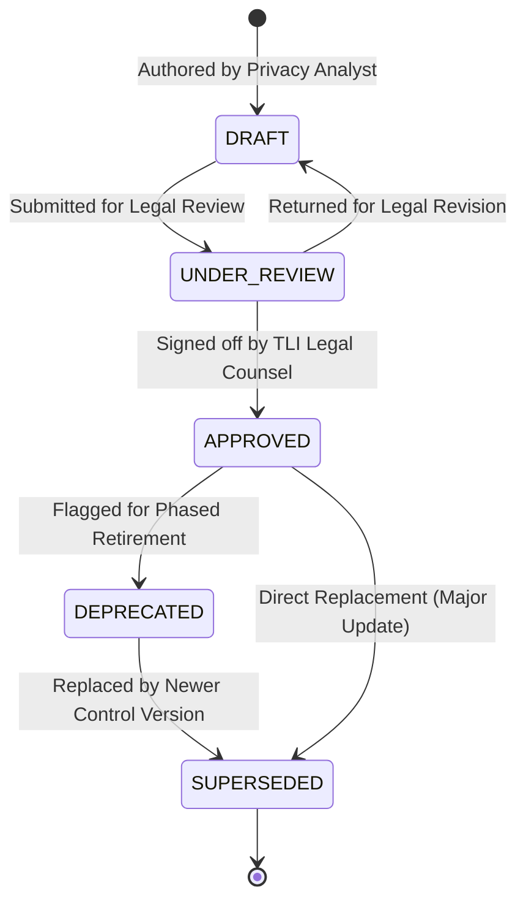
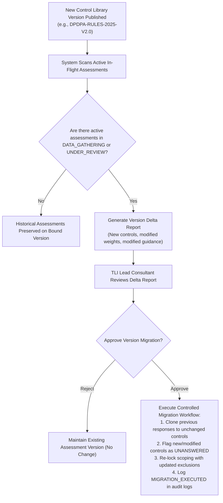

# 20. Control-Library Versioning and Change Management Procedure

**Project:** TLI DPDP Compliance Gap Analysis Tool  
**Framework Version:** `DPDPA-2023-V1.0`  
**Deliverable Ref:** Phase 2 Control-Library Versioning & Change Management  
**Status:** Canonical Standard — Version 1.0.0

---

## 1. Versioning Architecture & Guiding Principles

The legal framework and operational standards governing data protection evolve through legislative amendments, central rules notifications, judicial precedents, and regulatory advisories. 

To maintain forensic reproducibility and defensibility, the TLI platform enforces three versioning principles:
1. **Historical Immutability**: Once an assessment is issued or initiated under a specific control library version, **that assessment is permanently bound to that version**. Updates to the global library do not retroactively alter the questions, weights, or scoring rules of past assessments.
2. **Stable Identifiers, Versioned Definitions**:
   - `control_id` is permanent and invariant (e.g., `TLI-DPDP-NOT-01`).
   - `control_version` tracks substantive edits using Semantic Versioning (`MAJOR.MINOR.PATCH`).
3. **Controlled Version Transitions**: Active in-flight assessments can migrate to a newly published library version **only through an explicit, auditable migration workflow** approved by the assigned TLI Lead Consultant.

---

## 2. Control Lifecycle State Machine

Each control definition in the library progresses through an auditable lifecycle state machine:



### State Definitions
1. `DRAFT`: Newly authored or revised control definition in development. Cannot be bound to client assessments.
2. `UNDER_REVIEW`: Locked definition undergoing formal statutory review by TLI Legal Counsel and Methodology Leads.
3. `APPROVED`: Officially approved, immutable control version published in an active framework release (`framework_versions`). Available for client engagements.
4. `DEPRECATED`: Active in existing engagements but flagged for retirement in future assessments due to legal amendments.
5. `SUPERSEDED`: Formally replaced by a newer version (e.g., `v1.0.0` superseded by `v2.0.0`). Retained in the database for historical assessment reproducibility.

---

## 3. Semantic Versioning Rules (SemVer for Controls)

Changes to control definitions are governed by strict version increment rules:

| Version Change Type | Version Increment | Triggering Criteria | Impact on Active Assessments |
|---|:---:|---|---|
| **PATCH** | `1.0.0` $\rightarrow$ `1.0.1` | Editorial fixes, typo corrections, clarification of guidance, or addition of non-mandatory evidence examples that do not alter the legal threshold. | Transparently inherited by active assessments; does not alter scoring or applicability. |
| **MINOR** | `1.0.0` $\rightarrow$ `1.1.0` | Addition of new subordinate rule references, new recommended evidence types, or refined assessment questions reflecting new official regulatory guidance. | Opt-in migration for active assessments; backward-compatible. |
| **MAJOR** | `1.0.0` $\rightarrow$ `2.0.0` | Substantive statutory amendment, new penalty tier, fundamental change in legal ground (e.g. new gazetted rule modifying age verification), or altered scoring weight. | **Requires explicit framework release** (`DPDPA-RULES-2025-V2.0`). Existing assessments remain on `v1.0.0` unless explicitly migrated with Lead Consultant approval. |

---

## 4. Assessment Impact Analysis & Migration Procedure

When a new framework version (e.g., `v2.0.0`) is published, the platform executes an automated **Impact Analysis Protocol**:



### Rules Governing Historical Integrity
1. **Immutable Snapshots**: Issued reports (`report_snapshots`) store a cryptographic SHA-256 hash of the complete underlying assessment dataset and control version definitions.
2. **Reassessment Linking**: Rather than altering historical records, new compliance cycles (e.g. Year 2 Re-assessment) are initiated as new child assessments (`parent_assessment_id`), allowing side-by-side gap comparison between `Version 1.0` and `Version 2.0`.

---

## 5. Proposed Database Schema Adjustments for Phase 2

To support precise version pinning at the control level, the following minor schema enhancement is proposed for documentation in Phase 2 (to be integrated during Phase 2 DDL migration in Milestone 2.1):

```sql
-- Schema Refinement: Pin exact control version on assessment_controls
ALTER TABLE assessment_controls 
    ADD COLUMN pinned_control_version VARCHAR(20) NOT NULL DEFAULT '1.0.0';

-- Documentation of Schema Implication:
-- Rationale: Ensures that if a global control record is updated from v1.0.0 to v1.1.0, 
-- active assessment rows explicitly retain their pinned control version string, 
-- guaranteeing mathematical and audit reproducibility.
```

