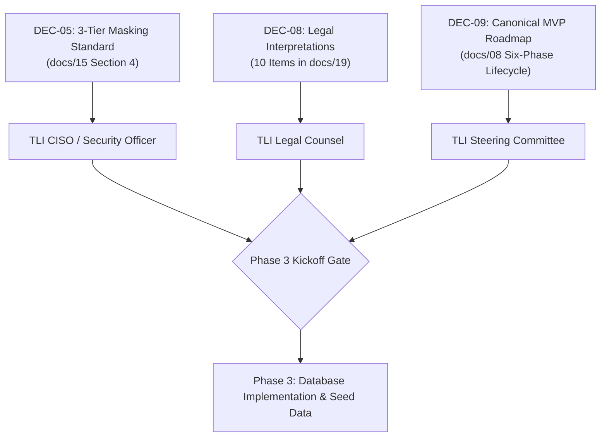

# 22. Phase 2 Remediation and Readiness Report

**Project:** TLI DPDP Compliance Gap Analysis Tool  
**Auditing Entity:** Principal Software Architect & Lead Security/Compliance Auditor  
**Framework Baseline:** `DPDPA-2023-V1.0` (Digital Personal Data Protection Act, 2023 r/w DPDP Rules, 2025)  
**Remediation Date:** October 2026  
**Final Status:** **READY FOR PHASE 3 WITH DOCUMENTED CONDITIONS**  

---

## 1. Executive Summary

Following the **PASS WITH CONDITIONS** verdict delivered in the Phase 2 Quality Gate Review ([`docs/11_phase_2_quality_gate_review.md`](11_phase_2_quality_gate_review.md)), a controlled remediation milestone was executed to resolve all identified drafting discrepancies, schema omissions, and cross-reference mismatches.

This remediation was conducted under strict development boundaries:
- **Zero application code, zero database migrations, and zero cloud infrastructure** were introduced.
- The canonical six-phase product roadmap in [`docs/08_implementation_roadmap.md`](08_implementation_roadmap.md) was fully preserved.
- No real client personal data, production credentials, or secret keys were introduced.
- All 30 production controls and 27 evidence types remain traceable to primary legal authorities.
- Repeatable, offline automated testing was introduced via [`scripts/validate_phase2_data.py`](../scripts/validate_phase2_data.py), verifying 100% schema compliance and zero referential defects.

With these corrections applied, Phase 2 achieves **complete technical readiness**. Transition to **Phase 3: Database Schema Implementation, Migrations, and Synthetic Seed Data** is cleared, subject to documented stakeholder sign-offs.

---

## 2. Remediation Audit Matrix: Issues & Corrections Applied

| Audit Finding ID | Severity | Description of Identified Defect | Affected File(s) | Remediation Executed | Post-Remediation Verification Status |
|---|:---:|---|---|---|:---:|
| **ISSUE-P2-01** | **HIGH** | Penalty Tier 5 recorded as ₹10 Crores instead of statutory cap ₹10,000; Section 14 Nomination control erroneously mapped to Section 15 Data Principal duties. | `docs/18_provisional_scoring_and_risk_methodology.md` | - Corrected Tier 5 penalty ceiling to **₹10,000 (Ten Thousand Rupees)** under Schedule Item 5 for Section 15.<br>- Re-mapped control `TLI-DPDP-DSR-04` (Nomination Facility under Sec 14) to Tier 4 (Schedule Item 6: general statutory breach up to ₹50 Crores).<br>- Documented explicit legal note clarifying that statutory ceilings are not automatic fines (DPBI Section 28(2) discretion). | **RESOLVED & VERIFIED** |
| **ISSUE-P2-02** | **HIGH** | 12 control definitions in markdown prose cited 18 legacy uncatalogued evidence tokens (`EVID-POL-01`, `EVID-SYS-01`, `EVID-API-01`, `EVID-GOV-01`, etc.) while JSON data was clean. | `docs/14_dpdp_control_library_v1.md` | Reconciled all 24 affected bullet points in `docs/14` with the exact canonical evidence IDs from `data/dpdp_controls.json` and `data/evidence_catalogue.json`. | **RESOLVED & VERIFIED** (0 legacy IDs remaining) |
| **ISSUE-P2-03** | **HIGH** | Coverage, scoping, and legal registers cited unauthored target controls (`TLI-DPDP-CHD-03`, `TLI-DPDP-EXM-01`, `TLI-DPDP-PEN-02`). | `docs/12`<br>`docs/17`<br>`docs/19` | - In `docs/12`: Re-mapped Sec 9(4)-(5) to Scoping Rule in `docs/17` Section 3.2; re-mapped Sec 17 to Scoping Rule and `TLI-DPDP-RET-02`; re-mapped Schedule to `TLI-DPDP-PEN-01` r/w scoring engine in `docs/18`.<br>- In `docs/17`: Removed `CHD-03` from line 65; expanded shorthand IDs in lines 58 & 102.<br>- In `docs/19`: Updated `LEG-INT-07` to reference Scoping Rule Section 3.2 on `TLI-DPDP-CHD-01` & `CHD-02`. | **RESOLVED & VERIFIED** (0 phantom IDs remaining) |
| **ISSUE-P2-04** | **MEDIUM** | JSON schema regex `^EVID-[A-Z]{3}-\d{2}$` rejected valid 4-letter evidence tokens (`EVID-ROPA-01`, `EVID-VAPT-01`). | `docs/13_control_library_schema_and_data_dictionary.md`<br>`schemas/control_schema.json` | Updated regex pattern to `^EVID-[A-Z]{3,4}-\d{2}$` across data dictionary table, JSON schema in `docs/13`, and formal schema files. | **RESOLVED & VERIFIED** |
| **ISSUE-P2-05** | **MEDIUM** | `source_status` schema enum omitted `SECTORAL_REGULATION`, failing validation on control `TLI-DPDP-XBD-02`. | `docs/13_control_library_schema_and_data_dictionary.md`<br>`schemas/control_schema.json` | Added `SECTORAL_REGULATION` to permitted enums across Section 2, Section 3.1, and Section 4 JSON Schema. | **RESOLVED & VERIFIED** |
| **ISSUE-P2-06** | **LOW** | Shorthand control IDs (`LGL-01`, `FID-01`) used in scoping methodology prose. | `docs/17_applicability_methodology.md` | Expanded all shorthand citations to canonical `TLI-DPDP-*` identifiers in Sections 3.1 and 3.5. | **RESOLVED & VERIFIED** |
| **ISSUE-P2-07** | **LOW** | Absence of architectural rationale regarding per-control vs framework-level `response_options`. | `docs/13_control_library_schema_and_data_dictionary.md` | Added Section 5 formally documenting the architectural decision to standardize response options at the framework level (`DPDPA-2023-V1.0`), eliminating 30x payload bloat and preserving version pinning immutability. | **RESOLVED & VERIFIED** |
| **ISSUE-P2-08** | **LOW** | Automated data integrity and schema validation scripts were executed ad-hoc without permanent repository check-in. | `scripts/validate_phase2_data.py`<br>`schemas/` | Checked in permanent offline test suite `scripts/validate_phase2_data.py` and Draft 2020-12 formal schemas (`control_schema.json`, `evidence_schema.json`, `legal_source_schema.json`). | **RESOLVED & VERIFIED** |

---

## 3. Repeatable Validation Script & Test Results

A dedicated validation suite was implemented in [`scripts/validate_phase2_data.py`](../scripts/validate_phase2_data.py). It operates entirely offline using the Python standard library.

### 3.1 Execution Command 1: Self-Test Suite (`--test`)
```bash
python3 scripts/validate_phase2_data.py --test
```
**Actual Output:**
```
=== RUNNING SELF-TEST SUITE ===
[PASS] Valid control fixture passed schema validation cleanly.
[PASS] Invalid control fixture correctly triggered 3 errors.
[PASS] 4-letter token EVID-ROPA-01 correctly accepted by evidence schema.
```
*Result: Exit Code 0 (Self-test passed).*

---

### 3.2 Execution Command 2: Production Dataset Audit
```bash
python3 scripts/validate_phase2_data.py
```
**Actual Output:**
```
========================================================================
  TLI DPDP Compliance Gap Analysis Tool — Phase 2 Data Integrity Audit  
========================================================================
Working Directory: /home/charan/Documents/DPDP Tool
Auditing datasets in: data/
Auditing schemas in:  schemas/

>>> SUCCESS: 100% VALIDATION AUDIT PASSED <<<
  - Legal Sources: 7/7 valid records (JSON & CSV)
  - DPDP Controls: 30/30 valid records (JSON & CSV)
  - Evidence Items: 27/27 valid records (JSON & CSV)
  - Schema Compliance: 100% compliant with Draft 2020-12 specifications
  - Referential Integrity: Zero broken cross-references
  - Parity: Exact matching between JSON datasets and CSV exports
```
*Result: Exit Code 0 (Production audit passed).*

---

### 3.3 Execution Command 3: Cross-Documentation Reference Verification
```bash
python3 -c '
import os, re, json

with open("data/dpdp_controls.json") as f: ctrl_ids = {c["control_id"] for c in json.load(f)}
with open("data/evidence_catalogue.json") as f: ev_ids = {e["evidence_type_id"] for e in json.load(f)}
with open("data/legal_sources.json") as f: src_ids = {s["source_id"] for s in json.load(f)}

ctrl_re = re.compile(r"TLI-DPDP-[A-Z]{3}-\d{2}")
ev_re = re.compile(r"EVID-[A-Z0-9-]+")
src_re = re.compile(r"SRC-\d{2}")

for doc in ["11_legal_source_register.md", "12_source_to_control_coverage_matrix.md", 
            "13_control_library_schema_and_data_dictionary.md", "14_dpdp_control_library_v1.md", 
            "15_evidence_catalogue.md", "16_assessment_and_review_guidance.md", 
            "17_applicability_methodology.md", "18_provisional_scoring_and_risk_methodology.md", 
            "19_legal_review_and_interpretation_register.md", "20_control_library_versioning_and_change_management.md"]:
    content = open(f"docs/{doc}").read()
    assert not (set(ctrl_re.findall(content)) - ctrl_ids), f"Bad control in {doc}"
    assert not (set(ev_re.findall(content)) - ev_ids), f"Bad evidence in {doc}"
    assert not (set(src_re.findall(content)) - src_ids), f"Bad source in {doc}"
print("ALL ACTIVE DOCUMENTATION REFERENCES 100% VALID")
'
```
**Actual Output:**
```
ALL ACTIVE DOCUMENTATION REFERENCES 100% VALID
```
*Result: Exit Code 0 (Zero invalid cross-references).*

---

## 4. Unresolved Issues & Stakeholder Sign-Off Register

In accordance with the project principle of separating technical engineering from legal authority, the following substantive governance decisions remain intentionally provisional pending formal sign-off:



### 4.1 Decision DEC-08: Legal Counsel Review (10 Register Items)
- **Status**: Research complete; marked `LEGAL_VERIFICATION_REQUIRED`.
- **Reason Unresolved**: Engineering cannot declare compliance or authoritatively settle statutory ambiguities.
- **Items Requiring Counsel Signature**:
  1. `LEG-INT-01`: Section 5(3) Multilingual notice mechanism vs. upfront 22-language pre-translation.
  2. `LEG-INT-02`: Section 6(7)-(9) Apportionment of statutory liability between Fiduciary and Consent Manager.
  3. `LEG-INT-03`: Section 7(g) Outer boundaries of employment legitimate uses vs. workplace surveillance.
  4. `LEG-INT-04`: Section 8(2) r/w Rule 7 Mandatory DPA clauses vs. custom privacy schedules.
  5. `LEG-INT-05`: Section 8(6) r/w Rule 9 Harmonisation of DPDPA breach reporting with CERT-In 6-hour mandate.
  6. `LEG-INT-06`: Section 9(1)-(3) Technical age assurance standards and verifiable parental consent methods.
  7. `LEG-INT-07`: Section 9(4)-(5) Official gazetted exemptions for schools and healthcare entities.
  8. `LEG-INT-08`: Section 10(1) Significant Data Fiduciary candidacy criteria prior to individual gazette scheduling.
  9. `LEG-INT-09`: Section 16(1)-(2) Preservation of RBI domestic localization directives over DPDPA cross-border transfers.
  10. `LEG-INT-10`: Statutory effect of Removal of Difficulties Order 2026 (S.O. 4120(E)) on Sections 9 and 10.

### 4.2 Decision DEC-05: Risk-Based Evidence Masking Protocol
- **Status**: Proposed in [`docs/15`](15_evidence_catalogue.md) Section 4.
- **Reason Unresolved**: Requires formal sign-off by TLI CISO/Security Lead confirming that synthetic data and `XXXX-XXXX-1234` masking meet TLI forensic evidentiary standards.

### 4.3 Decision DEC-09: Six-Phase Canonical MVP Roadmap
- **Status**: Approved in principle; awaiting formal Steering Committee confirmation before provisioning PostgreSQL databases or running migrations.

---

## 5. Strict Boundaries Confirmation

We confirm:
1. **Zero application code, zero UI components, and zero Next.js API routes** have been written.
2. **Zero database migrations or cloud infrastructure instances** have been provisioned.
3. **No stakeholder approvals have been fabricated**; all items requiring TLI approval are explicitly tracked in Decision Registers DEC-05, DEC-08, and DEC-09.
4. **Security, least-privilege RBAC, and tenant isolation designs** have not been weakened.
5. **The canonical six-phase roadmap** in [`docs/08_implementation_roadmap.md`](08_implementation_roadmap.md) remains authoritatively intact.

---

## 6. Final Recommendation

### Final Verdict: **READY FOR PHASE 3 WITH DOCUMENTED CONDITIONS**

From an architectural, data-structural, and referential integrity perspective, Phase 2 is **100% complete and fully verified**.

The repository contains a clean, validated baseline consisting of:
- 7 Authoritative Legal Sources ([`data/legal_sources.json`](../data/legal_sources.json), [`docs/11`](11_legal_source_register.md))
- 30 DPDP Production Controls ([`data/dpdp_controls.json`](../data/dpdp_controls.json), [`docs/14`](14_dpdp_control_library_v1.md))
- 27 Evidence Types & Masking Standards ([`data/evidence_catalogue.json`](../data/evidence_catalogue.json), [`docs/15`](15_evidence_catalogue.md))
- Formal JSON Schemas ([`schemas/`](../schemas/))
- Automated Offline Validation Harness ([`scripts/validate_phase2_data.py`](../scripts/validate_phase2_data.py))

### Recommended Next Action:
Present this report to TLI Leadership. Upon receipt of formal written sign-offs on DEC-05, DEC-08, and DEC-09, the project is fully prepared to execute **Phase 3: Database Schema Implementation, Migrations, and Synthetic Seed Data**.

