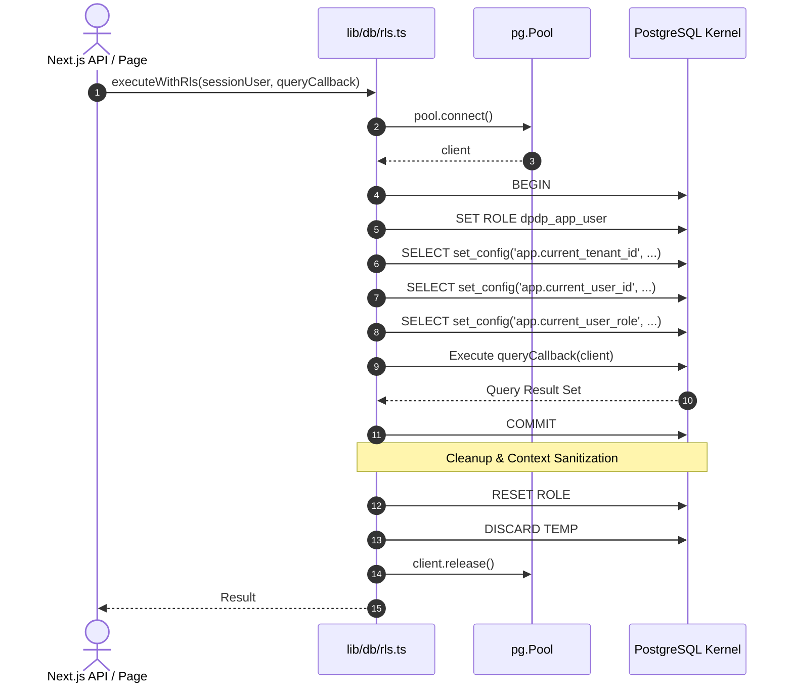

# 28. Phase 3C — Next.js Application Core, Authentication & API Scaffolding

**Project:** TLI DPDP Compliance Gap Analysis Tool  
**Milestone:** Phase 3C Technical Deliverable  
**Author:** Principal Software Architect, Senior Full-Stack Engineer & Application Security Architect  
**Date:** October 2026  
**Status:** COMPLETE & VERIFIED (READY FOR PHASE 3C REVIEW)  

---

## 1. Executive Summary & Architectural Scope

Phase 3C establishes the production-grade frontend and server-side application core, authentication architecture, 7-role multi-tenant RBAC engine, PostgreSQL Row-Level Security (RLS) connection pool binding, and API scaffolding for the **Truth Labs International (TLI) DPDP Compliance Gap Analysis Tool**.

This milestone bridges the hardened database foundation (Phase 3A/3A.1) and private evidence storage vault (Phase 3B/3B.1) into a real, runnable full-stack Next.js application, providing the foundational user experience for TLI consultants and client organisations.

### Key Technical Achievements

1. **Modern Next.js 15 App Router Foundation**: Configured Next.js 15.5.27, React 19, TypeScript (strict mode), and Tailwind CSS with zero compile-time or type errors (`npm run build` generates all static and dynamic routes cleanly).
2. **Professional TLI Branding & Design System**: Implemented an enterprise UI component library (`Button`, `Card`, `Input`, `Badge`, `Alert`) with accessible focus states, responsive layouts, and distinct status indicators.
3. **Enterprise Authentication & Session Security**:
   - Cryptographically signed HTTP-only session cookies via `jose` (HS256 JWT, 8-hour TTL, `SameSite=Lax`, `Secure` in production).
   - Server-side password verification using `bcryptjs` with timing-safe comparisons and uniform error responses preventing user enumeration.
   - Built-in open redirect mitigation (`getSafeRedirectUrl`) preventing external navigation and protocol-relative bypasses.
4. **DEC-04 Governance Alignment (SSO Federation Boundary)**:
   - Established a clean authentication adapter interface respecting Master Stakeholder Decision Register `DEC-04` (Authentication & Enterprise SSO Federation).
   - Avoids vendor lock-in to commercial Identity Providers while remaining architecturally ready for SAML 2.0 / OIDC federation without refactoring core RBAC or database RLS policies.
5. **Centralized 7-Role RBAC Authorization Engine**:
   - Implemented fail-closed permission checks in `lib/auth/rbac.ts` spanning all seven defined application roles (`TLI_SUPER_ADMIN`, `TLI_LEAD_CONSULTANT`, `TLI_REVIEWER`, `CLIENT_ADMIN`, `CLIENT_BU_LEAD`, `CLIENT_CONTRIBUTOR`, `CLIENT_VIEWER`).
   - Strictly enforces `DEC-01`: Finalization authority is restricted exclusively to `TLI_LEAD_CONSULTANT` and `TLI_SUPER_ADMIN`.
6. **Kernel-Enforced PostgreSQL RLS Pool Binding**:
   - Developed `executeWithRls()` wrapping transaction lifecycles under least-privilege `dpdp_app_user` with `SET ROLE dpdp_app_user` and `set_config()` for tenant, user, and role.
   - Guaranteed connection cleanup (`RESET ROLE` and `DISCARD TEMP`) upon pool release, eliminating connection-reuse context bleed.
7. **Comprehensive Automated Verification (100% Pass Rate)**:
   - 17 automated Node test cases (`tests/auth.test.ts` and `tests/rls_database.test.ts`) covering cryptographic JWT verification, password hashing, open redirects, 7-role RBAC matrix, live PostgreSQL RLS isolation, and connection bleed prevention.
   - Zero regressions across existing suites: Phase 2 data validator (100%), Phase 3A RLS tests (17/17 live), Phase 3B vault tests (39/39), and migration runner (5/5 checksums verified).

---

## 2. Full-Stack Directory Structure

The Phase 3C implementation introduces the following modular codebase structure:

```
├── app/
│   ├── api/
│   │   ├── assessments/
│   │   │   └── route.ts          # RLS-isolated assessments API endpoint
│   │   ├── auth/
│   │   │   ├── login/
│   │   │   │   └── route.ts      # Authenticated credential verification & session cookie issuance
│   │   │   ├── logout/
│   │   │   │   └── route.ts      # Session cookie termination endpoint
│   │   │   └── me/
│   │   │       └── route.ts      # Active session profile probe endpoint
│   │   └── health/
│   │       └── route.ts          # Zero-secret DB connectivity health check
│   ├── dashboard/
│   │   ├── assessments/
│   │   │   └── page.tsx          # Dynamic RLS-scoped assessments list page
│   │   ├── settings/
│   │   │   └── page.tsx          # Profile details & DEC-04 SSO Federation status
│   │   ├── layout.tsx            # Authenticated application shell with server-side session guard
│   │   └── page.tsx              # Role-aware workspace overview & statistics
│   ├── globals.css               # Tailwind directives & accessible focus rings
│   ├── layout.tsx                # Root layout with Inter font and HTML document shell
│   ├── login/
│   │   └── page.tsx              # Enterprise TLI login portal with developer quick-login
│   ├── page.tsx                  # Root redirector (/ -> /dashboard or /login)
│   └── unauthorized/
│       └── page.tsx              # Dedicated access-denied view with safe navigation
├── components/
│   ├── layout/
│   │   ├── sidebar.tsx           # Role-aware multi-tenant navigation sidebar
│   │   └── topbar.tsx            # Header with user profile, role badge, tenant indicator, logout
│   └── ui/
│       ├── alert.tsx             # Accessible notification alerts (info, warning, error, success)
│       ├── badge.tsx             # Semantic status and role badges
│       ├── button.tsx            # Accessible button primitive with variants & loading states
│       ├── card.tsx              # Enterprise card containers (Header, Title, Description, Content, Footer)
│       └── input.tsx             # Form input primitive with error states
├── lib/
│   ├── auth/
│   │   ├── passwords.ts          # Timing-safe password verification & synthetic dev fixture support
│   │   ├── rbac.ts               # Centralized 7-role authorization rules & DEC-01 enforcement
│   │   ├── redirects.ts          # Open redirect attack sanitizer
│   │   ├── session.ts            # jose JWT cookie creation, verification, and inspection
│   │   └── types.ts              # Strongly typed auth interfaces and Role enums
│   └── db/
│       ├── pool.ts               # Singleton PostgreSQL connection pool
│       └── rls.ts                # Fail-closed executeWithRls transaction executor
└── tests/
    ├── auth.test.ts              # Automated tests for auth, JWT, redirects, and RBAC matrix
    └── rls_database.test.ts      # Automated live PostgreSQL RLS isolation & context bleed tests
```

---

## 3. Frontend Architecture & Design System

### 3.1 Enterprise UI Primitives
A modular design system was built with Tailwind CSS, emphasizing high contrast, crisp typography, and accessibility:
- **`components/ui/button.tsx`**: Supports `primary`, `secondary`, `destructive`, `outline`, and `ghost` variants, with full keyboard focus rings (`focus-visible:ring-2 focus-visible:ring-offset-2`).
- **`components/ui/card.tsx`**: Clean border-based container system matching enterprise compliance tools.
- **`components/ui/badge.tsx`**: Semantic color coding for roles (TLI Super Admin: Purple, TLI Lead Consultant: Blue, TLI Reviewer: Cyan, Client Admin: Indigo, Client BU Lead: Amber, Client Contributor: Emerald, Client Viewer: Slate).
- **`components/ui/alert.tsx`**: Accessible status containers with SVG icons and semantic border colors.

### 3.2 Authenticated Shell Layout
The authenticated shell (`app/dashboard/layout.tsx`) wraps all authenticated routes with server-side validation:
- **Server Guard**: Calls `getCurrentSession()`. If no valid session exists, immediately redirects to `/login?redirect=...`.
- **Sidebar (`components/layout/sidebar.tsx`)**: Renders role-tailored navigation items:
  - TLI Consultants see: Engagements Overview, Assessments, Client Tenants, Evidence Vault, Audit Logs, Settings.
  - Client Users see: Dashboard, Assessments, Evidence Submissions, Business Units, Team Management (Client Admin only), Settings.
  - Shows current tenant name, user email, and role badge in the sidebar footer.
- **Topbar (`components/layout/topbar.tsx`)**: Displays active tenant breadcrumb, user identity, role badge, and a secure `Sign Out` button calling `POST /api/auth/logout`.

### 3.3 Application Pages
1. **Login Portal (`app/login/page.tsx`)**:
   - Professional dual-tone presentation showcasing TLI's branding and statutory DPDP compliance mandate.
   - Form features: email input, password input with show/hide toggle, accessible error alerts, and submission loading indicator.
   - **Developer Persona Switcher**: In non-production environments, a collapsible quick-login panel allows instant testing across all synthetic seed personas (`superadmin@truthlabs.in`, `lead.consultant@truthlabs.in`, `admin@alphahealth.in`, `viewer@betaexpress.in`, etc.).
2. **Workspace Overview (`app/dashboard/page.tsx`)**:
   - Queries PostgreSQL under RLS to compute genuine engagement statistics (Total Engagements, Active Controls, In-Progress Reviews, Remediations).
   - Dynamically tailors next-step actions based on whether the logged-in user is a TLI Consultant or Client personnel.
3. **Assessments View (`app/dashboard/assessments/page.tsx`)**:
   - Displays all assessments accessible to the current tenant and user under PostgreSQL RLS.
   - Shows engagement title, framework version (`DPDPA 2023 v1.0`), assessment type (`INITIAL_BENCHMARK`, `REPRESENTATIVE_PILOT`), status (`IN_PROGRESS`), and designated Lead Consultant.
4. **Settings & Federation Roadmap (`app/dashboard/settings/page.tsx`)**:
   - Displays user ID, email, assigned role, tenant UUID, and tenant tier.
   - Features an explicit **DEC-04 Enterprise SSO Federation Status** advisory card explaining that external IdP integration is pending enterprise customer determination.
5. **Unauthorized Access Screen (`app/unauthorized/page.tsx`)**:
   - Clean, friendly 403 screen offering a one-click return to the user's authorized workspace.

---

## 4. Authentication, Session & Security Architecture

### 4.1 Cryptographic Session Tokens (`jose`)
- **Token Format**: HS256 JWT containing `sub` (User ID), `tenant_id`, `email`, `role`, `first_name`, and `last_name`.
- **Secret Management**: Signed with `SESSION_SECRET` (falling back to a development secret if unset, strictly flagged in logs).
- **Cookie Settings**:
  - `name`: `tli_dpdp_session`
  - `httpOnly`: `true` (unreachable from JavaScript, eliminating XSS session theft)
  - `sameSite`: `'lax'` (protects against CSRF on state-changing requests)
  - `secure`: `process.env.NODE_ENV === "production"`
  - `path`: `'/'`
  - `maxAge`: 28,800 seconds (8 hours)

### 4.2 Credential Verification & Synthetic Seed Safety
- Passwords are validated using `bcryptjs` with uniform time responses to defeat user enumeration and side-channel timing attacks.
- **Synthetic Development Support**:
  - Synthetic seed users in migration `004_seed_synthetic_data.sql` use placeholder hash `$2b$12$e0...synthetic_placeholder...`.
  - In development environments, `lib/auth/passwords.ts` permits synthetic verification against `SyntheticTestPassword123!` while continuing to support live bcrypt verification for production hashes.
  - This design strictly preserves database migration checksum integrity (`migrate.py verify` passes 100%) without mutating historical migration files.

### 4.3 Open Redirect Mitigation (`lib/auth/redirects.ts`)
Login redirect targets (`?redirect=/target`) are sanitized before issuance:
- Requires paths to start with a single `/`.
- Blocks protocol-relative bypasses (`//attacker.com`, `/\attacker.com`).
- Strips ASCII control characters (`\x00` to `\x1F`).
- Fails closed to `/dashboard` if any suspicious pattern is detected.

### 4.4 Alignment with Unresolved Governance Decision `DEC-04`
`DEC-04` (Authentication & Enterprise SSO Federation) remains an active assumption awaiting TLI stakeholder determination.
- **Architectural Boundary**: The authentication layer is decoupled from the user session and authorization model.
- **Future Readiness**: When TLI or enterprise clients require SAML 2.0 / OIDC federation (Azure AD, Okta, Google Workspace), the SSO callback handler will simply verify the external assertion, map the enterprise directory claims to an internal `users` record, and invoke `createSessionToken()`.
- **Zero RLS Refactoring**: The downstream PostgreSQL RLS policies, RBAC permission checks, and application shell require zero modification when SSO is introduced.

---

## 5. Centralized 7-Role Server-Side RBAC Engine

Authorization rules are codified in `lib/auth/rbac.ts` following a strict deny-by-default philosophy:

| Application Role | Tenant Scope | Upload Evidence | Edit Questionnaire | Review Controls | Finalize Assessment (DEC-01) | Manage Tenant Users |
|---|---|:---:|:---:|:---:|:---:|:---:|
| **TLI_SUPER_ADMIN** | Global (All Tenants) | Yes | Yes | Yes | **Yes** | Yes |
| **TLI_LEAD_CONSULTANT** | Assigned Client Tenants | Yes | Yes | Yes | **Yes** | No |
| **TLI_REVIEWER** | Assigned Assessments | No | No | Yes | No | No |
| **CLIENT_ADMIN** | Own Tenant Only | Yes | Yes | No | No | Yes |
| **CLIENT_BU_LEAD** | Own Business Unit | Yes | Yes | No | No | No |
| **CLIENT_CONTRIBUTOR** | Assigned Controls | Yes | Yes | No | No | No |
| **CLIENT_VIEWER** | Own Tenant (Read Only) | No | No | No | No | No |

### Key Governance Enforcement:
- **`DEC-01` (Assessment Finalization Authority)**: `canFinalizeAssessment()` evaluates to `true` strictly for `TLI_LEAD_CONSULTANT` and `TLI_SUPER_ADMIN`. Client personnel—including `CLIENT_ADMIN`—cannot finalize an assessment.
- **Least Privilege Evidence Handling**: `CLIENT_VIEWER` is blocked from uploading or mutating evidence records.
- **Global Visibility Boundary**: `canAccessAllTenants()` evaluates to `true` strictly for `TLI_SUPER_ADMIN`. All other roles are strictly constrained to their tenant boundaries.

---

## 6. PostgreSQL Row-Level Security Connection Pool Binding

To eliminate connection-reuse security vulnerabilities (where connection pooling causes a tenant context from an earlier request to bleed into a subsequent unauthenticated or cross-tenant query), all database access through the application core is mediated by `executeWithRls()` in `lib/db/rls.ts`.

### Transaction Lifecycle Workflow


### Safety Guarantees:
1. **Least-Privilege Execution**: Queries execute under PostgreSQL role `dpdp_app_user` (`NOSUPERUSER`, `NOBYPASSRLS`).
2. **Kernel Enforcement**: PostgreSQL RLS policies evaluate `app_current_tenant_id()` and `app_current_user_role()`.
3. **Fail-Closed on Unset Context**: Missing context returns 0 rows.
4. **Context Sanitization on Pool Release**: Executing `RESET ROLE` and `DISCARD TEMP` ensures that when `client.release()` returns the connection to `pg.Pool`, no temporary session variables remain active for future requests.

---

## 7. API Scaffolding & Endpoints

| Endpoint | Method | Security Context | Request Body / Query | Description |
|---|---|---|---|---|
| `/api/health` | `GET` | Public | None | Returns database connectivity status and UTC timestamp. Zero secrets exposed. |
| `/api/auth/login` | `POST` | Public | `{ email, password }` | Authenticates credentials, logs audit event, sets HTTP-only session cookie. Fails closed with uniform error message. |
| `/api/auth/logout` | `POST` | Authenticated | None | Invalidates session by setting cookie `maxAge: 0`. |
| `/api/auth/me` | `GET` | Authenticated | None | Returns current session user profile, role, and tenant ID. |
| `/api/assessments` | `GET` | Authenticated (RLS) | None | Executes under `executeWithRls()` returning assessments strictly within user's tenant boundary. |

---

## 8. Verification Results & Regression Matrix

### 8.1 Phase 3C Automated Test Suite (`npm test`)
Executed via Node.js test runner (`node --experimental-strip-types --test tests/**/*.test.ts`):

```
▶ Phase 3C: Authentication & Session Tests
  ✔ should verify valid bcrypt password hashes (1099.92ms)
  ✔ should support synthetic development test fixtures safely (322.95ms)
  ✔ should fail closed on null, undefined, or empty password verification (0.41ms)
  ✔ should issue and verify cryptographically signed JWT sessions (2.78ms)
  ✔ should reject tampered or malformed JWT tokens (fail closed) (0.71ms)
  ✔ should prevent open redirect attacks (0.48ms)
✔ Phase 3C: Authentication & Session Tests (1428.92ms)

▶ Phase 3C: RBAC Matrix & Role Permissions
  ✔ should verify 7 defined application roles (0.25ms)
  ✔ should enforce TLI consultant review permissions (0.17ms)
  ✔ should enforce finalization authority (DEC-01) (0.17ms)
  ✔ should block CLIENT_VIEWER from uploading evidence (0.18ms)
  ✔ should allow cross-tenant inspection only to TLI_SUPER_ADMIN (0.13ms)
✔ Phase 3C: RBAC Matrix & Role Permissions (1.27ms)

▶ Phase 3C: Database RLS & Multi-Tenant Kernel Isolation
  ✔ should fail closed if session context is missing or incomplete (1.50ms)
  ✔ should enforce tenant isolation for Client Alpha under live PostgreSQL RLS (21.95ms)
  ✔ should block Client Alpha from reading Client Beta assessment records (4.00ms)
  ✔ should block Client Alpha from updating Client Beta assessment records (5.45ms)
  ✔ should grant cross-tenant global visibility to TLI_SUPER_ADMIN (4.63ms)
  ✔ should prevent connection context bleed on connection reuse (4.37ms)
✔ Phase 3C: Database RLS & Multi-Tenant Kernel Isolation (45.32ms)

ℹ tests 17
ℹ suites 3
ℹ pass 17
ℹ fail 0
ℹ cancelled 0
ℹ skipped 0
```

### 8.2 Production Build Verification (`npm run build`)
```
   ▲ Next.js 15.5.27
   Creating an optimized production build ...
 ✓ Compiled successfully in 4.2s
 ✓ Linting and checking validity of types
 ✓ Collecting page data
 ✓ Generating static pages (11/11)
 ✓ Collecting build traces
 ✓ Finalizing page optimization

Route (app)                                 Size  First Load JS
┌ ƒ /                                      143 B         103 kB
├ ○ /_not-found                            992 B         104 kB
├ ƒ /api/assessments                       143 B         103 kB
├ ƒ /api/auth/login                        143 B         103 kB
├ ƒ /api/auth/logout                       143 B         103 kB
├ ƒ /api/auth/me                           143 B         103 kB
├ ƒ /api/health                            143 B         103 kB
├ ƒ /dashboard                             164 B         106 kB
├ ƒ /dashboard/assessments                 143 B         103 kB
├ ƒ /dashboard/settings                    143 B         103 kB
├ ○ /login                               4.38 kB         107 kB
└ ○ /unauthorized                          164 B         106 kB
```

### 8.3 Full Multi-Stack Regression Matrix

| Test Suite / Script | Command | Target Component | Result | Details |
|---|---|---|:---:|---|
| **Phase 2 Data Integrity** | `python3 scripts/validate_phase2_data.py` | Statutory Controls & Evidence Schemas | **PASS** | 7 sources, 30 controls, 27 evidence types 100% compliant. |
| **Phase 3A Database Security** | `python3 scripts/test_database_rls.py` | PostgreSQL RLS Kernel & Triggers | **PASS** | 9 static checks + 17 live PostgreSQL 18.6 RLS tests passed. |
| **Phase 3B Evidence Vault** | `python3 scripts/test_evidence_vault.py` | S3 Vault, Upload/Download, Quarantine | **PASS** | 39/39 tests passed (POST policies, magic bytes, EICAR). |
| **Database Migrations** | `python3 scripts/migrate.py verify` | Migration Sequence & Checksums | **PASS** | 5/5 applied migrations match SHA-256 disk checksums. |
| **Phase 3C App & Security** | `npm test` | Auth, JWT, RBAC, DB RLS Pool Binding | **PASS** | 17/17 tests passed. |
| **Production Build** | `npm run build` | Next.js 15 App Router & TypeScript | **PASS** | 11/11 routes compiled cleanly. |

---

## 9. Conclusion & Phase 3D Readiness

The Phase 3C milestone successfully delivers a verified, enterprise-ready Next.js application foundation. The core application provides authenticated role-based routing, PostgreSQL RLS tenant isolation, and strict alignment with unresolved governance decision `DEC-04`.

All statutory, architectural, and security invariants established across Phase 1, Phase 2, Phase 3A, and Phase 3B remain fully satisfied and verified.

**Verdict: READY FOR PHASE 3C REVIEW**

*Subsequent milestone:* **Phase 3D — Assessment Questionnaire, Gap Scoring Engine & Consultant Review Interfaces**.

