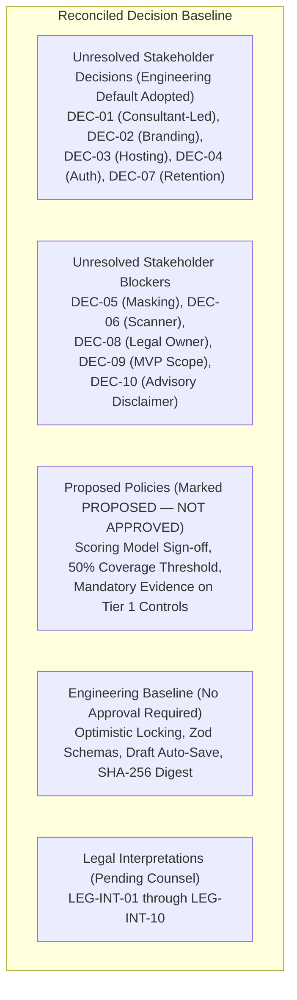

# 32. Phase 3D — Governance, Legal Mapping and Implementation Readiness Review

**Project:** TLI DPDP Compliance Gap Analysis Tool  
**Milestone:** Phase 3D.0.1 Scoring Governance, Legal Mapping & Implementation Readiness Review  
**Author:** Principal Software Architect, Application Security Architect & Lead Backend Engineer  
**Date:** October 2026 (Refined Milestone 3D.0.2)  
**Status:** **GOVERNANCE & READINESS REVIEW (PRE-IMPLEMENTATION GATE)**  
**Verdict:** **READY FOR PHASE 3D.1 FOUNDATION ONLY**  

---

## 1. Executive Summary & Review Scope

This review conducts a rigorous governance audit, statutory penalty mapping verification, and mathematical specification check of the Phase 3D implementation plan ([`docs/31`](31_phase_3d_assessment_workflow_implementation_plan.md)) for the **Truth Labs International (TLI) DPDP Compliance Gap Analysis Tool**.

Before creating any Phase 3D application features or database migrations, this review verifies:
1. **Canonical Decision-Register Alignment**: Complete reconciliation against [`docs/09_unresolved_decisions_and_tl_assumptions.md`](file:///home/charan/Documents/DPDP%20Tool/docs/09_unresolved_decisions_and_tl_assumptions.md) and [`docs/19_legal_review_and_interpretation_register.md`](file:///home/charan/Documents/DPDP%20Tool/docs/19_legal_review_and_interpretation_register.md), confirming that all 10 canonical decisions remain unresolved stakeholder decisions where recommended defaults have been adopted as working architectural baselines, but formal stakeholder approvals are still pending.
2. **Statutory Penalty Mapping Fidelity**: Verification of penalty tier ceilings under DPDPA 2023 Section 33(1) and the Schedule, distinguishing statutory ceilings from automatic fines, and auditing enactment, commencement, and Section 28(2) mitigating factors.
3. **Deterministic Scoring Mathematics**: Formal specification of the non-compensatory dual-metric model, 13-domain weighting, zero-denominator edge-case handling, assessment coverage percentages, perception gap deltas, and three provisional worked synthetic examples.
4. **Evidence Vault & Concurrency Controls**: Inspection of Phase 3B storage interfaces, client redaction certification status, presigned URL lifecycles, fail-closed quarantine enforcement, and optimistic locking tokens.
5. **Repository Baseline & Working Tree Status**: Audit of active Git status, uncommitted Phase 3C.2 security fixes, and commit readiness.

---

## 2. Canonical Decision-Register Reconciliation

An inspection of `docs/09_unresolved_decisions_and_tl_assumptions.md` and Git history confirms that **no formal stakeholder sign-offs have been recorded in Git** for DEC-01 through DEC-10. All 10 items remain unresolved stakeholder decisions:

### 2.1 Reconciled Decision Status Table

| Ref | Canonical Topic | Recommended Default in Register | Actual Status in Repository | Implementation Impact |
|---|---|---|:---:|---|
| **DEC-01** | Consultant-Led vs. Standalone Self-Service | Consultant-Led Engagement Model | **UNRESOLVED (ACTIVE DEFAULT)** | Enforced in code: clients cannot approve/issue final reports. |
| **DEC-02** | Report Branding & Co-Branding Authority | TLI Forensic Audit Branding Only | **UNRESOLVED (ACTIVE DEFAULT)** | Blocks Phase 5 report templates. |
| **DEC-03** | Cloud Hosting Provider & Data Residency | AWS ap-south-1 (Mumbai) | **UNRESOLVED (ACTIVE DEFAULT)** | Blocks Phase 6 production cloud deployment. |
| **DEC-04** | Authentication & Enterprise SSO Federation | Phased Auth (email/pwd + TOTP; SAML later) | **UNRESOLVED (ACTIVE DEFAULT)** | Implemented in Phase 3C application shell. |
| **DEC-05** | Evidence Handling & PII Masking Policy | Risk-Based Masking, prohibit unmasked Aadhaar/PAN | **UNRESOLVED (BLOCKER)** | Technical checkbox exists; policy sign-off pending. |
| **DEC-06** | Evidence Antivirus & Malware Scanning | AWS GuardDuty S3 Malware Protection / ClamAV | **UNRESOLVED (ACTIVE DEFAULT)** | Blocks Phase 3 production scan pipeline. |
| **DEC-07** | Data Retention & Historical Snapshot Immutability | 5-Year Retention with WORM Object Lock | **UNRESOLVED (ACTIVE DEFAULT)** | Blocks Phase 5 snapshot locking. |
| **DEC-08** | Legal Review Ownership & Rules Integration | TLI Legal Advisory Sign-off on library | **UNRESOLVED (BLOCKER)** | Must be formally owned before Phase 2 completion. |
| **DEC-09** | Approved MVP Scope & Acceptance Criteria | Six-Phase Canonical MVP | **UNRESOLVED (BLOCKER)** | Governs project roadmap scope. |
| **DEC-10** | Statutory Legal Disclaimer Language | Approved Standard Advisory Disclaimer | **UNRESOLVED (ACTIVE DEFAULT)** | Blocks Phase 5 report generation. |

> [!CAUTION]
> **GOVERNANCE STATUS RE-AFFIRMATION**: The scoring model approval, 50% minimum coverage threshold, high-weight-control mandatory evidence rules, and executive disclaimer text are explicitly classified as **PROPOSED — NOT APPROVED**. They are treated as engineering proposals and are **NOT** represented as settled policy.

---

## 3. Statutory Penalty Mapping Audit

### 3.1 Statutory Framework & Enactment Reality
Under Section 33(1) and the Schedule of the Digital Personal Data Protection Act, 2023:
Parliament established maximum monetary penalty limits across six discrete statutory items:

| Schedule Item | Statutory Authority | Prescribed Maximum Ceiling | Triggering Provisions | Mapped Canonical Controls | Enactment & Status |
|---|---|:---:|---|---|---|
| **Item 1 (Tier 1)** | Sec 33(1) r/w Sched Item 1 | **₹250 Crores** | Sec 8(5) (Failure to take reasonable security safeguards to prevent data breach) | `TLI-DPDP-SEC-01` `TLI-DPDP-SEC-02` | **Enacted; Phased commencement**. Statutory ceiling. Subject to DPBI Section 28(2) mitigating factors. |
| **Item 2 & 3 (Tier 2)** | Sec 33(1) r/w Sched Items 2 & 3 | **₹200 Crores** | Sec 8(6) (Failure to notify Board/Principals of breach) Sec 9 (Breach of obligations in respect of children) | `TLI-DPDP-BRC-01..02` `TLI-DPDP-CHD-01..02` | **Enacted; Phased commencement**. Statutory ceiling. Section 9 subject to executive exemptions (Sec 9(4)-(5)). |
| **Item 4 (Tier 3)** | Sec 33(1) r/w Sched Item 4 | **₹150 Crores** | Sec 10 (Breach of Significant Data Fiduciary obligations) | `TLI-DPDP-SDF-01..02` | **Enacted; Phased commencement**. Conditional: applies **only** to entities notified as SDF by Central Government under Sec 10(1). |
| **Item 6 (Tier 4)** | Sec 33(1) r/w Sched Item 6 | **₹50 Crores** | Sections 5, 6, 8(1)-(3), 8(7)-(8), 11-14, 16 (General statutory breaches) | `TLI-DPDP-SCO-01` `TLI-DPDP-NOT-01..03` `TLI-DPDP-CON-01..03` `TLI-DPDP-RET-01..02` `TLI-DPDP-DSR-01..04` `TLI-DPDP-XBD-01..02` `TLI-DPDP-PEN-01` | **Enacted; Phased commencement**. Residual general statutory ceiling under Schedule Item 6. |
| **Item 5 (Tier 5)** | Sec 33(1) r/w Sched Item 5 | **₹10,000** | Sec 15 (Breach in observance of duties of Data Principal) | `TLI-DPDP-DSR-01` (Advisory Note only) | **Enacted; Phased commencement**. Applies **exclusively to individual Data Principals**, NOT Data Fiduciaries. Zero enterprise controls mapped. |

### 3.2 Critical Legal Audit Principles
1. **Statutory Ceilings $\ne$ Automatic Liabilities**: The ₹250 Crore, ₹200 Crore, and ₹50 Crore figures represent the **statutory maximum ceiling** prescribed by Parliament under Section 33(1). Under no circumstances does a gap on a control automatically trigger the maximum statutory penalty.
2. **Mandatory Mitigating Factors (Section 28(2))**: The Data Protection Board of India (DPBI) is statutorily required to consider mitigating factors: nature, gravity, duration of breach, type of data, repetitive nature, financial gain realized, and proactive mitigation steps taken.
3. **Phased Commencement Reality**: DPDPA 2023 was enacted in August 2023 under phased commencement (`SRC-01`). Section 33 enforcement is contingent upon the establishment and operational gazetting of the DPBI.
4. **Platform Language Mandate**: The platform never presents ₹250 Crores as a confirmed fine. It is displayed strictly as a **"Potential Statutory Maximum Penalty Ceiling"** for executive awareness.

---

## 4. Deterministic Scoring Ambiguities & Mathematical Specification

### 4.1 Canonical Database Domain Weights Reconciliation
An audit of `control_domains` in [`migrations/003_seed_canonical_library.sql`](file:///home/charan/Documents/DPDP%20Tool/migrations/003_seed_canonical_library.sql) confirms exactly **13 canonical domains** with explicit database weights $W_D$:

| Domain Identifier | Database Weight ($W_D$) | Canonical Controls Count | Total Control Weight Sum ($\sum W_c$) |
|---|:---:|:---:|:---:|
| `NOTICE_TRANSPARENCY` | 1.25 | 4 (`SCO-01`, `NOT-01..03`) | 4.00 |
| `LEGITIMATE_USES` | 1.00 | 3 (`LGL-01`, `LEG-01..02`) | 3.00 |
| `CONSENT_MANAGEMENT` | 1.25 | 3 (`CON-01..03`) | 3.00 |
| `FIDUCIARY_DUTIES` | 1.00 | 2 (`FID-01..02`) | 2.00 |
| `PROCESSOR_OVERSIGHT` | 1.00 | 1 (`PRO-01`) | 1.00 |
| `SECURITY_SAFEGUARDS` | 1.50 | 2 (`SEC-01..02`) | 3.00 (1.50 each) |
| `BREACH_READINESS` | 1.50 | 2 (`BRC-01..02`) | 2.50 (1.25 each) |
| `RETENTION_ERASURE` | 1.00 | 2 (`RET-01..02`) | 2.00 |
| `DATA_PRINCIPAL_RIGHTS` | 1.25 | 4 (`DSR-01..04`) | 4.00 |
| `CHILDREN_DISABLED_DATA` | 1.25 | 2 (`CHD-01..02`) | 2.50 (1.25 each) |
| `SDF_GOVERNANCE` | 1.25 | 2 (`SDF-01..02`) | 2.00 |
| `CROSS_BORDER_TRANSFERS` | 1.00 | 2 (`XBD-01..02`) | 2.00 |
| `PENALTY_READINESS` | 1.00 | 1 (`PEN-01`) | 1.00 |

### 4.2 Three Worked Illustrative Calculations (Provisional)

#### Case 1: Complete Assessment (100% Coverage, 2 Active Domains)
- **Domain 1: `SECURITY_SAFEGUARDS` ($W_{D1} = 1.50$)**:
  - `SEC-01` ($W_c = 1.50$): $M_1 = 4.0 \implies 4.0 \times 1.50 = 6.00$
  - `SEC-02` ($W_c = 1.50$): $M_2 = 3.0 \implies 3.0 \times 1.50 = 4.50$
  - $S_{D1} = \frac{6.00 + 4.50}{1.50 + 1.50} = \frac{10.50}{3.00} = \mathbf{3.50}$
- **Domain 2: `BREACH_READINESS` ($W_{D2} = 1.50$)**:
  - `BRC-01` ($W_c = 1.25$): $M_3 = 4.0 \implies 4.0 \times 1.25 = 5.00$
  - `BRC-02` ($W_c = 1.25$): $M_4 = 4.0 \implies 4.0 \times 1.25 = 5.00$
  - $S_{D2} = \frac{5.00 + 5.00}{1.25 + 1.25} = \frac{10.00}{2.50} = \mathbf{4.00}$
- **Overall Maturity**:
  $$S_{\text{Overall}} = \frac{(3.50 \times 1.50) + (4.00 \times 1.50)}{1.50 + 1.50} = \frac{5.25 + 6.00}{3.00} = \frac{11.25}{3.00} = \mathbf{3.75}$$
- **Coverage**:
  $Cov = \left(\frac{4}{4 - 0}\right) \times 100\% = \mathbf{100.00\%}$

---

#### Case 2: Incomplete Assessment (Partial Rapid Diagnostic Mode, 50% Coverage)
- **Domain 1: `SECURITY_SAFEGUARDS` ($W_{D1} = 1.50$)**:
  - `SEC-01` ($W_c = 1.50$): Evaluated $M_1 = 4.0 \implies 4.0 \times 1.50 = 6.00$
  - `SEC-02` ($W_c = 1.50$): Unevaluated (`UNASSESSED_DEFICIT`, $M_2 = 0.0$) $\implies 0.0 \times 1.50 = 0.00$
  - $S_{D1} = \frac{6.00 + 0.00}{1.50 + 1.50} = \frac{6.00}{3.00} = \mathbf{2.00}$
- **Domain 2: `BREACH_READINESS` ($W_{D2} = 1.50$)**:
  - `BRC-01` ($W_c = 1.25$): Evaluated $M_3 = 4.0 \implies 4.0 \times 1.25 = 5.00$
  - `BRC-02` ($W_c = 1.25$): Unevaluated (`UNASSESSED_DEFICIT`, $M_4 = 0.0$) $\implies 0.0 \times 1.25 = 0.00$
  - $S_{D2} = \frac{5.00 + 0.00}{1.25 + 1.25} = \frac{5.00}{2.50} = \mathbf{2.00}$
- **Overall Maturity**:
  $$S_{\text{Overall}} = \frac{(2.00 \times 1.50) + (2.00 \times 1.50)}{1.50 + 1.50} = \frac{3.00 + 3.00}{3.00} = \mathbf{2.00}$$
- **Coverage**:
  $N_{\text{evaluated}} = 2$ (only `SEC-01` and `BRC-01`). $N_{\text{total}} = 4$.
  $$Cov = \left(\frac{2}{4 - 0}\right) \times 100\% = \mathbf{50.00\%}$$
- **Scope Limitation Notice**:
  > *"NOTICE OF PARTIAL ASSESSMENT: This evaluation covers 50.0% of applicable statutory controls. The remaining 50.0% of controls were unevaluated and are categorized as unassessed compliance risks."*
- **Mathematical Implication**: Assigning $M_c = 0.0$ to unassessed controls depresses the maturity score ($3.75 \to 2.00$) while simultaneously dropping coverage to $50.0\%$. This conservative dual penalty is flagged for formal TLI methodology confirmation under DEC-08.

---

#### Case 3: Assessment with Approved Exclusions (Pure B2B Entity)
- **Domain 1: `SECURITY_SAFEGUARDS` ($W_{D1} = 1.50$)**: Both controls evaluated ($M = 4.0$). $S_{D1} = \mathbf{4.00}$.
- **Domain 2: `CHILDREN_DISABLED_DATA` ($W_{D2} = 1.25$)**:
  - `CHD-01`: `EXCLUSION_APPROVED` (No children's data processed).
  - `CHD-02`: `EXCLUSION_APPROVED` (No children's data processed).
  - Calculation: $\sum W_c = 0.00 \implies S_{D2} = \text{EXCLUDED}$.
- **Overall Maturity**:
  Domain 2 is omitted entirely from numerator and denominator:
  $$S_{\text{Overall}} = \frac{4.00 \times 1.50}{1.50} = \mathbf{4.00}$$
- **Coverage**:
  $N_{\text{total}} = 4$, $N_{\text{excluded}} = 2$, $N_{\text{evaluated}} = 2$.
  $$Cov = \left(\frac{2}{4 - 2}\right) \times 100\% = \left(\frac{2}{2}\right) \times 100\% = \mathbf{100.00\%}$$

---

## 5. Evidence Vault & Concurrency Review

1. **Pre-Upload Client Certification (DEC-05)**:
   - Schema column `redaction_certified_by_client BOOLEAN NOT NULL DEFAULT FALSE` exists in `evidence_items`.
   - Certification checkbox is required before presigned POST URL issuance.
2. **Access Isolation & Quarantine**:
   - Files in `PENDING_UPLOAD` or `PENDING_SCAN` cannot be viewed or downloaded.
   - Quarantined files (`QUARANTINED`) permanently block downloads fail-closed (HTTP 403).
   - Only `ACTIVE` (or `SUPERSEDED` for audit history) evidence can be viewed via 15-minute presigned GET URLs.
3. **Concurrency Controls**:
   - Response edits enforce optimistic locking via `updated_at` / version tokens. Stale edits return `409 Conflict` with a generic message, preventing unauthorized data leakage.
   - Assessment state transitions execute within atomic database transactions with `SELECT ... FOR UPDATE` row locks to serialize state changes.

---

## 6. Reconciled Assessment Lifecycle & Permission Matrix

The 14-state lifecycle defined in [`docs/03`](03_assessment_workflow_and_state_machine.md) and PostgreSQL enum `assessment_status` contains 14 canonical states:
`DRAFT`, `SCOPING`, `SCOPE_LOCKED`, `DATA_GATHERING`, `SUBMITTED_FOR_REVIEW`, `UNDER_REVIEW`, `CLARIFICATION_PENDING`, `REVIEW_COMPLETED`, `DRAFT_REPORT_GENERATED`, `LEAD_APPROVED`, `FINAL_ISSUED`, `REMEDIATION_ACTIVE`, `CANCELLED`, `ARCHIVED`.

`CANCELLED` is a pre-existing canonical enum value and terminal state.

| Current State | Requested Action | Authorized Roles | Required Preconditions | Next State | Audit Event | Failure Behavior |
|---|---|---|---|---|---|---|
| `DRAFT` | Start Scoping | `TLI_LEAD_CONSULTANT`, `TLI_SUPER_ADMIN` | Tenant, framework version, lead assigned. | `SCOPING` | `ASSESSMENT_SCOPING_STARTED` | 400 Bad Request if fields missing. |
| `DRAFT` | Terminate Engagement | `TLI_LEAD_CONSULTANT`, `TLI_SUPER_ADMIN` | Written cancellation rationale provided. | `CANCELLED` | `ASSESSMENT_CANCELLED` | 400 if cancellation rationale empty. |
| `SCOPING` | Lock Scope | `TLI_LEAD_CONSULTANT`, `TLI_SUPER_ADMIN` | All 30 controls in-scope OR `EXCLUSION_APPROVED`. | `SCOPE_LOCKED` | `ASSESSMENT_SCOPE_LOCKED` | 422 Unprocessable Entity if proposals pending. |
| `SCOPE_LOCKED` | Dispatch to Client | `TLI_LEAD_CONSULTANT`, `CLIENT_ADMIN` | Active contributors and BUs assigned. | `DATA_GATHERING` | `ASSESSMENT_DISPATCHED_TO_CLIENT` | 400 if no contributors assigned. |
| `DATA_GATHERING` | Submit for Review | `CLIENT_ADMIN` | 100% controls answered OR approved partial. | `SUBMITTED_FOR_REVIEW` | `ASSESSMENT_SUBMITTED` | 422 listing unanswered controls. |
| `DATA_GATHERING` | Terminate Engagement | `TLI_LEAD_CONSULTANT`, `TLI_SUPER_ADMIN` | Written cancellation rationale provided. | `CANCELLED` | `ASSESSMENT_CANCELLED` | 400 if rationale empty. |
| `SUBMITTED_FOR_REVIEW` | Withdraw Submission | `CLIENT_ADMIN` | Review has not commenced (0 controls in evaluation). | `DATA_GATHERING` | `ASSESSMENT_SUBMISSION_WITHDRAWN` | 409 Conflict if review commenced. |
| `SUBMITTED_FOR_REVIEW` | Commence Audit | `TLI_LEAD_CONSULTANT`, `TLI_REVIEWER` | Reviewer assigned. | `UNDER_REVIEW` | `ASSESSMENT_REVIEW_COMMENCED` | 400 if reviewer missing. |
| `UNDER_REVIEW` | Request Clarifications | `TLI_REVIEWER`, `TLI_LEAD_CONSULTANT` | Open clarification thread exists. | `CLARIFICATION_PENDING` | `ASSESSMENT_CLARIFICATIONS_REQUESTED` | 422 if no open thread. |
| `CLARIFICATION_PENDING` | Return Clarifications | `CLIENT_ADMIN`, `CLIENT_BU_LEAD` | All open threads marked `RESOLVED`. | `UNDER_REVIEW` | `ASSESSMENT_CLARIFICATIONS_SUBMITTED` | 422 if open threads remain. |
| `UNDER_REVIEW` | Return for Rework | `TLI_LEAD_CONSULTANT` | Data fundamentally inadequate; rationale logged. | `DATA_GATHERING` | `ASSESSMENT_RETURNED_FOR_REWORK` | 400 if rationale empty. |
| `UNDER_REVIEW` | Complete Audit | `TLI_REVIEWER`, `TLI_LEAD_CONSULTANT` | 100% applicable controls scored with notes. | `REVIEW_COMPLETED` | `ASSESSMENT_REVIEW_COMPLETED` | 422 listing unscored controls. |
| `REVIEW_COMPLETED` | Run Scoring Engine | `TLI_REVIEWER`, `TLI_LEAD_CONSULTANT` | Deterministic scoring algorithm runs cleanly. | `DRAFT_REPORT_GENERATED` | `ASSESSMENT_DRAFT_REPORT_GENERATED` | 500 if calculation error occurs. |
| `DRAFT_REPORT_GENERATED` | Reopen Audit | `TLI_LEAD_CONSULTANT` | Lead identifies finding revisions needed. | `UNDER_REVIEW` | `ASSESSMENT_REVIEW_REOPENED` | 400 if revision notes empty. |
| `DRAFT_REPORT_GENERATED` | Lead Sign-off | **`TLI_LEAD_CONSULTANT` ONLY** | Executive summary and legal disclaimers approved. | `LEAD_APPROVED` | `ASSESSMENT_LEAD_APPROVED` | **403 Forbidden** if caller is not Lead Consultant. |
| `LEAD_APPROVED` | Issue Final Report | **`TLI_LEAD_CONSULTANT`, `TLI_SUPER_ADMIN`** | SHA-256 dataset hash generated; report rendered. | `FINAL_ISSUED` | `ASSESSMENT_FINAL_ISSUED` | **403 Forbidden** if called by client roles. Permanent lock. |
| `FINAL_ISSUED` | Activate Remediation | Automated / `TLI_LEAD_CONSULTANT` | Remediation tasks created in `remediation_tasks`. | `REMEDIATION_ACTIVE` | `ASSESSMENT_REMEDIATION_ACTIVATED` | 500 if task creation fails. |
| `REMEDIATION_ACTIVE` | Archive Engagement | `TLI_SUPER_ADMIN`, `TLI_LEAD_CONSULTANT` | Remediation completed or retention expired. | `ARCHIVED` | `ASSESSMENT_ARCHIVED` | 400 if open critical remediation tasks remain without closure exception. |

---

## 7. Repository Baseline Verification

Inspection of `git log` and `git status` reveals:
1. **Current Commit**: `36bfc4f` (`feat(app): establish authenticated application foundation` - Phase 3C.1).
2. **Working Tree State**:
   - Modified uncommitted files from Phase 3C.2:
     - `app/api/auth/login/route.ts`
     - `docs/README.md`
     - `lib/auth/rate_limit.ts`
     - `lib/db/rls.ts`
     - `tests/auth.test.ts`
     - `tests/rls_database.test.ts`
   - Untracked files:
     - `docs/30_phase_3c_final_security_and_commit_readiness.md`
     - `docs/31_phase_3d_assessment_workflow_implementation_plan.md`
     - `docs/32_phase_3d_governance_and_scoring_readiness_review.md`
3. **Multi-Stack Test Stability**:
   - `npm test`: 27/27 Node application tests pass (Auth, RBAC, live RLS pool isolation).
   - `python3 scripts/validate_phase2_data.py`: 100% Phase 2 data and schema integrity passes.
   - `git diff --check`: 0 whitespace errors or conflict markers found.
4. **Recommended Commit Sequence**:
   - **Commit 1 (Phase 3C.2 Security Hardening)**: Stage and commit application code fixes and Document 30.
   - **Commit 2 (Phase 3D Documentation)**: Stage and commit Documents 31, 32, 33, and updated README.

---

## 8. Outstanding Stakeholder Approvals Checklist

Before Phase 3D implementation proceeds to the scoring calculation milestone (Submilestone 3D.4), the following governance conditions must be satisfied:

- [ ] **Condition 1**: TLI Leadership sign-off on DEC-08 (Legal Review Ownership of Control Library).
- [ ] **Condition 2**: TLI Methodology Board sign-off on `SCORING-V1-STANDARD-WEIGHTED` mathematical model and weights.
- [ ] **Condition 3**: TLI Leadership sign-off on DEC-05 (Risk-Based Evidence PII Masking Policy).
- [ ] **Condition 4**: TLI General Counsel sign-off on Phase 2 legal blockers `LEG-INT-01` (Multilingual Notice) and `LEG-INT-06` (Age Verification).
- [ ] **Condition 5**: Commit of Phase 3C.2 working-tree security fixes to establish clean Git baseline.

---

## 9. Final Verdict

**VERDICT: READY FOR PHASE 3D.1 FOUNDATION ONLY**

### Architectural Justification:
1. **Submilestones 3D.1 & 3D.2 Isolation**: Submilestone 3D.1 (Assessment Scoping API) and Submilestone 3D.2 (Questionnaire Responses) are **completely decoupled from deferred scoring decisions**. They deal strictly with engagement creation, tenant-isolated scoping, contributor assignments, narrative drafting, and immutable response history.
2. **PostgreSQL Schema Stability**: Tables `assessments`, `assessment_assignments`, `assessment_controls`, and `control_response_history` are already deployed and verified in live PostgreSQL with append-only immutability triggers. No DDL migrations are required for Submilestone 3D.1 or 3D.2.
3. **DEC-01 Compliance Verified**: The state machine and RBAC matrix strictly enforce that client roles can never approve exclusions, approve assessments, or issue reports.
4. **Scoring Gate Isolated**: Submilestone 3D.4 (Scoring Engine) is explicitly gated behind formal stakeholder methodology sign-off, ensuring that provisional formulas are never presented as settled law.

Implementation may proceed with **Submilestone 3D.1 Foundation** once the working tree is committed.
