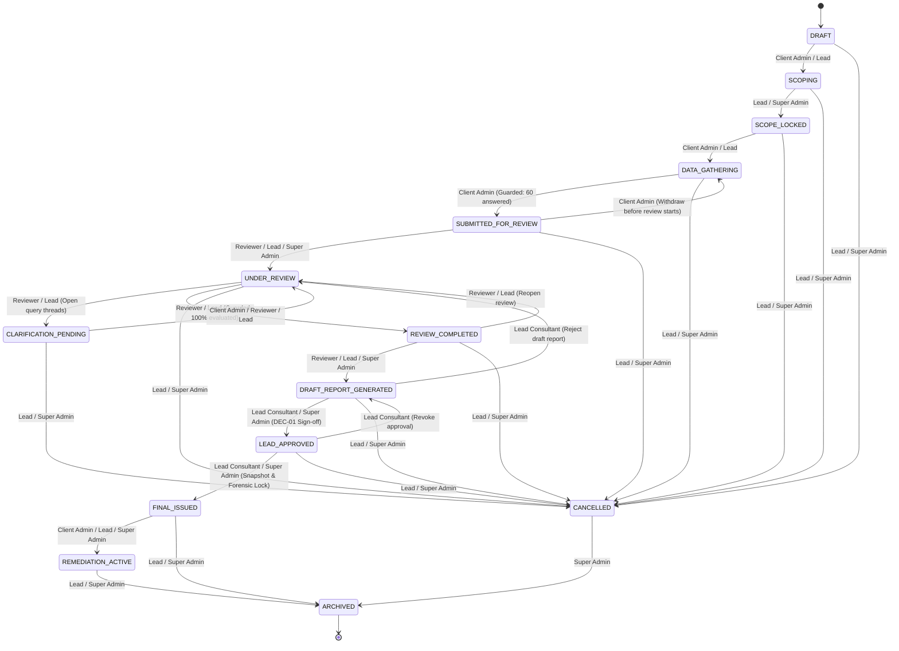

# Truth Labs International (TLI) DPDP Compliance Gap Analysis Tool
## Phase 3D.5 Implementation Report: Assessment Lifecycle and Approval Controls

**Document Reference:** `docs/45_assessment_lifecycle_and_approval_controls.md`  
**Classification:** Internal Technical Architecture & Compliance Governance Report  
**Lifecycle Stage:** Phase 3D.5 Implementation Complete  
**Date:** 2026-10-11  
**Target Repository:** `/home/charan/Documents/DPDP Tool`  
**Related Code Modules:**  
- `migrations/011_assessment_lifecycle_and_immutability.sql`
- `lib/lifecycle/types.ts`
- `lib/lifecycle/rules.ts`
- `lib/lifecycle/service.ts`
- `lib/lifecycle/index.ts`
- `app/api/assessments/[id]/transition/route.ts`
- `app/api/assessments/[id]/re-audit/route.ts`
- `components/lifecycle/AssessmentLifecycleControls.tsx`
- `components/review/AssessorReviewClient.tsx`
- `components/questionnaire/AssessmentSummaryView.tsx`
- `tests/assessment_lifecycle.test.ts`

---

### Executive Summary

In accordance with Phase 3D.5 requirements, this milestone implements the authoritative end-to-end **Assessment Lifecycle and Approval Control Architecture** for the Truth Labs International (TLI) Digital Personal Data Protection (DPDP) Compliance Gap Analysis Platform.

The implementation strictly operationalizes the **canonical 14-state machine** defined in `docs/09_unresolved_decisions_and_tl_assumptions.md`, `docs/03_assessment_workflow_and_state_machine.md`, and `docs/31_phase_3d_assessment_workflow_implementation_plan.md`. Every lifecycle state transition is explicitly authorized by Role-Based Access Control (RBAC), validated by deterministic precondition guards, recorded to an append-only forensic audit trail, and enforced at the PostgreSQL database kernel level via Row-Level Security (RLS) policies and tamper-resistance triggers.

Under decision **DEC-01**, formal assessor review and Lead Consultant sign-off remain mandatory prerequisite gates before any final advisory report can be issued. Upon progression to `FINAL_ISSUED` or `ARCHIVED`, the assessment, its client questionnaire responses, assessor review decisions, and associated evidentiary records are cryptographically snapshotted and locked against modification by kernel database triggers. Subsequent evaluations are conducted by cloning the baseline assessment into an independent re-audit engagement linked via `parent_assessment_id`.

---

### 1. The Canonical 14-State Lifecycle Machine

In adherence to system specifications, the platform uses exactly 14 canonical states. No states have been renamed, abbreviated, or invented:

```
┌──────────────────────────────────────────────────────────────────────────────────────────────┐
│                                CANONICAL 14 LIFECYCLE STATES                                 │
├───────────────┬─────────────────────────┬────────────────────────────────────────────────────┤
│ State Identifier │ User-Facing Label        │ Operational Meaning & Phase Scope                  │
├───────────────┼─────────────────────────┼────────────────────────────────────────────────────┤
│ DRAFT         │ Draft Initializing      │ Newly created engagement; baseline parameters.     │
│ SCOPING       │ Scoping & Applicability │ Defining entities, systems, and statutory scope.   │
│ SCOPE_LOCKED  │ Scope Confirmed         │ Engagement scope finalized and locked by Lead.    │
│ DATA_GATHERING│ Data Gathering Active   │ Client completing 60 questions & uploading proof.  │
│ SUBMITTED_FOR_REVIEW │ Submitted for Review│ Client locked questionnaire; awaiting evaluation. │
│ UNDER_REVIEW  │ Under Assessor Review   │ TLI Assessors evaluating responses and evidence.   │
│ CLARIFICATION_PENDING │ Clarification Requested│ Questions returned to client with queries. │
│ REVIEW_COMPLETED │ Assessor Review Done │ All 60 controls evaluated and exclusions verified. │
│ DRAFT_REPORT_GENERATED │ Draft Report Ready │ System draft gap report and scoring compiled.   │
│ LEAD_APPROVED │ Lead Consultant Approved│ Engagement Lead verified methodology & sign-off.   │
│ FINAL_ISSUED  │ Final Report Issued     │ Cryptographically sealed final report issued.      │
│ REMEDIATION_ACTIVE │ Remediation Tracking│ Post-assessment corrective action tracking.       │
│ CANCELLED     │ Cancelled               │ Engagement terminated with recorded justification. │
│ ARCHIVED      │ Archived & Locked       │ Permanently retained immutable historical archive. │
└───────────────┴─────────────────────────┴────────────────────────────────────────────────────┘
```

#### State Transition Graph



---

### 2. State Transition Matrix and Role Authority

Transition authority is strictly governed by server-side Role-Based Access Control:

| From State | Allowed To State | Authorized Roles | Precondition Guard Rules |
| :--- | :--- | :--- | :--- |
| **DRAFT** | `SCOPING` | `CLIENT_ADMIN`, `TLI_LEAD_CONSULTANT`, `TLI_SUPER_ADMIN` | Engagement metadata initialized. |
| **DRAFT** | `CANCELLED` | `TLI_LEAD_CONSULTANT`, `TLI_SUPER_ADMIN` | Written cancellation rationale required. |
| **SCOPING** | `SCOPE_LOCKED` | `TLI_LEAD_CONSULTANT`, `TLI_SUPER_ADMIN` | Engagement scope signed off. |
| **SCOPING** | `CANCELLED` | `TLI_LEAD_CONSULTANT`, `TLI_SUPER_ADMIN` | Written cancellation rationale required. |
| **SCOPE_LOCKED** | `DATA_GATHERING` | `CLIENT_ADMIN`, `TLI_LEAD_CONSULTANT`, `TLI_SUPER_ADMIN` | Ready for questionnaire data entry. |
| **SCOPE_LOCKED** | `CANCELLED` | `TLI_LEAD_CONSULTANT`, `TLI_SUPER_ADMIN` | Written cancellation rationale required. |
| **DATA_GATHERING** | `SUBMITTED_FOR_REVIEW` | `CLIENT_ADMIN`, `TLI_SUPER_ADMIN` | **Data Completeness Guard:** All 60 questions must be answered unless explicitly designated as `is_partial_assessment = true` with documented reason. All N/A exclusions must have non-empty written justifications. |
| **DATA_GATHERING** | `CANCELLED` | `TLI_LEAD_CONSULTANT`, `TLI_SUPER_ADMIN` | Written cancellation rationale required. |
| **SUBMITTED_FOR_REVIEW** | `UNDER_REVIEW` | `TLI_REVIEWER`, `TLI_LEAD_CONSULTANT`, `TLI_SUPER_ADMIN` | Engagement assigned to assessor team. |
| **SUBMITTED_FOR_REVIEW** | `DATA_GATHERING` | `CLIENT_ADMIN`, `TLI_SUPER_ADMIN` | **Withdrawal Guard:** Allowed *strictly before* any assessor has commenced review evaluation or entered review comments. |
| **UNDER_REVIEW** | `CLARIFICATION_PENDING` | `TLI_REVIEWER`, `TLI_LEAD_CONSULTANT`, `TLI_SUPER_ADMIN` | Active clarification threads or formal questions for client. |
| **UNDER_REVIEW** | `REVIEW_COMPLETED` | `TLI_REVIEWER`, `TLI_LEAD_CONSULTANT`, `TLI_SUPER_ADMIN` | **Review Completion Guard:** All 60 applicable questions evaluated; all N/A exclusions verified; zero open clarification threads. |
| **CLARIFICATION_PENDING** | `UNDER_REVIEW` | `CLIENT_ADMIN`, `TLI_REVIEWER`, `TLI_LEAD_CONSULTANT`, `TLI_SUPER_ADMIN` | Client responds to queries or assessor resumes review. |
| **REVIEW_COMPLETED** | `DRAFT_REPORT_GENERATED`| `TLI_REVIEWER`, `TLI_LEAD_CONSULTANT`, `TLI_SUPER_ADMIN` | Review complete and scoring calculated. |
| **REVIEW_COMPLETED** | `UNDER_REVIEW` | `TLI_REVIEWER`, `TLI_LEAD_CONSULTANT`, `TLI_SUPER_ADMIN` | Assessor reopens review for revisions. |
| **DRAFT_REPORT_GENERATED** | `LEAD_APPROVED` | `TLI_LEAD_CONSULTANT`, `TLI_SUPER_ADMIN` | **DEC-01 Sign-off:** Lead Consultant sign-off mandatory. Client cannot approve draft report. |
| **DRAFT_REPORT_GENERATED** | `UNDER_REVIEW` | `TLI_LEAD_CONSULTANT`, `TLI_SUPER_ADMIN` | Lead Consultant returns report for review revisions. |
| **LEAD_APPROVED** | `FINAL_ISSUED` | `TLI_LEAD_CONSULTANT`, `TLI_SUPER_ADMIN` | **Forensic Seal Guard:** Creates cryptographic SHA-256 report snapshot and activates kernel-level immutability triggers. |
| **LEAD_APPROVED** | `DRAFT_REPORT_GENERATED`| `TLI_LEAD_CONSULTANT`, `TLI_SUPER_ADMIN` | Lead revokes approval before issuance. |
| **FINAL_ISSUED** | `REMEDIATION_ACTIVE` | `CLIENT_ADMIN`, `TLI_LEAD_CONSULTANT`, `TLI_SUPER_ADMIN` | Client commences corrective remediation. |
| **FINAL_ISSUED** | `ARCHIVED` | `TLI_LEAD_CONSULTANT`, `TLI_SUPER_ADMIN` | Engagement archived post-retention window. |
| **REMEDIATION_ACTIVE** | `ARCHIVED` | `TLI_LEAD_CONSULTANT`, `TLI_SUPER_ADMIN` | Remediation monitoring concluded. |
| **CANCELLED** | `ARCHIVED` | `TLI_SUPER_ADMIN` | Abandoned record moved to deep archive. |

---

### 3. Server-Side Precondition Guards

Validation rules are evaluated by `validateTransitionGuards()` in `lib/lifecycle/service.ts` inside the database transaction before state transitions are allowed:

#### Guard 1: Data Completeness on Client Submission (`SUBMITTED_FOR_REVIEW`)
- Evaluates the total count of answers recorded in `assessment_questionnaire_responses`.
- If fewer than 60 questions are answered, submission is rejected with:
  > *"Assessment is incomplete (X/60 questions answered). All 60 canonical questions must be answered before submission unless designated as an approved partial assessment."*
- **Exception handling:** If `is_partial_assessment` is `true`, the submission is permitted provided a non-empty `partial_assessment_reason` is documented.
- **Justification check:** Any question marked `NOT_APPLICABLE` must have a non-empty `not_applicable_justification` recorded by the client. Missing justifications abort the transition.

#### Guard 2: Submission Withdrawal Gate (`SUBMITTED_FOR_REVIEW` $\rightarrow$ `DATA_GATHERING`)
- A Client Admin is allowed to withdraw a submitted assessment back to `DATA_GATHERING` only if no assessor has started evaluating it.
- If any record exists in `questionnaire_assessor_reviews` with a recorded decision or review comment, withdrawal is blocked with:
  > *"Cannot withdraw submission: Assessor review has already commenced. Please coordinate with your TLI Lead Consultant."*

#### Guard 3: Clarification Thread Gating
- Transitioning to `REVIEW_COMPLETED` is rejected if there are open clarification threads (`status = 'OPEN'`) in `evidence_clarification_threads`. All threads must be marked `RESOLVED` or `CLOSED`.
- Transitioning from `CLARIFICATION_PENDING` back to `UNDER_REVIEW` requires that all open client query threads have received responses.

#### Guard 4: Assessor Review Completion Gate (`UNDER_REVIEW` $\rightarrow$ `REVIEW_COMPLETED`)
- Assessor review cannot be closed if any applicable question is left unevaluated (`assessor_status IS NULL`).
- Any question marked `NOT_APPLICABLE` by the client must be formally verified by the assessor (`assessor_status = 'EXCLUSION_VERIFIED'`). If marked `EXCLUSION_REJECTED`, the exclusion must be reclassified or evaluated.
- Any open items block review completion with explicit missing question references.

#### Guard 5: Lead Consultant Sign-Off (`DEC-01`)
- In adherence to `DEC-01`, Client Admins and Reviewers cannot transition an assessment to `LEAD_APPROVED` or `FINAL_ISSUED`.
- Only a user with role `TLI_LEAD_CONSULTANT` or `TLI_SUPER_ADMIN` assigned as `lead_consultant_id` or `ENGAGEMENT_LEAD` can execute these transitions.

---

### 4. Forensic Immutability & Database Kernel Enforcement

Once an assessment reaches `FINAL_ISSUED` or `ARCHIVED`, it becomes an immutable legal record of assessment. Enforcing immutability solely in TypeScript application logic is insufficient; PostgreSQL triggers guard all relevant tables:

#### Migration 011 Database Kernel Triggers
1. **`trg_assessments_lifecycle_guard` on `assessments`:**
   - Blocks any attempt to mutate core engagement metadata (`title`, `engagement_code`, `tenant_id`, `framework_version_id`, `scoring_model_id`, `is_partial_assessment`).
   - If `status = 'ARCHIVED'`, all updates and deletes are permanently forbidden (`FORENSIC_INTEGRITY_VIOLATION`).
   - If `status = 'FINAL_ISSUED'`, only progression to `REMEDIATION_ACTIVE` or `ARCHIVED` is permitted.
2. **`trg_q_responses_finalized_guard` on `assessment_questionnaire_responses`:**
   - Blocks `INSERT`, `UPDATE`, and `DELETE` on responses when the parent assessment status is in `('FINAL_ISSUED', 'REMEDIATION_ACTIVE', 'ARCHIVED')`.
3. **`trg_q_reviews_finalized_guard` on `questionnaire_assessor_reviews`:**
   - Blocks `INSERT`, `UPDATE`, and `DELETE` on assessor reviews when the parent assessment status is in `('FINAL_ISSUED', 'REMEDIATION_ACTIVE', 'ARCHIVED')`.
4. **`trg_evidence_finalized_guard` on `evidence_items`:**
   - Blocks `INSERT`, `UPDATE`, and `DELETE` on evidence vault items when the parent assessment is finalized or archived.
5. **Report Snapshot Generation (`report_snapshots`):**
   - Upon final issuance, a canonical JSON snapshot of assessment results, scoring breakdown, and audit metadata is computed.
   - An SHA-256 cryptographic checksum is generated and stored in `report_snapshots` with `signature_status = 'ISSUED'`.
   - The snapshot table is protected by `trg_snapshots_immutable` which aborts any `UPDATE` or `DELETE`.

---

### 5. Re-Audit Cloning Workflow (`parent_assessment_id`)

Under DPDP Act Section 28 and regular governance review cycles, organizations undergo periodic re-audits. Because finalized assessments are permanently immutable, re-auditing cannot modify existing records:

```
┌──────────────────────────────────────┐
│  Historical Assessment (Immutable)   │
│  ID: 018f...201                      │
│  Status: FINAL_ISSUED                │
│  Engagement: ENG-ALPHA-2026-Q4       │
└──────────────────┬───────────────────┘
                   │
         POST /api/assessments/[id]/re-audit
                   │
                   ▼
┌──────────────────────────────────────┐
│  New Re-Audit Engagement (Active)    │
│  ID: 018f...305                      │
│  Status: DRAFT                       │
│  parent_assessment_id: 018f...201    │
│  Engagement: ENG-ALPHA-2027-REAUDIT  │
│  Responses: Cloned from baseline     │
└──────────────────────────────────────┘
```

1. **API Endpoint:** `POST /api/assessments/[id]/re-audit`
2. **Baseline Forward Copy:** A PostgreSQL security-definer function `clone_assessment_questionnaire_responses(p_source_id, p_target_id)` deep-copies all 60 questionnaire responses from the source assessment into the new assessment.
3. **Lineage Preservation:** The new assessment records `parent_assessment_id = source.id`, establishing continuous audit lineage.
4. **Security Boundary:** Cloned responses start in `DRAFT` for the new assessment, while the source assessment remains untouched and protected by database triggers.

---

### 6. Append-Only Forensic Audit Trail

Every lifecycle state transition writes an immutable audit record to `audit_logs`:

```json
{
  "tenant_id": "018f3a5b-7c8d-7e90-8000-000000000088",
  "assessment_id": "01a12bb5-5dcf-7634-90b1-b0414bf93993",
  "actor_user_id": "018f3a5b-7c8d-7e90-8000-000000000189",
  "actor_role": "TLI_LEAD_CONSULTANT",
  "action": "LIFECYCLE_TRANSITION",
  "resource_type": "assessments",
  "resource_id": "01a12bb5-5dcf-7634-90b1-b0414bf93993",
  "details": {
    "fromStatus": "LEAD_APPROVED",
    "toStatus": "FINAL_ISSUED",
    "reason": "Engagement concluded with Lead sign-off. Issuing final advisory gap analysis report.",
    "snapshotHash": "e3b0c44298fc1c149afbf4c8996fb92427ae41e4649b934ca495991b7852b855"
  }
}
```

The `audit_logs` table is protected by `trg_audit_logs_immutable`, prohibiting any `UPDATE` or `DELETE` even by super administrators.

---

### 7. User Interface Integration

The lifecycle management interface is provided by `components/lifecycle/AssessmentLifecycleControls.tsx` and integrated into:
1. **Assessor Review Workspace** (`components/review/AssessorReviewClient.tsx`):
   - Status badge and metadata headers.
   - Consultant transition controls (`Start Review`, `Request Clarification`, `Complete Review`, `Generate Draft Report`, `Lead Sign-off`, `Issue Final Report`).
   - Guard failure alerts detailing missing requirements when an action is unavailable.
   - Interactive audit history drawer displaying the immutable timeline of state transitions.
2. **Client Assessment Summary View** (`components/questionnaire/AssessmentSummaryView.tsx`):
   - Real-time status indicator.
   - Client submission buttons (`Submit for TLI Review`, `Withdraw Submission`).
   - Clear guidance on prerequisite completion (answered questions, justification for exclusions).

---

### 8. Verification and Quality Gate Summary

All automated test suites, kernel security checks, and builds were executed and verified:

1. **Automated Test Suite (`tests/assessment_lifecycle.test.ts`):**
   - 13/13 unit and integration tests passing.
   - Covers: canonical 14 states, role checks, completeness guards, partial assessment exceptions, submission withdrawal lock, clarification thread gating, assessor review completion gate, Lead Consultant sign-off (`DEC-01`), final issuance snapshot, database immutability triggers, and re-audit cloning.
2. **Global Test Runner (`npm test`):**
   - 14 test suites, 111 total tests; 111 passed (100% pass rate).
3. **Live PostgreSQL Row-Level Security Tests (`scripts/test_database_rls.py`):**
   - 9 static schema validations and 17 live PostgreSQL RLS kernel tests; 17/17 passed.
4. **Migration Checksums (`scripts/migrate.py verify`):**
   - All 11 migrations verified with disk SHA-256 match.
5. **Next.js Production Build (`npm run build`):**
   - Compiled with 0 TypeScript or lint errors.

---

### 9. Deliverables Register

| File Path | Description |
| :--- | :--- |
| `migrations/011_assessment_lifecycle_and_immutability.sql` | RLS policy refinements, DB triggers for immutability, and clone helper function. |
| `lib/lifecycle/types.ts` | 14 canonical statuses, transition types, and DTO schemas. |
| `lib/lifecycle/rules.ts` | Canonical transition state machine graph and role authority mapping. |
| `lib/lifecycle/service.ts` | Guard validation, transition execution, audit trail writer, and re-audit cloning service. |
| `lib/lifecycle/index.ts` | Lifecycle module entry point and public exports. |
| `app/api/assessments/[id]/transition/route.ts` | REST API for status summary and state transitions. |
| `app/api/assessments/[id]/re-audit/route.ts` | REST API for cloning finalized assessments. |
| `components/lifecycle/AssessmentLifecycleControls.tsx` | Reusable UI component with action buttons, modals, and audit timeline. |
| `components/review/AssessorReviewClient.tsx` | Assessor review workspace integration. |
| `components/questionnaire/AssessmentSummaryView.tsx` | Client summary and review integration. |
| `tests/assessment_lifecycle.test.ts` | 13 automated lifecycle tests. |
| `docs/45_assessment_lifecycle_and_approval_controls.md` | Authoritative architecture and verification document. |

