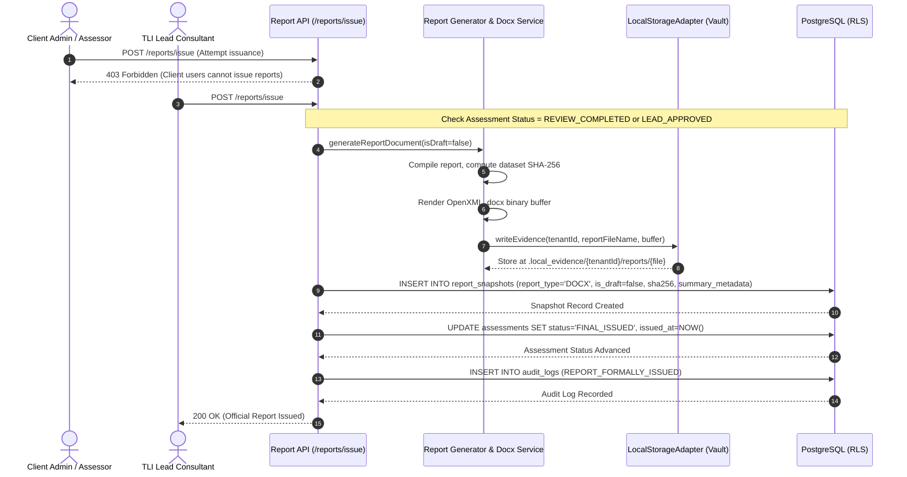
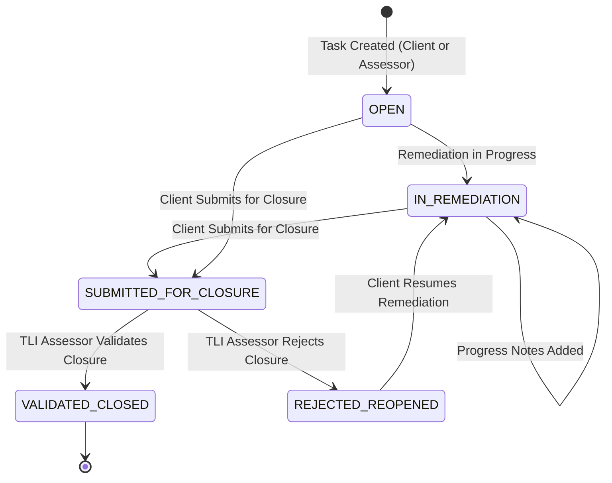

# TLI DPDP Platform — Phase 5: Reporting, Approval & Remediation Management

## 1. Executive Summary

Phase 5 completes the reporting, governance sign-off, and Corrective and Preventive Action (CAPA) remediation management capabilities of the **Truth Labs International (TLI) DPDP Compliance Gap Assessment Platform**.

The implementation establishes an end-to-end audit lifecycle from data compilation to executive reporting and post-audit corrective action tracking, while enforcing strict governance constraints:
1. **Live Data Traceability**: Every finding, penalty exposure estimate, domain metric, and score in generated reports is deterministically compiled from live database records (questionnaire responses, assessor review findings, uploaded evidence, and calculation algorithms).
2. **Professional OpenXML Word Export (`.docx`)**: Generates production-grade Word documents conforming to ISO/IEC 29500 (OpenXML) with TLI corporate typography, executive metric tables, draft watermark banners, Section 33(1) penalty tiers, 60-question findings, methodology disclosures, and formal signature blocks.
3. **Formal Approval & Issuance Gate**: Draft reports are explicitly watermarked and disclaimed. Final issuance is strictly restricted to `TLI_LEAD_CONSULTANT` and `TLI_SUPER_ADMIN`. Issuance persists an immutable record in `report_snapshots`, stores the binary artifact in the secure evidence vault, records cryptographic SHA-256 dataset hashes, and advances the assessment lifecycle to `FINAL_ISSUED`.
4. **Kernel-Enforced Immutability**: Historical report snapshots are guarded at the PostgreSQL kernel level by the `trg_report_snapshots_immutable` trigger and least-privilege role permissions, blocking any `UPDATE` or `DELETE` operations.
5. **CAPA Remediation Tracking**: Corrective actions are tracked with granular priorities, progress milestones, and lifecycle states (`OPEN`, `IN_REMEDIATION`, `SUBMITTED_FOR_CLOSURE`, `VALIDATED_CLOSED`, `REJECTED_REOPENED`). Client users can submit remediation evidence and claim closure, but only authorized TLI assessors can validate and close items.
6. **Non-Compensatory Response Independence**: Completing remediation tasks does **not** mutate historical questionnaire responses or alter issued reports. Remediations represent ongoing corrective actions that do not falsify baseline audit records.

---

## 2. Database Schema & Migration 012

Database enhancements were implemented in `migrations/012_reporting_and_remediation_workflows.sql` and verified via `scripts/migrate.py`:

```sql
-- 1. REPORT SNAPSHOTS ENHANCEMENTS
-- Allow 'DOCX' as a valid report_type in addition to 'PDF' and 'XLSX'
ALTER TABLE report_snapshots DROP CONSTRAINT IF EXISTS report_snapshots_report_type_check;
ALTER TABLE report_snapshots ADD CONSTRAINT report_snapshots_report_type_check 
    CHECK (report_type IN ('PDF', 'XLSX', 'DOCX'));

-- Add is_draft flag to clearly distinguish draft from formally issued reports
ALTER TABLE report_snapshots ADD COLUMN IF NOT EXISTS is_draft BOOLEAN NOT NULL DEFAULT FALSE;

-- Add summary_metadata JSONB to store executive metrics, calculation hashes, and audit trace
ALTER TABLE report_snapshots ADD COLUMN IF NOT EXISTS summary_metadata JSONB DEFAULT '{}'::jsonb;

-- 2. REMEDIATION TASKS ENHANCEMENTS
-- Add direct assessment_id to remediation_tasks
ALTER TABLE remediation_tasks ADD COLUMN IF NOT EXISTS assessment_id UUID REFERENCES assessments(id) ON DELETE RESTRICT;

-- Backfill assessment_id from assessment_controls if not set
UPDATE remediation_tasks rt
SET assessment_id = ac.assessment_id
FROM assessment_controls ac
WHERE rt.assessment_control_id = ac.id
  AND rt.assessment_id IS NULL;

-- Add question_code to link directly to canonical 60-question findings
ALTER TABLE remediation_tasks ADD COLUMN IF NOT EXISTS question_code VARCHAR(50);

-- Make assessment_control_id nullable to support remediation on unmapped questions (e.g. GOV-005)
ALTER TABLE remediation_tasks ALTER COLUMN assessment_control_id DROP NOT NULL;

-- Indexes for assessment-level remediation queries
CREATE INDEX IF NOT EXISTS idx_remediation_assessment ON remediation_tasks(assessment_id, tenant_id);
CREATE INDEX IF NOT EXISTS idx_remediation_question ON remediation_tasks(question_code);

-- 3. RLS POLICIES FOR REMEDIATION TASKS
DROP POLICY IF EXISTS rls_remediation_tasks_policy ON remediation_tasks;
CREATE POLICY rls_remediation_tasks_policy ON remediation_tasks
    FOR ALL
    TO dpdp_app_user
    USING (
        app_current_user_role() = 'TLI_SUPER_ADMIN'
        OR (
            app_current_user_role() IN ('TLI_LEAD_CONSULTANT', 'TLI_REVIEWER')
            AND (
                (assessment_id IS NOT NULL AND is_user_assigned_to_assessment(assessment_id, app_current_user_id()))
                OR (assessment_control_id IN (SELECT ac.id FROM assessment_controls ac))
            )
        )
        OR (
            app_current_tenant_id() IS NOT NULL
            AND tenant_id = app_current_tenant_id()
        )
    )
    WITH CHECK (
        app_current_user_role() = 'TLI_SUPER_ADMIN'
        OR (
            app_current_user_role() IN ('TLI_LEAD_CONSULTANT', 'TLI_REVIEWER')
            AND (
                (assessment_id IS NOT NULL AND is_user_assigned_to_assessment(assessment_id, app_current_user_id()))
                OR (assessment_control_id IN (SELECT ac.id FROM assessment_controls ac))
            )
        )
        OR (
            app_current_tenant_id() IS NOT NULL
            AND tenant_id = app_current_tenant_id()
        )
    );
```

---

## 3. Architecture & Domain Services

### 3.1 Report Compilation & Generation (`lib/reports/`)

The reporting subsystem is organized under `lib/reports/`:

```
lib/reports/
├── types.ts        # Comprehensive TypeScript interfaces for report structures & snapshots
├── generator.ts    # Compiles live database data, sanitizes assessor notes, computes SHA-256
├── docx.ts         # Generates ISO/IEC 29500 OpenXML Word documents via docx library
├── service.ts      # Domain service managing download streaming, snapshots, and issuance
└── index.ts        # Public module exports
```

#### Compilation & Redaction Pipeline (`generator.ts`)
1. **Live Data Fetching**: Queries target assessment, tenant metadata, engagement dates, framework version, responses, reviews, and evidence records under PostgreSQL RLS.
2. **Gap Analysis Engine Integration**: Executes `evaluateAssessmentGaps` to generate the 4 core metrics, domain breakdowns, and Section 33(1) penalty exposure calculations.
3. **Role-Based Assessor Note Redaction**: Internal assessor notes (`review_findings`, internal comments) are automatically censored (`[Confidential Assessor Finding — Restricted to TLI Advisory Team]`) when compiled for client roles (`CLIENT_ADMIN`, `CLIENT_ASSESSOR`, `CLIENT_VIEWER`).
4. **Dataset Fingerprinting**: Generates a cryptographic SHA-256 fingerprint over the assessment ID, status, scoring calculation hash, and question findings.
5. **Draft Banner Determination**: Assessments not in `FINAL_ISSUED` status are automatically flagged `isDraft = true`, injecting prominent amber watermark notices.

### 3.2 Professional Word Exporter (`docx.ts`)

Reports exported in `.docx` format feature comprehensive styling adhering to TLI consulting guidelines:
- **TLI Palette**: Deep Navy (`#1b365d`), Charcoal Dark (`#16191f`), Warm Paper (`#f8f6f0`), Stone Muted (`#64748b`), Alert Amber (`#c27803`), Crimson Red (`#b91c1c`).
- **Running Headers & Footers**: Right-aligned document status indicator (`[DRAFT COPY]` vs `OFFICIAL REPORT`), engagement reference code, confidentiality markings, and dynamic Word page numbers (`Page X of Y`).
- **Prominent Draft Banner**: Styled alert box warning that draft reports do not constitute official advisory opinions or judicial certifications.
- **Engagement Metadata Table**: Two-column layout detailing data fiduciary entity, classification (SDF vs Standard), target framework, evaluation dates, and lead consultant.
- **Executive Summary & 4-Metric Ledger**:
  - Assessment Completeness %
  - Evidence Coverage %
  - Provisional Readiness %
  - Provisional Maturity Score (0.0 to 5.0)
- **Section 33(1) Statutory Penalty Exposure Table**: Categorizes gaps into DPDPA Schedule tiers:
  - Tier 1: Security Safeguards Failure (Section 8(4)) — Up to ₹250 Crores
  - Tier 2: Breach Notification Failure (Section 8(6)) — Up to ₹200 Crores
  - Tier 3: Children's Data & SDF Duties (Sections 9, 10) — Up to ₹150 Crores
  - Tier 4: General Statutory Default (Schedule Item 4) — Up to ₹50 Crores
  - Accompanied by statutory disclaimers highlighting Section 33(2) mitigating factors.
- **13 Statutory Domains Matrix**: Domain title, statutory provision, weight, mapped questions, answered count, critical gaps, and readiness percentage.
- **60-Question Detailed Audit Ledger**: Section-by-section breakdown of every canonical question, respondent option, justifications, mapped control ID, statutory provision, observed gap type, assessor findings, and recommended remediation.
- **Unresolved Question Callout**: Prominently highlights the 4 questions (`GOV-005`, `GOV-006`, `GOV-008`, `APP-006`) awaiting official Excel build sheet mappings.
- **CAPA Remediation Table**: Lists active corrective action tasks, priorities, target completion dates, and ownership.
- **Formal Methodology Disclosures**: `SCORING-V1-PROVISIONAL` disclaimer, non-compensatory scoring rules, and DPBI regulatory authority disclosures.
- **Sign-Off Block**: Lead consultant signature line, advisory credentials, and timestamp.

---

## 4. Report Approval & Issuance Workflow



### 4.1 Immutability Enforcement
The `report_snapshots` table is protected by a PostgreSQL trigger and role privileges:
1. **Trigger `trg_report_snapshots_immutable`**: Rejects any `UPDATE` or `DELETE` with `RAISE EXCEPTION 'Report snapshots are immutable'`.
2. **PostgreSQL Grant Matrix**: Role `dpdp_app_user` is granted `SELECT` and `INSERT` on `report_snapshots`, but **zero** `UPDATE` or `DELETE` privileges.

---

## 5. CAPA Remediation Management (`lib/remediation/`)

Corrective and Preventive Action (CAPA) tracking bridges compliance findings with operational remediation:

```
lib/remediation/
├── types.ts        # RemediationTask, RemediationStatus, RemediationPriority, inputs
├── service.ts      # CRUD, progress logging, and assessor closure validation under RLS
└── index.ts        # Public exports
```

### 5.1 Remediation Lifecycle State Machine



### 5.2 Independent Closure Validation
- **Client Limitation**: A client user cannot update a task's status directly to `VALIDATED_CLOSED`. Attempting to do so returns `403 Forbidden` (`Only authorized TLI consultants can validate and close remediation tasks`).
- **Consultant Validation**: An assessor or lead consultant inspects the remediation, records validation notes in `closure_notes`, updates the status to `VALIDATED_CLOSED`, records `closed_by_user_id` and `closed_at`, and generates an immutable entry in `audit_logs`.

### 5.3 Non-Compensatory Response Independence
A key regulatory audit requirement is that post-audit remediation does **not** alter the baseline audit record:
- Closing a remediation task (e.g., uploading encryption certificates for `SEC-001`) updates the `remediation_tasks` table.
- It does **not** alter `assessment_questionnaire_responses.selected_option` (which remains `Not implemented` for the historical assessment cycle).
- Issued report snapshots remain immutable.
- Subsequent compliance gains are formally measured by initiating a re-audit assessment cycle (`/api/assessments/[id]/re-audit`).

---

## 6. Frontend Workspace Integrations

The user experience was extended with role-specific workspaces and navigation:

1. **Remediation Management Workspace (`/dashboard/assessments/[id]/remediation`)**:
   - Server-rendered page loading assessment metadata and remediation tasks under RLS.
   - Client workspace `RemediationManagementClient` providing:
     - 5 KPI summary cards: Total Tasks, Open, In Remediation, Awaiting Validation, Validated & Closed.
     - Filter chips by status and priority.
     - Remediation task cards with badges, question code links, ownership, target completion dates, and progress history.
     - "New Remediation Task" modal with priority selector and ownership assignment.
     - "Update Progress" modal for adding progress notes and submitting for closure.
     - "Validate Closure" modal (visible strictly to TLI consultants) for approving or rejecting closure with formal verification notes.
2. **Report View (`/dashboard/reports/[id]`)**:
   - Added direct `.docx` download button streaming Word documents with SHA-256 integrity headers.
   - Link to Remediation & CAPA Tracking.
   - Section 6: "Issued Immutable Report Snapshots" ledger displaying issued snapshots, file types, SHA-256 hashes, issuing lead consultants, and issuance timestamps.
3. **Questionnaire Summary View (`components/questionnaire/AssessmentSummaryView.tsx`)**:
   - Added direct navigation button to Remediation & CAPA Tracking.
4. **Assessment List View (`app/dashboard/assessments/page.tsx`)**:
   - Added "Remediation" button to assessment cards alongside Questionnaire, Review, and Reports.

---

## 7. Verification & Testing

### 7.1 Automated Test Suite (`tests/phase5_reporting_remediation.test.ts`)

A dedicated automated test suite validates all 9 Phase 5 acceptance criteria:

| Test Case | Acceptance Criteria | Result |
|---|---|:---:|
| **1** | Compile comprehensive report data traceable to questions and provisions | **PASS** |
| **2** | Redact internal assessor notes for client roles | **PASS** |
| **3** | Generate valid Word document (`.docx`) and verify OpenXML structure via ZIP parsing | **PASS** |
| **4** | Strictly reject client users from approving or issuing final reports | **PASS** |
| **5** | Enforce kernel immutability: UPDATE and DELETE on `report_snapshots` blocked by trigger | **PASS** |
| **6** | Create, track progress, and submit remediation tasks for closure | **PASS** |
| **7** | Prevent clients from self-validating closure and allow TLI assessor validation | **PASS** |
| **8** | Non-compensatory independence: closing remediation does not mutate questionnaire responses | **PASS** |
| **9** | Enforce live PostgreSQL RLS cross-tenant isolation on reports and remediations | **PASS** |

### 7.2 Verification Gates Summary

```bash
# 1. Next.js Production Build
$ npm run build
✓ Compiled successfully
✓ Generating static pages (11/11)
✓ Finalizing page optimization
39 routes generated with 0 errors.

# 2. Automated Test Suite (All 16 suites)
$ npm test
ℹ tests 129
ℹ suites 16
ℹ pass 129
ℹ fail 0

# 3. PostgreSQL Live Database & RLS Tests
$ python3 scripts/test_database_rls.py
Static Validation: 9/9 checks passed.
Live Security Tests: 17/17 tests passed.
>>> ALL PHASE 3A STATIC AND LIVE DATABASE TESTS PASSED <<<

# 4. Migration Checksum Verification
$ python3 scripts/migrate.py verify
[VERIFIED] All 12 applied migrations match their disk checksums exactly.

# 5. Questionnaire Parity
$ python3 scripts/validate_questionnaire_source_parity.py
>>> SUCCESS: 100% CANONICAL QUESTIONNAIRE SOURCE PARITY VERIFIED <<<

# 6. Phase 2 Data Integrity
$ python3 scripts/validate_phase2_data.py
>>> SUCCESS: 100% VALIDATION AUDIT PASSED <<<
```

