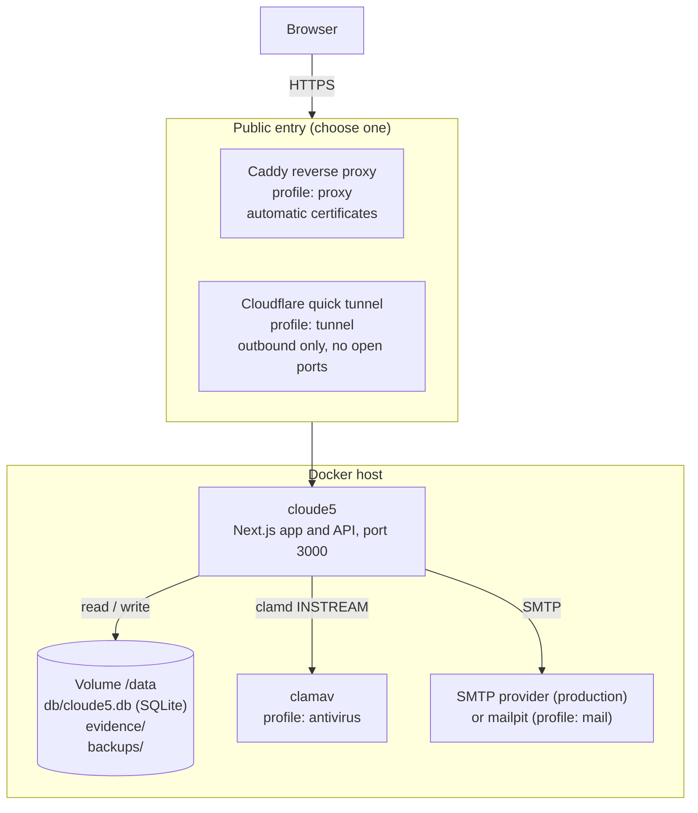

# CloudE5 architecture

CloudE5 is one Next.js application in one container. All state (database, evidence files and
backups) lives in a single data volume. Optional sidecar containers add HTTPS, virus scanning, a test
mail catcher or a public tunnel.

## Components

| Component | Role | Required |
|---|---|---|
| `cloude5` | Pages, API routes, authentication, scoring, reports, migrations and the operations CLI | yes |
| Volume `/data` | `db/cloude5.db` (SQLite, WAL mode), `evidence/` (uploaded files), `backups/` | yes |
| `caddy` (profile `proxy`) | HTTPS with automatic certificates for a server with a domain | on a server |
| `cloudflared` (profile `tunnel`) | Temporary public HTTPS address for a machine without a domain or open ports | laptop trials |
| `clamav` (profile `antivirus`) | Scans every evidence upload. While configured, uploads are refused if it is unavailable | recommended |
| `mailpit` (profile `mail`) | Catches outgoing email locally (web UI on `127.0.0.1:8025`) | testing only |

## Inside the application

| Layer | Where | What it does |
|---|---|---|
| Request gate | `proxy.ts` | Same-origin (CSRF) check on state-changing requests; a fresh CSP nonce per page; strict CSP on API responses |
| Sessions | `lib/auth/` | Signed session cookies, checked against live account state on every request; revocation on sign-out and password change |
| Two-factor | `lib/auth/mfa.ts` | Authenticator-app codes and recovery codes; an organisation can require it for all its users |
| Rate limits | `lib/auth/rate_limit.ts` (database-backed) | Sign-in, registration and account-email limits per IP and account |
| Tenant isolation | `lib/db/rls.ts`, `lib/db/sqlite/` | Every tenant query runs on a connection whose temporary views and triggers expose only that organisation's rows |
| Evidence | `lib/storage/` | Type and content validation, optional ClamAV scan, private per-organisation storage, SHA-256 integrity |
| Methodology | `lib/scoring/`, `lib/gaps/`, `lib/lifecycle/`, `lib/reports/`, `lib/remediation/` | Deterministic scoring, gap register, approval workflow, .docx reports, CAPA tracking |
| Operations | `deploy/docker-entrypoint.sh`, `scripts/` | `migrate`, `status`, `verify`, `backup`, `backup-all`, `restore`, `admin:create`, `verify-email`, `reset-mfa` |

Details of the security controls are in [SECURITY_MODEL.md](SECURITY_MODEL.md).

## Request flow

1. The browser connects over HTTPS to Caddy or the Cloudflare tunnel, which forwards to `cloude5` on port 3000.
2. `proxy.ts` rejects cross-origin state-changing requests and sets the Content Security Policy.
3. The route handler loads the session and re-checks it against the database (account active, session
   not revoked, two-factor completed where required).
4. Tenant data is read and written only through the tenant policy layer.
5. Evidence uploads are validated, scanned and stored under `/data/evidence`; their records go to SQLite.
6. Emails (verification, password reset, invitations) are sent through SMTP with links built from
   `CLOUDE5_PUBLIC_URL`.

## Deployment modes

| Mode | Entry | Email | Suitable for |
|---|---|---|---|
| Development | `npm run dev` on `localhost:3000` | written to `.cloude5/dev-outbox/` | coding |
| Laptop trial | `cloudflared` quick tunnel (`*.trycloudflare.com`) | `mailpit` | demos; offline when the laptop sleeps, address changes on restart |
| Production server | `caddy` with your domain | real SMTP provider | customers; see [PRODUCTION_CHECKLIST.md](PRODUCTION_CHECKLIST.md) |

## Limits of the design

SQLite serves one application server with dozens of concurrent users and many organisations. Running
several application servers, or putting the database on a network filesystem, is not supported.
Evidence and database must be backed up together (`backup-all`).
