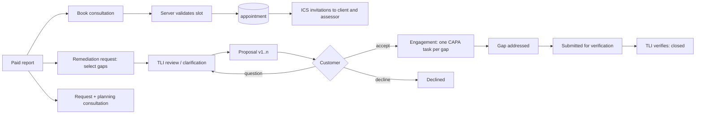

# Consultations and compliance-gap remediation

After a customer pays for their final report, the report page offers **Continue Your Compliance Journey
with Truth Labs International**: book a consultation, get help fixing compliance gaps, or both. Nothing
here charges the customer; remediation work is agreed through a proposal, and any future payment for it
would be a separate, explicitly approved workflow.

## Workflows

### Consultation booking

1. The customer (administrator, business-unit lead or contributor) chooses a consultation type.
2. Available times come from `GET /api/consultations/slots`: each assessor's weekly hours **in the
   assessor's timezone**, minus blocked dates, existing appointments and their buffers, minimum notice
   and booking window. Times display in the viewer's browser timezone; everything is stored in UTC.
3. On booking the server regenerates availability and accepts only a time that is still offered, then
   inserts inside one transaction. The database trigger `trg_appointments_no_overlap_*` refuses any
   overlapping active appointment for the assessor (buffers included), so concurrent bookings of the same
   slot cannot both succeed (the loser gets HTTP 409).
4. Types marked "TLI confirms" create a `PENDING` request; the assessor confirms it (optionally adding a
   meeting link), which sends the invitations. Other types are `CONFIRMED` immediately.
5. Rescheduling (either side) and cancellation update the same calendar event.

### Remediation

| Status | Meaning |
|---|---|
| Draft | Saved by the customer, not yet sent |
| Submitted | Waiting for TLI |
| Under TLI review | A TLI assessor is reviewing (assigned on start) |
| Clarification required | TLI asked the customer a question |
| Proposal prepared | TLI is drafting (drafts are invisible to customers) |
| Proposal sent | The customer can accept, decline or ask a question |
| Accepted | Customer administrator accepted; no gap changes |
| In progress | Engagement started: one corrective-action task per gap |
| Completed | Every gap verified and closed by TLI |
| Declined / Cancelled | Closed |

- Requests are available only after the report is paid for (gaps are part of the paid report). Only
  identified gaps of that assessment can be selected.
- Proposals are versioned. A sent proposal can never be edited (database trigger); a revision is a new
  version that supersedes the previous one. Acceptance and decline record who, when and the note.
- Only lead consultants and the super administrator prepare/send proposals and start or complete
  engagements; only the customer administrator accepts or declines.
- Corrective actions reuse the existing remediation (CAPA) module. Each gap moves **Action planned →
  Being addressed → Submitted for verification → Verified and closed**. Only a TLI assessor can verify
  and close (`validateRemediationClosure`); accepting a proposal never closes a gap, and an engagement
  cannot be completed while any gap is open.
- Supporting documents and corrective evidence are validated (type, size, magic bytes), virus-scanned
  when ClamAV is configured, stored outside the web root, integrity-checked on download and audited.

## Calendar invitations

- Every appointment has a stable UID (`appointment-<id>@truthlabs-dpdp`); every change increments
  `SEQUENCE`. Emails carry an RFC 5545/5546 `REQUEST` (new or updated) or `CANCEL` invitation as a
  `text/calendar` part, which Google Calendar, Outlook/Microsoft 365 and Apple Calendar treat as a real
  invitation (one event, updated in place, no duplicates).
- Each invitation includes date, time, timezone, duration, organisation, assessment reference, agenda and
  meeting link or location, plus "Add to Google Calendar" and "Add to Outlook" links. `GET
  /api/consultations/<id>/ics` downloads the current event.
- **Not implemented:** direct Google Calendar / Microsoft Graph API sync (OAuth). It needs provider
  credentials that are not available to test here; the emailed invitations work without them.

## Notifications

`notification_deliveries` holds one row per recipient per event with a unique `dedupe_key`, tracked
separately from appointment and request status: `QUEUED → SENDING → SENT`, or `FAILED` (retried after
2 and 10 minutes, 3 automatic attempts), or `CANCELLED` (superseded by a later change, or the meeting
was cancelled). Lead consultants can retry a failed email from the Appointments page.

- Customer: confirmation + invitation, 24-hour and 1-hour reminders, reschedule, cancellation; request
  clarification, proposal sent, engagement started, completed.
- Assessor / TLI: new appointment or request, invitation, changes, reminders; new remediation request,
  customer replies, proposal accepted/declined/questioned.
- Reminder offsets are configurable by the super administrator (Availability page).
- Sending: immediately after each action (in the background) and by an in-process scheduler every minute
  (`instrumentation.ts`), which also sends reminders when due. Claims are atomic, so nothing is sent
  twice. Disable with `TLI_NOTIFICATION_SCHEDULER=off` (for example when running a separate worker).

## Database (migration 0010)

`appointment_types` (5 seeded), `assessor_availability`, `availability_exceptions`, `appointments`,
`notification_deliveries`, `remediation_requests`, `remediation_request_gaps`, `remediation_messages`
(append-only), `remediation_proposals` (frozen once sent, never deleted), `remediation_documents`, and
`remediation_tasks.remediation_request_id`. All are read through the tenant policy layer (customers see
only their organisation; reviewers see their own appointments; draft proposals are TLI-only) and written
only by the services after authorisation.

## API

| Method and path | Who | Purpose |
|---|---|---|
| `GET /api/consultations/options` | signed in | Types and bookable assessors |
| `GET /api/consultations/slots?typeId&from&to[&assessorId]` | signed in | Real availability |
| `GET /api/consultations` · `POST` | visible / customer writers | List (filters `status, tenantId, assessorId, from, to`) · book |
| `POST /api/consultations/<id>` | both sides | `RESCHEDULE`, `CANCEL`, `CONFIRM` (TLI), `COMPLETE` (TLI) |
| `GET /api/consultations/<id>/ics` | visible | Calendar file |
| `GET/PUT/POST/DELETE /api/availability` | assessors | Own hours; block/unblock dates |
| `GET/PUT /api/consultations/settings` | super admin | Appointment types, reminder offsets |
| `POST /api/notifications/<id>/retry` | lead / super admin | Retry a failed email |
| `GET/POST /api/remediation-requests` | visible / customer writers | List (filters) · create (draft or submit) |
| `GET/PATCH/POST /api/remediation-requests/<id>` | visible | Detail · edit draft · actions and messages |
| `POST /api/remediation-requests/<id>/proposals` | lead / super admin | New version or update draft |
| `POST /api/remediation-proposals/<id>` | TLI `SEND`; customer `ACCEPT`/`DECLINE`/`CLARIFY` | Proposal decisions |
| `POST /api/remediation-requests/<id>/documents` | both sides | Upload (multipart) |
| `GET /api/remediation-documents/<id>` | visible | Download |
| `PATCH /api/assessments/<aid>/remediations/<taskId>` | existing | Task progress; TLI closure validation |

Every route validates input with zod and returns 400/401/402/403/404/409 from the services.

## Pages

Customers: **Consultations** (`/dashboard/consultations`), **Remediation** (`/dashboard/remediation-requests`,
`/new`, `/<id>`), and the journey section on paid reports. TLI: **Appointments** (week calendar, today,
upcoming, requests, history, filters, failed-email alerts), **Availability** (hours, buffer, notice,
blocked dates; types and reminders for the super admin), **Remediation** (filters and verification queue).

## Configuration and deployment

- Migration: `docker compose run --rm cloude5 migrate` (backup first). No new required variables.
- Email uses the existing SMTP settings; set `SMTP_FROM` to a real sender (it is the invitation organiser).
- Optional: `TLI_NOTIFICATION_SCHEDULER=off`; `TLI_ASSESSOR_EMAIL` is also the fallback TLI recipient for
  remediation notifications.
- Assessors must set their hours on **Availability** before customers see any slots.

## Testing

`tests/consultations.test.ts` (timezones, ICS, slots, booking, invalid/blocked times, concurrent
double-booking, database overlap guard, invitations once, rescheduling, superseded invites, reminders,
email failure/backoff/limit/manual retry, approval types, isolation) and
`tests/remediation_requests.test.ts` (payment gate, gap validation, drafts, isolation, clarification,
proposal visibility/permissions/freezing/versions, acceptance without closure or charge, engagement,
corrective evidence, TLI-only verification, completion, decline and cancel).

## Limits

- No calendar-provider API sync (see above); no dark theme (the application has none).
- "Sent" is SMTP acceptance; inbox delivery is visible only in the mail provider.
- Assessor availability is configured per assessor; administrators do not edit other assessors' hours.
