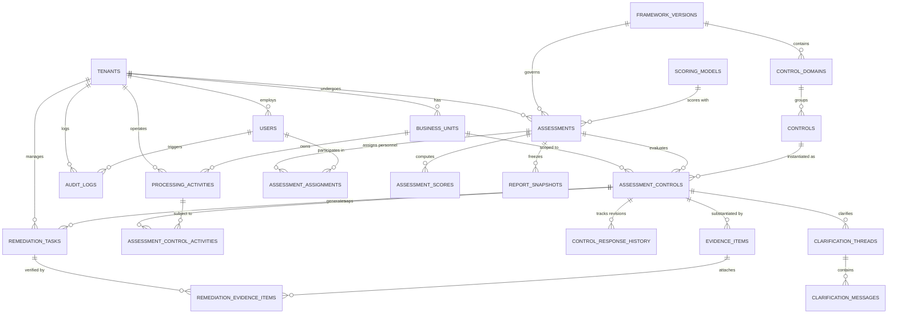
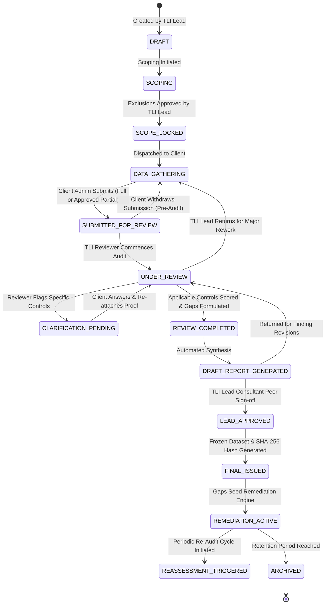

# 10. Phase 1 Review, Architecture Validation and Requirements Refinement Summary

**Project:** TLI DPDP Compliance Gap Analysis Tool  
**Client / Institution:** Truth Labs International (TLI)  
**Deliverable Ref:** Phase 1 Review & Architecture Validation Report  
**Date:** October 2026

---

## 1. Existing Documents Inspected & Authoritative Hierarchy

All Phase 1 architectural documents in the repository have been inspected in full:

| Document | Title | Scope & Authoritative Topic |
|---|---|---|
| [`docs/README.md`](../README.md) | Documentation Index & Principles | Master catalog and global system architecture principles. |
| [`docs/reference/01_product_requirements_specification.md`](../reference/01_product_requirements_specification.md) | Product Requirements Specification | **Authoritative** for DPDPA 2023 statutory alignment, business capabilities, functional scope, and NFRs. |
| [`docs/reference/02_roles_and_permissions_matrix.md`](../reference/02_roles_and_permissions_matrix.md) | Roles and Permissions Matrix | **Authoritative** for 7-role RBAC, least privilege boundaries, and operation matrices. |
| [`docs/reference/03_assessment_workflow_and_state_machine.md`](../reference/03_assessment_workflow_and_state_machine.md) | Assessment Workflow & State Machine | **Authoritative** for assessment lifecycle, control sub-states, and exception workflows. |
| [`docs/archive/04_database_schema_and_erd.md`](04_database_schema_and_erd.md) | Database Schema and ERD | **Authoritative** for PostgreSQL relational entities, DDL constraints, foreign keys, and ERD. |
| [`docs/archive/05_tenant_isolation_and_evidence_security.md`](05_tenant_isolation_and_evidence_security.md) | Tenant Isolation & Evidence Security | **Authoritative** for PostgreSQL RLS policies, connection pooling safety, S3 presigned URLs, and evidence policies. |
| [`docs/archive/06_system_architecture_and_deployment.md`](06_system_architecture_and_deployment.md) | System Architecture & Deployment | **Authoritative** for Next.js full-stack topology, MVP simplicity, and cloud sovereignty. |
| [`docs/archive/07_testing_strategy_and_threat_model.md`](07_testing_strategy_and_threat_model.md) | Testing Strategy & Threat Model | **Authoritative** for STRIDE threat vectors, automated test pyramid, and synthetic data protocol. |
| [`docs/archive/08_implementation_roadmap.md`](08_implementation_roadmap.md) | Implementation Roadmap | **Authoritative** for the 6 canonical product phases, milestones, deliverables, and verification gates. |
| [`docs/reference/09_unresolved_decisions_and_tl_assumptions.md`](../reference/09_unresolved_decisions_and_tl_assumptions.md) | Stakeholder Decisions & Assumptions | **Authoritative** for stakeholder decision registry, default recommendations, and assumption tracking. |

---

## 2. Issues Found in Initial Documents (Grouped by Severity)

### Critical Severity Issues
1. **Unsafe Cascading Deletes in Historical Records**: The initial schema applied `ON DELETE CASCADE` from `assessments` to `assessment_controls`, `evidence_items`, and `remediation_tasks`. In a compliance advisory platform, deleting an assessment would irrevocably destroy forensically sensitive evidence records, consultant working papers, and audit history.
2. **Missing Operational Context (RoPA / Data Processing Activities)**: The initial schema evaluated statutory controls in isolation without linking them to specific corporate Data Processing Activities (e.g. Customer KYC Onboarding, Employee Payroll, Vendor Processing). Statutory mandates under Sections 4, 5, 6, 8(2), and 10 apply to specific processing activities, not abstract checkboxes.
3. **Implicit Superuser RLS Bypass Risk**: The initial RLS design did not account for PostgreSQL's default behavior where table owners and superusers bypass Row-Level Security. Running web queries under table-owning database credentials would completely negate RLS protections.

### High Severity Issues
4. **Premature Infrastructure Complexity**: The initial architecture mandated Redis clusters, BullMQ background workers, and PgBouncer proxies for the MVP. This added unnecessary operational overhead, financial cost ($200+/month), and local development complexity without justification for low-concurrency advisory workloads.
5. **Rigid 100% Completion Guard Blocking Real-World Workflows**: The initial state machine strictly blocked submission unless 100% of controls were answered. This broke valid business scenarios such as M&A rapid diagnostics, baseline assessments, or interim quarterly reviews.
6. **Imprecise Legal Claims Regarding Notice Languages**: The initial document claimed that privacy notices must be proactively translated into all 22 Eighth Schedule languages upfront. In statutory reality, Section 5(3) of DPDPA 2023 mandates providing the *option* to access notice in English or any 8th Schedule language.
7. **Blanket PII Redaction Policy Crippling Evidence Submission**: Prohibiting any document mentioning Aadhaar/PAN prevented clients from uploading legitimate proof of their KYC consent notices or masked customer application forms.

### Medium Severity Issues
8. **Lack of Response Revision History**: The initial schema stored only the latest client narrative in `assessment_controls`, overwriting historical draft answers when resubmitted following consultant clarifications.
9. **Missing Remediation Evidence Association**: The initial schema allowed clients to mark remediation tasks as closed without a dedicated table to link corrective proof documents.
10. **Roadmap Phase Title Discrepancies**: The initial roadmap used milestone titles that did not align with the six canonical product phases.

---

## 3. Proposed Corrections and Rationale

| Issue Ref | Implemented Correction | Architectural & Operational Rationale |
|---|---|---|
| **Cascading Deletes** | Replaced `ON DELETE CASCADE` with `ON DELETE RESTRICT` across all compliance tables. | Guarantees that historical audit records, reports, and evidence files cannot be deleted while dependent records exist. |
| **RoPA Integration** | Introduced `processing_activities` and `assessment_control_activities`. | Bridges abstract legal controls to concrete enterprise operations, enabling accurate gap identification. |
| **Superuser RLS Bypass** | Mandated dedicated least-privilege `app_runtime_user` role and executed `ALTER TABLE ... FORCE ROW LEVEL SECURITY`. | Enforces RLS kernel filters even if queries are executed by table owners. |
| **MVP Simplification** | Adopted a single Next.js full-stack app + managed PostgreSQL. Isolated Redis/BullMQ as scaling triggers. | Reduces deployment complexity and infrastructure costs while delivering $< 2$s vector PDF report generation via `@react-pdf/renderer`. |
| **Workflow Flexibility** | Introduced `is_partial_assessment` exception workflow and withdrawal mechanism. | Enables approved partial gap reviews while prominently flagging scope limitations and coverage percentages in issued reports. |
| **Statutory Nuance** | Refined Section 5 notice requirements to focus on operational multilingual option mechanisms. | Eliminates legal inaccuracy and aligns controls with DPDPA Section 5(3) and upcoming rules. |
| **Risk-Based Evidence** | Implemented 3-tier evidence classification and replaced blanket ban with mandatory masking standards. | Enables submission of blank templates and masked operational samples (`XXXX-XXXX-1234`) while prohibiting live unmasked customer PII. |
| **Revision History** | Introduced `control_response_history`. | Preserves draft versions and client responses across clarification rounds for forensic auditability. |
| **Remediation Proof** | Introduced `remediation_evidence_items` mapping table. | Requires documentary proof before remediation tasks can transition to `VALIDATED_CLOSED`. |
| **Roadmap Alignment** | Realigned `docs/08` to the exact six canonical product phases. | Ensures predictable milestone tracking and explicit verification gates. |

---

## 4. Verified Facts vs. Unverified Legal/Technical Assumptions

### Verified Facts
1. **DPDPA 2023 Statutory Enactment**: Act No. 22 of 2023 is enacted. Sections 4–16 establish clear statutory duties for Data Fiduciaries and Processors.
2. **Statutory Penalties**: The Schedule to DPDPA 2023 mandates statutory financial penalties up to ₹250 Crores for failure to take reasonable security safeguards under Section 8(5), and up to ₹200 Crores under Sections 8(6) and 9.
3. **No General Legitimate Interest Balancing Test**: Unlike GDPR Art. 6(1)(f), DPDPA 2023 Section 7 provides an exhaustive statutory list of legitimate uses.
4. **PostgreSQL RLS Kernel Mechanics**: PostgreSQL Row-Level Security reliably isolates rows across tenants when session parameters are set with `is_local = true` inside SQL transactions.

### Unverified Legal & Technical Assumptions (Requiring Stakeholder Sign-Off)
1. **DPDP Rules Notification Details**: The operational details (breach notification timelines, parental consent mechanisms, DPBI filing forms) are governed by pending/draft DPDP Rules. *Assumption*: The control library will launch with the statutory Act foundation (`DPDPA-2023-V1.0`) and modularly ingest rules (`DPDPA-RULES-2025-V1.0`) once formally gazetted.
2. **SDF Candidacy Criteria**: Central Government notification of Significant Data Fiduciaries is pending. *Assumption*: The tool provides consultative SDF candidacy tracking based on statutory indicators.
3. **Cloud Infrastructure Choice**: *Assumption*: Targeting AWS `ap-south-1` (Mumbai) satisfies domestic data sovereignty under Section 16, subject to final TLI IT confirmation.
4. **SaaS vs. Advisory Engagement Model**: *Assumption*: Assessments are consultant-led by TLI, with standalone client self-assessments deferred pending commercial confirmation.

---

## 5. Revised Product Requirements & Architecture

The architecture is unified into a maintainable, full-stack TypeScript topology:
- **Application Core**: Next.js 14+ (App Router, React Server Components, Server Actions, Route Handlers, Zod DTO validation).
- **Database Engine**: Managed PostgreSQL 16+ residing in an Indian sovereign cloud region, enforcing transaction-scoped Row-Level Security (`set_config('app.current_tenant_id', $1, true)`).
- **Evidence Vault**: Private S3-compatible storage with SSE-KMS, 10-min presigned PUT / 15-min presigned GET URLs, and header magic-byte verification.
- **Reporting Engine**: In-memory streaming PDF generation (`@react-pdf/renderer`) and Excel export (`exceljs`) in MVP; Redis/BullMQ queue worker decoupled as an explicit scaling trigger.

---

## 6. Revised Entity Relationship Diagram & Data Model

The schema incorporates 16 relational entities with time-ordered UUIDv7 identifiers, explicit foreign key restrictions (`ON DELETE RESTRICT`), and append-only audit tracking:

---

## 7. Revised Role and Permission Matrix

Validated against real-world compliance advisory operations across 7 discrete roles:
1. `TLI_SUPER_ADMIN`: Global platform operations & control library steward.
2. `TLI_LEAD_CONSULTANT`: Engagement lead, exclusion approvals, final report sign-off, remediation closure validation.
3. `TLI_REVIEWER`: Assigned auditor, evidence verifier, clarification initiator, maturity scoring.
4. `CLIENT_ADMIN`: Client internal coordinator (DPO/CISO), BU management, questionnaire submission. Prohibited from self-approving statutory exclusions or self-closing audit findings.
5. `CLIENT_BU_LEAD`: Departmental head (HR, IT, Legal), oversees BU questions and remediation.
6. `CLIENT_CONTRIBUTOR`: Operational specialist, authors responses, certifies redaction, uploads evidence.
7. `CLIENT_VIEWER`: Executive read-only stakeholder (Board, CEO), views issued scorecards and reports.

---

## 8. Revised Assessment Lifecycle & State Machine

---

## 9. Security Threat Model & Testing Requirements

- **STRIDE Threat Mitigations**: Multi-layered defenses addressing cross-tenant bleed, reviewer verdict tampering, polyglot uploads, and repudiation risks.
- **Automated Test Pyramid**:
  - Unit tests for scoring determinism, zero-division handling, and state guards.
  - Integration tests for PostgreSQL RLS isolation, session pool safety, and presigned S3 lifecycles.
  - End-to-end Playwright tests executing multi-persona workflows.
- **Synthetic Data Protocol**: Strict prohibition on real client data, real employee PII, or live credentials during development or testing.

---

## 10. Master Stakeholder Decision Register

| Decision Ref | Topic | Recommended Default | Blocker Status |
|---|---|---|:---:|
| **DEC-01** | Engagement Model | Consultant-Led Engagement Model (TLI-assisted). | No (Blocks Phase 3) |
| **DEC-02** | Report Branding | TLI Forensic Branding Only (Client as Assessed Subject). | No (Blocks Phase 5) |
| **DEC-03** | Cloud Hosting | AWS ap-south-1 (Mumbai) with Indian data sovereignty. | No (Blocks Phase 6) |
| **DEC-04** | Authentication | Email/password (Argon2id) + TOTP MFA; SSO in Phase 3/4. | No |
| **DEC-05** | Evidence Policy | Risk-based classification with mandatory masking standards. | **Yes** (Blocks Phase 2) |
| **DEC-06** | Malware Scanning | AWS GuardDuty S3 Malware Protection for cloud production. | No (Blocks Phase 3) |
| **DEC-07** | Data Retention | 5-Year retention with S3 Object Lock (WORM compliance). | No (Blocks Phase 5) |
| **DEC-08** | Legal Ownership | TLI Legal Counsel formally signs off on seeded control library. | **Yes** (Blocks Phase 2) |
| **DEC-09** | MVP Scope | Complete 6-phase canonical product roadmap. | **Yes** (Blocks Phase 2) |
| **DEC-10** | Legal Disclaimer | Standard non-compensatory advisory disclaimer embedded on reports. | No (Blocks Phase 5) |

