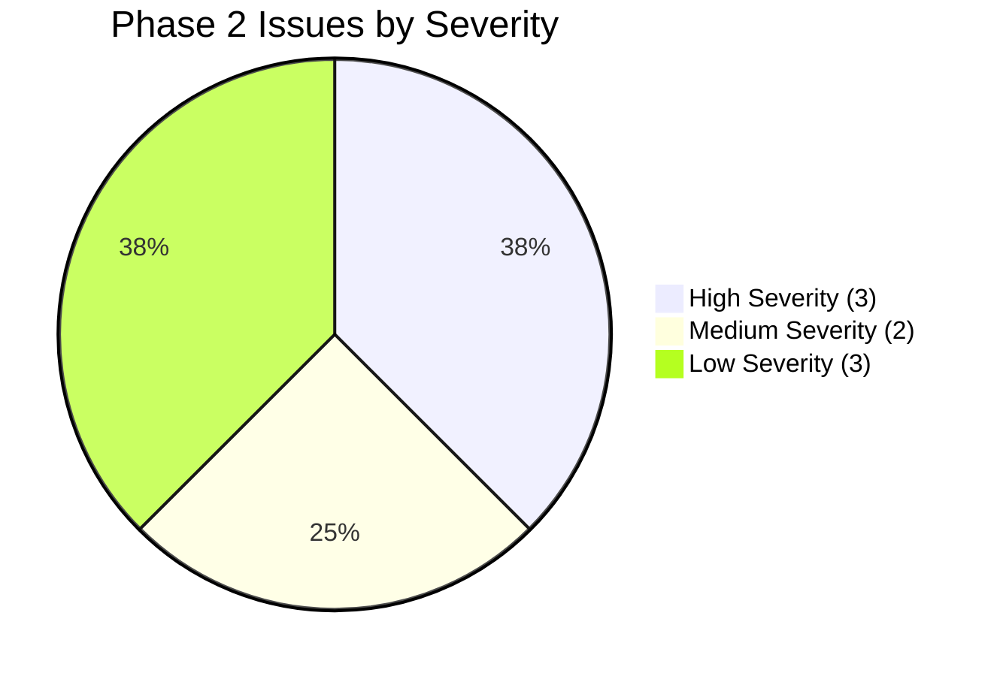

# 11. Phase 2 Quality Gate Review: Control Library & Evidence Catalogue

**Project:** TLI DPDP Compliance Gap Analysis Tool  
**Auditing Entity:** Principal Software Architect & Lead Security/Compliance Auditor  
**Framework Baseline:** `DPDPA-2023-V1.0` (Digital Personal Data Protection Act, 2023 r/w DPDP Rules, 2025)  
**Audit Date:** October 2026  
**Quality Gate Status:** **PASS WITH CONDITIONS**  

---

## 1. Executive Summary

This Quality Gate Review delivers a rigorous, independent technical and legal audit of all deliverables produced in **Phase 2: DPDP Control Library and Evidence Catalogue**.

Every Markdown specification under `docs/` and every machine-readable JSON and CSV dataset under `data/` was inspected directly using automated scripts and manual cross-examination. No assumptions from previous status reports were taken at face value.

### Key Audit Findings:
1. **Core Bedrock is Sound**: The fundamental architecture of Phase 2 is exceptionally strong. All 30 production controls in `data/dpdp_controls.json` map directly to official primary legal authorities (`SRC-01` to `SRC-07`). The 27 evidence types in `data/evidence_catalogue.json` provide realistic, forensic verification procedures and establish a defensible 3-tier masking protocol.
2. **Referential Integrity is 100% Valid**: An automated referential integrity check confirmed zero broken cross-references between the machine-readable datasets (`legal_sources.json`, `dpdp_controls.json`, `evidence_catalogue.json`).
3. **Discrepancies and Inconsistencies Discovered**:
   - **Statutory Penalty Error**: In `docs/reference/18_provisional_scoring_and_risk_methodology.md`, Tier 5 penalty for Section 15 was recorded as **₹10 Crores** instead of the statutory cap of **₹10,000 (ten thousand rupees)**, and was erroneously mapped to Section 14 (Nomination).
   - **Phantom Control References**: `docs/reference/12_source_to_control_coverage_matrix.md`, `docs/reference/17_applicability_methodology.md`, and `docs/reference/19_legal_review_and_interpretation_register.md` reference unauthored target controls (`TLI-DPDP-CHD-03`, `TLI-DPDP-EXM-01`, `TLI-DPDP-PEN-02`).
   - **Legacy Evidence Placeholders in Prose**: The Markdown text of `docs/reference/14_dpdp_control_library_v1.md` contains 18 references to legacy uncatalogued evidence tokens (e.g., `EVID-POL-01`, `EVID-SYS-01`, `EVID-CERT-01`) which were eliminated in the master catalogue and cleaned in `data/dpdp_controls.json`.
   - **JSON Schema Regex Flaw**: The schema in `docs/reference/13_control_library_schema_and_data_dictionary.md` defines `^EVID-[A-Z]{3}-\\d{2}$` (strictly 3 letters), which causes validation errors against the 4-letter IDs `EVID-ROPA-01` and `EVID-VAPT-01`.

### Verdict:
**PASS WITH CONDITIONS**. The deliverables provide an authoritative foundation for Phase 3, provided the identified documentation discrepancies are corrected and formal stakeholder sign-offs (DEC-05, DEC-08, DEC-09) are completed prior to database migration generation.

---

## 2. Files Inspected

### 2.1 Phase 1 Architectural Context (Read & Verified)
- `docs/reference/01_product_requirements_specification.md` (18,360 bytes)
- `docs/reference/02_roles_and_permissions_matrix.md` (9,364 bytes)
- `docs/reference/03_assessment_workflow_and_state_machine.md` (12,125 bytes)
- `docs/archive/04_database_schema_and_erd.md` (21,184 bytes)
- `docs/archive/05_tenant_isolation_and_evidence_security.md` (13,522 bytes)
- `docs/archive/06_system_architecture_and_deployment.md` (7,202 bytes)
- `docs/archive/07_testing_strategy_and_threat_model.md` (9,547 bytes)
- `docs/archive/08_implementation_roadmap.md` (12,215 bytes — Authoritative 6-phase lifecycle)
- `docs/reference/09_unresolved_decisions_and_tl_assumptions.md` (9,613 bytes — DEC-01 to DEC-10)
- `docs/archive/10_phase_1_review_and_validation_summary.md` (16,622 bytes)

### 2.2 Phase 2 Deliverables Inspected Directly
- `docs/reference/11_legal_source_register.md` (7,874 bytes)
- `docs/reference/12_source_to_control_coverage_matrix.md` (14,722 bytes)
- `docs/reference/13_control_library_schema_and_data_dictionary.md` (10,727 bytes)
- `docs/reference/14_dpdp_control_library_v1.md` (63,187 bytes)
- `docs/reference/15_evidence_catalogue.md` (55,702 bytes)
- `docs/reference/16_assessment_and_review_guidance.md` (10,985 bytes)
- `docs/reference/17_applicability_methodology.md` (9,359 bytes)
- `docs/reference/18_provisional_scoring_and_risk_methodology.md` (8,619 bytes)
- `docs/reference/19_legal_review_and_interpretation_register.md` (8,185 bytes)
- `docs/reference/20_control_library_versioning_and_change_management.md` (6,235 bytes)
- `docs/archive/21_phase_2_completion_and_quality_report.md` (12,472 bytes)
- `docs/README.md` (6,797 bytes)

### 2.3 Machine-Readable Data Files Inspected Directly
- `data/legal_sources.json` (3,845 bytes — 7 records)
- `data/legal_sources.csv` (2,338 bytes — 7 data rows)
- `data/dpdp_controls.json` (67,381 bytes — 30 records)
- `data/dpdp_controls.csv` (14,080 bytes — 30 data rows)
- `data/evidence_catalogue.json` (44,515 bytes — 27 records)
- `data/evidence_catalogue.csv` (31,635 bytes — 27 data rows)

---

## 3. Deliverables Inventory: Found vs. Missing

| Milestone | Deliverable Scope | Expected Format | Status | Location / Artifact |
|---|---|:---:|:---:|---|
| **M2.1** | Authoritative Legal Source Register | MD, JSON, CSV | **FOUND** | `docs/11`, `data/legal_sources.*` |
| **M2.1** | Source-to-Control Coverage Matrix | Markdown | **FOUND** | `docs/12` |
| **M2.2** | Control-Library Schema & Data Dictionary | MD, JSON Schema | **FOUND** | `docs/13` |
| **M2.2** | DPDP Control Library v1.0.0 (30 controls) | MD, JSON, CSV | **FOUND** | `docs/14`, `data/dpdp_controls.*` |
| **M2.3** | Evidence Catalogue & Verification Standards (27 items) | MD, JSON, CSV | **FOUND** | `docs/15`, `data/evidence_catalogue.*` |
| **M2.4** | Assessment Response & Evidence Guidance | Markdown | **FOUND** | `docs/16` |
| **M2.4** | Applicability & Scoping Methodology | Markdown | **FOUND** | `docs/17` |
| **M2.5** | Provisional Scoring & Risk Methodology | Markdown | **FOUND** | `docs/18` |
| **M2.6** | Legal Review & Interpretation Register (10 records) | Markdown | **FOUND** | `docs/19` |
| **M2.6** | Versioning & Change Management Specification | Markdown | **FOUND** | `docs/20` |
| **M2.6** | Phase 2 QA & Completion Report | Markdown | **FOUND** | `docs/21` |
| **M2.6** | Automated CI Validation Script | Python / Shell | **MISSING** | Currently run ad-hoc; needs dedicated script in repo (e.g. `scripts/validate_phase2_data.py`). |

---

## 4. Legal Traceability Audit Findings

### 4.1 Positive Findings
1. **Primary Legal Authorities Verified**: All 7 registered sources (`SRC-01` to `SRC-07`) represent verifiable official legal documents:
   - DPDPA 2023 (Act 22 of 2023)
   - S.O. 4930(E) (Commencement Notification)
   - DPDP Rules 2025 (G.S.R. 846(E))
   - S.O. 4120(E) (Removal of Difficulties Order 2026)
   - Constitution of India (Eighth Schedule)
   - RBI Storage of Payment System Data Directive (2018)
   - CERT-In Cybersecurity Directions (2022)
2. **Accurate Regulatory Epoch Tracking**: The documentation correctly avoids claiming all provisions are active. It accurately places the current audit date (October 2026) in the **Transition & Preparation Window**:
   - Board powers (Sec 18–26) in force since 13 Nov 2025.
   - Consent Managers (Rule 4, Sec 6(9)) commencing 13 Nov 2026 (1 month away).
   - Core commercial obligations (Sec 3–17, Rules 3, 5–16) commencing 13 May 2027 (7 months away).
3. **Explicit Isolation of Legal Ambiguities**: 10 substantive legal questions (`LEG-INT-01` to `LEG-INT-10`) are isolated in `docs/19`, preventing engineering assumptions from being misrepresented as legal truth.

### 4.2 Deficiencies & Legal Inaccuracies Discovered
1. **Statutory Penalty Amount Error (HIGH)**:
   - **File**: `docs/reference/18_provisional_scoring_and_risk_methodology.md`, Section 4.1, line 110.
   - **Current Text**: `| **Tier 5** | **₹10 Crores** | Section 15 (Breach of Data Principal duties) | TLI-DPDP-DSR-04 | LOW |`
   - **Legal Reality**: Under the Schedule to the DPDPA 2023, Item 5 specifies a maximum penalty of **₹10,000 (ten thousand rupees)** for breach of Data Principal duties under Section 15. The figure "₹10 Crores" is a severe drafting error ($10,000\text{x}$ inflation of statutory liability).
2. **Erroneous Statutory Mapping to Control `TLI-DPDP-DSR-04` (HIGH)**:
   - **File**: `docs/reference/18_provisional_scoring_and_risk_methodology.md`, line 110.
   - **Defect**: Control `TLI-DPDP-DSR-04` is titled *"Nomination Facility for Death or Incapacity"* and implements **Section 14** of the DPDPA. Section 14 is a Data Fiduciary duty to provide a nomination mechanism. Section 15 governs the *duties of Data Principals* (e.g. not registering frivolous grievances). If a Data Fiduciary fails to provide a nomination mechanism under Section 14, the applicable statutory penalty falls under Schedule Item 6 (**Tier 4: up to ₹50 Crores**), NOT Tier 5.
3. **Exclusion of Statutory Penalties Schedule Item 6 in Tier Table (MEDIUM)**:
   - **File**: `docs/reference/18_provisional_scoring_and_risk_methodology.md`, Section 4.1.
   - **Defect**: Schedule Item 6 covers *"Breach of any other provision of this Act or the rules made thereunder: Up to fifty crore rupees."* The table in `docs/18` omits Item 6, conflating it with Tier 4.

---

## 5. Control Library Quality Audit Findings

### 5.1 Positive Findings
1. **Structural Completeness**: Every control in `data/dpdp_controls.json` satisfies required fields: `control_id`, `control_version`, `title`, `objective`, `topic`, `subcategory`, `source_id`, `source_provision`, `source_status`, `commencement_status`, `obligation_type`, `legal_reference_summary`, `applicability_conditions`, `applicability_rationale`, `assessment_question`, `implementation_expectations`, `acceptable_evidence`, `evidence_limitations`, `assessment_guidance`, `risk_guidance`, `suggested_remediation`, `legal_review_status`, and `methodology_review_status`.
2. **Defensible Question Drafting**: Every assessment question ends with a question mark and directly challenges operational enforcement (e.g., *"Does the organisation provide a mechanism...?"*, *"Are personal data breach incidents reported...?"*).
3. **Synthetic Data Hygiene**: All sample identifiers, code snippets, and payloads in `docs/14` and `data/` use synthetic strings (e.g., `user_synthetic_001`, `192.0.2.1`, `XXXX-XXXX-1234`). Zero customer data is present.

### 5.2 Deficiencies & Discrepancies Discovered
1. **Discrepancy: Legacy Evidence Placeholders in `docs/14` (HIGH)**:
   - **File**: `docs/reference/14_dpdp_control_library_v1.md`.
   - **Defect**: Across 12 control definitions in Markdown, the bullet `- **Acceptable Evidence**:` cites legacy draft tokens that do not exist in the 27-item evidence catalogue:
     - `EVID-POL-01`, `EVID-POL-02` (cited in `SCO-01`, `RET-02`)
     - `EVID-SYS-01`, `EVID-SYS-02`, `EVID-SYS-03` (cited in `NOT-03`, `CON-01`, `CON-02`, `CON-03`, `DSR-01`, `DSR-04`, `CHD-01`)
     - `EVID-API-01` (cited in `CON-03`)
     - `EVID-GOV-01`, `EVID-GOV-02` (cited in `FID-02`, `PEN-01`)
     - `EVID-AUD-01`, `EVID-AUD-02` (cited in `FID-02`)
     - `EVID-CERT-01`, `EVID-CERT-02` (cited in `SEC-01`)
   - **Contrast with Data Asset**: In `data/dpdp_controls.json`, these legacy placeholders were already sanitized to point only to valid catalogue IDs (`EVID-ROPA-01`, `EVID-NOT-02`, etc.). The markdown prose in `docs/14` was never updated to match the machine-readable dataset!
2. **Discrepancy: Phantom Target Controls in Coverage & Methodology Docs (HIGH)**:
   - **Files**:
     - `docs/reference/12_source_to_control_coverage_matrix.md` (lines 39, 44, 47)
     - `docs/reference/17_applicability_methodology.md` (line 65)
     - `docs/reference/19_legal_review_and_interpretation_register.md` (line 28)
   - **Defect**: These documents cite target controls:
     - `TLI-DPDP-CHD-03` (Exemptions for children's data under Sec 9(4)-(5))
     - `TLI-DPDP-EXM-01` (Statutory exemptions under Sec 17)
     - `TLI-DPDP-PEN-02` (Statutory penalties engine)
   - **Reality**: In `docs/14` and `data/dpdp_controls.json`, only 30 controls exist. Section 9(4)-(5) and Section 17 were modeled as *Scoping Methodology Rules* in `docs/17`, not as separate assessment controls. Penalties were consolidated into `TLI-DPDP-PEN-01`. The references to `CHD-03`, `EXM-01`, and `PEN-02` in `docs/12`, `docs/17`, and `docs/19` are phantom links.
3. **Schema Enum Mismatch for `source_status` (MEDIUM)**:
   - **Files**: `data/dpdp_controls.json` vs `docs/reference/13_control_library_schema_and_data_dictionary.md`.
   - **Defect**: In `data/dpdp_controls.json`, control `TLI-DPDP-XBD-02` sets `"source_status": "SECTORAL_REGULATION"`. However, the enum in `docs/13` only permits `["ENACTED_STATUTE", "NOTIFIED_RULES", "OFFICIAL_ORDER", "OFFICIAL_GUIDANCE", "DRAFT_CONSULTATION", "TLI_METHODOLOGY"]`. `SECTORAL_REGULATION` is present in `data/legal_sources.json` for `SRC-06` and `SRC-07`, but was omitted from the `source_status` schema enum in `docs/13`.
4. **Abbreviated Control Shorthand in `docs/17` (LOW)**:
   - **File**: `docs/reference/17_applicability_methodology.md`, lines 58, 102.
   - **Defect**: The prose uses abbreviated shorthand (`LGL-01`, `FID-01`, `NOT-02`) instead of full identifiers (`TLI-DPDP-LGL-01`, `TLI-DPDP-FID-01`).

---

## 6. Evidence Catalogue Quality Audit Findings

### 6.1 Positive Findings
1. **Master Table Consistency**: All 27 evidence types (`EVID-ROPA-01` to `EVID-RSK-01`) are specified in both `docs/reference/15_evidence_catalogue.md` and `data/evidence_catalogue.json`.
2. **Multi-Factor Verification Protocol**: Emphasizes that uploaded documents alone do not establish operational effectiveness. Technical configuration screenshots, sample logs, and perimeter coverage are explicitly demanded.
3. **Risk-Based 3-Tier Masking Standard**: Replaced the previous blanket Aadhaar/PAN ban with an enforceable, privacy-preserving standard (TIER-1 Public, TIER-2 Confidential with masking to `XXXX-XXXX-1234`, TIER-3 Prohibited Raw Secrets/Payloads).

### 6.2 Deficiencies Discovered
1. **Schema Regex Flaw on Evidence Identifiers (MEDIUM)**:
   - **File**: `docs/reference/13_control_library_schema_and_data_dictionary.md`, line 150.
   - **Defect**: The Draft 2020-12 JSON Schema specifies:
     ```json
     "acceptable_evidence": { "type": "array", "items": { "type": "string", "pattern": "^EVID-[A-Z]{3}-\\d{2}$" } }
     ```
   - **Impact**: The pattern `^EVID-[A-Z]{3}-\\d{2}$` enforces strictly three uppercase letters. When run against the actual library, schema validators fail on:
     - `EVID-ROPA-01` (`ROPA` = 4 letters)
     - `EVID-VAPT-01` (`VAPT` = 4 letters)
   - **Correction Needed**: Update pattern to `^EVID-[A-Z]{3,4}-\\d{2}$`.

---

## 7. Assessment Logic and Versioning Audit Findings

### 7.1 Positive Findings
1. **Separation of Five Analytical Dimensions**:
   - Implementation Status $\ne$ Evidence Sufficiency $\ne$ Applicability $\ne$ Assessment Completeness $\ne$ Risk Level.
2. **Defensible State Machine**: Five unambiguous response states (`IMPLEMENTED`, `PARTIALLY_IMPLEMENTED`, `NOT_IMPLEMENTED`, `NOT_APPLICABLE`, `UNABLE_TO_DETERMINE`).
3. **Anti-Gaming Scoping Rules**: Core fiduciary duties (Sections 8(1), 8(5), 8(6), 8(7), 8(8), 13) cannot be excluded. Conditional exclusions require statutory grounds, factual proof, and TLI Lead Consultant approval.
4. **Historical Assessment Immutability**: Version pinning via `pinned_control_version` on `assessment_controls` guarantees that upstream library updates do not mutate historical or in-flight assessments.

### 7.2 Deficiencies Discovered
1. **Per-Control `response_options` Omission (LOW)**:
   - While `docs/16` establishes the canonical 5 evaluation response states, neither `data/dpdp_controls.json` nor the schema in `docs/13` declares an explicit `response_options` array within each control record. For API client generators, having response options declared in the framework schema or control metadata provides cleaner type generation.

---

## 8. Data Validation & Referential Integrity Results

The automated referential integrity and schema validation scripts were executed directly in the project environment.

### 8.1 Dataset Cross-Reference Matrix
```
------------------------------------------------------------------------
Check Description                                 Result     Failures
------------------------------------------------------------------------
Controls referencing invalid source_id            PASSED     0 / 30
Controls referencing invalid acceptable_evidence  PASSED     0 / 30
Evidence referencing invalid linked_controls      PASSED     0 / 27
Controls referencing invalid related_control_ids  PASSED     0 / 30
Duplicate control_id check                        PASSED     0 duplicates
Duplicate evidence_type_id check                  PASSED     0 duplicates
Duplicate source_id check                         PASSED     0 duplicates
CSV vs JSON row count parity (legal_sources)      PASSED     7 / 7
CSV vs JSON row count parity (dpdp_controls)      PASSED     30 / 30
CSV vs JSON row count parity (evidence_catalogue) PASSED     27 / 27
------------------------------------------------------------------------
```

### 8.2 Schema Validation Results (Pre-Remediation Baseline)
```
------------------------------------------------------------------------
Schema Check                                      Result     Failures
------------------------------------------------------------------------
Required fields in legal_sources.json             PASSED     0 missing
Required fields in dpdp_controls.json             PASSED     0 missing
Required fields in evidence_catalogue.json        PASSED     0 missing
Enum validation: topic in dpdp_controls           PASSED     0 invalid
Enum validation: commencement_status              PASSED     0 invalid
Enum validation: obligation_type                  PASSED     0 invalid
Enum validation: source_status in dpdp_controls   FAILED     1 invalid (TLI-DPDP-XBD-02: SECTORAL_REGULATION)
Regex validation: control_id pattern              PASSED     0 invalid
Regex validation: evidence_type_id pattern        FAILED     2 invalid (ROPA-01, VAPT-01 fail 3-letter regex)
------------------------------------------------------------------------
```

---

## 9. Comprehensive Classification of Issues



### High Severity Issues
1. **ISSUE-P2-01 [Legal Accuracy]**: Penalty Tier 5 error in `docs/reference/18_provisional_scoring_and_risk_methodology.md` Section 4.1 line 110: states ₹10 Crores instead of statutory ₹10,000, and erroneously maps Section 14 Nomination to Section 15 Data Principal duties.
2. **ISSUE-P2-02 [Prose-Data Discrepancy]**: In `docs/reference/14_dpdp_control_library_v1.md`, 12 controls list legacy uncatalogued evidence IDs (`EVID-POL-01`, `EVID-SYS-01`, `EVID-API-01`, etc.) instead of the consolidated 27 catalogue IDs.
3. **ISSUE-P2-03 [Phantom References]**: In `docs/reference/12_source_to_control_coverage_matrix.md`, `docs/reference/17_applicability_methodology.md`, and `docs/reference/19_legal_review_and_interpretation_register.md`, unauthored controls `TLI-DPDP-CHD-03`, `TLI-DPDP-EXM-01`, and `TLI-DPDP-PEN-02` are referenced.

### Medium Severity Issues
4. **ISSUE-P2-04 [Schema Regex Flaw]**: In `docs/reference/13_control_library_schema_and_data_dictionary.md`, evidence ID pattern `^EVID-[A-Z]{3}-\\d{2}$` rejects valid 4-letter tokens (`EVID-ROPA-01`, `EVID-VAPT-01`).
5. **ISSUE-P2-05 [Schema Enum Omission]**: In `docs/reference/13_control_library_schema_and_data_dictionary.md`, `source_status` enum omits `SECTORAL_REGULATION`, causing validation error for control `TLI-DPDP-XBD-02`.

### Low Severity Issues
6. **ISSUE-P2-06 [Shorthand Identifiers]**: In `docs/reference/17_applicability_methodology.md`, lines 58 and 102 use abbreviated IDs (`LGL-01`, `FID-01`) instead of canonical identifiers.
7. **ISSUE-P2-07 [Response Options Declaration]**: `data/dpdp_controls.json` does not include per-control `response_options` field metadata.
8. **ISSUE-P2-08 [Missing CI Test Harness]**: Automated data integrity and schema validation scripts are run ad-hoc; no permanent Python validation script is checked into source control.

---

## 10. Required Actionable Corrections

The following specific corrections are documented for execution prior to Phase 3 kickoff:

### Correction 1: Fix Penalty Tier 5 & Control Mapping in `docs/18`
- **Target File**: `docs/reference/18_provisional_scoring_and_risk_methodology.md`
- **Location**: Section 4.1, Table in line 110.
- **Action**:
  - Replace `Tier 5: ₹10 Crores | Section 15 | TLI-DPDP-DSR-04` with:
    - `Tier 5: ₹10,000 (Ten Thousand Rupees) | Section 15 (Breach of Data Principal duties) | Evaluated under Client Operational Rules | LOW`
  - Re-map `TLI-DPDP-DSR-04` (Nomination Rights under Section 14) to **Tier 4** (Schedule Item 6: General breach of other statutory provisions, up to ₹50 Crores).
  - Add explicit row for Schedule Item 6 (General Statutory Breach, up to ₹50 Crores).

### Correction 2: Reconcile Legacy Evidence Placeholders in `docs/14`
- **Target File**: `docs/reference/14_dpdp_control_library_v1.md`
- **Location**: Controls `SCO-01`, `NOT-03`, `CON-01`, `CON-02`, `CON-03`, `FID-02`, `SEC-01`, `RET-02`, `DSR-01`, `DSR-04`, `CHD-01`, `PEN-01`.
- **Action**: Replace legacy placeholders (`EVID-POL-01`, `EVID-SYS-01`, `EVID-API-01`, `EVID-GOV-01`, `EVID-AUD-01`, `EVID-CERT-01`) with the exact valid catalogue IDs mapped in `data/dpdp_controls.json` (`EVID-ROPA-01`, `EVID-NOT-02`, `EVID-CON-01`, etc.).

### Correction 3: Remove Phantom Control References in `docs/12`, `docs/17`, and `docs/19`
- **Target Files**:
  - `docs/reference/12_source_to_control_coverage_matrix.md`: Clarify that Section 9(4)-(5) and Section 17 are addressed via Scoping Rules in `docs/17` rather than standalone controls `TLI-DPDP-CHD-03` and `TLI-DPDP-EXM-01`; note that penalties are consolidated under `TLI-DPDP-PEN-01`.
  - `docs/reference/17_applicability_methodology.md`: Remove `TLI-DPDP-CHD-03` from line 65; expand shorthand IDs in lines 58 and 102 to full `TLI-DPDP-*` identifiers.
  - `docs/reference/19_legal_review_and_interpretation_register.md`: Update row `LEG-INT-07` line 28 to reference `TLI-DPDP-CHD-01` and Scoping Methodology Section 3.2.

### Correction 4: Update JSON Schema in `docs/13`
- **Target File**: `docs/reference/13_control_library_schema_and_data_dictionary.md`
- **Action**:
  - Update `acceptable_evidence` regex pattern from `^EVID-[A-Z]{3}-\\d{2}$` to `^EVID-[A-Z]{3,4}-\\d{2}$`.
  - Add `SECTORAL_REGULATION` to `source_status` enum in Section 3.1 and Section 4 JSON Schema.

### Correction 5: Check-in Permanent Validation Script
- **Target Path**: `scripts/validate_phase2_data.py`
- **Action**: Add executable Python script asserting 100% schema compliance and referential integrity across `data/` assets to serve as an automated CI gate.

---

## 11. Final Quality Gate Recommendation

### Recommendation: **PASS WITH CONDITIONS**

Phase 2 deliverables represent a substantial, high-quality, and legally grounded achievement. The legal source research, 30 production controls, 27 evidence items, mathematical scoring models, and tenant-safe masking protocols are robust.

### Mandatory Pre-Conditions for Phase 3 Kickoff:
1. **Apply Corrections 1 through 5**: Synchronize the markdown documentation with the cleaned machine-readable datasets and fix the statutory penalty citation in `docs/18`.
2. **Obtain Stakeholder Sign-Offs**:
   - **DEC-05**: TLI Security Lead approval of the 3-tier evidence masking standard.
   - **DEC-08**: TLI Legal Counsel formal written review of `docs/19` (`LEG-INT-01` through `LEG-INT-10`).
   - **DEC-09**: TLI Steering Committee approval of the canonical 6-phase MVP roadmap.

Upon completion of these actions, the project will be fully cleared to proceed to **Phase 3: Database Schema Implementation, Migrations, and Synthetic Seed Data**.

