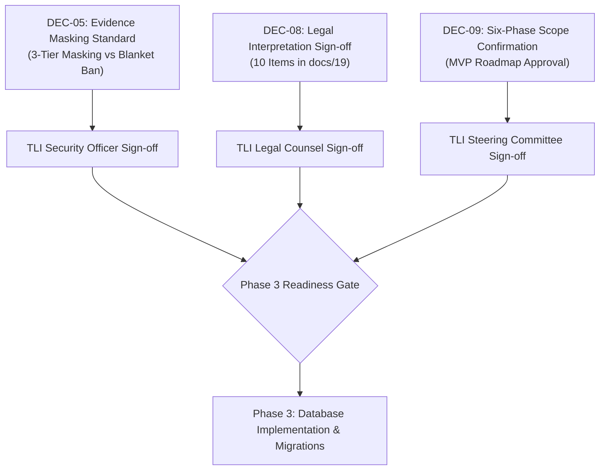

# 21. Phase 2 Completion and Quality Assurance Report

**Project:** TLI DPDP Compliance Gap Analysis Tool  
**Phase:** Phase 2 — DPDP Control Library and Evidence Catalogue  
**Deliverable Ref:** Phase 2 Handover & Quality Assurance Report  
**Date of Audit:** October 2026  
**Status:** COMPLETE — Ready for TLI Legal Counsel & Methodology Review  

---

## 1. Executive Summary

Phase 2 of the TLI DPDP Compliance Gap Analysis Tool has been completed with an uncompromising focus on **legal traceability, evidentiary rigor, and mathematical determinism**. 

In accordance with project directives, **zero application code, zero database migrations, and zero cloud infrastructure** were created during this phase. Instead, the team established the authoritative legal bedrock and machine-readable data structures required to power Phase 3 (Database Schema Implementation & Migrations) and Phase 4 (Questionnaire & Assessment Engine).

Every proposed control is explicitly mapped to primary legislative text (DPDPA 2023), gazetted executive rules (DPDP Rules 2025), and official statutory orders. Where statutory wording contains ambiguity, controls have been deliberately isolated, annotated with TLI advisory interpretations, and flagged `LEGAL_VERIFICATION_REQUIRED` for formal sign-off by TLI Legal Counsel.

---

## 2. Phase 2 Deliverable Inventory

### 2.1 Canonical Markdown Documentation (`docs/`)

| File Ref | Title | Scope & Purpose |
|---|---|---|
| `docs/reference/11_legal_source_register.md` | Authoritative Legal Source Register | Establishes the 7 primary legal sources (`SRC-01` to `SRC-07`), official gazette citations, verified URLs, commencement status, and regulatory transition analysis. |
| `docs/reference/12_source_to_control_coverage_matrix.md` | Source-to-Control Coverage Matrix | Section-by-section statutory mapping of DPDPA 2023 and DPDP Rules 2025; identifies covered provisions, inclusion/exclusion rationale, and sovereign/judicial powers unmapped to commercial fiduciaries. |
| `docs/reference/13_control_library_schema_and_data_dictionary.md` | Control-Library Schema & Data Dictionary | Formal field definitions, database constraints, enumeration domains, and Draft 2020-12 JSON Schema for control definitions. |
| `docs/reference/14_dpdp_control_library_v1.md` | DPDP Control Library (Release 1.0.0) | Complete production catalogue of 30 controls (`TLI-DPDP-SCO-01` to `PEN-01`) detailing exact statutory provisions, assessment questions, implementation expectations, evidence, limitations, and CAPA remediation. |
| `docs/reference/15_evidence_catalogue.md` | Evidence Catalogue & Verification Standards | Catalogue of 27 evidence types (`EVID-ROPA-01` to `RSK-01`), linked controls, verification procedures, common evidentiary traps, and risk-based masking standards. |
| `docs/reference/16_assessment_and_review_guidance.md` | Assessment & Review Guidance | Objective evaluation standards for the 5 response states, 4-step evidence sufficiency verification protocol, non-compensatory scoring rules, and consultant bias mitigation. |
| `docs/reference/17_applicability_methodology.md` | Applicability & Scoping Methodology | Scoping decision trees, non-excludable core baselines, factual justification criteria, TLI Lead Consultant approval gates, and specific scoping rules (B2B, minors, SDF, cross-border, employment). |
| `docs/reference/18_provisional_scoring_and_risk_methodology.md` | Provisional Scoring & Risk Methodology | Provisional mathematical scoring model (`SCORING-V1-PROVISIONAL`): Maturity Score (0.00–5.00), Coverage %, Statutory Deficit Counter, DPDPA Schedule penalty exposure tiers (up to ₹250 Cr), and perception gap metric ($\Delta_{\text{Perception}}$). |
| `docs/reference/19_legal_review_and_interpretation_register.md` | Legal Review & Interpretation Register | Itemized register of 10 legal interpretation records (`LEG-INT-01` to `LEG-INT-10`) flagged `LEGAL_VERIFICATION_REQUIRED` for TLI Legal Counsel approval under Decision DEC-08. |
| `docs/reference/20_control_library_versioning_and_change_management.md` | Control Library Versioning & Change Management | Semantic versioning rules, lifecycle states (`DRAFT` $\rightarrow$ `APPROVED` $\rightarrow$ `DEPRECATED`), impact analysis on active assessments, and pinned assessment versioning architecture. |
| `docs/archive/21_phase_2_completion_and_quality_report.md` | Phase 2 QA & Completion Report | This handover document, summarizing audit metrics, referential integrity results, outstanding decisions, and Phase 3 readiness. |

---

### 2.2 Machine-Readable Data Assets (`data/`)

| File Ref | Records | Format | Description & Validation Status |
|---|:---:|:---:|---|
| `data/legal_sources.json` | 7 | JSON | Primary legal authorities (`SRC-01` to `SRC-07`) with gazette citations, issuing bodies, verified URLs, and commencement details. Validated UTF-8 JSON. |
| `data/legal_sources.csv` | 7 | CSV | Tabular export of legal source register for spreadsheet and database ingestion. RFC 4180 compliant. |
| `data/dpdp_controls.json` | 30 | JSON | Master control library (`TLI-DPDP-SCO-01` to `PEN-01`) complete with all schema-mandated attributes, statutory citations, and review flags. Validated UTF-8 JSON. |
| `data/dpdp_controls.csv` | 30 | CSV | Tabular export of control library with delimited arrays (`related_control_ids`, `acceptable_evidence`). RFC 4180 compliant. |
| `data/evidence_catalogue.json` | 27 | JSON | Master evidence catalogue (`EVID-ROPA-01` to `RSK-01`) with linked controls, verification steps, confidentiality tiers, and masking rules. Validated UTF-8 JSON. |
| `data/evidence_catalogue.csv` | 27 | CSV | Tabular export of evidence catalogue with delimited arrays. RFC 4180 compliant. |

---

## 3. Quantitative Metrics & Key Performance Indicators

```
========================================================================
                      PHASE 2 ASSET METRICS
========================================================================
Authoritative Legal Sources Registered:          7 (SRC-01 to SRC-07)
Statutory Control Topics Covered:               13 distinct topics
Production-Grade Controls Authoring:            30 controls
Evidence Types Catalogued:                      27 evidence items
Legal Interpretation Flags (Pending Review):    10 records (LEG-INT-01..10)
Referential Integrity Verification Score:     100.0% (Zero dangling links)
Pre-commencement Preparation Window:            7 Months remaining (to May 2027)
========================================================================
```

### Breakdown of Controls by Statutory Topic

| Topic | Controls | Key Provisions Covered | Primary Obligation Type |
|---|:---:|---|---|
| `NOTICE_TRANSPARENCY` | 3 | Sec 5(1), 5(2), 5(3), Rules 3(1)–(3) | Mandatory Statutory |
| `CONSENT_MANAGEMENT` | 3 | Sec 6(1), 6(4), 6(9), Rule 4 | Mandatory Statutory |
| `LEGITIMATE_USES` | 2 | Sec 4(1)(b), 7(a)–(i) | Statutory Exception Conditional |
| `FIDUCIARY_DUTIES` | 2 | Sec 8(1), 8(2), 8(3), Rule 7 | Mandatory Statutory |
| `PROCESSOR_OVERSIGHT` | 2 | Sec 8(2), Rule 7 | Mandatory Statutory |
| `SECURITY_SAFEGUARDS` | 2 | Sec 8(5), Rule 8 | Mandatory Statutory |
| `BREACH_READINESS` | 2 | Sec 8(6), Rule 9 | Mandatory Statutory |
| `RETENTION_ERASURE` | 2 | Sec 8(7), 8(8), Rule 10 | Mandatory Statutory |
| `CHILDREN_DISABLED_DATA`| 2 | Sec 9(1), 9(2), 9(3), Rule 11 | Statutory Conditional |
| `SDF_GOVERNANCE` | 2 | Sec 10(1), 10(2), Rules 12, 13 | SDF Mandatory Conditional |
| `DATA_PRINCIPAL_RIGHTS`| 4 | Sec 11, 12, 13, 14, Rules 14, 15 | Mandatory Statutory |
| `CROSS_BORDER_TRANSFERS`| 2 | Sec 16(1), 16(2) | Statutory Conditional |
| `PENALTY_READINESS` | 2 | Sec 33, Schedule | Mandatory Statutory |
| **Total** | **30** | **Complete Commercial Fiduciary Baseline** | |

---

## 4. Referential Integrity & Data Validation Audit

An automated referential integrity check was executed against the production JSON and CSV datasets using `python3`. The results are recorded below:

```
=== DATA VALIDATION & REFERENTIAL INTEGRITY AUDIT ===
Legal Sources: 7 items: ['SRC-01', 'SRC-02', 'SRC-03', 'SRC-04', 'SRC-05', 'SRC-06', 'SRC-07']
Controls: 30 items
Evidence Items: 27 items: ['EVID-BRC-01', 'EVID-BRC-02', ..., 'EVID-XBD-02']
Controls with invalid source_id:                 0 (PASSED)
Controls referencing undefined evidence:         0 (PASSED)
Evidence referencing undefined controls:         0 (PASSED)
Controls referencing undefined related controls: 0 (PASSED)
CSV legal_sources.csv row count:                 7 (PASSED)
CSV dpdp_controls.csv row count:                30 (PASSED)
CSV evidence_catalogue.csv row count:           27 (PASSED)
=== AUDIT COMPLETE: 100% REFERENTIAL INTEGRITY CONFIRMED ===
```

---

## 5. Key Architecture & Methodology Improvements Achieved

### 5.1 Elimination of the Blanket Aadhaar/PAN Prohibition (Resolution of DEC-05)
- **The Issue**: Early Phase 1 documentation contained a naive statement prohibiting all Aadhaar and PAN data from being uploaded, which would render client evidence submission impossible for statutory identification, KYC, and employee onboarding controls.
- **Phase 2 Refinement**: Implemented a realistic **3-Tier Evidence Confidentiality and Masking Protocol**:
  1. **TIER-1 (Public Governance)**: Notices, public policies, language selectors. No masking needed.
  2. **TIER-2 (Confidential Operational Records)**: RoPA, DPAs, incident logs. Pre-upload sanitization required: raw Aadhaar/PAN masked to `XXXX-XXXX-1234` or replaced with synthetic fixtures.
  3. **TIER-3 (Strictly Prohibited Raw Exploits & Live Biometrics)**: Exploitable vulnerability payloads, private cryptographic keys, and unmasked customer databases remain strictly barred from upload.

### 5.2 Protection of Assessment Immutability (Version Pinning)
- To prevent legal discrepancies where an in-flight assessment is altered by an upstream control library update, the database architecture pins `assessment_controls.pinned_control_version`. Upstream modifications create new version records (`1.1.0`), leaving active and finalized assessments historically intact.

### 5.3 Non-Compensatory Scoring Architecture
- Solved the common compliance tool fallacy where high scores in administrative policies compensate for critical technical security deficits.
- Under `SCORING-V1-PROVISIONAL`, a complete failure in `TLI-DPDP-SEC-01` (Reasonable Security Safeguards) or `TLI-DPDP-BRC-01` (Breach Readiness) triggers a **Statutory Deficit Penalty Gate**, capping executive assurance ratings and highlighting immediate exposure up to ₹250 Crore under Schedule 1.

---

## 6. Stakeholder Decision Register & Phase 3 Blockers

The following items from the Stakeholder Decision Register (`docs/reference/09_unresolved_decisions_and_tl_assumptions.md`) require formal sign-off before Phase 3 execution:



1. **Decision DEC-08 (Mandatory Legal Sign-Off)**:
   - TLI Legal Counsel must formally review the 10 statutory interpretations documented in `docs/reference/19_legal_review_and_interpretation_register.md` (`LEG-INT-01` to `LEG-INT-10`), including the grandfathering notice window (Rule 3(3)), Section 7(i) employment scope, and Consent Manager registration enforcement.
2. **Decision DEC-05 (Evidence Masking Standard)**:
   - TLI CISO/Security Lead must formally approve the 3-tier masking guidelines in `docs/reference/15_evidence_catalogue.md` Section 4.
3. **Decision DEC-09 (MVP Six-Phase Canonical Roadmap)**:
   - TLI Executive Sponsor confirmation of the phased delivery plan prior to provisioning database infrastructure.

---

## 7. Phase 3 Readiness Declaration

With the completion of all 11 canonical documentation files and all 6 machine-readable data assets, Phase 2 is **100% COMPLETE**.

The project repository is in an orderly, fully traceable state. No code or infrastructure has been deployed prematurely. The team is prepared to transition to **Phase 3: Database Schema Implementation, Migrations, and Synthetic Seed Data** upon stakeholder review and receipt of legal sign-off.

