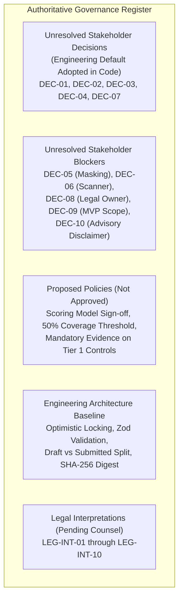
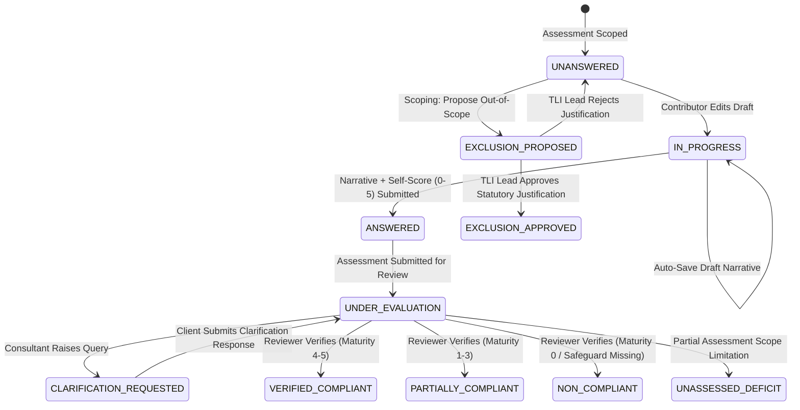
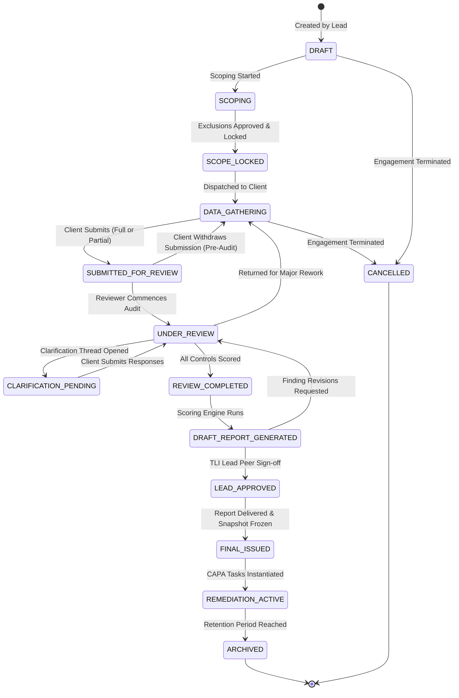

# 31. Phase 3D — Assessment Questionnaire, Gap Scoring Engine, and Consultant Review Interfaces Implementation Plan

**Project:** TLI DPDP Compliance Gap Analysis Tool  
**Milestone Ref:** Phase 3D.0 Architecture Specification & Phased Implementation Roadmap  
**Author:** Principal Software Architect, Application Security Architect & Lead Backend Engineer  
**Date:** October 2026 (Refined Milestone 3D.0.2)  
**Status:** **DESIGN & PLANNING SPECIFICATION (PRE-IMPLEMENTATION GATE)**  
**Target Reviewer:** Truth Labs International (TLI) Architecture Board & Stakeholder Committee  

---

> [!IMPORTANT]
> **GOVERNANCE & PLANNING NOTICE**:
> This document constitutes the formal, repository-grounded engineering plan for **Phase 3D: Assessment Questionnaire, Gap Scoring Engine, and Consultant Review Interfaces**.
> In accordance with the canonical six-phase roadmap and milestone instructions, this document is a **design and planning deliverable only**. No application features have been implemented, no migrations applied, no auth/RLS policies modified, and no git commits created in this milestone.
> 
> Implementation will proceed in controlled, independently verifiable submilestones (**3D.1 through 3D.6**) following formal stakeholder review and approval.

---

## 1. Executive Summary, Repository Reconciliation & Baseline State

### 1.1 Objective & Context
The TLI DPDP Compliance Gap Analysis Tool is designed to execute deterministic, forensically auditable, multi-tenant compliance evaluations against India's **Digital Personal Data Protection Act, 2023 (DPDPA 2023)** and forthcoming **DPDP Rules, 2025**.

Phases 1 through 3C established:
1. **Phase 1**: Product requirements ([`docs/01`](../reference/01_product_requirements_specification.md)), 7-role RBAC ([`docs/02`](../reference/02_roles_and_permissions_matrix.md)), 14-state lifecycle ([`docs/03`](../reference/03_assessment_workflow_and_state_machine.md)), 23-table relational schema ([`docs/04`](04_database_schema_and_erd.md)), and master decision register ([`docs/09`](../reference/09_unresolved_decisions_and_tl_assumptions.md)).
2. **Phase 2**: 7 authoritative legal sources, 30 canonical DPDP controls, 27 evidence types, Draft 2020-12 JSON schemas, and provisional scoring methodology ([`docs/18`](../reference/18_provisional_scoring_and_risk_methodology.md)).
3. **Phase 3A / 3A.1**: PostgreSQL 16+ database foundation, UUIDv7 generation, versioned migrations (`001`–`004`), row-level security (RLS) policies, and synthetic seed datasets verified against live PostgreSQL 18.6.
4. **Phase 3B / 3B.1 / 3B.2**: Provider-neutral S3 evidence storage vault (`lib/storage/`), presigned upload/download workflows, file magic-byte validation, fail-closed malware quarantine, Migration `005`, and automated storage test suites.
5. **Phase 3C / 3C.1 / 3C.2**: Next.js 15 App Router shell, Argon2id/bcrypt passwords, encrypted jose JWT session cookies, edge IP resolution, client/consultant shell workspaces, and `executeWithRls` transaction pooling integration verified with 27 automated tests.

Phase 3D represents the core functional deliverable of the platform: transforming static control libraries and evidence vaults into an interactive, consultant-led compliance assessment engine.

---

### 1.2 Multi-Tier Verification of Existing Repository Assets

A comprehensive audit of the active repository (`/home/charan/Documents/DPDP Tool`) confirms the exact state of foundational assets:

| Repository Asset | Location / Ref | Actual Status | Relevance to Phase 3D |
|---|---|:---:|---|
| **PostgreSQL Migrations** | [`migrations/001_initial_schema.sql`](file:///home/charan/Documents/DPDP%20Tool/migrations/001_initial_schema.sql) through [`005_evidence_vault_lifecycle.sql`](file:///home/charan/Documents/DPDP%20Tool/migrations/005_evidence_vault_lifecycle.sql) | **VERIFIED** | Tables `assessments`, `assessment_assignments`, `assessment_controls`, `control_response_history`, `evidence_items`, `clarification_threads`, `clarification_messages`, `assessment_scores`, and `report_snapshots` already exist with UUIDv7 primary keys and relational constraints. |
| **Row-Level Security (RLS)** | [`migrations/002_rls_and_security.sql`](file:///home/charan/Documents/DPDP%20Tool/migrations/002_rls_and_security.sql) | **VERIFIED** | Kernel-level RLS policies already enforce tenant boundaries and consultant assignments across all assessment tables via `is_user_assigned_to_assessment(...)` and `app_current_tenant_id()`. |
| **Canonical Control Library** | [`data/dpdp_controls.json`](file:///home/charan/Documents/DPDP%20Tool/data/dpdp_controls.json) (30 controls) | **VERIFIED** | 30 canonical controls seeded in `controls` table under framework version `DPDPA-2023-V1.0` (`ab68a890-9932-5775-bd04-d18bffdb0415`). |
| **Control Domains** | `control_domains` table & `data/dpdp_controls.json` | **VERIFIED** | Exactly **13 normalized control domains** seeded in PostgreSQL and reflected in canonical JSON `topic` fields with individual domain weights $W_D$ ($1.00$ to $1.50$). |
| **Evidence Catalogue** | [`data/evidence_catalogue.json`](file:///home/charan/Documents/DPDP%20Tool/data/evidence_catalogue.json) (27 types) | **VERIFIED** | 27 evidence types seeded in `evidence_types` table with confidentiality levels and validation rules. |
| **Canonical Scoring Model** | `scoring_models` table | **VERIFIED** | Model `SCORING-V1-STANDARD-WEIGHTED` (`c9ddba7f-8954-5d37-a92f-cf5a1f27e68b`) is seeded with statutory penalty tiers (`TIER_1` = ₹250 Cr through `TIER_5` = ₹10k). Marked `PROVISIONAL` awaiting formal TLI methodology sign-off. |
| **Evidence Vault Storage** | [`lib/storage/`](file:///home/charan/Documents/DPDP%20Tool/lib/storage/) | **VERIFIED** | S3 adapter, presigned upload/download URL generators, mime validation, and quarantine handlers tested and operational. |
| **Database Pool & RLS Helper** | [`lib/db/pool.ts`](file:///home/charan/Documents/DPDP%20Tool/lib/db/pool.ts) & [`lib/db/rls.ts`](file:///home/charan/Documents/DPDP%20Tool/lib/db/rls.ts) | **VERIFIED** | `executeWithRls(sessionUser, callback)` enforces transaction-local `SET LOCAL ROLE dpdp_app_user` with automatic rollback, strict cleanup ordering, and tainted connection socket destruction. |
| **RBAC Authorization Helpers** | [`lib/auth/rbac.ts`](file:///home/charan/Documents/DPDP%20Tool/lib/auth/rbac.ts) | **VERIFIED** | Implements role checks: `canReviewAssessment`, `canFinalizeAssessment` (DEC-01), `canEditQuestionnaire`, and role-based UI badges. |
| **Session & Authentication** | [`lib/auth/session.ts`](file:///home/charan/Documents/DPDP%20Tool/lib/auth/session.ts) | **VERIFIED** | Jose JWT authentication via HTTP-only cookie with edge rate limiting and safe client IP resolution. |

---

### 1.3 Authoritative Decision Register Reconciliation

A Git history audit of [`docs/reference/09_unresolved_decisions_and_tl_assumptions.md`](file:///home/charan/Documents/DPDP%20Tool/docs/09_unresolved_decisions_and_tl_assumptions.md) confirms that **all 10 canonical decisions (DEC-01 to DEC-10) remain unresolved stakeholder decisions** requiring formal sign-off from Truth Labs International leadership before or during development. No commits exist recording executive sign-off.

To maintain strict governance fidelity, decisions are categorized into:



#### 1. Unresolved Stakeholder Decisions (Engineering Default Adopted)
Engineering has adopted the documented "Recommended Default" from `docs/09` as the baseline architecture for MVP development, but formal stakeholder sign-off is pending:
- **DEC-01 (Consultant-Led Engagement Model)**: Recommended Default adopted. Assessments can only be scoped, peer-reviewed, and finalized by assigned TLI consultants. Client roles are strictly barred from approving or issuing final reports. Implementation blocker: No.
- **DEC-02 (Report Branding)**: Recommended Default adopted. TLI Forensic Audit Branding only; issued reports feature TLI credentials. Blocks Phase 5 report templates.
- **DEC-03 (Hosting Provider & Data Location)**: Recommended Default adopted. AWS Mumbai (`ap-south-1`) data residency compliance under DPDPA Section 16. Blocks Phase 6 production cloud deployment.
- **DEC-04 (Authentication Model)**: Recommended Default adopted. Phased authentication: email/password (Argon2id/bcrypt) with session cookies for MVP; SAML 2.0 / OIDC in later phase. Does not block Phase 2/3 core development.
- **DEC-07 (Data Retention)**: Recommended Default adopted. 5-year retention with WORM Object Lock; immutable report snapshots. Blocks Phase 5 snapshot locking.

#### 2. Unresolved Stakeholder Decisions (Documented Blockers)
- **DEC-05 (Evidence Handling & PII Masking Policy)**: Marked `Implementation Blocker = Yes`. Risk-based evidence classification prohibiting unmasked live Aadhaar/PAN. Pre-upload certification checkbox exists in schema, but policy requires formal TLI leadership sign-off.
- **DEC-06 (Evidence Antivirus & Malware Scanning Solution)**: AWS GuardDuty S3 Malware Protection for production; ClamAV for local/staging. Blocks Phase 3 evidence pipeline.
- **DEC-08 (Legal Review Ownership & Rules Integration)**: Marked `Implementation Blocker = Yes`. Mandates formal TLI Legal Counsel ownership of the seeded control library.
- **DEC-09 (Approved MVP Scope & Acceptance Criteria)**: Marked `Implementation Blocker = Yes`. Six-phase canonical roadmap commitment.
- **DEC-10 (Statutory Legal Disclaimer Language)**: Standard advisory disclaimer clarifying that assessments are professional advisory evaluations, not legal immunity certificates. Blocks Phase 5 report generation.

#### 3. Proposed Policies (Marked: PROPOSED — NOT APPROVED)
- **Formal Scoring Model Approval**: The mathematical model `SCORING-V1-STANDARD-WEIGHTED` is currently marked `PROVISIONAL` in [`docs/18`](../reference/18_provisional_scoring_and_risk_methodology.md). Status: **PROPOSED — NOT APPROVED**. Must receive formal methodology sign-off under DEC-08/DEC-09 before Phase 3D.4 scoring calculations can be declared definitive.
- **Rapid Diagnostic Coverage Threshold**: Proposed policy that an assessment must achieve at least 50% coverage ($Cov \ge 50\%$) before a TLI Lead Consultant may approve an interim report (`is_partial_assessment = TRUE`). Status: **PROPOSED — NOT APPROVED**.
- **Mandatory Evidence Requirement**: Proposed policy that Tier 1 controls (`SEC-01`, `SEC-02`) require attached documentary proof to achieve maturity $\ge 3$. Status: **PROPOSED — NOT APPROVED**. (Engineering default: Soft UI warning in MVP; consultant discretion governs).
- **Executive Report Disclaimer Text**: The exact disclaimer wording drafted in Section 4 of [`docs/09`](../reference/09_unresolved_decisions_and_tl_assumptions.md). Status: **PROPOSED — NOT APPROVED** (awaiting TLI Legal sign-off under DEC-10).

#### 4. Engineering Recommendations (No Legal Approval Required)
- Implementation of optimistic concurrency control using `updated_at` / version tokens (HTTP 409 on conflict).
- Separation of client auto-save drafts (`IN_PROGRESS`) from formal submissions (`ANSWERED`).
- Cryptographic SHA-256 calculation snapshot hashing to ensure forensic immutability of calculated scores.
- Cascading transaction rollback and socket purging on tainted database pool connections.

#### 5. Legal Interpretations Requiring TLI Counsel (`LEG-INT-01` to `LEG-INT-10`)
- 10 itemized legal interpretation records in [`docs/19`](../reference/19_legal_review_and_interpretation_register.md) remain in status `LEGAL_VERIFICATION_REQUIRED`.
- The questionnaire and scoring engines treat these areas with statutory fidelity without guessing unsettled subordinate rules.

---

## 2. Assessment Questionnaire Architecture

### 2.1 Canonical Control-to-Questionnaire Mapping
The questionnaire is dynamically rendered from the 30 canonical controls seeded in the `controls` table, organized across **13 canonical control domains** seeded in `control_domains`:

| Domain Code | Domain Title | Domain Weight ($W_D$) | Controls Count | Canonical Controls | Statutory Focus | Primary Penalty Tier |
|---|---|:---:|:---:|---|---|:---:|
| **NOTICE_TRANSPARENCY** | Notice & Transparency Architecture | **1.25** | 4 | `TLI-DPDP-SCO-01`<br>`TLI-DPDP-NOT-01`<br>`TLI-DPDP-NOT-02`<br>`TLI-DPDP-NOT-03` | Section 3 (Scope)<br>Section 5(1) (Notice Contents)<br>Section 5(2) (Notice Timing)<br>Section 5(3) (Multilingual) | Tier 4 (₹50 Cr) |
| **LEGITIMATE_USES** | Legitimate Uses & Legal Grounds | **1.00** | 3 | `TLI-DPDP-LGL-01`<br>`TLI-DPDP-LEG-01`<br>`TLI-DPDP-LEG-02` | Section 4 (Grounds)<br>Section 7(a) (Voluntary)<br>Section 7(g) (Employment) | Tier 4 (₹50 Cr) |
| **CONSENT_MANAGEMENT** | Consent Architecture & Consent Managers | **1.25** | 3 | `TLI-DPDP-CON-01`<br>`TLI-DPDP-CON-02`<br>`TLI-DPDP-CON-03` | Section 6(1)-(3) (Valid Consent)<br>Section 6(4)-(6) (Withdrawal)<br>Section 6(7)-(9) (Consent Mgrs) | Tier 4 (₹50 Cr) |
| **FIDUCIARY_DUTIES** | Data Fiduciary General Obligations | **1.00** | 2 | `TLI-DPDP-FID-01`<br>`TLI-DPDP-FID-02` | Section 8(1) (Accuracy)<br>Section 8(3) (Principal Duty) | Tier 4 (₹50 Cr) |
| **PROCESSOR_OVERSIGHT** | Data Processor Oversight & Contracts | **1.00** | 1 | `TLI-DPDP-PRO-01` | Section 8(2) r/w Rule 7 (Processor Agreement) | Tier 4 (₹50 Cr) |
| **SECURITY_SAFEGUARDS** | Security Safeguards & Technical Measures | **1.50** | 2 | `TLI-DPDP-SEC-01`<br>`TLI-DPDP-SEC-02` | Section 8(4)-(5) (Safeguards)<br>Section 8(5) r/w Rule 8 (Controls) | **Tier 1 (₹250 Cr)** |
| **BREACH_READINESS** | Personal Data Breach Readiness & Notification | **1.50** | 2 | `TLI-DPDP-BRC-01`<br>`TLI-DPDP-BRC-02` | Section 8(6) (Board Notice)<br>Section 8(6) r/w Rule 9 (Principal Notice) | **Tier 2 (₹200 Cr)** |
| **RETENTION_ERASURE** | Data Retention & Purpose Erasure | **1.00** | 2 | `TLI-DPDP-RET-01`<br>`TLI-DPDP-RET-02` | Section 8(7) (Erasure on Purpose)<br>Section 8(7)-(8) (Withdrawal Erasure) | Tier 4 (₹50 Cr) |
| **DATA_PRINCIPAL_RIGHTS** | Data Principal Rights & Grievance Redressal | **1.25** | 4 | `TLI-DPDP-DSR-01`<br>`TLI-DPDP-DSR-02`<br>`TLI-DPDP-DSR-03`<br>`TLI-DPDP-DSR-04` | Section 11 (Access)<br>Section 12 (Correction/Erasure)<br>Section 13 (Grievance)<br>Section 14 (Nomination) | Tier 4 (₹50 Cr) |
| **CHILDREN_DISABLED_DATA** | Children & Persons with Disabilities Safeguards | **1.25** | 2 | `TLI-DPDP-CHD-01`<br>`TLI-DPDP-CHD-02` | Section 9(1) (Verifiable Consent)<br>Section 9(2)-(3) (No Tracking) | **Tier 2 (₹200 Cr)** |
| **SDF_GOVERNANCE** | Significant Data Fiduciary (SDF) Governance | **1.25** | 2 | `TLI-DPDP-SDF-01`<br>`TLI-DPDP-SDF-02` | Section 10(1)-(2)(a) (DPO & Auditor)<br>Section 10(2)(b)-(c) (DPIA & Audit) | **Tier 3 (₹150 Cr)** |
| **CROSS_BORDER_TRANSFERS** | Cross-Border Personal Data Transfers | **1.00** | 2 | `TLI-DPDP-XBD-01`<br>`TLI-DPDP-XBD-02` | Section 16(1) (Negative List)<br>Section 16(2) (Sectoral Laws) | Tier 4 (₹50 Cr) |
| **PENALTY_READINESS** | Statutory Penalties & Adjudication Readiness | **1.00** | 1 | `TLI-DPDP-PEN-01` | Section 33 r/w Schedule (Penalties & Defense) | Tier 4 (₹50 Cr) |

> [!NOTE]
> **Resolution of Domain Count Discrepancy**: Earlier documentation informally referenced "10 privacy domains" as a conceptual UI module grouping. The authoritative database schema (`control_domains` table in PostgreSQL migration 003) and machine-readable data (`data/dpdp_controls.json` `topic` fields) strictly establish **13 normalized control domains**. All 13 domains are fully reconciled in this specification.

---

### 2.2 Control Response Lifecycle & Data Model

Every control in an active assessment is instantiated in `assessment_controls`. The response lifecycle follows a deterministic progression:



#### Field Specifications for `assessment_controls`:
- `is_applicable`: `BOOLEAN` (default `TRUE`). When `FALSE`, must have approved exclusion.
- `exclusion_justification`: `TEXT` (mandatory when proposing exclusion).
- `exclusion_approved_by_id`: `UUID` (foreign key to `users(id)`, must be TLI Lead Consultant or Super Admin).
- `exclusion_approved_at`: `TIMESTAMPTZ`.
- `verification_status`: `verification_status` enum (11 states).
- `current_response_narrative`: `TEXT` (operational explanation provided by client).
- `current_self_maturity_score`: `SMALLINT` (`0` to `5`).
- `response_submitted_at`: `TIMESTAMPTZ` (timestamp of latest client submission).
- `reviewer_verified_maturity_score`: `SMALLINT` (`0` to `5`).
- `reviewer_eval_notes`: `TEXT` (internal and client-facing consultant evaluation rationale).
- `gap_findings`: `TEXT` (statutory deficit analysis).
- `remediation_recommendation`: `TEXT` (CAPA actionable advice).
- `gap_severity`: `gap_severity` enum (`CRITICAL`, `HIGH`, `MEDIUM`, `LOW`, `ADVISORY`).
- `score_override_reason`: `TEXT` (mandatory if verified score differs from self-score by $> 1$ point).

---

### 2.3 Clarification of Response & Verification States

To eliminate ambiguity between missing data, evaluated gaps, and scoping decisions:

| Verification Status | State Meaning & Criteria | Maturity Impact | Coverage Impact | Deficit Register Impact |
|---|---|:---:|:---:|:---:|
| `UNANSWERED` | Engagement active; contributor has not begun drafting narrative. | Evaluated as $0.0$ if partial submitted | Not evaluated (reduces $Cov$) | Informational open task |
| `IN_PROGRESS` | Draft narrative saved by contributor; formal submission pending. | Evaluated as $0.0$ if partial submitted | Not evaluated (reduces $Cov$) | Informational open task |
| `ANSWERED` | Formal narrative and self-score submitted by contributor. | Awaits consultant review | Awaits consultant evaluation | Awaits consultant evaluation |
| `UNDER_EVALUATION` | TLI Reviewer actively examining narrative, systems, and evidence. | Review in progress | In-flight evaluation | Review in progress |
| `CLARIFICATION_REQUESTED` | Reviewer raised query; awaiting client supplementary response. | Paused evaluation | In-flight evaluation | Flagged for review |
| `VERIFIED_COMPLIANT` | Reviewer verified operational safeguards satisfy statute ($M_c \in \{4, 5\}$). | Scored as verified $M_c$ | Counted in $N_{\text{evaluated}}$ | **Zero deficit** |
| `PARTIALLY_COMPLIANT` | Partial safeguards exist but operational execution incomplete ($M_c \in \{1, 2, 3\}$). | Scored as verified $M_c$ | Counted in $N_{\text{evaluated}}$ | **Enters Deficit Register** |
| `NON_COMPLIANT` | Complete absence of safeguard or active violation ($M_c = 0$). | Scored as $0.0$ | Counted in $N_{\text{evaluated}}$ | **Enters Deficit Register (Red Flag)** |
| `UNASSESSED_DEFICIT` | Unevaluated control in an approved rapid diagnostic / interim report. | Scored as $0.0$ | Excluded from $N_{\text{evaluated}}$ (reduces $Cov$) | **Enters Deficit Register (Unassessed Risk)** |
| `EXCLUSION_PROPOSED` | Client proposed out-of-scope; awaiting TLI Lead sign-off. | Ineligible for scoring | Awaits scoping approval | Scoping task |
| `EXCLUSION_APPROVED` | Formally approved out-of-scope by TLI Lead Consultant. | Excluded from calculation | Excluded from $N_{\text{total}} - N_{\text{excluded}}$ | Excluded from Deficit Register |

---

### 2.4 Response Revision History & Append-Only Audit Trail
Every formal submission creates an append-only record in `control_response_history`:
```sql
CREATE TABLE IF NOT EXISTS control_response_history (
    id UUID PRIMARY KEY DEFAULT generate_uuid_v7(),
    assessment_control_id UUID NOT NULL REFERENCES assessment_controls(id) ON DELETE RESTRICT,
    version_number INT NOT NULL,
    response_narrative TEXT NOT NULL,
    self_maturity_score SMALLINT CHECK (self_maturity_score BETWEEN 0 AND 5),
    submitted_by_id UUID NOT NULL REFERENCES users(id) ON DELETE RESTRICT,
    submitted_at TIMESTAMPTZ NOT NULL DEFAULT CURRENT_TIMESTAMP,
    CONSTRAINT uq_control_response_version UNIQUE (assessment_control_id, version_number)
);
```
Kernel trigger `trg_response_history_immutable` prevents any `UPDATE` or `DELETE`, guaranteeing a forensically unalterable audit trail.

---

### 2.5 Evidence Vault Integration & Lifecycle Safeguards
Evidence linking leverages the Phase 3B S3 Evidence Storage Vault (`evidence_items` table):
- **Pre-Upload Client Certification (DEC-05)**: Checkbox mandates `redaction_certified_by_client = TRUE` before presigned POST URL issuance.
- **Upload Expiration**: Upload URLs expire in 10 minutes (`upload_expires_at`). Abandoned uploads remain in `PENDING_UPLOAD` and are ignored by review and scoring.
- **Fail-Closed Malware Quarantine**: Files flagged by malware scanning transition to `QUARANTINED`, binary moved to quarantine prefix, and download attempts return `403 Forbidden`.
- **Reviewer Gating**: Reviewers can only inspect and award credit for evidence in `ACTIVE` (or `SUPERSEDED` for audit history) status.

---

## 3. Reconciled Assessment Lifecycle & Role Permission Matrix

### 3.1 14-State Assessment Finite State Machine Reconciliation
An inspection of `migrations/001_initial_schema.sql` lines 131–146 confirms that PostgreSQL enum `assessment_status` contains **exactly 14 canonical states**:
`DRAFT`, `SCOPING`, `SCOPE_LOCKED`, `DATA_GATHERING`, `SUBMITTED_FOR_REVIEW`, `UNDER_REVIEW`, `CLARIFICATION_PENDING`, `REVIEW_COMPLETED`, `DRAFT_REPORT_GENERATED`, `LEAD_APPROVED`, `FINAL_ISSUED`, `REMEDIATION_ACTIVE`, `CANCELLED`, `ARCHIVED`.

`CANCELLED` is an established, pre-existing enum state and canonical transition from `DRAFT` or `DATA_GATHERING`, terminating an engagement.



### 3.2 State Transition Matrix with Preconditions and Failure Behaviors

| Current State | Requested Action | Authorized Roles | Required Preconditions | Next State | Audit Event | Failure Behavior |
|---|---|---|---|---|---|---|
| `DRAFT` | Start Scoping | `TLI_LEAD_CONSULTANT`, `TLI_SUPER_ADMIN` | Tenant, framework version, lead assigned. | `SCOPING` | `ASSESSMENT_SCOPING_STARTED` | 400 Bad Request if fields missing. |
| `DRAFT` | Terminate Engagement | `TLI_LEAD_CONSULTANT`, `TLI_SUPER_ADMIN` | Written cancellation rationale provided. | `CANCELLED` | `ASSESSMENT_CANCELLED` | 400 if cancellation rationale empty. |
| `SCOPING` | Lock Scope | `TLI_LEAD_CONSULTANT`, `TLI_SUPER_ADMIN` | All 30 controls in-scope OR `EXCLUSION_APPROVED`. | `SCOPE_LOCKED` | `ASSESSMENT_SCOPE_LOCKED` | 422 Unprocessable Entity if proposals pending. |
| `SCOPE_LOCKED` | Dispatch to Client | `TLI_LEAD_CONSULTANT`, `CLIENT_ADMIN` | Active contributors and BUs assigned. | `DATA_GATHERING` | `ASSESSMENT_DISPATCHED_TO_CLIENT` | 400 if no contributors assigned. |
| `DATA_GATHERING` | Submit for Review | `CLIENT_ADMIN` | 100% controls answered OR approved partial. | `SUBMITTED_FOR_REVIEW` | `ASSESSMENT_SUBMITTED` | 422 listing unanswered controls. |
| `DATA_GATHERING` | Terminate Engagement | `TLI_LEAD_CONSULTANT`, `TLI_SUPER_ADMIN` | Written cancellation rationale provided. | `CANCELLED` | `ASSESSMENT_CANCELLED` | 400 if rationale empty. |
| `SUBMITTED_FOR_REVIEW` | Withdraw Submission | `CLIENT_ADMIN` | Review has not commenced (0 controls in evaluation). | `DATA_GATHERING` | `ASSESSMENT_SUBMISSION_WITHDRAWN` | 409 Conflict if review commenced. |
| `SUBMITTED_FOR_REVIEW` | Commence Audit | `TLI_LEAD_CONSULTANT`, `TLI_REVIEWER` | Reviewer assigned. | `UNDER_REVIEW` | `ASSESSMENT_REVIEW_COMMENCED` | 400 if reviewer missing. |
| `UNDER_REVIEW` | Request Clarifications | `TLI_REVIEWER`, `TLI_LEAD_CONSULTANT` | Open clarification thread exists. | `CLARIFICATION_PENDING` | `ASSESSMENT_CLARIFICATIONS_REQUESTED` | 422 if no open thread. |
| `CLARIFICATION_PENDING` | Return Clarifications | `CLIENT_ADMIN`, `CLIENT_BU_LEAD` | All open threads marked `RESOLVED`. | `UNDER_REVIEW` | `ASSESSMENT_CLARIFICATIONS_SUBMITTED` | 422 if open threads remain. |
| `UNDER_REVIEW` | Return for Rework | `TLI_LEAD_CONSULTANT` | Data fundamentally inadequate; rationale logged. | `DATA_GATHERING` | `ASSESSMENT_RETURNED_FOR_REWORK` | 400 if rationale empty. |
| `UNDER_REVIEW` | Complete Audit | `TLI_REVIEWER`, `TLI_LEAD_CONSULTANT` | 100% applicable controls scored with notes. | `REVIEW_COMPLETED` | `ASSESSMENT_REVIEW_COMPLETED` | 422 listing unscored controls. |
| `REVIEW_COMPLETED` | Run Scoring Engine | `TLI_REVIEWER`, `TLI_LEAD_CONSULTANT` | Deterministic scoring algorithm runs cleanly. | `DRAFT_REPORT_GENERATED` | `ASSESSMENT_DRAFT_REPORT_GENERATED` | 500 if calculation error occurs. |
| `DRAFT_REPORT_GENERATED` | Reopen Audit | `TLI_LEAD_CONSULTANT` | Lead identifies finding revisions needed. | `UNDER_REVIEW` | `ASSESSMENT_REVIEW_REOPENED` | 400 if revision notes empty. |
| `DRAFT_REPORT_GENERATED` | Lead Sign-off | **`TLI_LEAD_CONSULTANT` ONLY** | Executive summary and legal disclaimers approved. | `LEAD_APPROVED` | `ASSESSMENT_LEAD_APPROVED` | **403 Forbidden** if caller is not Lead Consultant. |
| `LEAD_APPROVED` | Issue Final Report | **`TLI_LEAD_CONSULTANT`, `TLI_SUPER_ADMIN`** | SHA-256 dataset hash generated; report rendered. | `FINAL_ISSUED` | `ASSESSMENT_FINAL_ISSUED` | **403 Forbidden** if called by client roles. Permanent lock. |
| `FINAL_ISSUED` | Activate Remediation | Automated / `TLI_LEAD_CONSULTANT` | Remediation tasks created in `remediation_tasks`. | `REMEDIATION_ACTIVE` | `ASSESSMENT_REMEDIATION_ACTIVATED` | 500 if task creation fails. |
| `REMEDIATION_ACTIVE` | Archive Engagement | `TLI_SUPER_ADMIN`, `TLI_LEAD_CONSULTANT` | Remediation completed or retention expired. | `ARCHIVED` | `ASSESSMENT_ARCHIVED` | 400 if open critical remediation tasks remain without closure exception. |

---

## 4. Deterministic Scoring Mathematics (Provisional Specification)

> [!WARNING]
> **PROVISIONAL STATUS NOTICE**:
> The formulas and models below represent the **engineering proposal** grounded in [`docs/18`](../reference/18_provisional_scoring_and_risk_methodology.md) (`SCORING-V1-PROVISIONAL`) and seeded in PostgreSQL as `SCORING-V1-STANDARD-WEIGHTED`. They carry status **PROPOSED — NOT APPROVED** until formal methodology sign-off by TLI Leadership under DEC-08 and DEC-09.

### 4.1 Mathematical Formulas
1. **Domain Maturity Score ($S_D$)**:
   $$S_D = \frac{\sum_{c \in C_D, \text{applicable}} \left( M_c \times W_c \right)}{\sum_{c \in C_D, \text{applicable}} W_c}$$
   - $M_c \in \{0.0, 1.0, 2.0, 3.0, 4.0, 5.0\}$.
   - `EXCLUSION_APPROVED` controls are omitted from both numerator and denominator.
   - Zero-denominator guard: If all controls in domain $D$ are excluded ($\sum W_c = 0$), $S_D = \text{null}$ (marked `EXCLUDED`), and domain $D$ is excluded from the overall weighted calculation.
2. **Overall Implementation Maturity Score ($S_{\text{Overall}}$)**:
   $$S_{\text{Overall}} = \frac{\sum_{D \in \mathcal{D}_{\text{active}}} \left( S_D \times W_D \right)}{\sum_{D \in \mathcal{D}_{\text{active}}} W_D}$$
   - Where $W_D$ is the domain weight from `control_domains.weight` ($1.00$ to $1.50$). Rounded to two decimal places.
3. **Assessment Coverage Percentage ($Cov$)**:
   $$Cov = \left( \frac{N_{\text{evaluated}}}{N_{\text{total}} - N_{\text{excluded}}} \right) \times 100\%$$
   - $N_{\text{total}} = 30$, $N_{\text{excluded}}$ = count of approved exclusions, $N_{\text{evaluated}}$ = count of evaluated controls (`VERIFIED_COMPLIANT`, `PARTIALLY_COMPLIANT`, `NON_COMPLIANT`).
4. **Perception Gap Delta ($\Delta_{\text{Perception}}$)**:
   $$\Delta_{\text{Perception}} = M_{\text{client}} - M_{\text{verified}}$$

---

### 4.2 Three Illustrative Calculations (Provisional)

#### Case 1: Complete Assessment (100% Coverage, 2 Active Domains)
- **Domain 1: `SECURITY_SAFEGUARDS` ($W_{D1} = 1.50$)**:
  - `SEC-01` ($W_c = 1.50$): $M_1 = 4.0 \implies 4.0 \times 1.50 = 6.00$
  - `SEC-02` ($W_c = 1.50$): $M_2 = 3.0 \implies 3.0 \times 1.50 = 4.50$
  - $S_{D1} = \frac{6.00 + 4.50}{1.50 + 1.50} = \frac{10.50}{3.00} = \mathbf{3.50}$
- **Domain 2: `BREACH_READINESS` ($W_{D2} = 1.50$)**:
  - `BRC-01` ($W_c = 1.25$): $M_3 = 4.0 \implies 4.0 \times 1.25 = 5.00$
  - `BRC-02` ($W_c = 1.25$): $M_4 = 4.0 \implies 4.0 \times 1.25 = 5.00$
  - $S_{D2} = \frac{5.00 + 5.00}{1.25 + 1.25} = \frac{10.00}{2.50} = \mathbf{4.00}$
- **Overall Maturity**:
  $$S_{\text{Overall}} = \frac{(3.50 \times 1.50) + (4.00 \times 1.50)}{1.50 + 1.50} = \frac{5.25 + 6.00}{3.00} = \frac{11.25}{3.00} = \mathbf{3.75}$$
- **Coverage**:
  $Cov = \left(\frac{4}{4 - 0}\right) \times 100\% = \mathbf{100.00\%}$
- **Deficit Register**: Zero critical deficits. Section 8(5) partially compliant on `SEC-02` recorded in register.

---

#### Case 2: Incomplete Assessment (Partial Rapid Diagnostic Mode, 50% Coverage)
- **Domain 1: `SECURITY_SAFEGUARDS` ($W_{D1} = 1.50$)**:
  - `SEC-01` ($W_c = 1.50$): Evaluated $M_1 = 4.0 \implies 4.0 \times 1.50 = 6.00$
  - `SEC-02` ($W_c = 1.50$): Unevaluated (`UNASSESSED_DEFICIT`, $M_2 = 0.0$) $\implies 0.0 \times 1.50 = 0.00$
  - $S_{D1} = \frac{6.00 + 0.00}{1.50 + 1.50} = \frac{6.00}{3.00} = \mathbf{2.00}$
- **Domain 2: `BREACH_READINESS` ($W_{D2} = 1.50$)**:
  - `BRC-01` ($W_c = 1.25$): Evaluated $M_3 = 4.0 \implies 4.0 \times 1.25 = 5.00$
  - `BRC-02` ($W_c = 1.25$): Unevaluated (`UNASSESSED_DEFICIT`, $M_4 = 0.0$) $\implies 0.0 \times 1.25 = 0.00$
  - $S_{D2} = \frac{5.00 + 0.00}{1.25 + 1.25} = \frac{5.00}{2.50} = \mathbf{2.00}$
- **Overall Maturity**:
  $$S_{\text{Overall}} = \frac{(2.00 \times 1.50) + (2.00 \times 1.50)}{1.50 + 1.50} = \frac{3.00 + 3.00}{3.00} = \mathbf{2.00}$$
- **Coverage**:
  $N_{\text{evaluated}} = 2$ (only `SEC-01` and `BRC-01`). $N_{\text{total}} = 4$.
  $$Cov = \left(\frac{2}{4 - 0}\right) \times 100\% = \mathbf{50.00\%}$$
- **Scope Limitation Notice**:
  > *"NOTICE OF PARTIAL ASSESSMENT: This evaluation covers 50.0% of applicable statutory controls. The remaining 50.0% of controls were unevaluated and are categorized as unassessed compliance risks."*
- **Mathematical Implication Note**: Assigning $M_c = 0.0$ to unassessed controls depresses the maturity score ($3.75 \to 2.00$) while simultaneously dropping coverage to $50.0\%$. This conservative dual penalty is flagged for formal TLI methodology confirmation under DEC-08.

---

#### Case 3: Assessment with Approved Exclusions (Pure B2B Entity)
- **Domain 1: `SECURITY_SAFEGUARDS` ($W_{D1} = 1.50$)**: Both controls evaluated ($M = 4.0$). $S_{D1} = \mathbf{4.00}$.
- **Domain 2: `CHILDREN_DISABLED_DATA` ($W_{D2} = 1.25$)**:
  - `CHD-01`: `EXCLUSION_APPROVED` (No children's data processed).
  - `CHD-02`: `EXCLUSION_APPROVED` (No children's data processed).
  - Calculation: $\sum W_c = 0.00 \implies S_{D2} = \text{EXCLUDED}$.
- **Overall Maturity**:
  Domain 2 is omitted entirely from numerator and denominator:
  $$S_{\text{Overall}} = \frac{4.00 \times 1.50}{1.50} = \mathbf{4.00}$$
- **Coverage**:
  $N_{\text{total}} = 4$, $N_{\text{excluded}} = 2$, $N_{\text{evaluated}} = 2$.
  $$Cov = \left(\frac{2}{4 - 2}\right) \times 100\% = \left(\frac{2}{2}\right) \times 100\% = \mathbf{100.00\%}$$
- **Takeaway**: Approved exclusions do **not** artificially depress the coverage percentage ($Cov = 100\%$) and do **not** distort the maturity score.

---

## 5. Security & Concurrency Safeguards

1. **Three-Layer Authorization**: Edge JWT validation -> Application RBAC -> In-transaction PostgreSQL Kernel RLS (`executeWithRls`).
2. **IDOR Protection**: Lookups query strictly under RLS; foreign tenant lookups return 0 rows at kernel level, resulting in uniform `404 Not Found`.
3. **Optimistic Concurrency Control**: Responses check `updated_at` / version tokens. Stale edits return `409 Conflict` with a generic, safe error message.
4. **State Transition Concurrency**: Transitions execute inside atomic transactions with `SELECT ... FOR UPDATE` row locks.

---

## 6. Phased Implementation Roadmap (Submilestones 3D.1 to 3D.6)

1. **Submilestone 3D.1 — Assessment Scoping & Assignments API**:
   - Align `app/api/assessments/route.ts` with real schema columns.
   - Engagement creation (`DRAFT`), assignment management, and 30-control instantiation.
   - Scoping API (`propose-exclusion`, `approve-exclusion`, `lock`).
2. **Submilestone 3D.2 — Questionnaire Response Submission & Revision Engine**:
   - Control questionnaire endpoints; draft auto-save; formal submission creating append-only version snapshots in `control_response_history`.
3. **Submilestone 3D.3 — Evidence Vault Integration & Clarification Threads Engine**:
   - Presigned upload/download under RLS; pre-upload client certification; clarification messaging loop.
4. **Submilestone 3D.4 — Deterministic Scoring & Gap-Analysis Calculation Engine** *(Gated by Stakeholder Sign-off)*:
   - Implementation of scoring engine once `SCORING-V1-STANDARD-WEIGHTED` is formally approved.
5. **Submilestone 3D.5 — Consultant Review, Evaluation & Lifecycle Transition Engine (DEC-01 Gate)**:
   - Consultant evaluation API; 14-state transition engine enforcing DEC-01 finalization blocking.
6. **Submilestone 3D.6 — Interactive Frontend Workspaces & Dashboards**:
   - Scoping, questionnaire, review, and gap dashboard App Router workspaces.

---

## 7. Implementation Checklist & Acceptance Criteria

- [ ] **Gate 3D.1**: Assessment Scoping API operational, RLS verified, non-excludable controls enforced.
- [ ] **Gate 3D.2**: Response authoring, auto-save, and immutable history triggers verified with unit tests.
- [ ] **Gate 3D.3**: Evidence vault upload/download and clarification messaging integrated under RLS.
- [ ] **Gate 3D.4**: Deterministic scoring engine passed 100% mathematical test vectors following formal methodology sign-off.
- [ ] **Gate 3D.5**: Full 14-state FSM operational with DEC-01 client finalization blocking verified.
- [ ] **Gate 3D.6**: Next.js App Router workspaces rendered, tested, and compiling cleanly in production build.
- [ ] **Gate 3D.7**: Multi-stack regression passed: Node application tests, Python Phase 2 data validator, Phase 3A PostgreSQL RLS tests, and Phase 3B storage tests.

---

## 8. Final Verdict

**VERDICT: READY FOR PHASE 3D.1 FOUNDATION ONLY**

The engineering specifications for **Submilestone 3D.1** (Assessment Scoping & Assignments API) and **Submilestone 3D.2** (Questionnaire Responses) are fully decoupled from deferred scoring decisions (`SCORING-V1-STANDARD-WEIGHTED` formal sign-off) and legal interpretations (`LEG-INT-01..10`). Implementation of Submilestone 3D.1 may proceed safely once the working tree is committed.
