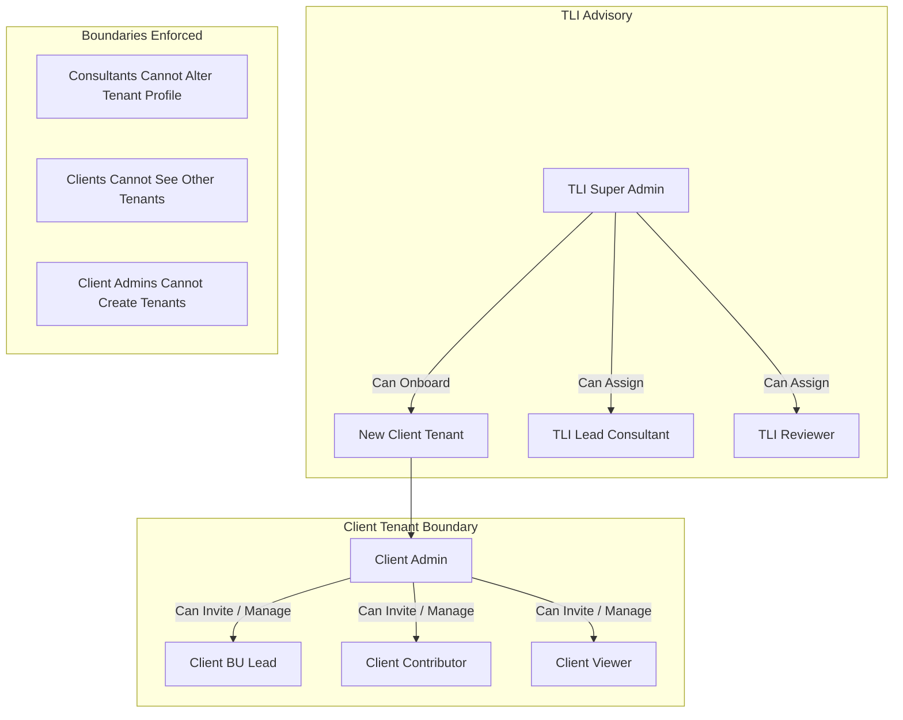
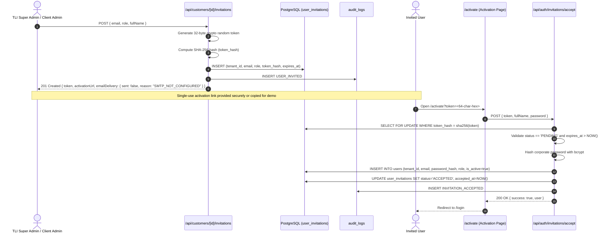

# TLI DPDP Platform — Secure Customer Onboarding, User Invitations & Assessment Assignment

**Document Reference**: `TLI-DPDP-DOC-51`  
**Phase**: Phase 7 — Secure Customer Onboarding & Assessment Assignment  
**Status**: APPROVED / VERIFIED  
**Version**: 1.0.0  
**Target Release**: DPDP Enterprise Gap Analysis Tool v1.0  
**Author**: Truth Labs International — Architecture & Security Advisory  

---

## 1. Executive Summary

Phase 7 implements an end-to-end, secure customer onboarding workflow for the **Truth Labs International (TLI) DPDP Compliance Gap Analysis Tool**. Prior to Phase 7, the platform relied on synthetic database seed fixtures (`Alpha Healthcare` and `Beta Express`) created during initial schema migrations. This precluded demonstrating authentic organizational onboarding to stakeholders or conducting multi-tenant client pilots without manual database intervention.

The objective of Phase 7 is to enable an authorized TLI administrator (`TLI_SUPER_ADMIN`) to:
1. **Onboard a new Customer Organization** (`tenants` table) under PostgreSQL Row-Level Security (RLS).
2. **Provision or invite organization users** (`users` and `user_invitations` tables) with strict client-role boundaries.
3. **Generate cryptographic, single-use invitation tokens** stored strictly as SHA-256 hashes, with explicit fail-closed notices when SMTP is unconfigured.
4. **Create a DPDP Assessment Engagement** for that organization, assigning corporate coordinators while preventing cross-tenant user assignment.
5. **Verify customer authentication and tenant isolation** under live PostgreSQL kernel RLS without cross-tenant bleed.

All 155 automated tests across 18 suites pass cleanly, verifying 100% security boundary enforcement and zero regression across canonical questionnaire parity (60 questions), 30 DPDP controls, and the deterministic scoring engine.

---

## 2. Security Architecture & Threat Model

### 2.1 Role-Based Access Control (RBAC) Hierarchy

The platform enforces strict administrative separation between TLI advisory personnel and client tenant users:



| Action | `TLI_SUPER_ADMIN` | `TLI_LEAD_CONSULTANT` | `TLI_REVIEWER` | `CLIENT_ADMIN` | `CLIENT_CONTRIBUTOR` |
|---|:---:|:---:|:---:|:---:|:---:|
| **Create Tenant** | **Allowed (201)** | Blocked (403) | Blocked (403) | Blocked (403) | Blocked (403) |
| **View Tenant Details** | Global Access | Assigned Tenants | Assigned Tenants | Own Tenant Only | Own Tenant Only |
| **Provision User Directly** | Any Client Tenant | Blocked (403) | Blocked (403) | Own Tenant Only | Blocked (403) |
| **Issue User Invitation** | Any Client Tenant | Blocked (403) | Blocked (403) | Own Tenant Only | Blocked (403) |
| **Initialize Assessment** | Allowed (201) | Allowed (201) | Blocked (403) | Blocked (403) | Blocked (403) |
| **Assign Coordinators** | Target Tenant Users | Target Tenant Users | Blocked (403) | Blocked (403) | Blocked (403) |

### 2.2 STRIDE Threat Mitigation Matrix

| Threat Category | Potential Attack Vector | Mitigation Control |
|---|---|---|
| **Spoofing** | Attacker crafts forged JWT claiming `TLI_SUPER_ADMIN` role | Cryptographic JWT verification with `HS256`, strict issuer/audience check, and live database lookup (`validateSessionContext`). |
| **Tampering** | Intercepting or decrypting invitation tokens in database | Raw tokens are 32 bytes random hex (64 chars); database stores **strictly SHA-256 hash** (`token_hash`). Database compromise reveals zero usable tokens. |
| **Repudiation** | An administrator denies creating a tenant or inviting a rogue user | Mandatory append-only forensic `audit_logs` entries (`TENANT_CREATED`, `USER_PROVISIONED`, `USER_INVITED`, `INVITATION_ACCEPTED`) protected by database kernel immutability triggers. |
| **Information Disclosure** | Client user from Tenant Alpha queries Tenant Beta records | Live PostgreSQL kernel Row-Level Security (`ENABLE & FORCE ROW LEVEL SECURITY`) with session context variables (`app_current_tenant_id()`). Queries return `0 rows` fail-closed. |
| **Denial of Service** | Replay attack using captured or accepted activation tokens | Single-use token enforcement via transactional row locking (`SELECT ... FOR UPDATE`); status is set to `ACCEPTED` and rejects subsequent usage with HTTP 400. |
| **Elevation of Privilege** | Tenant Admin attempts to provision an account with `TLI_SUPER_ADMIN` role | Role validation gate checks `CLIENT_ROLES = ["CLIENT_ADMIN", "CLIENT_BU_LEAD", "CLIENT_CONTRIBUTOR", "CLIENT_VIEWER"]`; non-client roles are rejected with HTTP 400. |

---

## 3. Database Schema & RLS Policies (Migration 013)

### 3.1 DDL Specification (`migrations/013_user_invitations_and_onboarding.sql`)

```sql
CREATE TABLE IF NOT EXISTS user_invitations (
    id UUID PRIMARY KEY DEFAULT generate_uuid_v7(),
    tenant_id UUID NOT NULL REFERENCES tenants(id) ON DELETE CASCADE,
    email VARCHAR(255) NOT NULL,
    full_name VARCHAR(255) NOT NULL,
    role user_role NOT NULL,
    invited_by_id UUID NOT NULL REFERENCES users(id) ON DELETE CASCADE,
    token_hash VARCHAR(64) NOT NULL UNIQUE,
    expires_at TIMESTAMPTZ NOT NULL,
    status VARCHAR(50) NOT NULL DEFAULT 'PENDING' CHECK (status IN ('PENDING', 'ACCEPTED', 'EXPIRED', 'REVOKED')),
    accepted_at TIMESTAMPTZ,
    created_at TIMESTAMPTZ NOT NULL DEFAULT CURRENT_TIMESTAMP,
    updated_at TIMESTAMPTZ NOT NULL DEFAULT CURRENT_TIMESTAMP
);

CREATE INDEX IF NOT EXISTS idx_user_invitations_tenant ON user_invitations(tenant_id);
CREATE INDEX IF NOT EXISTS idx_user_invitations_token ON user_invitations(token_hash);
CREATE INDEX IF NOT EXISTS idx_user_invitations_email ON user_invitations(email);

GRANT SELECT, INSERT, UPDATE, DELETE ON TABLE user_invitations TO dpdp_app_user;

ALTER TABLE user_invitations ENABLE ROW LEVEL SECURITY;
ALTER TABLE user_invitations FORCE ROW LEVEL SECURITY;
```

### 3.2 Row-Level Security Policies

```sql
-- Super Admin or Tenant Admin in own tenant
CREATE POLICY rls_user_invitations_admin_policy ON user_invitations
    FOR ALL
    TO dpdp_app_user
    USING (
        app_current_user_role() = 'TLI_SUPER_ADMIN'
        OR (app_current_tenant_id() IS NOT NULL AND tenant_id = app_current_tenant_id() AND app_current_user_role() = 'CLIENT_ADMIN')
    )
    WITH CHECK (
        app_current_user_role() = 'TLI_SUPER_ADMIN'
        OR (app_current_tenant_id() IS NOT NULL AND tenant_id = app_current_tenant_id() AND app_current_user_role() = 'CLIENT_ADMIN')
    );

-- TLI Consultants assigned to active assessments can inspect invitations for context
CREATE POLICY rls_user_invitations_consultant_select ON user_invitations
    FOR SELECT
    TO dpdp_app_user
    USING (
        app_current_user_role() IN ('TLI_LEAD_CONSULTANT', 'TLI_REVIEWER')
        AND tenant_id IN (
            SELECT a.tenant_id
            FROM assessments a
            JOIN assessment_assignments aa ON aa.assessment_id = a.id
            WHERE aa.user_id = app_current_user_id()
        )
    );
```

---

## 4. User Provisioning & Cryptographic Token Lifecycle



### 4.1 Token Security Rules

1. **Entropy**: Generated using Node.js `crypto.randomBytes(32).toString('hex')` (256 bits of cryptographic entropy).
2. **One-Way Storage**: Raw token is NEVER stored in PostgreSQL. Only `crypto.createHash('sha256').update(rawToken).digest('hex')` is stored.
3. **Expiration**: Hardcoded to 7 days (`NOW() + INTERVAL '7 days'`). Expired tokens reject activation with HTTP 400.
4. **Race-Condition & Replay Prevention**: Evaluated inside `BEGIN ... FOR UPDATE` row locks; once `status = 'ACCEPTED'`, all subsequent activation attempts immediately fail.
5. **No Mock Email Fabrication**: Because SMTP credentials are not configured in `.env`, the API explicitly informs the client:
   ```json
   {
     "success": true,
     "token": "a1b2c3...",
     "activationUrl": "http://localhost:3000/activate?token=a1b2c3...",
     "emailDelivery": {
       "sent": false,
       "reason": "SMTP_NOT_CONFIGURED"
     }
   }
   ```
   The UI surfaces this status with a clear visual notice and a copyable activation URL, avoiding fabricated email simulation.

---

## 5. Assessment Assignment & Cross-Tenant Defense

When initializing a new assessment via `POST /api/assessments`, the system verifies assigned users:

```typescript
// CRITICAL CROSS-TENANT DEFENSE: Verify assigned user belongs to target customer tenant
for (const userId of assignedUserIds) {
  const userCheck = await client.query(
    "SELECT id, tenant_id, full_name FROM users WHERE id = $1;",
    [userId]
  );
  if (userCheck.rows.length === 0) {
    throw new OnboardingError(`Assigned user ${userId} not found in database.`, "USER_NOT_FOUND", 400);
  }
  const targetUser = userCheck.rows[0];
  if (targetUser.tenant_id !== requestedTenantId) {
    throw new OnboardingError(
      `Cross-tenant assignment violation: Assigned user '${targetUser.full_name}' (${userId}) does not belong to the customer organization '${requestedTenantId}'.`,
      "CROSS_TENANT_VIOLATION",
      400
    );
  }
  await client.query(
    `INSERT INTO assessment_assignments (assessment_id, user_id, assignment_role)
     VALUES ($1, $2, 'CLIENT_COORDINATOR')
     ON CONFLICT (assessment_id, user_id) DO NOTHING;`,
    [newAssessment.id, targetUser.id]
  );
}
```

This guarantees that a rogue or misconfigured request cannot assign a user from `Alpha Healthcare` as coordinator for `Acme FinCorp`.

---

## 6. Management Demonstration Script (Synthetic Scenario)

This step-by-step walkthrough demonstrates onboarding without relying on pre-seeded accounts:

### Step 1: Log in as TLI Super Admin
- Navigate to `/login`.
- Authenticate with `admin.super@truthlabs.in` / `SyntheticTestPassword123!` (or active production credentials).
- The dashboard displays the global enterprise view.

### Step 2: Navigate to Customer Management
- Click **Customers** in the navigation sidebar (`/dashboard/customers`).
- View the active tenant directory.
- Click **+ New Customer** (`/dashboard/customers/new`).

### Step 3: Onboard a New Customer Organization
- Enter Organization Name: `Tata Digital Consumer Health Pvt Ltd`
- Sector: `E-Commerce & Digital Health`
- Significant Data Fiduciary (SDF): Check `[x] Designated Significant Data Fiduciary (SDF)`
- DPO Contact: `Sunil K. Nambiar` (`dpo@tatadigital.demo`)
- Optional Initial Admin: Check `Provision Initial Client Administrator Account`
  - Admin Full Name: `Ananya Rao`
  - Admin Email: `ananya.rao@tatadigital.demo`
  - Corporate Password: `TataDigital2026!@#`
- Click **Complete Customer Onboarding**.
- The platform creates the tenant, provisions the initial administrator, writes an immutable audit record, and redirects to the Customer Detail workspace (`/dashboard/customers/[id]`).

### Step 4: Issue User Invitation
- In the Customer Detail workspace, click **Invite User**.
- Enter Email: `karthik.privacy@tatadigital.demo`
- Full Name: `Karthik Menon`
- Role: `CLIENT_CONTRIBUTOR`
- Click **Create & Send Invitation**.
- Notice the unconfigured SMTP indicator (`SMTP_NOT_CONFIGURED`) and copy the generated single-use activation link (`/activate?token=...`).

### Step 5: Activate Account as Customer User
- Open a private browser window (or navigate to the copied link).
- The public **Account Activation** page displays the organization context (`Tata Digital Consumer Health Pvt Ltd`) and invited email (`karthik.privacy@tatadigital.demo`).
- Enter Corporate Password: `KarthikPass2026!@#` and confirm.
- Click **Activate Corporate Account**.
- The platform validates the token hash, marks the invitation `ACCEPTED`, provisions the active user, and redirects to `/login`.

### Step 6: Initialize Assessment & Assign Coordinators
- Returning as TLI Administrator, navigate to **Assessments -> New Assessment** (`/dashboard/assessments/new`).
- In the **Customer Organization** dropdown, select `Tata Digital Consumer Health Pvt Ltd`.
- Notice the DPO contact name (`Sunil K. Nambiar`) and provisioned users (`Ananya Rao`, `Karthik Menon`) dynamically populate.
- Enter Title: `Tata Digital DPDP Comprehensive Readiness Assessment 2026`
- Select `Ananya Rao` as assigned Client Coordinator.
- Click **Initialize Assessment**.

### Step 7: Verify Multi-Tenant RLS Kernel Isolation
- Log in as `ananya.rao@tatadigital.demo` (`TataDigital2026!@#`).
- The Client Workspace opens.
- The assessments table displays strictly the newly created assessment.
- Attempting to query `Alpha Healthcare` or `Beta Express` records returns `0 rows`.
- Audit log confirms full forensic attribution.

---

## 7. Verification Evidence & Automated Test Results

### 7.1 Automated Test Execution (`tests/phase7_customer_onboarding.test.ts`)

```
▶ Phase 7: Secure Customer Onboarding, User Invitations & Assessment Assignment
  ✔ 1. Authorized TLI_SUPER_ADMIN creates customer organization (HTTP 201) (65.258239ms)
  ✔ 2. Unauthorized CLIENT_ADMIN and Consultant blocked from creating customer (HTTP 403) (4.114474ms)
  ✔ 3. Duplicate customer name / slug returns HTTP 409 Conflict (7.516249ms)
  ✔ 4. Direct provisioning of client user with valid client role (HTTP 201) (812.912149ms)
  ✔ 5. Rejection of non-client roles in user provisioning (HTTP 400) (0.625382ms)
  ✔ 6. Duplicate user email returns HTTP 409 Conflict (7.06503ms)
  ✔ 7. Cryptographic invitation token generation with SHA-256 hash storage & unconfigured SMTP notice (12.416703ms)
  ✔ 8. Single-use token acceptance and account activation via acceptCustomerInvitation (HTTP 200) (575.03533ms)
  ✔ 9. Rejection of expired, reused, or invalid invitation tokens (HTTP 400) (4.907988ms)
  ✔ 10. Assessment creation for newly created customer with coordinator assignment (HTTP 201) (10.684271ms)
  ✔ 11. Strict rejection of cross-tenant user assignment (HTTP 400) (4.344639ms)
  ✔ 12. Customer user accesses strictly their own organization's assessment under live PostgreSQL RLS (10.516083ms)
  ✔ 13. Customer user blocked from querying or modifying other tenant records (7.225362ms)
  ✔ 14. Verification of immutable audit log entries across entire onboarding workflow (1.786632ms)
✔ Phase 7: Secure Customer Onboarding, User Invitations & Assessment Assignment (1530.192196ms)
```

### 7.2 Full Platform Test Suite Status (`npm test`)

- **Total Test Suites**: 18
- **Total Tests Executed**: 155
- **Passed**: 155
- **Failed**: 0
- **Duration**: ~33 seconds

### 7.3 PostgreSQL Kernel RLS Status (`scripts/test_database_rls.py`)

- **Migrations Applied**: 13/13 (including `013_user_invitations_and_onboarding.sql`)
- **Static Schema Validations**: 9/9 passed
- **Live Kernel RLS Security Tests**: 17/17 passed

---

## 8. Summary of Files Changed & Created

| Component | File Path | Status | Purpose |
|---|---|:---:|---|
| **Database Migration** | `migrations/013_user_invitations_and_onboarding.sql` | New | Creates `user_invitations` table with UUIDv7, least privilege permissions, and RLS policies. |
| **RLS Test Suite** | `scripts/test_database_rls.py` | Modified | Added migration 013 to expected migrations sequence list for static compliance parity. |
| **Domain Service** | `lib/onboarding/types.ts` | New | Formal TypeScript interfaces for onboarding, user provisioning, invitations, and assignments. |
| **Domain Service** | `lib/onboarding/service.ts` | New | Server-side domain service implementing onboarding business logic, token hashing, and audit trails. |
| **Domain Service** | `lib/onboarding/index.ts` | New | Module exports for onboarding domain service. |
| **Session Core** | `lib/auth/session.ts` | Modified | Enhanced `getCurrentSession(req?)` to inspect direct `Bearer` or `Cookie` headers in test environments. |
| **RBAC Matrix** | `lib/auth/rbac.ts` | Modified | Added `canCreateCustomer` permission rule restricted to `TLI_SUPER_ADMIN`. |
| **API Endpoint** | `app/api/customers/route.ts` | New | `GET` customer list under RLS; `POST` create customer organization (TLI Super Admin only). |
| **API Endpoint** | `app/api/customers/[id]/route.ts` | New | `GET` customer organization details, users, invitations, and assessments. |
| **API Endpoint** | `app/api/customers/[id]/users/route.ts` | New | `POST` directly provision client user with role boundary validation. |
| **API Endpoint** | `app/api/customers/[id]/invitations/route.ts` | New | `POST` issue cryptographic single-use invitation with unconfigured SMTP indicator. |
| **API Endpoint** | `app/api/auth/invitations/accept/route.ts` | New | `POST` single-use token acceptance, password hashing, and user activation. |
| **API Endpoint** | `app/api/assessments/route.ts` | Modified | Upgraded to validate `assignedUserIds` and reject cross-tenant user assignments (HTTP 400). |
| **UI Page** | `app/dashboard/customers/page.tsx` | Modified | Added "+ New Customer" button, customer detail links, and "Start Assessment" buttons. |
| **UI Page** | `app/dashboard/customers/new/page.tsx` | New | Server component page wrapper for customer onboarding. |
| **UI Form** | `app/dashboard/customers/new/CreateCustomerForm.tsx` | New | Comprehensive onboarding form with sector, SDF checkbox, DPO contact, and initial user account. |
| **UI Page** | `app/dashboard/customers/[id]/page.tsx` | New | Server component page wrapper for customer details. |
| **UI Workspace** | `app/dashboard/customers/[id]/CustomerDetailClient.tsx` | New | Tabbed workspace displaying provisioned users, invitations (with copyable links), and assessments. |
| **UI Page** | `app/activate/page.tsx` | New | Public account activation page validating token and setting initial corporate password. |
| **UI Page** | `app/dashboard/assessments/new/CreateAssessmentForm.tsx` | Modified | Upgraded to dynamically select customer organization, populate real contacts, and assign coordinators. |
| **Automated Tests** | `tests/phase7_customer_onboarding.test.ts` | New | Comprehensive 14-test acceptance suite verifying all security boundaries and RLS isolation. |
| **Documentation** | `docs/archive/51_secure_customer_onboarding_and_assignment.md` | New | Authoritative architecture and verification document (this file). |
| **Documentation** | `docs/README.md` | Modified | Indexed document 51 in the master documentation index. |

